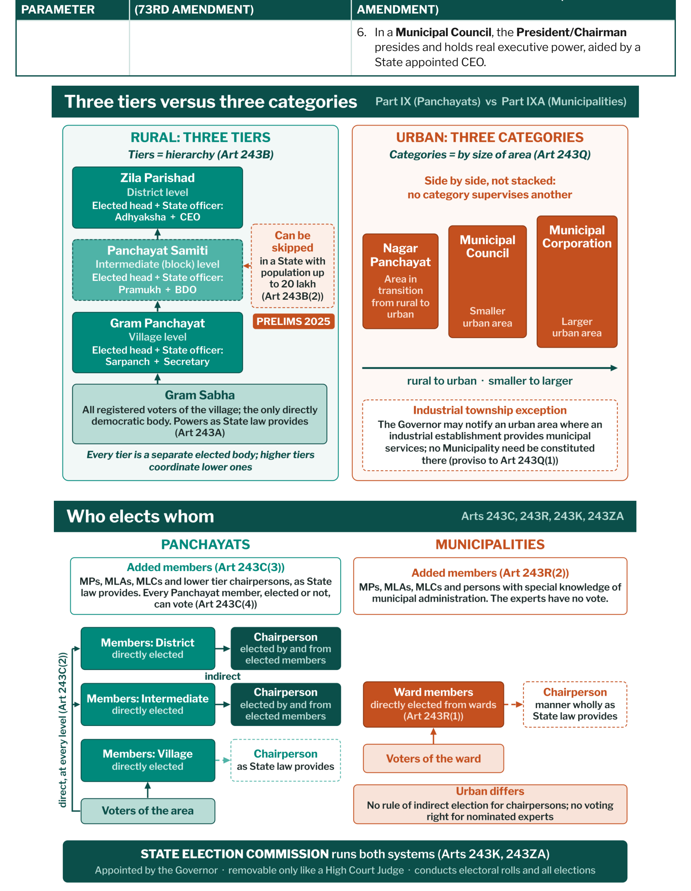
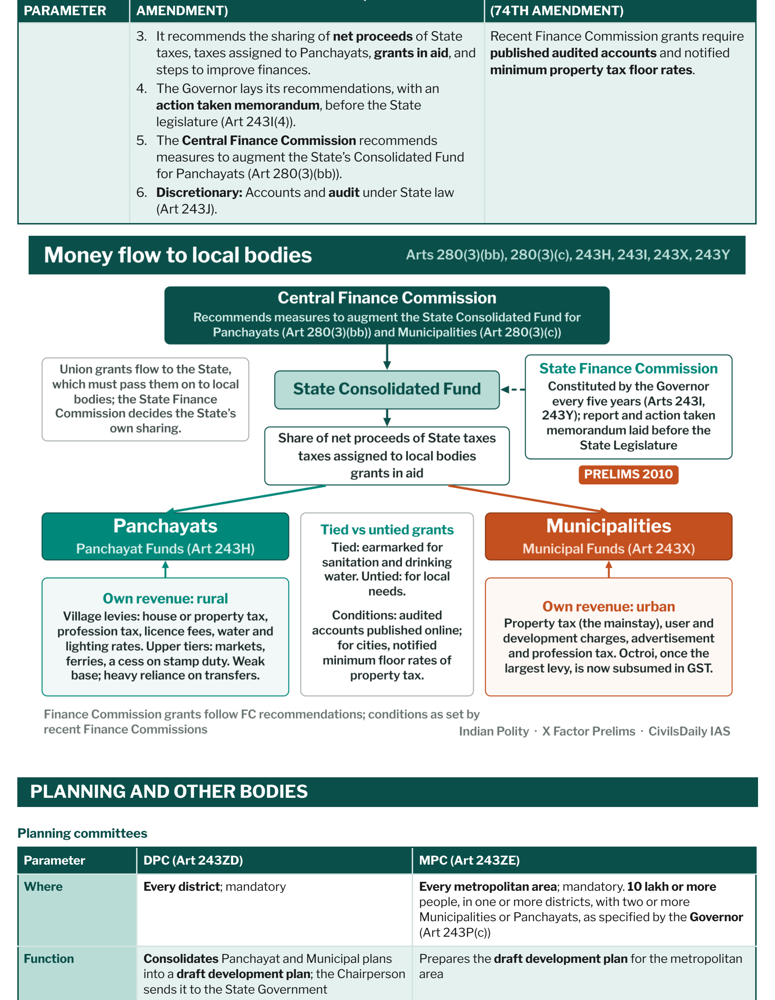

# Panchayati Raj Institutions (Part IX, Art 243–243O), Evolution Committees, 3Fs Crisis, Women Reservation & PESA Act 1996 — Prelims Notes (Ch10_Sub01_Panchayati_Raj_73rd_Amendment_and_PESA)

---

### [Prelims Source Page 137](../../pages/prelims/prelims_page_137.pdf)

## CHAPTER 18: PANCHAYATI RAJ

### THEME ANALYSIS PYQ pattern for this chapter

#### 1. REPEATS

#### A. Constitutional Provisions and Structure

- The 73rd Amendment Act, 1992 inserted Articles 243 to 243O and the Eleventh Schedule.

- It provides State Election Commissions, State Finance Commissions and District Planning Committees together [2011].

- The scheme is three tier, yet the intermediate level is absent in smaller States [2025].

- A Metropolitan Planning Committee is constitutional and drafts plans, never implements schemes [2011].

#### B. Age, Tenure and Finance

- Minimum age is 21 years, and a reconstituted Panchayat serves only the remainder term [2016, 2025].

- Elections after dissolution must finish within six months [2009].

- The Governor, not the Chief Minister, constitutes the State Finance Commission [2010, 2025].

#### C. Decentralisation as a Concept

- Local self government is best explained as democratic decentralisation [2017].

- Its objects are participation and accountability, not financial mobilisation [2015].

- Reservation extends to women of Scheduled Castes and Scheduled Tribes [2026].

#### D. Scheduled Areas and PESA

- The Fifth Schedule governs Scheduled Areas [2008]; both it and the Sixth protect tribal interests [2015].

- Scheduled Areas are notified by a Presidential Order, the Governor reporting on administration [2023].

- Listing bars transfer of tribal land to non-tribals [2022, 2019], yet the State keeps executive power [2025].

- PESA, 1996 gives the Gram Sabha land and forest produce rights, only recommendation on mining [2012].

- PESA seeks self governance, not autonomous regions [2013]; Scheduled Tribe lists are State specific [2024].

#### 2. HOW THE FORMAT HAS CHANGED

- 2008 to 2013: single answer recall of Schedules, tenure and bodies [2008, 2009, 2010, 2013]

- 2011 to 2016: code sets on 73rd and 74th Amendment features [2011, 2012, 2016]

- 2023 to 2026: "how many" and multi statement sets on Scheduled Areas and SC and ST provisions [2023, 2024, 2025, 2026]

#### 3. WHAT IS BEING ASKED NOW

- Scheduled Areas and STs: notification, administration and the Union's role [2023, 2024, 2025]

- Intermediate tier traps: not in all States, age, State Finance Commission [2025]

- Reservation for SC and ST women in Panchayats [2026]

---

### [Prelims Source Page 138](../../pages/prelims/prelims_page_138.pdf)

### PRELIMS PREVIOUS YEAR QUESTIONS

#### Q1 (2026)

**Consider the following statements about provisions pertaining to SC/STs in India:**

- **1.** Provisions for Tribal Areas in Assam, Meghalaya, Tripura and Mizoram are in the Fifth Schedule.
- **2.** Some tribes of India are entitled to exemption from paying Income Tax on certain incomes.
- **3.** The Constitution provides for reservation of seats in Panchayats for women belonging to SCs and STs.

- **(a)** There are two correct statements, that include statement 2
- **(b)** There are two correct statements, that are statements 1 and 3
- **(c)** There is only one correct statement
- **(d)** All three statements are correct

> **Answer:** `(a)` · [Prelims Source Page 138](../../pages/prelims/prelims_page_138.pdf)

#### Q2 (2025)

**Consider the following statements:**

- **I.** Panchayats at the intermediate level exist in all States.
- **II.** To be eligible to be a Member of a Panchayat at the intermediate level, a person should attain the age of thirty years.
- **III.** The Chief Minister of a State constitutes a commission to review the financial position of Panchayats at the intermediate levels and to make recommendations regarding the distribution of net proceeds of taxes and duties, leviable by the State, between the State and Panchayats at the intermediate level.

*Which of the statements given above are not correct?*

- **(a)** I and II only
- **(b)** II and III only
- **(c)** I and III only
- **(d)** I, II and III

> **Answer:** `(d)` · [Prelims Source Page 138](../../pages/prelims/prelims_page_138.pdf)

#### Q3 (2025)

**Consider the following statements: With reference to the Constitution of India, if an area in a State is declared as Scheduled Area under the Fifth Schedule:**

- **I.** The State Government loses its executive power in such areas and a local body assumes total administration.
- **II.** The Union Government can take over the total administration of such areas under certain circumstances on the recommendations of the Governor.

*Which of the statements given above is/are correct?*

- **(a)** 1 only
- **(b)** 2 only
- **(c)** Both 1 and 2
- **(d)** Neither 1 nor 2

> **Answer:** `(d)` · [Prelims Source Page 138](../../pages/prelims/prelims_page_138.pdf)

#### Q4 (2024)

**Consider the following statements:**

- **1.** It is the Governor of the State who recognizes and declares any community of that State as a Scheduled Tribe.
- **2.** A community declared as a Scheduled Tribe in a State need not be so in another State.

*Which of the statements given above is/are correct?*

- **(a)** 1 only
- **(b)** 2 only
- **(c)** Both 1 and 2
- **(d)** Neither 1 nor 2

> **Answer:** `(b)` · [Prelims Source Page 138](../../pages/prelims/prelims_page_138.pdf)

#### Q5 (2023)

**With reference to 'Scheduled Areas' in India, consider the following statements :**

- **1.** Within a State, the notification of an area as Scheduled Area takes place through an Order of the President.
- **2.** The largest administrative unit forming the Scheduled Area is the District and the lowest is the cluster of villages in the Block.
- **3.** The Chief Ministers of the concerned States are required to submit annual reports to the Union Home Ministry on the administration of Scheduled Areas in the States.

*How many of the above statements are correct?*

- **(a)** Only one
- **(b)** Only two
- **(c)** All three
- **(d)** None

> **Answer:** `(b)` · [Prelims Source Page 138](../../pages/prelims/prelims_page_138.pdf)

---

### [Prelims Source Page 139](../../pages/prelims/prelims_page_139.pdf)

#### Q6 (2022)

**If a particular area is brought under the Fifth Schedule of the Constitution of India, which one of the following statements best reflects the consequence of it ?**

- **(a)** This would prevent the transfer of land of tribal people to non-tribal people.
- **(b)** This would create a local self-governing body in that area.
- **(c)** This would convert that area into a Union Territory.
- **(d)** The State having such areas would be declared a Special Category State.

> **Answer:** `(a)` · [Prelims Source Page 139](../../pages/prelims/prelims_page_139.pdf)

#### Q7 (2019)

**Under which Schedule of the Constitution of India can the transfer of tribal land to private parties for mining be declared null and void?**

- **(a)** Third Schedule
- **(b)** Fifth Schedule
- **(c)** Ninth Schedule
- **(d)** Twelfth Schedule

> **Answer:** `(b)` · [Prelims Source Page 139](../../pages/prelims/prelims_page_139.pdf)

#### Q8 (2017)

**Local self-government can be best explained as an exercise in**

- **(a)** Federalism
- **(b)** Democratic decentralization
- **(c)** Administrative delegation
- **(d)** Direct democracy

> **Answer:** `(b)` · [Prelims Source Page 139](../../pages/prelims/prelims_page_139.pdf)

#### Q9 (2016)

**Consider the following statements:**

- **1.** The minimum age prescribed for any person to be a member of Panchayat is 25 years.
- **2.** A Panchayat reconstituted after premature dissolution continues only for the remainder period.

*Which of the statements given above is/are correct?*

- **(a)** 1 only
- **(b)** 2 only
- **(c)** Both 1 and 2
- **(d)** Neither 1 nor 2

> **Answer:** `(b)` · [Prelims Source Page 139](../../pages/prelims/prelims_page_139.pdf)

#### Q10 (2015)

**The fundamental object of Panchayati Raj system is to ensure which among the following? (1) People's participation in development (2) Political accountability (3) Democratic decentralization (4) Financial mobilization Select the correct answer using the code given below.**

- **(a)** 1, 2 and 3 only
- **(b)** 2 and 4 only
- **(c)** 1 and 3 only
- **(d)** 1, 2, 3 and 4

> **Answer:** `(c)` · [Prelims Source Page 139](../../pages/prelims/prelims_page_139.pdf)

#### Q11 (2015)

**The provisions in Fifth Schedule and Sixth Schedule in the Constitution of India are made in order to**

- **(a)** protect the interests of Scheduled Tribes
- **(b)** determine the boundaries between States
- **(c)** determine the powers, authority and responsibilities of Panchayats
- **(d)** protect the interests of all border States

> **Answer:** `(a)` · [Prelims Source Page 139](../../pages/prelims/prelims_page_139.pdf)

#### Q12 (2013)

**The Government enacted the Panchayat Extension to Scheduled Areas (PESA) Act in 1996. Which one of the following is not identified as its objective?**

- **(a)** To provide self-governance
- **(b)** To recognize traditional rights
- **(c)** To create autonomous regions in tribal areas
- **(d)** To free tribal people from exploitation

> **Answer:** `(c)` · [Prelims Source Page 139](../../pages/prelims/prelims_page_139.pdf)

#### Q13 (2012)

**In the areas covered under the Panchayat (Extension to the Scheduled Areas) Act, 1996, what is the role/power of Gram Sabha?**

- **1.** Gram Sabha has the power to prevent alienation of land in the Scheduled Areas.
- **2.** Gram Sabha has the ownership of minor forest produce.
- **3.** Recommendation of Gram Sabha is required for granting prospecting license or mining lease for any mineral in the Scheduled Areas.

*Which of the statements given above is/are correct?*

- **(a)** 1 only
- **(b)** 1 and 2 only
- **(c)** 2 and 3 only
- **(d)** 1, 2 and 3

> **Answer:** `(b)` · [Prelims Source Page 139](../../pages/prelims/prelims_page_139.pdf)

---

### [Prelims Source Page 140](../../pages/prelims/prelims_page_140.pdf)

#### Q14 (2011)

**The Constitution (Seventy-Third Amendment) Act, 1992, which aims at promoting the Panchayati Raj Institutions in the country, provides for which of the following?**

- **1.** Constitution of District Planning Committees.
- **2.** State Election Commissions to conduct all Panchayat elections.
- **3.** Establishment of State Finance Commissions.

*Select the correct answer using the code given below:*

- **(a)** 1 only
- **(b)** 1 and 2 only
- **(c)** 2 and 3 only
- **(d)** 1, 2 and 3

> **Answer:** `(c)` · [Prelims Source Page 140](../../pages/prelims/prelims_page_140.pdf)

#### Q15 (2011)

**Consider the following statements: In India, a Metropolitan Planning Committee**

- **1.** is constituted under the provisions of the Constitution of India.
- **2.** prepares the draft development plans for the metropolitan area.
- **3.** has the sole responsibility for implementing Government sponsored schemes in the metropolitan area.

*Which of the statements given above is/are correct?*

- **(a)** 1 and 2 only
- **(b)** 2 only
- **(c)** 1 and 3 only
- **(d)** 1, 2 and 3

> **Answer:** `(a)` · [Prelims Source Page 140](../../pages/prelims/prelims_page_140.pdf)

#### Q16 (2010)

**Which one of the following authorities makes recommendations to the Governor of a State as to the principles for determining the taxes and duties which may be appropriated by the Panchayats in that particular State?**

- **(a)** District Planning Commission
- **(b)** State Finance Commission
- **(c)** Finance Ministry of that State
- **(d)** Panchayati Raj Ministry of that State

> **Answer:** `(b)` · [Prelims Source Page 140](../../pages/prelims/prelims_page_140.pdf)

#### Q17 (2009)

**If a Panchayat is dissolved, elections are to be held within:**

- **(a)** 1 month
- **(b)** 3 months
- **(c)** 6 months
- **(d)** 1 year

> **Answer:** `(c)` · [Prelims Source Page 140](../../pages/prelims/prelims_page_140.pdf)

#### Q18 (2009)

**In India, the first Municipal Corporation was set up in which one among the following:**

- **(a)** Calcutta
- **(b)** Madras
- **(c)** Bombay
- **(d)** Delhi

> **Answer:** `(b)` · [Prelims Source Page 140](../../pages/prelims/prelims_page_140.pdf)

#### Q19 (2008)

**Which schedule of the Constitution of India contains special provisions for the administration and control of Scheduled Areas in several States?**

- **(a)** Third
- **(b)** Fifth
- **(c)** Seventh
- **(d)** Ninth

> **Answer:** `(b)` · [Prelims Source Page 140](../../pages/prelims/prelims_page_140.pdf)

### CONSTITUTIONAL SCHEME

| FEATURE / PARAMETER | RURAL LOCAL SELF GOVERNMENT (73RD AMENDMENT) | URBAN LOCAL SELF GOVERNMENT (74TH AMENDMENT) |
| --- | --- | --- |
| Constitutional basis and nature of local self-government [PRELIMS 2017,2015,2011] | **1.** The 73rd Amendment Act, 1992 inserted Part IX and the Eleventh Schedule of 29 functional items (Arts 243 to 243O). **2.** Local self government means democratic decentralisation: power, funds and functions move to elected village, block and district bodies. **3.** Panchayats draw their powers from State law. **4.** The system is representative; only the Gram Sabha is directly democratic. **5.** The core objective is people’s participation in development; financial mobilisation and accountability are only the means. **6.** The State shall organise village panchayats as units of self government (Art 40, DPSP). | Same principle governs. The 74th Amendment Act, 1992 inserted Part IXA and the Twelfth Schedule of 18 matters (Arts 243P to 243ZG). No Directive Principle like Art 40 for urban bodies. |

---

### [Prelims Source Page 141](../../pages/prelims/prelims_page_141.pdf)

| FEATURE / PARAMETER | RURAL LOCAL SELF GOVERNMENT (73RD AMENDMENT) | URBAN LOCAL SELF GOVERNMENT (74TH AMENDMENT) |
| --- | --- | --- |
| Parliament legislating on a State subject [PRELIMS 2016] | **1.** Local government is a State subject; Parliament can legislate on it only through these routes. **2.** National interest, on a Rajya Sabha resolution passed by two thirds present and voting; the law lapses six months after the resolution expires (Art 249). **3.** National Emergency (Art 250). **4.** Request of two or more States; the law binds them and any State adopting it later, and only Parliament can amend or repeal it (Art 252). **5.** International treaties and agreements (Art 253). **6.** President’s Rule (Art 356), and All India Services on a Rajya Sabha two thirds resolution (Art 312). **7.** These routes mark the Rajya Sabha as the chamber of the States. | Same principle governs. |

### STRUCTURE AND COMPOSITION

| FEATURE / PARAMETER | RURAL LOCAL SELF GOVERNMENT (73RD AMENDMENT) | URBAN LOCAL SELF GOVERNMENT (74TH AMENDMENT) |
| --- | --- | --- |
| Gram Sabha, tiers and categories of bodies [PRELIMS 2025] | **1.** Gram Sabha: Mandatory in every village; made up of all registered voters of the village; its powers are left to State law (Art 243A). **2.** Three tiers: Mandatory at village, intermediate and district levels; States with population up to 20 lakh may skip the intermediate tier (Art 243B). | Three categories by size of area, not three tiers (Art 243Q): **(a)** Nagar Panchayat: an area in transition from rural to urban. **(b)** Municipal Council: a smaller urban area. **(c)** Municipal Corporation: a larger urban area. The Governor may declare an industrial township where an industrial establishment provides municipal services; no Municipality need then be constituted (proviso to Art 243Q(1)). |
| Election of members and chairpersons | **1.** Members: All directly elected at every level (Art 243C). **2.** Chairpersons: Indirectly elected at the intermediate and district levels; at the village level, as State law provides. **3.** MPs and MLAs: Representation is left to State law; every member, directly elected or not, can vote in meetings (Art 243C(4)). | Same principle governs. (Art 243R) Members are elected from wards; the State may add persons with municipal experience, who have no vote. No rule of indirect election for chairpersons; it is wholly left to State law. |
| Executive machinery (State law, non-constitutional) | Each tier pairs an elected head with a State appointed officer: **(a)** District: Adhyaksha and CEO. **(b)** Block: Pramukh and BDO. **(c)** Village: Sarpanch and Panchayat Secretary. | **1.** A Municipal Corporation has three authorities: the Council, Standing Committees and the Municipal Commissioner. **2.** Council: Elected councillors under the Mayor, a largely ceremonial head (one year in some States, the full term in others), with a Deputy Mayor. **3.** Standing Committees (finance, works, health, education, taxation) take the real decisions, as the Council is too large to act. **4.** Municipal Commissioner: The chief executive, an IAS or senior State officer appointed by the State Government. **5.** Real power lies with a State appointee, not the elected Mayor; hence the case for directly elected mayors. |

---

### [Prelims Source Page 142](../../pages/prelims/prelims_page_142.pdf)

*Diagram Screenshot: [Panchayati Raj & Municipalities: Three Tiers vs Three Categories & Who Elects Whom](../../diagrams/pre_diag_pri_tiers_elections_p142.png) · [Full Source Page 142](../../pages/prelims/prelims_page_142.pdf)*

| FEATURE / PARAMETER | RURAL LOCAL SELF GOVERNMENT (73RD AMENDMENT) | URBAN LOCAL SELF GOVERNMENT (74TH AMENDMENT) |
| --- | --- | --- |
| **Executive machinery (State law, non-constitutional)** *(Contd.)* | — | **6.** In a Municipal Council, the President/Chairman presides and holds real executive power, aided by a State appointed CEO. |

---

### [Prelims Source Page 143](../../pages/prelims/prelims_page_143.pdf)

### ELECTIONS, RESERVATION AND TENURE

| FEATURE / PARAMETER | RURAL LOCAL SELF GOVERNMENT (73RD AMENDMENT) | URBAN LOCAL SELF GOVERNMENT (74TH AMENDMENT) |
| --- | --- | --- |
| State Election Commission | **1.** Mandatory: Conducts electoral rolls and all Panchayat elections (Art 243K). **2.** The State Election Commissioner is appointed by the Governor, who fixes his service conditions and tenure. **3.** Removal only like a High Court Judge; service conditions cannot be worsened after appointment. **4.** Other election matters are left to State law. | Same principle governs. The same Commission conducts municipal rolls and elections (Art 243ZA). |
| Qualifications and disqualifications [PRELIMS 2016] | **1.** Same qualifications as for the State Legislature, but the minimum age is 21, not 25 (Art 243F). **2.** Disqualification is under State law; disputes go to an authority set by State law. | Same principle governs. Minimum age 21 (Art 243V). |
| Reservation of seats and offices | **1.** Mandatory: Seats for SCs and STs at all levels, in proportion to their population (Art 243D(1)). **2.** Mandatory: At least one third of seats for women, including SC/ST women’s seats (Art 243D(2), (3)). **3.** Mandatory: At least one third of chairperson posts at each level for women (Art 243D(4)). **4.** Mandatory: State law reserves chairperson posts for SCs and STs (Art 243D(4)). **5.** Discretionary: Reservation for backward classes (Art 243D(6)). **6.** SC/ST reservation, not women’s, ends with the Art 334 period, now 25 January 2030 under the 104th Amendment, 2019 (Art 243D(5)). **7.** No SC reservation in Arunachal Pradesh, which has no SC population (83rd Amendment, 2000; Art 243M). | Same principle governs. (Art 243T) No one third floor for women chairpersons; chairperson posts are reserved as State law provides (Art 243T(4)). |
| Duration and dissolution [PRELIMS 2009] | **1.** Five year term from the date of the first meeting, unless dissolved earlier (Art 243E(1)). **2.** Elections must be held before the term ends, and within six months of an early dissolution (Art 243E(3)). **3.** The new body serves only the remainder of the term. **4.** No election is needed if the remainder is under six months. **5.** Amending a law cannot dissolve a Panchayat before its term ends (Art 243E(2)). | Same principle governs. (Art 243U) A Municipality must get a reasonable opportunity of being heard before dissolution (Art 243U(1)). |

### POWERS, FUNCTIONS AND FINANCE

| FEATURE / PARAMETER | RURAL LOCAL SELF GOVERNMENT (73RD AMENDMENT) | URBAN LOCAL SELF GOVERNMENT (74TH AMENDMENT) |
| --- | --- | --- |
| Devolution of powers and responsibilities | **1.** Discretionary: The State may give Panchayats the powers to work as institutions of self government (Art 243G). | Same principle governs. For the 18 Twelfth Schedule matters (Art 243W). |

---

### [Prelims Source Page 144](../../pages/prelims/prelims_page_144.pdf)

| FEATURE / PARAMETER | RURAL LOCAL SELF GOVERNMENT (73RD AMENDMENT) | URBAN LOCAL SELF GOVERNMENT (74TH AMENDMENT) |
| --- | --- | --- |
| **Devolution of powers and responsibilities** *(Contd.)* | **2.** This covers plans for economic development and social justice, including the 29 Eleventh Schedule matters. **3.** Enabling, not self executing: the Schedule transfers nothing by itself. **4.** Real devolution needs the 3 Fs (functions, funds, functionaries) through State law and orders; so it is uneven, and activity mapping is the main tool. | The State may also empower Wards Committees and other committees. Note: Parastatals (water and sewerage boards, development authorities, housing boards, power and transport bodies) still hold many of these functions, so Municipalities often plan for functions they do not control. |
| Eleventh Schedule (29 matters) vs Twelfth Schedule (18 matters) | **1.** Agriculture and extension; land improvement, land reforms, consolidation, soil conservation; minor irrigation, water management, watershed development. **2.** Animal husbandry, dairying, poultry; fisheries; social and farm forestry; minor forest produce. **3.** Small scale industries including food processing; khadi, village and cottage industries. **4.** Rural housing; drinking water; fuel and fodder; roads, culverts, bridges, ferries, waterways; rural electrification and non-conventional energy. **5.** Poverty alleviation; education (primary, secondary, technical, vocational, adult, non-formal); libraries; culture. **6.** Markets and fairs; health and sanitation (hospitals, PHCs, dispensaries); family welfare; women and child development; social welfare including the handicapped. **7.** Welfare of weaker sections, especially SCs and STs; public distribution system; community assets. | **1.** Urban planning including town planning; land-use and building regulation; planning for economic and social development. **2.** Roads and bridges; water supply (domestic, industrial, commercial); public health, sanitation, conservancy, solid waste management; fire services. **3.** Urban forestry, environment and ecology; interests of weaker sections including the handicapped. **4.** Slum improvement and upgradation; urban poverty alleviation; amenities - parks, gardens, playgrounds; cultural, educational and aesthetic aspects. **5.** Burials, burial grounds, cremations, electric crematoriums; cattle pounds and prevention of cruelty to animals; slaughter houses and tanneries. **6.** Vital statistics (births and deaths registration); public amenities - street lighting, parking lots, bus stops, conveniences. |
| Sources of finance and taxation | **1.** Discretionary: The State may let a Panchayat levy, collect and keep taxes, duties, tolls and fees; assign it State taxes; give grants in aid; and create Panchayat Funds (Art 243H). **2.** Second ARC, five streams: Union grants on the Central FC’s advice (Art 280(3)(bb)); State devolution on the State FC’s advice; State loans and grants; Centrally Sponsored Schemes and Additional Central Assistance; own revenue. **3.** Village levies: house or property tax, profession tax, land cess, vehicle tax and tolls, entertainment tax, licence fees, water rate, lighting tax, sanitation tax, education cess, fairs and festivals tax. **4.** Intermediate and district Panchayats have almost no tax base; they rely on ferries, markets, a cess on stamp duty and non tax sources. **5.** ARC diagnosis: weak own revenue, dependence on tied grants, and a mismatch of duties and resources. | Same principle governs. With Municipal Funds (Art 243X). A stronger own revenue base: property tax (the mainstay), advertisement and profession tax, water and sewerage charges, user and development charges, building permission fees. Octroi, once the largest municipal levy, is abolished in almost all States and subsumed in GST, increasing dependence on State transfers. |
| Finance Commissions, accounts and audit [PRELIMS 2010] | **1.** Mandatory: The Governor sets up a State Finance Commission every five years to review Panchayat finances (Art 243I). **2.** Discretionary: Its composition, qualifications and selection (State law). | Same principle governs. The same SFC reviews municipal finances (Art 243Y); accounts and audit under State law (Art 243Z); the Central FC’s parallel duty (Art 280(3)(c)). |

---

### [Prelims Source Page 145](../../pages/prelims/prelims_page_145.pdf)

*Diagram Screenshot: [Money Flow to Local Bodies: Central & State Finance Commissions](../../diagrams/pre_diag_local_bodies_money_flow_p145.png) · [Full Source Page 145](../../pages/prelims/prelims_page_145.pdf)*

| FEATURE / PARAMETER | RURAL LOCAL SELF GOVERNMENT (73RD AMENDMENT) | URBAN LOCAL SELF GOVERNMENT (74TH AMENDMENT) |
| --- | --- | --- |
| **Finance Commissions, accounts and audit** *(Contd.)* | **3.** It recommends the sharing of net proceeds of State taxes, taxes assigned to Panchayats, grants in aid, and steps to improve finances. **4.** The Governor lays its recommendations, with an action taken memorandum, before the State legislature (Art 243I(4)). **5.** The Central Finance Commission recommends measures to augment the State’s Consolidated Fund for Panchayats (Art 280(3)(bb)). **6.** Discretionary: Accounts and audit under State law (Art 243J). | Recent Finance Commission grants require published audited accounts and notified minimum property tax floor rates. |

### PLANNING AND OTHER BODIES

Planning committees

| Parameter | DPC (Art 243ZD) | MPC (Art 243ZE) |
| --- | --- | --- |
| Where | Every district; mandatory | Every metropolitan area; mandatory. 10 lakh or more people, in one or more districts, with two or more Municipalities or Panchayats, as specified by the Governor (Art 243P(c)) |
| Function | Consolidates Panchayat and Municipal plans into a draft development plan; the Chairperson sends it to the State Government | Prepares the draft development plan for the metropolitan area |

---

### [Prelims Source Page 146](../../pages/prelims/prelims_page_146.pdf)

| Parameter | DPC (Art 243ZD) | MPC (Art 243ZE) |
| --- | --- | --- |
| Elected share | At least four fifths, elected by and from the elected members of the district Panchayat and Municipalities, in the rural urban population ratio | At least two thirds, elected by and from the elected members of Municipalities and Chairpersons of Panchayats in the area, by population |
| Implements schemes? | No; a planning body only | No; implementation rests with municipal bodies and State departments |
| Left to State law | Composition and functions | Composition and functions |
| Source | Part IXA (74th Amendment), not Part IX, though it consolidates Panchayat plans | Part IXA (74th Amendment) |

Traps: Both come from the 74th Amendment. DPC = four fifths, MPC = two thirds. Both plan only. [PRELIMS 2011] Wards Committees

| FEATURE / PARAMETER | RURAL LOCAL SELF GOVERNMENT (73RD AMENDMENT) | URBAN LOCAL SELF GOVERNMENT (74TH AMENDMENT) |
| --- | --- | --- |
| Wards Committees | **1.** No ward or standing committee for Panchayats; the rural counterpart is the Gram Sabha, whose powers are wholly left to State law (Art 243A). **2.** Subject committees of the Zila Parishad and Panchayat Samiti exist only under State Panchayati Raj Acts. | **1.** Mandatory: Wards Committees in every Municipality of three lakh or more people (Art 243S). **2.** Discretionary: Composition, area and manner of filling seats (State law). **3.** A ward’s councillor is automatically a member, and its Chairperson if it covers one ward; if more, the Committee elects one of them. **4.** The State may set up other committees too. **5.** The Area Sabha, the urban analogue of the Gram Sabha, was proposed in the Model Nagara Raj Bill under JNNURM; it is not a constitutional requirement. |

Local bodies outside the constitutional scheme

| Body | Set up by | Composition | Key fact |
| --- | --- | --- | --- |
| Notified Area Committee | State gazette notification | Wholly nominated | For a fast developing town, or one not yet fit to be a municipality; neither elected nor statutory |
| Town Area Committee | Separate State Act | Elected, nominated or both | Semi municipal body for a small town; limited functions (drainage, roads, street lighting, conservancy) |
| Cantonment Board | Centre (Ministry of Defence), Cantonments Act, 2006 | Partly elected (five years), partly nominated or ex officio; the Station Commander is the ex officio President, aided by a CEO | 61 cantonments now (62 earlier; Khas Yol denotified from 27 April 2023); civil areas of 58 are being excised and merged with adjoining municipalities; military areas become exclusive military stations |
| Township | The public enterprise | A town administrator with engineers; no elected members | The staff colony of a public enterprise |
| Port Authority (earlier Port Trust) | Act of Parliament | — | For major ports; manages the port and civic amenities; Port Trusts became Major Port Authorities under the Major Port Authorities Act, 2021 |
| Special Purpose Agency | State laws | — | Single function parastatals (improvement trusts, development authorities, water and sewerage boards, housing boards, pollution control and electricity boards, city transport) that work independently of municipal bodies |

---

### [Prelims Source Page 147](../../pages/prelims/prelims_page_147.pdf)

| Body | Set up by | Composition | Key fact |
| --- | --- | --- | --- |
| Rural: excluded areas | Art 243M | — | Part IX does not apply to Fifth and Sixth Schedule areas, Nagaland, Meghalaya, Mizoram, hill areas of Manipur and Darjeeling |
| Rural: PESA areas | PESA, 1996 | — | Part IX applies with modifications |
| Rural: DRDA | Executive | — | An implementing agency, not a local government; now merged with Zila Parishads |

### SCHEDULED AND EXCLUDED AREAS

| DIMENSION | FIFTH SCHEDULE - SCHEDULED AREAS (ART 244(1)) | SIXTH SCHEDULE - TRIBAL AREAS (ARTS 244(2), 275(1)) |
| --- | --- | --- |
| States covered and scope [PRELIMS 2026,2008] | **1.** Covers Scheduled Areas and Scheduled Tribes in any State other than Assam, Meghalaya, Tripura and Mizoram. **2.** Notified in 10 States - Andhra Pradesh, Telangana, Chhattisgarh, Gujarat, Himachal Pradesh, Jharkhand, Madhya Pradesh, Maharashtra, Odisha, Rajasthan. | **1.** Covers Tribal Areas in four north-eastern States - Assam, Meghalaya, Tripura, Mizoram - which are NOT in the Fifth Schedule. **2.** Ten autonomous councils, by State: **(a)** Assam (3): Bodoland Territorial, Karbi Anglong, Dima Hasao. **(b)** Meghalaya (3): Khasi Hills, Jaintia Hills, Garo Hills. **(c)** Mizoram (3): Chakma, Lai, Mara. **(d)** Tripura (1): Tripura Tribal Areas Autonomous District Council. |
| Application of Part IX and PESA | Part IX, excluded by Art 243M, was extended here by PESA, 1996. | **1.** Part IX does not extend here; no PESA equivalent exists. **2.** No Panchayats; nomination here is to the District or Regional Council. |
| Degree of autonomy | **1.** Weak autonomy - the Governor and the State dominate; the Tribes Advisory Council only advises and has no veto. **2.** The tribal voice is consultative and protection is administered from above. | **1.** Strong autonomy - the Councils hold legislative, executive, judicial and financial powers together, the widest self government of any local body in India. **2.** Some Councils, such as the Bodoland Territorial Council, hold powers over a longer list of subjects under separate accords. |
| Object and criteria for declaring an area [PRELIMS 2015] | **1.** Dhebar Commission criteria - preponderance of tribal population, compactness and reasonable size, viability as an administrative entity, economic backwardness. **2.** The object is protection of the interests of Scheduled Tribes - not boundary fixing, and not determining the powers of Panchayats. | **1.** The same object, pursued through self-governance rather than protective regulation by the Governor. |
| Governing body, nature of powers and Union control [PRELIMS 2025] | **1.** The Governor, supervised by the President - no autonomous council, no separate legislative body; the Tribes Advisory Council only advises. **2.** The executive power of the State extends to the Scheduled Areas; the State does not lose it. | **1.** Autonomous District and Regional Councils under the Governor - genuine units of self-government with law-making power, not advisory bodies. **2.** These areas too remain under the State's executive authority. **3.** No equivalent annual report to the President. **4.** Union grants-in-aid for these areas (Art 275(1)). |
