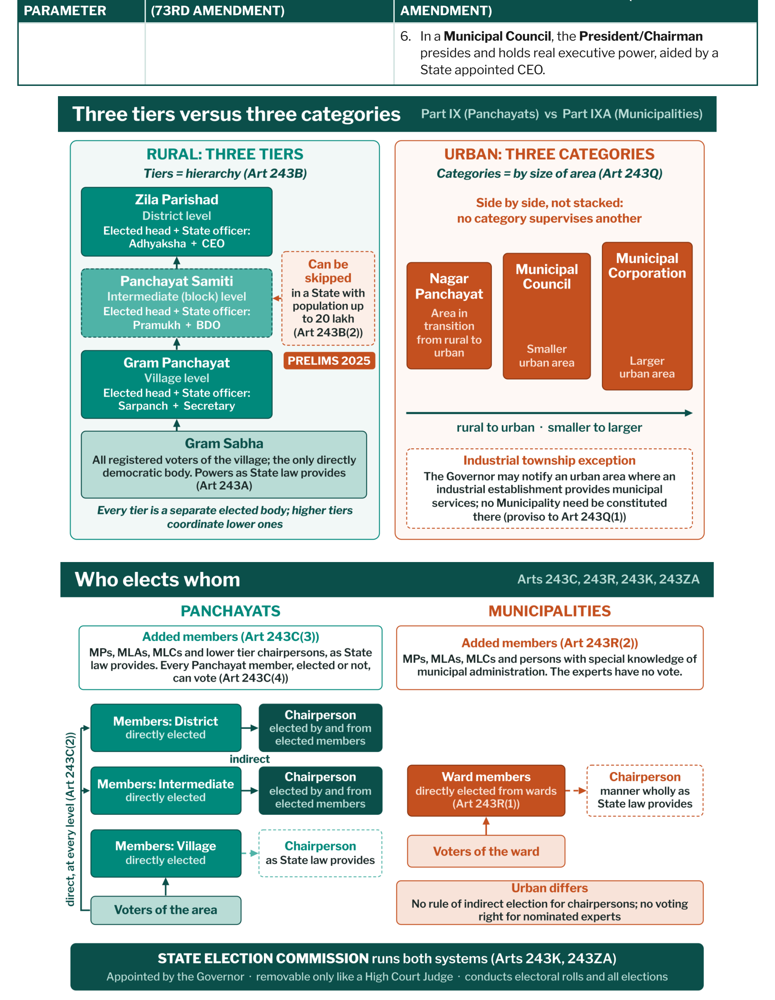
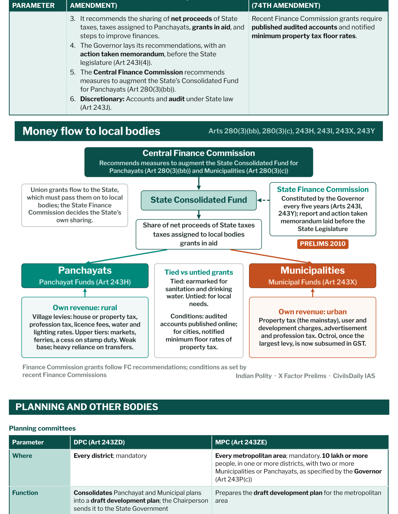

# Urban Local Bodies (Part IXA, Art 243P–243ZG), Municipal Governance, Municipal Bonds & Smart Cities — Prelims Notes (Ch10_Sub02_Urban_Local_Bodies_74th_Amendment_Municipal_Finances)

---

### [Prelims Source Page 142](../../pages/prelims/prelims_page_142.pdf)

*Diagram Screenshot: [Panchayati Raj & Municipalities: Three Tiers vs Three Categories & Who Elects Whom](../../diagrams/pre_diag_pri_tiers_elections_p142.png) · [Full Source Page 142](../../pages/prelims/prelims_page_142.pdf)*

| FEATURE / PARAMETER | RURAL LOCAL SELF GOVERNMENT (73RD AMENDMENT) | URBAN LOCAL SELF GOVERNMENT (74TH AMENDMENT) |
| --- | --- | --- |
| **Executive machinery (State law, non-constitutional)** *(Contd.)* | — | **6.** In a Municipal Council, the President/Chairman presides and holds real executive power, aided by a State appointed CEO. |

---

### [Prelims Source Page 145](../../pages/prelims/prelims_page_145.pdf)

*Diagram Screenshot: [Money Flow to Local Bodies: Central & State Finance Commissions](../../diagrams/pre_diag_local_bodies_money_flow_p145.png) · [Full Source Page 145](../../pages/prelims/prelims_page_145.pdf)*

| FEATURE / PARAMETER | RURAL LOCAL SELF GOVERNMENT (73RD AMENDMENT) | URBAN LOCAL SELF GOVERNMENT (74TH AMENDMENT) |
| --- | --- | --- |
| **Finance Commissions, accounts and audit** *(Contd.)* | **3.** It recommends the sharing of net proceeds of State taxes, taxes assigned to Panchayats, grants in aid, and steps to improve finances. **4.** The Governor lays its recommendations, with an action taken memorandum, before the State legislature (Art 243I(4)). **5.** The Central Finance Commission recommends measures to augment the State’s Consolidated Fund for Panchayats (Art 280(3)(bb)). **6.** Discretionary: Accounts and audit under State law (Art 243J). | Recent Finance Commission grants require published audited accounts and notified minimum property tax floor rates. |

### PLANNING AND OTHER BODIES

Planning committees

| Parameter | DPC (Art 243ZD) | MPC (Art 243ZE) |
| --- | --- | --- |
| Where | Every district; mandatory | Every metropolitan area; mandatory. 10 lakh or more people, in one or more districts, with two or more Municipalities or Panchayats, as specified by the Governor (Art 243P(c)) |
| Function | Consolidates Panchayat and Municipal plans into a draft development plan; the Chairperson sends it to the State Government | Prepares the draft development plan for the metropolitan area |

---

### [Prelims Source Page 147](../../pages/prelims/prelims_page_147.pdf)

| Body | Set up by | Composition | Key fact |
| --- | --- | --- | --- |
| Rural: excluded areas | Art 243M | — | Part IX does not apply to Fifth and Sixth Schedule areas, Nagaland, Meghalaya, Mizoram, hill areas of Manipur and Darjeeling |
| Rural: PESA areas | PESA, 1996 | — | Part IX applies with modifications |
| Rural: DRDA | Executive | — | An implementing agency, not a local government; now merged with Zila Parishads |

### SCHEDULED AND EXCLUDED AREAS

| DIMENSION | FIFTH SCHEDULE - SCHEDULED AREAS (ART 244(1)) | SIXTH SCHEDULE - TRIBAL AREAS (ARTS 244(2), 275(1)) |
| --- | --- | --- |
| States covered and scope [PRELIMS 2026,2008] | **1.** Covers Scheduled Areas and Scheduled Tribes in any State other than Assam, Meghalaya, Tripura and Mizoram. **2.** Notified in 10 States - Andhra Pradesh, Telangana, Chhattisgarh, Gujarat, Himachal Pradesh, Jharkhand, Madhya Pradesh, Maharashtra, Odisha, Rajasthan. | **1.** Covers Tribal Areas in four north-eastern States - Assam, Meghalaya, Tripura, Mizoram - which are NOT in the Fifth Schedule. **2.** Ten autonomous councils, by State: **(a)** Assam (3): Bodoland Territorial, Karbi Anglong, Dima Hasao. **(b)** Meghalaya (3): Khasi Hills, Jaintia Hills, Garo Hills. **(c)** Mizoram (3): Chakma, Lai, Mara. **(d)** Tripura (1): Tripura Tribal Areas Autonomous District Council. |
| Application of Part IX and PESA | Part IX, excluded by Art 243M, was extended here by PESA, 1996. | **1.** Part IX does not extend here; no PESA equivalent exists. **2.** No Panchayats; nomination here is to the District or Regional Council. |
| Degree of autonomy | **1.** Weak autonomy - the Governor and the State dominate; the Tribes Advisory Council only advises and has no veto. **2.** The tribal voice is consultative and protection is administered from above. | **1.** Strong autonomy - the Councils hold legislative, executive, judicial and financial powers together, the widest self government of any local body in India. **2.** Some Councils, such as the Bodoland Territorial Council, hold powers over a longer list of subjects under separate accords. |
| Object and criteria for declaring an area [PRELIMS 2015] | **1.** Dhebar Commission criteria - preponderance of tribal population, compactness and reasonable size, viability as an administrative entity, economic backwardness. **2.** The object is protection of the interests of Scheduled Tribes - not boundary fixing, and not determining the powers of Panchayats. | **1.** The same object, pursued through self-governance rather than protective regulation by the Governor. |
| Governing body, nature of powers and Union control [PRELIMS 2025] | **1.** The Governor, supervised by the President - no autonomous council, no separate legislative body; the Tribes Advisory Council only advises. **2.** The executive power of the State extends to the Scheduled Areas; the State does not lose it. | **1.** Autonomous District and Regional Councils under the Governor - genuine units of self-government with law-making power, not advisory bodies. **2.** These areas too remain under the State's executive authority. **3.** No equivalent annual report to the President. **4.** Union grants-in-aid for these areas (Art 275(1)). |

---

### [Prelims Source Page 148](../../pages/prelims/prelims_page_148.pdf)

| DIMENSION | FIFTH SCHEDULE - SCHEDULED AREAS (ART 244(1)) | SIXTH SCHEDULE - TRIBAL AREAS (ARTS 244(2), 275(1)) |
| --- | --- | --- |
| **Governing body, nature of powers and Union control** *(Contd.)* | **3.** The Governor reports annually, or when required, to the President on their administration (Para 3). **4.** The Union's executive power extends only to giving directions to the State; no takeover of administration. | — |
| Declaration and alteration of areas [PRELIMS 2023] | **1.** The President declares an area a Scheduled Area by order and may increase, decrease, rename or rescind it (Para 6). **2.** Done in consultation with the Governor. | **1.** The Governor creates, increases, decreases, renames and dissolves autonomous districts, on a Commission's recommendation. **2.** No Presidential role. |
| Composition of the advisory or governing body | **1.** Tribes Advisory Council of up to 20 members, three-fourths of them representatives of the Scheduled Tribes in the State Legislative Assembly (Para 4). **2.** It advises the Governor, who rules on its membership and mode of appointment. | **1.** Autonomous District Council of not more than 30 members - up to 4 nominated by the Governor, 26 elected, for a five-year term. **2.** Exception: the Bodoland Territorial Council may have 46 members - 40 elected, 6 nominated. |
| Legislative powers | **1.** No direct law making power vests in the tribal population; the State Legislature legislates for a Scheduled Area in the ordinary way. **2.** The Governor may make regulations for the peace and good government of the area, with the President's assent (Para 5). **3.** Such a regulation may repeal or amend an Act of Parliament or of the State legislature in its application to the area. | **1.** The Councils have real law making power, exercised through Bills passed by the Council (Para 3). **2.** Subjects: land other than reserved forest, management of forests other than reserved forest, shifting cultivation, village and town administration including village police and public health, inheritance of property, marriage and divorce, social customs. **3.** Every such law takes effect only on the Governor's assent (Para 3). |
| Governor's role: regulation making and protective safeguards [PRELIMS 2022,2019] | **1.** The Governor may make regulations, requiring the President's assent, to restrict transfer of land by or among Scheduled Tribes and to regulate money lending (Para 5). **2.** Source of the power to declare a transfer of tribal land, including for mining, null and void. **3.** The role is dominant: the Governor is the custodian of Scheduled Areas and his powers here are wider than anywhere else in the Constitution. | **1.** Protection works through the Councils' own legislative and judicial powers, not gubernatorial regulations. **2.** The Governor's main role is to give assent to Council laws and regulations (Para 3). **3.** The Governor may alter or dissolve a Council, but day to day powers rest with the Council. |
| Applicability of Union and State laws | **1.** An Act of Parliament or the State legislature applies by default. **2.** The Governor may direct that it shall not apply, or apply with modifications (Para 5). | **1.** On matters within the Councils' competence, Acts of Parliament or the State legislature do not apply of their own force. **2.** For other matters the Governor may direct non-application or modified application. |
| Judicial powers | **1.** None. The regular State judiciary and the ordinary civil and criminal courts operate in Scheduled Areas. **2.** Customary law is protected, if at all, through the Governor's regulations and not through tribal courts. | **1.** The Councils may constitute village councils and courts to try suits and cases between parties all of whom belong to Scheduled Tribes of the area (Para 4). **2.** They apply customary law; the Governor may confer wider civil and criminal jurisdiction on them. **3.** Appeals lie to the District Council and thereafter to the High Court as the Governor specifies. |

---

### [Prelims Source Page 149](../../pages/prelims/prelims_page_149.pdf)

| DIMENSION | FIFTH SCHEDULE - SCHEDULED AREAS (ART 244(1)) | SIXTH SCHEDULE - TRIBAL AREAS (ARTS 244(2), 275(1)) |
| --- | --- | --- |
| Financial powers | **1.** No financial autonomy - no separate fund and no power of taxation; the administration is financed through the State machinery. **2.** The Union may make grants in aid to the State for tribal welfare and for raising the level of administration of Scheduled Areas (Art 275(1)). | **1.** The Councils may levy and collect land revenue, taxes on lands and buildings, tolls, taxes on professions, trades, animals, vehicles, entry of goods into a market and for the maintenance of schools and roads (Para 8). **2.** Each Council has its own District Fund or Regional Fund (Para 7). **3.** The Councils also receive grants in aid from the Consolidated Fund of India (Art 275(1)). **4.** The Councils may grant licences or leases for extraction of minerals and share in royalties (Para 9). |

### EVOLUTION AND COMMITTEES

Evolution of local self government [PRELIMS 2009] Rural committees

| Committee (year) | Focus | Key recommendations |
| --- | --- | --- |
| Balwant Rai Mehta (1957) | Review of the Community Development Programme (1952) and National Extension Service (1953) | Three tiers: Gram Panchayat, Panchayat Samiti, Zila Parishad. Samiti executive; Zila Parishad advisory, headed by the Collector. Direct elections at village level, indirect above. Core idea: democratic decentralisation. First inaugurated by Nehru at Nagaur, Rajasthan (2 October 1959); Andhra Pradesh next. |
| K. Santhanam (1963) | PRI finances | Special taxes on land revenue and home tax; all grants consolidated and released to PRIs; a Panchayati Raj Finance Corporation in each State. |
| Ashok Mehta (1977 to 78) | 132 recommendations | Two tiers: Zila Parishad (executive) and Mandal Panchayat (15,000 to 20,000 people). District as the first point of decentralisation. Parties contest openly; compulsory taxation; social audit; elections within six months of supersession; Nyaya Panchayats; a State Minister for PR; SC/ST reservation. |
| Dantwala (1978) | Block level planning | Block as the unit of planning; Collector central to district planning. |
| C.H. Hanumantha Rao (1984) | District planning | District Planning Bodies headed by the Collector or a Minister. |
| G.V.K. Rao (1985), Planning Commission | Bureaucratisation of development (“grass without roots”) | Zila Parishad as pivot; planning shifted to the district; a District Development Commissioner as CEO of the Zila Parishad; regular elections. |
| L.M. Singhvi (1986) | Constitutional recognition | A new chapter in the Constitution; Gram Sabha as direct democracy; viable village panchayats; Nyaya Panchayats; more finances; judicial tribunals for election disputes. |
| Sarkaria Commission (1988) | Centre State relations | Regular elections to PRIs; no prolonged supersession. |
| P.K. Thungon (1988) | Constitutional recognition | Three tiers, Zila Parishad as pivot; five year term; supersession not beyond six months; a subject list in the Constitution; reservation including women; State Finance Commission; Collector as CEO of the Zila Parishad. |
| Gadgil (1988) | Constitutional status | Three tiers; five year term; direct elections at all levels; reservation for SCs, STs and women; planning and taxation powers; State Finance Commission and State Election Commission. Basis for the 64th Amendment Bill (1989), which shaped the 73rd Amendment (1992). |
| Sushil Kumar (2025), MoPR | Proxy representation | The “Sarpanch Pati” / “Pradhan Pati” problem; penalties for proxy leadership; measures to empower elected women representatives. |

---

### [Prelims Source Page 150](../../pages/prelims/prelims_page_150.pdf)

Urban milestones

| Year | Milestone | Significance |
| --- | --- | --- |
| 1688 | Madras Municipal Corporation | First municipal corporation; Bombay and Calcutta followed in 1726. |
| 1870 | Mayo’s Resolution | Financial decentralisation begins. |
| 1882 | Ripon’s Resolution | Magna Carta of local self government: largely elected boards with non official chairmen; Ripon is the father of local self government. |
| 1907 | Royal Commission on Decentralisation (Hobhouse) | Reviewed local bodies. |
| 1919, 1935 | GoI Acts | 1919: a transferred subject under dyarchy. 1935: a provincial subject. |
| 1949 to 1988 | Urban committees | Local Finance Enquiry (1949 to 51, P.K. Wattal); Taxation Enquiry Commission (1953 to 54, John Matthai); Rural Urban Relationship (1963 to 66, A.P. Jain); Financial Resources of ULBs (1963, Rafiq Zakaria); Constitution, Powers and Laws of ULBs (1982, K.N. Sahaya); National Commission on Urbanisation (1985 to 88, C.M. Correa). |
| 1989 | Rajiv Gandhi: 64th (Panchayats) and 65th (Nagarpalika) Amendment Bills | Passed the Lok Sabha, failed in the Rajya Sabha. |
| 1990 | V.P. Singh: a fresh Bill | Lapsed with the government. |
| 1991 to 92 | Narasimha Rao | Dropped the controversial features; the 73rd and 74th Amendment Acts, 1992. |

Traps: Ashok Mehta proposed two tiers; Balwant Rai Mehta, Thungon and Gadgil proposed three. G.V.K. Rao and Thungon made the Zila Parishad the pivot; Ashok Mehta made the district the first point of decentralisation.
