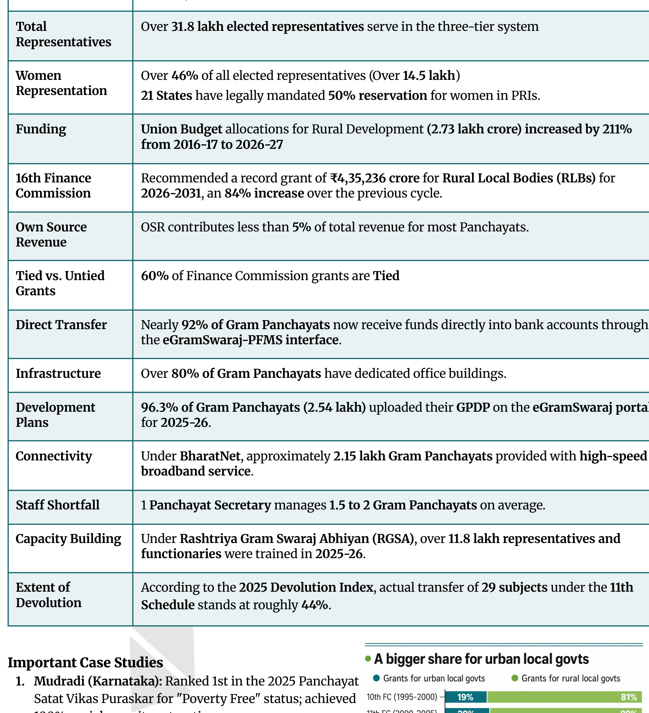
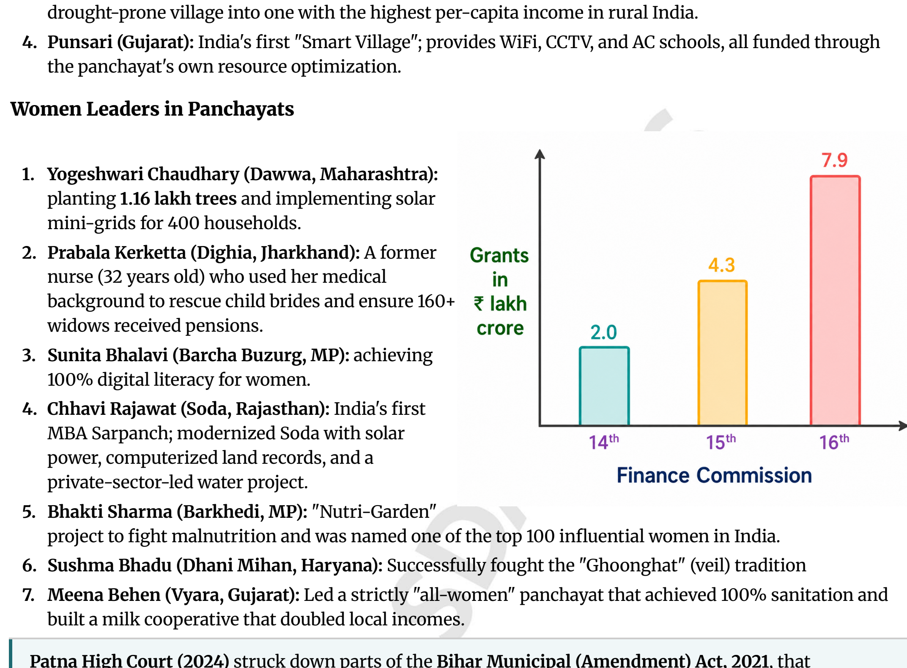
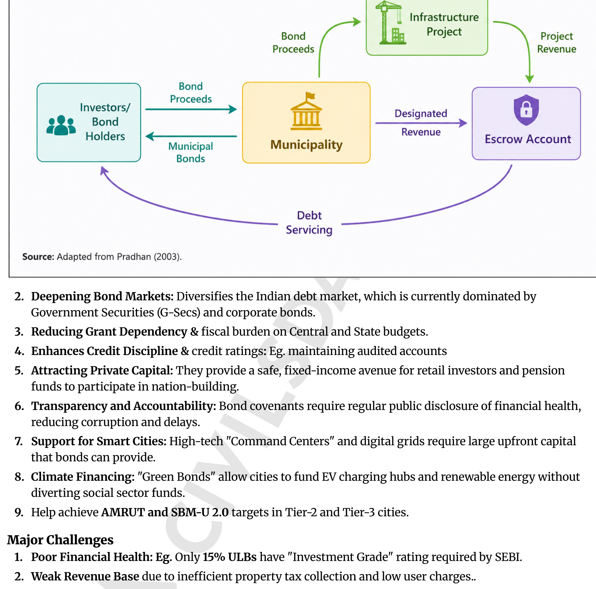

### [Smash Mains Source Page 204](../pages/mains/mains_page_204.pdf)

*Diagram Screenshot: [A Bigger Share for Urban Local Governments (Finance Commission Grants)](../diagrams/mains_diag_ulb_grants_share_p204.png) | [Full Source Page 204](../pages/mains/mains_page_204.pdf)*

Data on PRIs
Category Data
Total PRIs Approximately 2.64 lakh Gram Panchayats, 6,792 Block Panchayats, and 670 Zila
Panchayats across India.
Total
Representatives
Over 31.8 lakh elected representatives serve in the three-tier system
Women
Representation
Over 46% of all elected representatives (Over 14.5 lakh)
21 States have legally mandated 50% reservation for women in PRIs.
Funding Union Budget allocations for Rural Development (2.73 lakh crore) increased by 211%
from 2016-17 to 2026-27
16th Finance
Commission
Recommended a record grant of ₹4,35,236 crore for Rural Local Bodies (RLBs) for
2026-2031, an 84% increase over the previous cycle.
Own Source
Revenue
OSR contributes less than 5% of total revenue for most Panchayats.
Tied vs. Untied
Grants
60% of Finance Commission grants are Tied
Direct Transfer Nearly 92% of Gram Panchayats now receive funds directly into bank accounts through
the eGramSwaraj-PFMS interface.
Infrastructure Over 80% of Gram Panchayats have dedicated office buildings.
Development
Plans
96.3% of Gram Panchayats (2.54 lakh) uploaded their GPDP on the eGramSwaraj portal
for 2025-26.
Connectivity Under BharatNet, approximately 2.15 lakh Gram Panchayats provided with high-speed
broadband service.
Staff Shortfall 1 Panchayat Secretary manages 1.5 to 2 Gram Panchayats on average.
Capacity Building Under Rashtriya Gram Swaraj Abhiyan (RGSA), over 11.8 lakh representatives and
functionaries were trained in 2025-26.
Extent of
Devolution
According to the 2025 Devolution Index, actual transfer of 29 subjects under the 11th
Schedule stands at roughly 44%.
Important Case Studies
1. Mudradi (Karnataka): Ranked 1st in the 2025 Panchayat
Satat Vikas Puraskar for "Poverty Free" status; achieved
100% social security saturation.
2. Madamakki (Karnataka): achieved 100% Functional
Household Tap Connections (FHTC) and integrated
greywater management.
206

#### Structured Tables on Page 204

| Category | Data |
| --- | --- |
| Total PRIs | Approximately 2.64 lakh Gram Panchayats, 6,792 Block Panchayats, and 670 Zila Panchayats across India. |
| Total Representatives | Over 31.8 lakh elected representatives serve in the three-tier system |
| Women Representation | Over 46% of all elected representatives (Over 14.5 lakh) 21 States have legally mandated 50% reservation for women in PRIs. |
| Funding | Union Budget allocations for Rural Development (2.73 lakh crore) increased by 211% from 2016-17 to 2026-27 |
| 16th Finance Commission | Recommended a record grant of ₹4,35,236 crore for Rural Local Bodies (RLBs) for 2026-2031, an 84% increase over the previous cycle. |
| Own Source Revenue | OSR contributes less than 5% of total revenue for most Panchayats. |
| Tied vs. Untied Grants | 60% of Finance Commission grants are Tied |
| Direct Transfer | Nearly 92% of Gram Panchayats now receive funds directly into bank accounts through the eGramSwaraj-PFMS interface. |
| Infrastructure | Over 80% of Gram Panchayats have dedicated office buildings. |
| Development Plans | 96.3% of Gram Panchayats (2.54 lakh) uploaded their GPDP on the eGramSwaraj portal for 2025-26. |
| Connectivity | Under BharatNet, approximately 2.15 lakh Gram Panchayats provided with high-speed broadband service. |
| Staff Shortfall | 1 Panchayat Secretary manages 1.5 to 2 Gram Panchayats on average. |
| Capacity Building | Under Rashtriya Gram Swaraj Abhiyan (RGSA), over 11.8 lakh representatives and functionaries were trained in 2025-26. |
| Extent of Devolution | According to the 2025 Devolution Index, actual transfer of 29 subjects under the 11th Schedule stands at roughly 44%. |

---

### [Smash Mains Source Page 205](../pages/mains/mains_page_205.pdf)

*Diagram Screenshot: [Finance Commission Grants to Local Bodies (11th to 15th FC in Rs Lakh Crore)](../diagrams/mains_diag_fc_grants_local_bodies_p205.png) | [Full Source Page 205](../pages/mains/mains_page_205.pdf)*

3. Hiware Bazar (Maharashtra): The gold standard for water harvesting. Transformed from a
drought-prone village into one with the highest per-capita income in rural India.
4. Punsari (Gujarat): India's first "Smart Village"; provides WiFi, CCTV, and AC schools, all funded through
the panchayat's own resource optimization.
Women Leaders in Panchayats
1. Yogeshwari Chaudhary (Dawwa, Maharashtra):
planting 1.16 lakh trees and implementing solar
mini-grids for 400 households.
2. Prabala Kerketta (Dighia, Jharkhand): A former
nurse (32 years old) who used her medical
background to rescue child brides and ensure 160+
widows received pensions.
3. Sunita Bhalavi (Barcha Buzurg, MP): achieving
100% digital literacy for women.
4. Chhavi Rajawat (Soda, Rajasthan): India's first
MBA Sarpanch; modernized Soda with solar
power, computerized land records, and a
private-sector-led water project.
5. Bhakti Sharma (Barkhedi, MP): "Nutri-Garden"
project to fight malnutrition and was named one of the top 100 influential women in India.
6. Sushma Bhadu (Dhani Mihan, Haryana): Successfully fought the "Ghoonghat" (veil) tradition
7. Meena Behen (Vyara, Gujarat): Led a strictly "all-women" panchayat that achieved 100% sanitation and
built a milk cooperative that doubled local incomes.
Patna High Court (2024) struck down parts of the Bihar Municipal (Amendment) Act, 2021, that
transferred the powers of appointment of Grade C and D employees of municipalities from the Empowered
Standing Committee of the municipality to the State government-controlled Directorate of Municipal
Administration.
The court held that such recentralisation of power was "incompatible with the idea, intent, and design" of
the constitutional amendment, reaffirming urban local autonomy.
Significance of Local Bodies
Rajni Kothari - Described local bodies as "schools of democracy" where political awareness and participation
are cultivated at the grassroots level.
1. Normative Foundation: It rests on two core values - efficiency in public service delivery and deepening
of democracy through proximity to citizens.
2. Democratic Decentralization - Eg. Kerala's People's Plan Campaign grants local bodies control over
40% of the state's plan budget.
3. Principle of Subsidiarity: decisions closer to the people. Eg. selection of beneficiaries under PM-Awas
Yojana
4. Inclusivity and social justice: representation to Scheduled Castes, and Scheduled Tribes.
5. Implementation of Schemes, ensuring that benefits reach the grassroots. Eg. MGNREGA.
6. Gender Empowerment: Over 14.5 lakh Elected Women Representatives, with 21 states providing 50%
reservation.
207

---

### [Smash Mains Source Page 216](../pages/mains/mains_page_216.pdf)

f. User Charge Gap: Minimal charges for water and waste result in poor Operation & Maintenance
(O&M) cost recovery.
2. Functional Challenges
a. Parastatal bodies control key functions like water, and transport leading to "responsibility without
power" syndrome for ULBs. Eg. Delhi Jal Board
b. Schemes like JNNURM (2005) and Smart Cities Mission (2015) implemented via SPVs. SPVs, led by
bureaucrats, indicate "procedural distrust" of local democracy.
c. Incomplete devolution: Most States haven't transferred all 18 functions under the 12th Schedule.
d. Inactive District Planning Committees (DPCs): Non-functional in 9 States.
e. Urban planning remains reactive and fragmented rather than long-term and integrated with
transit.
f. 65% of Indian cities still operate without updated Master Plans. (NITI Aayog)
3. Functionary Challenges
a. Election delays: Eg. BBMP (Bengaluru) vacant since 2020.
b. Proxy representation: "Corporator Pati" syndrome weakens women's empowerment.
c. State-appointed Municipal Commissioners overshadow elected mayors.
d. Staff shortage: 42% of posts vacant (2022), leading to poor service delivery.
e. Absence of a dedicated Municipal Administrative Service in many states.
4. Functionality Challenges
a. Neo-liberal urban policy bias: Focus on "competitive cities" and investment-driven growth has
sidelined democratic decentralisation. (RBI)
b. Weak Citizen Participation Structures - Ward committees and area sabhas are non-functional or
absent in most states. Only 5 out of 35 states have legally mandated participatory bodies.
c. Rapid urbanisation strains water, housing, and sanitation systems. Eg. Bengaluru floods (2022) and
Mumbai water shortages show planning failures.
d. 17% of urban households live in slums; 11 million homes vacant (ORF, 2023).
e. Ceremonial Mayors: In most Indian cities, the Mayor has no executive power, which instead rests
with the state-appointed Commissioner.
f. Audit Lags: Delayed and non-transparent audits lead to poor financial credibility and loss of
performance grants.
g. Legal Constraints: ULBs lack the freedom to set their own tax rates or borrow without stringent
state approvals.
Greater Bengaluru Governance Bill (2024):
- Creates Greater Bengaluru Authority (GBA) headed by the Chief Minister and Chief Commissioner
(bureaucrat).
- Empowers GBA to alter ULB boundaries and override elected councils.
- This effectively removes even the symbolic layer of decentralisation.
Government Schemes
16th Finance Commission (2026–2031)
1. ₹3.56 lakh crore has been allocated specifically for Urban Local Bodies (ULBs).
2. ₹58,000 crore is tied to performance, requiring ULBs to show a 5% annual growth in their Own Source
Revenue (OSR) and 100% digital auditing of accounts.
218

---

### [Smash Mains Source Page 217](../pages/mains/mains_page_217.pdf)

3. Urbanization Premium: A new ₹10,000 crore fund to reward states with rapid but well-planned urban
transitions.
Urban Challenge Fund (UCF)
1. ₹1,00,000 crore Central Assistance aimed at catalyzing a total investment of ₹4 lakh crore over five
years.
2. The Centre provides 25% of project costs only if the ULB raises 50% from the market (bonds/loans) and
the remaining 25% from State/Local funds.
3. Small ULBs (population <1 lakh) are supported with a 70% central guarantee for loans up to ₹7 crore,
helping them build credit history.
City Economic Regions (CER) – Budget 2026-27
1. It links a core city with its satellite towns and industrial hubs into a single labor market (Eg.
Pune-Pimpri-Chinchwad belt).
2. ₹5,000 crore per region for 14 identified CERs to develop common regional infrastructure like rapid
transit and high-speed logistics.
AMRUT 2.0 (Atal Mission for Rejuvenation and Urban Transformation)
1. Aims for 100% water tap coverage in all 4,800+ ULBs and 100% sewerage coverage in 500 major cities.
2. Pey Jal Survekshan: "water survey" to rank cities based on water quality, recycling, and conservation
efforts.
3. Mandatory rejuvenation of at least one water body in every city.
Swachh Bharat Mission-Urban (SBM-U) 2.0
1. Focus on the "Garbage Free City" (GFC) star rating and circular economy.
2. A dedicated drive to remediate all 2,400+ legacy dumpsites in India by 2027.
3. Mandatory setting up of Material Recovery Facilities (MRF) and Waste-to-Energy plants in all cities with
a population over 5 lakh.
4. Ensuring that no untreated sewage is discharged into open drains or water bodies.
Urban Infrastructure Development Fund (UIDF)
1. Managed by the National Housing Bank, this fund focuses on Tier-2 and Tier-3 cities.
2. It provides low-interest loans to ULBs for basic infrastructure like water supply, sanitation, and
storm-water drainage.
Smart Cities Mission (Post-2025 Transition)
1. The official Smart Cities Mission concluded on March 31, 2025, but its legacy continues through the
Integrated Command and Control Centres (ICCCs).
2. All 100 Smart Cities have operational ICCCs which now act as "City Brains" for traffic, emergency
response, and healthcare monitoring.
3. The India Urban Data Exchange (IUDX) and Smart Cities Open Data Portal are now being scaled to 500
additional cities.
Way Forward
1. Move toward a "Mayor in council" system with executive powers and a fixed 5-year tenure (similar to
London or New York).
2. Financial Autonomy: Implement the FC recommendation of 5% annual OSR growth and leverage the ₹1
lakh crore Urban Challenge Fund for market borrowing.
3. Institutionalizing "Value Capture Financing" (VCF) to monetize public infrastructure investments. Eg.
Betterment Levies or higher FSI charges on lands adjacent to Metro line
4. Create a Dedicated Urban Planning Cadre (as suggested by the HPEC on Urban Infrastructure) to
professionalize municipal administration.
219

---

### [Smash Mains Source Page 218](../pages/mains/mains_page_218.pdf)

5. Integrated Planning (CER): Utilize the City Economic Region framework to coordinate growth across
rural-urban boundaries, preventing unplanned peri-urban sprawl.
6. Complete GIS-based property mapping for 100% of cities by 2030 to double OSR and ensure equitable
service delivery.
7. Sustainability: Adopting "Sponge City" Frameworks
8. Strengthening "Metropolitan Planning Committees" (MPCs) with binding powers to regulate growth of
Urban Sprawls
9. Enacting "Right to Services Act" for Municipalities with clear timelines and grievance redressal
mechanisms for services like birth certificates, water connections etc.
Kerala's People's Plan Model allocates 40% of the State's plan budget directly to local bodies.
Municipal Bonds
Municipal Bonds are debt instruments issued by Urban Local Bodies or municipal corporations to raise
funds from the open market for specific infrastructure projects.
Recent News
- Budget 2026-27: ₹100 crore incentive for any single municipal bond issuance exceeding ₹1,000 crore.
This aims to encourage large-scale "City Economic Region" projects.
- RBI Repo Guideline (Oct 2025): allowed municipal bonds to be used as collateral for repo transactions.
- Urban Challenge Fund (UCF): requires cities to raise at least 50% of project costs via municipal bonds
or private loans.
Key Data Points
- Market Size: Total outstanding municipal debt reached ₹13,500 crore by March 2025, with FY26
issuances projected to hit ₹2,000 crore.
- Credit Quality: Nearly 32 major Indian cities now hold "Investment Grade" ratings.
- The U.S. muni market is 14% of its GDP, while India's remains at 0.06% of GDP in 2026.
Success Case Studies
1. Indore: Raised ₹244 crore (oversubscribed 6x) to fund a 60MW solar power plant.
2. Pimpri-Chinchwad: Leveraged its AA+ rating to raise funds for smart-city digital infrastructure and
fiber-grid networks.
Need for Municipal Bonds in India
1. Non-inflationary capital - Urban India requires $840 billion in infrastructure investment by 2036. NITI
Aayog notes that grants cover less than 30% of needed urban capex in 2026.
220

---

### [Smash Mains Source Page 219](../pages/mains/mains_page_219.pdf)

*Diagram Screenshot: [Chart III.2: Municipal Bond Financing Architecture for an Urban Local Body (ULB)](../diagrams/mains_diag_ulb_bond_financing_p219.png) | [Full Source Page 219](../pages/mains/mains_page_219.pdf)*

2. Deepening Bond Markets: Diversifies the Indian debt market, which is currently dominated by
Government Securities (G-Secs) and corporate bonds.
3. Reducing Grant Dependency & fiscal burden on Central and State budgets.
4. Enhances Credit Discipline & credit ratings: Eg. maintaining audited accounts
5. Attracting Private Capital: They provide a safe, fixed-income avenue for retail investors and pension
funds to participate in nation-building.
6. Transparency and Accountability: Bond covenants require regular public disclosure of financial health,
reducing corruption and delays.
7. Support for Smart Cities: High-tech "Command Centers" and digital grids require large upfront capital
that bonds can provide.
8. Climate Financing: "Green Bonds" allow cities to fund EV charging hubs and renewable energy without
diverting social sector funds.
9. Help achieve AMRUT and SBM-U 2.0 targets in Tier-2 and Tier-3 cities.
Major Challenges
1. Poor Financial Health: Eg. Only 15% ULBs have "Investment Grade" rating required by SEBI.
2. Weak Revenue Base due to inefficient property tax collection and low user charges..
3. Low Secondary Liquidity: Once issued, municipal bonds are rarely traded, making it difficult for
investors to exit early.
4. Opaque Accounting Standards: Lack of standardized, digitized, and timely audited financial statements
deters high-value institutional investors.
5. Administrative Inefficiency: Most ULBs lack a dedicated "Finance Cell" or experts capable of managing
complex bond documentation.
6. Populist measures like "waiving user charges" jeopardize the dedicated revenue streams promised to
bondholders.
7. High Transaction Costs of credit rating, underwriting, and legal compliance makes small issuances
(<₹50cr) economically unviable.
221

---

### [Smash Mains Source Page 220](../pages/mains/mains_page_220.pdf)

8. Strict State Controls: ULBs need multiple state-level clearances to borrow, leading to delays.
9. Absence of Default Framework: There is no clear legal mechanism or "Insolvency Code" for municipal
defaults in India.
Steps Taken by Government
1. AMRUT: Centre provides an incentive of ₹13 crore for every ₹100 crore raised via bonds.
2. Credit Repayment Guarantee Fund (CRGSS)
3. SEBI has simplified the "Listing of Municipal Debt Securities" norms and introduced a "Municipal
Bond Information Repository."
4. GST Compensation Integration: Allowing states to use a portion of GST compensation as a "Sinking
Fund" to guarantee bond repayments.
Way Forward
1. Municipal Recovery Fund to act as a backstop in case of temporary repayment delays (Global Practice:
USA's Bond Insurance).
2. Scale up Pooled Finance Development Fund (PFDF) model where several small ULBs "pool" their
requirements to issue a single, large-value bond.
3. Complete 100% GIS-based property tax mapping to double municipal revenue (recommendation of
HPEC on Urban Infrastructure).
4. Create a specialized "Municipal Administrative Service" to provide professional financial managers to
ULBs.
5. Grant "Tax-Free" status to bonds used for water and sanitation projects to attract retail investors.
Direct Election of Mayor
The 74th Constitutional Amendment Act (1992) provides for urban local bodies but does not prescribe the
mode of election of mayors. Hence, the method of mayoral election is decided by State legislatures under
Article 243R of the Constitution.
1. Active Direct Election: Haryana, Uttar Pradesh, Bihar, Chhattisgarh, Jharkhand, Madhya Pradesh,
Odisha, Telangana, and Uttarakhand.
2. Fluctuating Systems: States like Rajasthan and Tamil Nadu have frequently switched between direct
and indirect systems depending on the political party in power.
Benefits of Direct Election of Mayor
1. Fixed Tenure and Stability
2. Direct Accountability to Citizens
3. City-Wide Vision: Directly elected mayors represent the entire city, not just a single ward, reducing
"parochial" ward-level politics.
4. Stronger Mandate for Reform: Popular support provides the political capital needed to implement tough
reforms like increased property taxes.
5. Checks on Bureaucracy
6. Reduced Horse-Trading: Eliminates the "resort politics" seen during indirect elections
7. Faster Decision Making
8. Professionalization of Politics: Attracts high-profile candidates who can run a city like a CEO.
9. Enhanced City Branding: helps in attracting global investments and sister-city partnerships.
10. Improved Crisis Management: a single point of command during disasters ensures
222

---

### [Smash Mains Source Page 221](../pages/mains/mains_page_221.pdf)

Major Issues/Challenges
1. Executive-Legislative Deadlock
2. Ceremonial Nature of Post: In many states, even directly elected mayors lack actual "executive powers,"
which remain with the Commissioner.
3. Conflict with State Government in funds
4. Tussle with MPs and MLAs: Directly elected can be seen as political rivals to local legislators, leading to
administrative friction.
5. Risk of Autocratic Behavior without strong "Mayor-in-Council" checks.
6. Increased Election Costs
7. Populist Bias
Way Forward
1. Strong Mayor-in-Council Model - Eg. Kolkata
2. 2nd ARC Recommendation: Mayor should be Executive Head of the city with a fixed tenure.
3. Global Best Practice (London/New York): "Executive Mayor" system where the Mayor proposes the
budget and the Council performs the audit/veto function.
4. Dedicated Municipal Cadre, independent of state-level transfers.
5. Introduce a "Right to Recall" to ensure the Mayor remains responsive throughout the term.
6. Direct a fixed percentage of State GST (S-GST) to the Mayor's office to ensure financial autonomy from
the state.
7. Form a "City Coordination Committee" chaired by the Mayor, including local MPs/MLAs, to prevent
jurisdictional friction.
Delays in elections of local bodies
After nearly four years of delay, elections for the Brihanmumbai Municipal Corporation (BMC) and other
major cities were finally held in January 2026.
- The average delay in municipal elections across major Indian states stands at 22 to 24 months after the
expiry of the previous council's term.
- Over 30% of urban residents in India are currently governed by state-appointed administrators
Constitutional Provisions
1. Article 243-E (Panchayats) & 243-U (Municipalities): Mandate a fixed term of five years. Elections must
be completed before the expiry of this term.
2. Six-Month Rule: In case of dissolution, elections must be held within six months from the date of such
dissolution.
3. Article 243-K & 243-ZA: Empower the State Election Commission with the "superintendence, direction,
and control" of conduct of all local body elections.
Reasons Behind Delays
1. OBC Reservation Litigation: States struggle to fulfill the SC-mandated "Triple Test" (Commission,
Empirical Data, 50% Ceiling) for backward class quotas.
2. Delimitation Exercises: State governments use the redrawing of ward boundaries as a tactical tool to
postpone polls.
223

---

### [Smash Mains Source Page 222](../pages/mains/mains_page_222.pdf)

3. Census 2021 Postponement: States like Rajasthan cited "incomplete population data" as a primary
reason for the April 2026 poll delay.
4. States prefer "Administrators" over elected heads for easier control over local funds
5. State Election Commissions lack independent funding and personnel.
6. Legal Challenges to Rotation: Court cases regarding the rotation of "Reserved Seats" (Women/SC/ST)
frequently stop the election notification process.
Way Forward
1. Strict Adherence to "Kishan Singh Tomar" Case: Enforcement of the SC ruling that administrative
excuses like delimitation are not valid for delaying polls.
2. Permanent OBC Commission to avoid last-minute "Triple Test" hurdles before every election.
3. Financial Independence of SECs
4. Explore the possibility of "One Nation, One Election" extending down to the local level.
5. The Finance Commission should strictly bar any "Untied Grants" to states where local body elections
are overdue by more than six months.
Reasons behind reluctance of states in empowering local bodies in India
- Preservation of Political Patronage: States fear that empowering local bodies will create a parallel
center of power.
- Rivalry with Emerging Leadership: State-level politicians (MLAs/MPs) view strong local leaders as
potential political competitors for their own legislative seats.
- States use "grant dependency" as a tool to keep local bodies politically aligned; independent local
revenue would break this leverage.
- Bureaucratic Comfort with Centralization: The state bureaucracy (IAS/PCS) prefers reporting to a
single State Minister rather than being accountable to a decentralized "Mayor-in-Council."
- Unitary Bias in Governance Philosophy: Many state leaders still view "extreme localism" as a threat to
state-level administrative unity and unified policy implementation.
Fear of Fractionalization: States argue that local bodies are "caste-ridden" or "inefficient," using these
social complexities as a pretext to deny them real power.
6th schedule areas
Recent news
1. The Kargil Democratic Alliance (KDA) and Leh Apex Body (LAB) recently rejected a Union proposal for
a "Territorial Council," reiterating their demand for full Sixth Schedule status and Statehood for Ladakh
to protect its fragile ecology and 97% tribal population.
2. Several ADCs in Meghalaya and Mizoram passed formal resolutions opposing the Uniform Civil Code,
arguing it infringes upon the "Customary Laws" protected under Sixth Schedule
3. There is a renewed push for the passage of the 125th Constitutional Amendment Bill, which seeks to
increase the financial autonomy of ADCs and introduce Village-level councils.
Key Data Points
1. States Covered: 4 States (Assam, Meghalaya, Tripura, Mizoram).
2. 10 Autonomous District Councils (3 each in Assam, Meghalaya, and Mizoram; 1 in Tripura).
3. Council Composition: Maximum 30 members (26 elected and 4 nominated by Governor).
224

---

### [Smash Mains Source Page 223](../pages/mains/mains_page_223.pdf)

4. Term: 5 years (Nominated members hold office at the pleasure of the Governor).
5. Central and State laws do not automatically apply to these areas; they require a notification by the
Governor (for Assam) or the President (for others) with specific modifications.
Constitutional Provisions
1. Article 244(2): Specifically provides that the provisions of the Sixth Schedule shall apply to the
administration of the tribal areas in the four North-Eastern states.
2. Article 275(1): Mandates special Grants-in-aid from the Consolidated Fund of India to these areas for
development and administration.
3. Governor's Role: The Governor has the power to create, reorganize, or change the names/boundaries of
autonomous districts.
Benefits of the Sixth Schedule
1. Cultural Preservation: Protects the unique "civilizational" identity of North-Eastern tribes
2. Prevents the alienation of tribal land by prohibiting its transfer to non-tribals.
3. Recognizes traditional dispute resolution systems for tribal disputes.
4. Legislative Self-Rule: Empowers councils to make laws on subjects like shifting cultivation,
watercourses, and local social customs.
5. Fiscal Empowerment: collect land revenue and taxes on professions, vehicles, and trades.
6. Resource Management: Allows tribal communities to manage community forests (excluding reserved
forests) and local water resources.
7. Protection from Exploitation: Regulates money-lending and trading by non-tribals to prevent debt
traps and economic marginalization.
8. Political Representation: Ensures that minority tribal groups within a state have a dedicated platform
for political expression.
9. Countering Insurgency: Eg. The creation of the Bodoland Territorial Region (BTR) ended decades of
militancy through constitutional accommodation.
10. Customary Law Recognition: Safeguards the traditional social fabric by making Governor's assent
mandatory for laws affecting tribal customs.
Major Issues in Sixth Schedule Areas
1. Overlapping jurisdictions lead to frequent power struggles between the state legislature and the
councils.
2. No mandatory reservation for women. Women's representation in most ADCs below 5%
3. Absence of Anti-Defection Law, leading to instability and "horse-trading."
4. Financial Dependency: Despite taxing powers, most councils remain heavily dependent on
discretionary state grants, limiting actual autonomy.
5. Bureaucratic Hegemony: Eg. In Assam, the "Principal Secretary" to the council is an IAS officer
reporting to the state.
6. Incomplete Power Transfer: Eg. Departments like PWD and Irrigation in Tripura's ADC often remain
under state control in practice.
7. Power is often concentrated among a few "Tribal Elites."
8. Corruption cases in the Chakma Council (2025) highlighted the misappropriation of funds by
high-ranking members.
9. Non-tribal residents lack basic voting rights and land ownership, causing social friction.
10.There is no strict constitutional time limit for holding fresh elections if a council is dissolved.
225

---

### [Smash Mains Source Page 224](../pages/mains/mains_page_224.pdf)

Way Forward
1. 125th Amendment Bill: Fast-track this bill to introduce Village Councils (similar to Gram Sabhas) and
make the Anti-Defection law applicable to ADCs.
2. Mandate the Central Finance Commission to directly allocate funds to ADCs, bypassing state discretion
(as per the B.K. Chaturvedi Committee).
3. Amend the Schedule to provide at least 33% reservation for women.
4. Activity Mapping: Clearly delineate functions between the State, District, and Village levels
226