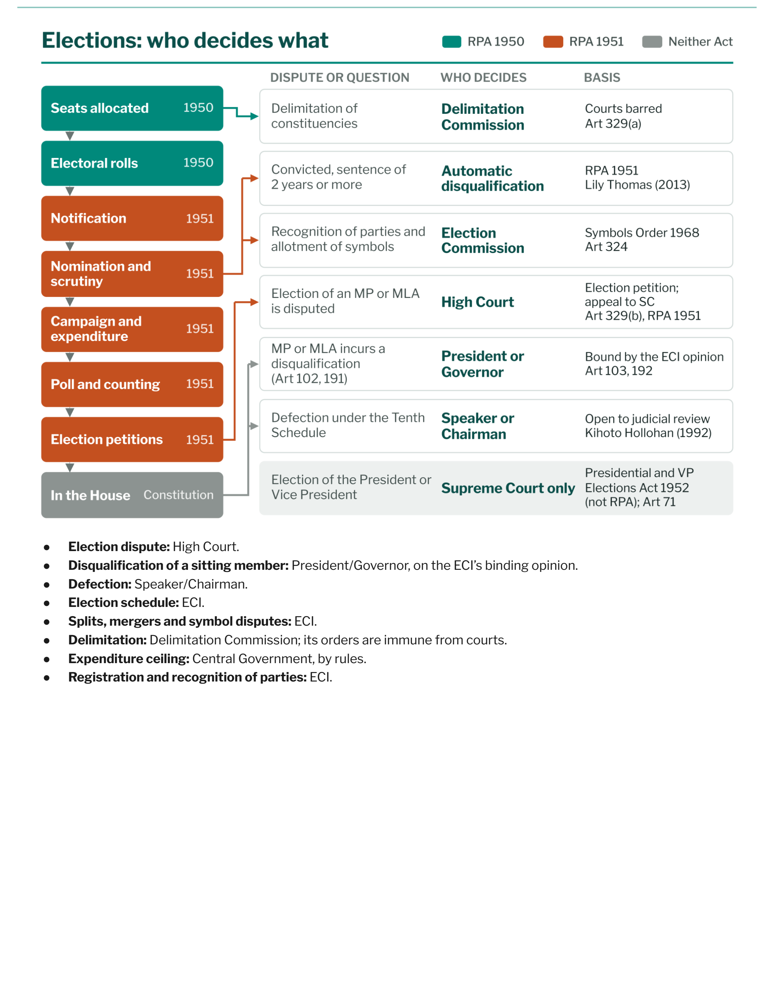

# Elections, Representation of the People Acts, Electoral Reforms, Simultaneous Elections & Anti-Defection Law — Prelims Notes (X-Factor Pre'27)

---

### [Prelims Source Page 151](pages/prelims/prelims_page_151.pdf)

## CHAPTER 19
ELECTIONS
THEME ANALYSIS PYQ pattern for this chapter
1. REPEATS

#### A. Constitutional Frame, Article 81 onwards
- Part XV, Articles 324 to 329, superintendence with the Election Commission of India
- Article 81 seat size and the largest seat by area; Article 173 sets 25 years, ceiling 500 not 450 [2008]
- Article 329 bars courts from delimitation orders and mid poll interference [2012]

#### B. Delimitation
- Delimitation Commission orders resist court challenge and legislative modification [2012]
- Four Commissions had been constituted till December 2023 [2024]
- Composition of the Delimitation Commission under the Delimitation Act, 2002, and the 2026 delimitation package
now before Parliament

#### C. Candidate Qualification and Disqualification
- A nomination needs the name on any electoral roll, not residence in that constituency [2017]
- Under the Representation of the People Act, 1951 conviction disqualifies for six years from release, never
permanently [2020]
- A non member may be minister for six months, a standing distractor [2020]
- Lily Thomas (2013) ended the shield of a pending appeal

#### D. Contesting, Polling and Money
- Two constituency cap; Devi Lal contested three seats in 1991 [2021]
- No rule makes a party pay for the resulting bye elections [2021]
- Untested here but live: NOTA, VVPAT, Model Code of Conduct
- Also tested: no 50% rule for winning, no constitutional rule on Speaker and Deputy Speaker posts [2017], the right to
vote as a constitutional right [2017]
2. HOW THE FORMAT HAS CHANGED
- 2008: recall of seats and numbers [2008]
- 2012 to 2021: two statement sets on delimitation and disqualification [2012, 2017, 2020, 2021]
- 2024: a "how many" count of Delimitation Commissions [2024]
3. WHAT IS BEING ASKED NOW
- Delimitation: how many Commissions, and the finality of their orders [2012, 2024]
- Absolute words as traps: "permanently", "must get 50 percent" [2017, 2020]

#### Structured Tables on Page 151

| CHAPTER 19 |
| --- |
| ELECTIONS |
| THEME ANALYSIS PYQ pattern for this chapter |
| 1. REPEATS A. Constitutional Frame, Article 81 onwards • Part XV, Articles 324 to 329, superintendence with the Election Commission of India • Article 81 seat size and the largest seat by area; Article 173 sets 25 years, ceiling 500 not 450 [2008] • Article 329 bars courts from delimitation orders and mid poll interference [2012] B. Delimitation • Delimitation Commission orders resist court challenge and legislative modification [2012] • Four Commissions had been constituted till December 2023 [2024] • Composition of the Delimitation Commission under the Delimitation Act, 2002, and the 2026 delimitation package now before Parliament C. Candidate Qualification and Disqualification • A nomination needs the name on any electoral roll, not residence in that constituency [2017] • Under the Representation of the People Act, 1951 conviction disqualifies for six years from release, never permanently [2020] • A non member may be minister for six months, a standing distractor [2020] • Lily Thomas (2013) ended the shield of a pending appeal D. Contesting, Polling and Money • Two constituency cap; Devi Lal contested three seats in 1991 [2021] • No rule makes a party pay for the resulting bye elections [2021] • Untested here but live: NOTA, VVPAT, Model Code of Conduct • Also tested: no 50% rule for winning, no constitutional rule on Speaker and Deputy Speaker posts [2017], the right to vote as a constitutional right [2017] 2. HOW THE FORMAT HAS CHANGED • 2008: recall of seats and numbers [2008] • 2012 to 2021: two statement sets on delimitation and disqualification [2012, 2017, 2020, 2021] • 2024: a "how many" count of Delimitation Commissions [2024] 3. WHAT IS BEING ASKED NOW • Delimitation: how many Commissions, and the finality of their orders [2012, 2024] • Absolute words as traps: "permanently", "must get 50 percent" [2017, 2020] |

---

### [Prelims Source Page 152](pages/prelims/prelims_page_152.pdf)

### PRELIMS PREVIOUS YEAR QUESTIONS

**Q1. How many Delimitation Commissions have been**
constituted by the Government of India till December
2023? [2024]
(a) One
(b) Two
(c) Three
(d) Four
**`ANSWER (d)`**

**Q2. Consider the following statements: [2021]**
1. In India, there is no law restricting candidates
from contesting in one Lok Sabha election from
three constituencies.
2. In the 1991 Lok Sabha Election, Shri Devi Lal
contested from three Lok Sabha constituencies.
3. As per the existing rules, if a candidate contests in
one Lok Sabha election from many
constituencies, his/her party should bear the cost
of bye-elections to the constituencies vacated by
him/her in the event of him/her winning in all the
constituencies.
Which of the statements given above is/are correct?
(a) 1 only
(b) 2 only
(c) 1 and 3
(d) 2 and 3
**`ANSWER (b)`**

**Q3. Consider the following statements: [2020]**
1. According to the Constitution of India, a person
who is eligible to vote can be made a minister in a
State for six months even if he/she is not a
member of the Legislature of that State.
2. According to the Representation of People Act,
1951, a person convicted of a criminal offence
and sentenced to imprisonment for five years is
permanently disqualified from contesting an
election even after his release from prison.
Which of the statements given above is/are correct?
(a) 1 only
(b) 2 only
(c) Both 1 and 2
(d) Neither 1 nor 2
**`ANSWER (d)`**

**Q4. For election to the Lok Sabha, a nomination paper can**
be filed by [2017]
(a) Anyone residing in India.
(b) A resident of the constituency from which the
election is to be contested.
(c) Any citizen of India whose name appears in the
electoral roll of a constituency.
(d) Any citizen of India.
**`ANSWER (c)`**

**Q5. Right to vote and to be elected in India is a [2017]**
(a) Fundamental Right
(b) Natural Right
(c) Constitutional Right
(d) Legal Right
**`ANSWER (c)`**

**Q6. Consider the following statements: [2017]**
1. In the election for Lok Sabha or State Assembly,
the winning candidate must get at least 50
percent of the votes polled, to be declared
elected.
2. According to the provisions laid down in the
Constitution of India, in Lok Sabha, the Speaker's
post goes to the majority party and the Deputy
Speaker's to the Opposition.
Which of the statements given above is/are correct?
(a) 1 only
(b) 2 only
(c) Both 1 and 2
(d) Neither 1 nor 2
**`ANSWER (d)`**

**Q7. With reference to the Delimitation Commission,**
consider the following statements: [2012]
1. The orders of the Delimitation Commission
cannot be challenged in a Court of Law.
2. When the orders of the Delimitation Commission
are laid before the Lok Sabha or State Legislative
Assembly, they cannot effect any modifications in
the orders.
Which of the statements given above is/are correct?
(a) 1 only
(b) 2 only
(c) Both 1 and 2
(d) Neither 1 nor 2
**`ANSWER (c)`**

---

### [Prelims Source Page 153](pages/prelims/prelims_page_153.pdf)

**Q8. Which one of the following is the largest (area wise)**
Lok Sabha constituency? [2008]
(a) Kangra
(b) Ladakh
(c) Kachchh
(d) Bhilwara
**`ANSWER (b)`**

**Q9. Consider the following statements: [2008]**
1. The Legislative Assembly of each State shall
consist of not more than 450 members chosen
by direct election from territorial constituencies
in the State.
2. A person shall not be qualified to be chosen to fill
a seat in the Legislative Assembly of a State if
he/she is less than 25 years of age.
(a) 1 Only
(b) 2 Only
(c) Both 1 and 2
(d) Neither 1 nor 2
**`ANSWER (b)`**

---

### [Prelims Source Page 154](pages/prelims/prelims_page_154.pdf)

CONSTITUTIONAL FRAMEWORK
Part XV at a glance (Arts 324 to 329)
- Art 324: Election Commission of India; superintendence, direction and control of electoral rolls and of elections to
Parliament, State Legislatures and the offices of President and Vice President.
- Art 325: One general electoral roll per constituency; no one excluded only on grounds of religion, race, caste or sex;
no separate communal electorates.
- Art 326: Adult suffrage; every citizen aged 18+ who is not disqualified may be registered. Age lowered from 21 to 18
by the 61st Amendment, 1988.
- Arts 327, 328: Parliament legislates on all election matters (used for the RPA, 1950 and RPA, 1951); the State
Legislature only where Parliament has not. Both are “subject to the provisions of this Constitution”.
- Art 329: Bar on courts: (a) laws on delimitation and seat allotment; (b) elections questioned only by election
petition.
Traps
- Part XV has no article on political parties. Parties got constitutional mention only in the Tenth Schedule (52nd
Amendment, 1985), which defines “legislature party” and “original political party” but not “political party”.
- Local body elections are outside Part XV; State Election Commissions run them (Arts 243K, 243ZA).
- Art 325 lists only religion, race, caste and sex; place of birth, descent and residence are not in it, and the RPA, 1950
requires ordinary residence.
- Art 326 applies only to the Lok Sabha and Assemblies, not to indirectly elected bodies (Rajya Sabha, Councils,
President, Vice President). Vote at 18, contest at 25.
- The voting age came by the 61st, not the 62nd Amendment (which extended SC/ST and Anglo-Indian reservation).
- State Assemblies to formulate election laws only in so far as Parliament has not already made a provision on the
matter.
Election Commission of India (Art 324)
- Composition: The CEC and such number of Election Commissioners as the President fixes; three members at
present, but the Constitution fixes no number.
- Appointment: By the President on the recommendation of a Selection Committee of the Prime Minister, a Union
Cabinet Minister and the Leader of the Opposition (CEC and other ECs Act, 2023).
- Removal: The CEC only like a Supreme Court Judge; other ECs only on the CEC’s recommendation (Art 324(5)).
- Reservoir of power: Acts where the law is silent (Mohinder Singh Gill, 1978): by elections, symbols, party
recognition, Model Code of Conduct, observers, countermanding a poll.
- Limit: Cannot act contrary to existing law. In A.C. Jose v Sivan Pillai (1984), EVMs used without statutory backing
were set aside, so Parliament had to legislate.
Traps
- Outside the ECI: panchayat and municipal polls (SECs), the election of the Speaker/Deputy Speaker, and
nominated Rajya Sabha members.
- The Ministry of Home Affairs has no role in fixing the election schedule; it is the ECI alone.
ECI versus State Election Commission (Arts 243K, 243ZA)
- SEC: Created by the 73rd and 74th Amendments, 1992; appointed by the Governor; conducts panchayat and
municipal rolls and elections.
- Protection: The SEC is removable only like a High Court Judge, and his service conditions cannot be varied to his
disadvantage; the CEC is protected like a Supreme Court Judge.
Traps
- The SEC is wholly independent of the ECI; the ECI has no supervisory or appellate role over it.
- The State Election Commissioner sits ex officio on the Delimitation Commission for his State (Delimitation Act,
2002).

---

### [Prelims Source Page 155](pages/prelims/prelims_page_155.pdf)

THE TWO REPRESENTATION OF THE PEOPLE ACTS
How to tell the two Acts apart
- The RPA, 1950 builds the stage: who may vote, the electoral roll, and how many seats each State has.
- The RPA, 1951 runs the play: qualifications and disqualifications, party registration, nomination, polling, corrupt
practices, results and election petitions.
- Where an item is constitutional, the Act supplies the machinery.
- Party registration entered the law only in 1989, through the RPA, 1951; the RPA, 1950 nowhere mentions political
parties.
Trap: The Model Code of Conduct, party symbols, NOTA, electoral bonds belong to neither Act.
SEATS AND DELIMITATION
Allocation of seats (RPA, 1950)
- State wise seats in the Lok Sabha (First Schedule), Assemblies (Second Schedule) and Councils (Third Schedule),
with SC/ST reserved seats and the manner of filling Council seats.
- The ceilings come from the Constitution (Art 81 for the Lok Sabha, Art 170 for Assemblies); the distribution among
States comes from the Act.
Traps
- Rajya Sabha seats are allotted in the Fourth Schedule of the Constitution, not the RPA.
Delimitation Commission (Delimitation Act, 2002)
- Members: A serving or retired Supreme Court Judge (Chairperson, appointed by the Centre); the CEC or an EC
nominated by him; and the State Election Commissioner of the State concerned (both ex officio).
- Associate members (MPs and MLAs of the State) assist but have no vote and sign no decision.
- Orders are published in the Gazette and laid before the Lok Sabha and the Assembly concerned (Sec 10); they apply
from the next general election. The ECI keeps them updated for minor corrections under the RPA, 1950.
Traps
- The Commission is statutory, unlike the ECI and the Finance Commission.
- Orders have the force of law: legislatures cannot modify them and courts cannot question them (Art 329(a);
Meghraj Kothari, 1967), except where delimitation is manifestly arbitrary (Kishorchandra Rathod, 2024).
Delimitation exercises so far [PRELIMS 2024]
- Four Commissions: 1952, 1963, 1973 and 2002 (under the Acts of 1952, 1962, 1972 and 2002).
- The 2002 Commission (Justice Kuldip Singh) finalised its orders in 2008, leaving out J&K, Assam, Arunachal
Pradesh, Manipur and Nagaland.
- Two later exercises, not Commissions under Art 82:
- J&K: Under the J&K Reorganisation Act, 2019; 90 Assembly seats (43 Jammu, 47 Kashmir).
- Assam: By the ECI under the RPA, 1950; 126 Assembly and 14 Lok Sabha seats kept.
Traps
- The count stays at four; the J&K and Assam exercises do not add to it.
Women’s reservation (106th Amendment, 2023)
- Nari Shakti Vandan Adhiniyam: Inserted Arts 330A, 332A and a proviso to Art 239AA(2)(b); one third of seats in
the Lok Sabha, State Assemblies and Delhi Assembly, including within SC/ST reserved seats, for 15 years.
- In force from 16 April 2026, but reservation applies only after delimitation following the first census taken after
commencement.
Traps
- Constitutional but not yet operational; the 131st Amendment Bill, 2026, which sought to advance it, was defeated.
- Rajya Sabha and Councils are excluded; there is no OBC sub quota.

---

### [Prelims Source Page 156](pages/prelims/prelims_page_156.pdf)

The 2026 delimitation package
- The Constitution (131st Amendment) Bill, 2026, the Delimitation Bill and the Union Territories Laws (Amendment)
Bill were introduced on 16 April 2026: to lift the freeze, let Parliament decide by law when delimitation is done and
on which census, and raise the Lok Sabha ceiling from 550 to 850 (States 530 to 815, UTs 20 to 35).
- Defeated on 17 April 2026: 298 of 528 present and voting, short of the two thirds required by Art 368(2); 230
against. The Delimitation Bill was then withdrawn.
Traps
- The freeze until the first census after 2026 still stands.
VOTERS AND CANDIDATES
Elector to Minister: who qualifies [PRELIMS 2008, 2017]
Parameter Registered
elector
Voter on
polling day
Candidate:
LS /
Assembly
Candidate:
RS / Council
Candidate:
Panchayat /
Municipality
Nominated
member
Minister
without
election
Source RPA, 1950
(Secs 14 to
20); Art 326
RPA, 1951,
Sec 62
Arts 84, 173;
RPA, 1951
(Secs 4, 5)
Arts 84, 173;
RPA, 1951
(Secs 3, 6)
Arts 243F,
243V; State
law
Art 80(3) (12
to RS, by
President);
Art 171(5)
(Council, by
Governor)
Art 75(5)
(Union); Art
164(4) (State)
Age 18 on the
qualifying
date
As for the
elector
25 30 21 30 (Art 84
applies)
None
prescribed; in
effect 25 / 30,
since he must
become a
member
Citizen￾ship /
residence
Citizen;
ordinarily
resident; NRI
at the
passport
address (Sec
20A)
Must be on
the roll of
that
constituency
Citizen; oath
before an ECI
authorised
person;
elector of any
PC in India
(LS) or any AC
in that State
(Assembly)
RS: elector of
any PC in
India
(domicile
dropped
2003; Kuldip
Nayar, 2006)
Council
(elected):
elector of an
AC in that
State
Council
(nominated):
ordinarily
resident in
the State
As per State
law
Citizen Not a
member at
appointment
Key bars Sec 16: non
citizen;
unsound
mind (court
declared);
disqualified
for corrupt
practices or
electoral
offences
Prison or
police
custody,
including
undertrials
(62(5)); a Sec
16 bar even if
still on the roll
(62(2)); Sec
11A
Preventive
detainees
vote by postal
ballot
Arts 102, 191;
RPA Secs 8 to
10A
Same as LS /
Assembly
State law
conditions
(minimum
education,
two child
norm), upheld
in Rajbala,
2015 and
Javed, 2003
Same as
elected
members;
may join a
party within 6
months
(Tenth
Schedule)
S.R.
Chaudhuri
(2001): no
reappointme
nt without
election in the
same term
B.R. Kapur
(2001): a
person
disqualified
from
membership
cannot be
appointed

#### Structured Tables on Page 156

| Parameter | Registered elector | Voter on polling day | Candidate: LS / Assembly | Candidate: RS / Council | Candidate: Panchayat / Municipality | Nominated member | Minister without election |
| --- | --- | --- | --- | --- | --- | --- | --- |
| Source | RPA, 1950 (Secs 14 to 20); Art 326 | RPA, 1951, Sec 62 | Arts 84, 173; RPA, 1951 (Secs 4, 5) | Arts 84, 173; RPA, 1951 (Secs 3, 6) | Arts 243F, 243V; State law | Art 80(3) (12 to RS, by President); Art 171(5) (Council, by Governor) | Art 75(5) (Union); Art 164(4) (State) |
| Age | 18 on the qualifying date | As for the elector | 25 | 30 | 21 | 30 (Art 84 applies) | None prescribed; in effect 25 / 30, since he must become a member |
| Citizen- ship / residence | Citizen; ordinarily resident; NRI at the passport address (Sec 20A) | Must be on the roll of that constituency | Citizen; oath before an ECI authorised person; elector of any PC in India (LS) or any AC in that State (Assembly) | RS: elector of any PC in India (domicile dropped 2003; Kuldip Nayar, 2006) Council (elected): elector of an AC in that State Council (nominated): ordinarily resident in the State | As per State law | Citizen | Not a member at appointment |
| Key bars | Sec 16: non citizen; unsound mind (court declared); disqualified for corrupt practices or electoral offences | Prison or police custody, including undertrials (62(5)); a Sec 16 bar even if still on the roll (62(2)); Sec 11A Preventive detainees vote by postal ballot | Arts 102, 191; RPA Secs 8 to 10A | Same as LS / Assembly | State law conditions (minimum education, two child norm), upheld in Rajbala, 2015 and Javed, 2003 | Same as elected members; may join a party within 6 months (Tenth Schedule) | S.R. Chaudhuri (2001): no reappointme nt without election in the same term B.R. Kapur (2001): a person disqualified from membership cannot be appointed |

---

### [Prelims Source Page 157](pages/prelims/prelims_page_157.pdf)

Parameter Registered
elector
Voter on
polling day
Candidate:
LS /
Assembly
Candidate:
RS / Council
Candidate:
Panchayat /
Municipality
Nominated
member
Minister
without
election
Other
condi￾tions
One entry
only (Secs 17,
18)
Once only, in
one
constituency;
extra votes
void (62(3),
(4))
SC/ST
member for a
reserved seat;
residence not
required; two
constituency
cap; deposit
Open ballot
for RS (2003)
Conducted by
the SEC
Literature,
science, art,
social service
(plus
cooperative
movement
for Councils)
Must become
a member
within six
consecutive
months, or
ceases to be
Minister
Traps
- Registration is not voting: a convict stays an elector, so he can propose a candidate and contest (subject to Sec 8),
but cannot vote while confined.
- A non member Minister can speak in either House (Arts 88, 177) but cannot vote.
- The six month rule covers the PM and CM too. Indira Gandhi (1966) and Manmohan Singh were Rajya Sabha
members when appointed; Deve Gowda (1996) was a member of neither House and later entered the Rajya Sabha.
- Nominated Rajya Sabha members can be Ministers; nothing bars them.
- A Minister otherwise qualifies as a member does, with three extras: a 15% size cap on the Council of Ministers (Arts
75(1A), 164(1A); minimum 12 in States); a tribal welfare Minister in Chhattisgarh, Jharkhand, MP and Odisha (Art
164(1)); and a disqualified defector cannot be a Minister until re-elected or the term ends (Arts 75(1B), 164(1B), 91st
Amendment, 2003), nor hold a remunerative political post (Art 361B).
Who votes in the indirect elections
Parameter President (Art 54) Vice President
(Art 66)
Rajya Sabha
(Art 80(4))
Legislative Council (Art 171(3)) Speaker /
Chairman
Electors Elected MPs;
elected MLAs of
States, Delhi,
Puducherry (70th
Amendment, 1992)
All MPs, elected
and nominated
Elected MLAs;
for UTs,
electoral
colleges set by
law
1/3 local bodies; 1/12 graduates (3
years’ standing); 1/12 teachers (3
years, secondary and above); 1/3
MLAs; rest nominated by
Governor
Members of
the House
Excluded Nominated MPs and
MLAs; MLCs
MLAs Nominated
MLAs; MLCs
n/a n/a
Traps
- Nominated MPs vote for the Vice President but not the President.
- MLCs vote for neither.
- Delhi and Puducherry MLAs vote for the President; J&K MLAs count only once J&K has an elected Assembly.
Special Intensive Revision (SIR)
- The ECI’s door to door reverification by Booth Level Officers (BLOs), followed by a draft roll and claims and
objections; deletions are recorded under the Registration of Electors Rules, 1960. Legal basis: Art 324 and Sec
21(3), RPA 1950.
- Supreme Court (27 May 2026): A Bench of CJI Surya Kant and Justice Joymalya Bagchi upheld the SIR. The ECI
may examine citizenship only for enrolment, not as a final declaration; Aadhaar is accepted as the 12th document,
for identity, not citizenship.
Traps
- The SIR revises the roll; it is not a citizenship determination.
Overseas (NRI) electors (RP (Amendment) Act, 2010)
- A citizen living abroad who has not acquired foreign citizenship registers at the address in his passport (Form 6A,
Sec 20A, RPA 1950).
- He must vote in person at his polling station in India.
Traps
- No postal ballot and no proxy; the 2018 Bill for NRI proxy voting lapsed.
- OCI and PIO cardholders cannot enrol, as they are not citizens.

#### Structured Tables on Page 157

| Parameter | Registered elector | Voter on polling day | Candidate: LS / Assembly | Candidate: RS / Council | Candidate: Panchayat / Municipality | Nominated member | Minister without election |
| --- | --- | --- | --- | --- | --- | --- | --- |
| Other condi- tions | One entry only (Secs 17, 18) | Once only, in one constituency; extra votes void (62(3), (4)) | SC/ST member for a reserved seat; residence not required; two constituency cap; deposit | Open ballot for RS (2003) | Conducted by the SEC | Literature, science, art, social service (plus cooperative movement for Councils) | Must become a member within six consecutive months, or ceases to be Minister |

| Parameter | President (Art 54) | Vice President (Art 66) | Rajya Sabha (Art 80(4)) | Legislative Council (Art 171(3)) | Speaker / Chairman |
| --- | --- | --- | --- | --- | --- |
| Electors | Elected MPs; elected MLAs of States, Delhi, Puducherry (70th Amendment, 1992) | All MPs, elected and nominated | Elected MLAs; for UTs, electoral colleges set by law | 1/3 local bodies; 1/12 graduates (3 years’ standing); 1/12 teachers (3 years, secondary and above); 1/3 MLAs; rest nominated by Governor | Members of the House |
| Excluded | Nominated MPs and MLAs; MLCs | MLAs | Nominated MLAs; MLCs | n/a | n/a |

---

### [Prelims Source Page 158](pages/prelims/prelims_page_158.pdf)

Service voters, postal ballot and proxy
Category (legal basis) Who
PROXY OR POSTAL BALLOT (ETPBS)
Classified Service Voters (RPA, 1950; proxy by
Election Laws (Amdt) Act, 2003, Form 13F)
Armed forces and forces under the Army Act, plus spouses
POSTAL BALLOT ONLY
Other service voters (RPA, 1950; Sec 60, RPA
1951; via ETPBS)
State armed police serving outside the State; Central government staff
abroad (e.g. diplomats), plus spouses
Special voters (Sec 60, RPA 1951) President, VP, Governors, Union Ministers and other declared offices, plus
spouses
Voters on election duty (Conduct of Election
(Amdt) Rules, 2023)
Polling staff, police on duty; they vote at facilitation centres
Absentee voters (Rule 27A; Sec 60(c)) Seniors above 85, PwD (40%+), notified essential services; seniors and PwD
can vote from home (Form 12D)
Preventive detainees (Sec 62(5), RPA 1951) Persons under preventive detention
IN PERSON ONLY
Overseas (NRI) electors (Sec 20A, RPA 1950,
2010 Amdt)
Citizens abroad without foreign citizenship
Traps
- Only Classified Service Voters can use a proxy. The proxy’s ink goes on the left middle finger, so he can still cast his
own vote.
- NRIs get no postal ballot and no proxy.
- The absentee age is 85, raised from 80 in March 2024.
- Voters on election duty are not “absentee voters”, and special voters are often missed in lists.
- Preventive detainees can vote; convicts and undertrials cannot.
- ETPBS sends only the blank ballot electronically; the marked ballot returns by post.
- Service voters are listed in a separate part of their home constituency’s roll.
Constitutional Disqualifications (Arts 102, 191)
- Office of profit; unsound mind declared by a court; undischarged insolvent; not a citizen, or voluntarily acquired
foreign citizenship; disqualified by any law made by Parliament.
- Defection is a separate ground (Arts 102(2), 191(2); Tenth Schedule).
Traps
- Disqualification of a sitting member is decided by the President/Governor on the ECI’s opinion, which is binding
(Arts 103, 192).
- Defection goes to the Speaker/Chairman; the ECI has no role.
- Disqualifications under Arts 102, 191 are constitutional; those in the RPA are statutory.
Statutory Disqualifications: four routes (RPA, 1951) [PRELIMS 2020]
Section Ground How established / who decides Period
Criminal route (Section 8): conviction by a court. Section 8 is not itself a list of offences; it picks up convictions under other laws.
Proved in a criminal trial; disqualification is automatic on conviction (Lily Thomas, 2013, after 8(4) was struck down).
8(1): electoral
offences under
the RPA, 1951
itself (Part VII,
Chapter III)
Sec 125 promoting enmity in connection with
an election; Sec 135 removal of ballot papers
from a polling station; Sec 136(2)(a) officials
fraudulently tampering with ballots or EVMs
Conviction; sentence does not
matter
Fine only: 6 years from
conviction
Jail: 6 years from release

#### Structured Tables on Page 158

| Category (legal basis) | Who |
| --- | --- |
| PROXY OR POSTAL BALLOT (ETPBS) |  |
| Classified Service Voters (RPA, 1950; proxy by Election Laws (Amdt) Act, 2003, Form 13F) | Armed forces and forces under the Army Act, plus spouses |
| POSTAL BALLOT ONLY |  |
| Other service voters (RPA, 1950; Sec 60, RPA 1951; via ETPBS) | State armed police serving outside the State; Central government staff abroad (e.g. diplomats), plus spouses |
| Special voters (Sec 60, RPA 1951) | President, VP, Governors, Union Ministers and other declared offices, plus spouses |
| Voters on election duty (Conduct of Election (Amdt) Rules, 2023) | Polling staff, police on duty; they vote at facilitation centres |
| Absentee voters (Rule 27A; Sec 60(c)) | Seniors above 85, PwD (40%+), notified essential services; seniors and PwD can vote from home (Form 12D) |
| Preventive detainees (Sec 62(5), RPA 1951) | Persons under preventive detention |
| IN PERSON ONLY |  |
| Overseas (NRI) electors (Sec 20A, RPA 1950, 2010 Amdt) | Citizens abroad without foreign citizenship |

| Section | Ground | How established / who decides | Period |
| --- | --- | --- | --- |
| Criminal route (Section 8): conviction by a court. Section 8 is not itself a list of offences; it picks up convictions under other laws. Proved in a criminal trial; disqualification is automatic on conviction (Lily Thomas, 2013, after 8(4) was struck down). |  |  |  |
| 8(1): electoral offences under the RPA, 1951 itself (Part VII, Chapter III) | Sec 125 promoting enmity in connection with an election; Sec 135 removal of ballot papers from a polling station; Sec 136(2)(a) officials fraudulently tampering with ballots or EVMs | Conviction; sentence does not matter | Fine only: 6 years from conviction Jail: 6 years from release |

---

### [Prelims Source Page 159](pages/prelims/prelims_page_159.pdf)

Section Ground How established / who decides Period
8(1): IPC / BNS
and other
statutes
IPC / BNS: 153A enmity, 171E bribery, 171F
undue influence or personation (the rest of BNS
Chapter IX, formerly IPC 171A to 171I, only
through 8(3)), 376 rape, 498A, 505(2), (3)
Other statutes: Protection of Civil Rights Act,
UAPA, NDPS, Prevention of Corruption Act, Sati
(Prevention) Act, Places of Worship Act,
National Honour Act, Religious Institutions Act,
Customs Act s.11, FEMA
Conviction; sentence does not
matter
Same as above
8(2): social
offences
Hoarding or profiteering; food or drug
adulteration; Dowry Prohibition Act
Conviction with 6 months or
more jail
6 years from release
8(3): any other
offence
Any offence Conviction with 2 years or
more jail
From conviction to 6 years
after release
11A: loss of the
vote
Conviction under 171E, 171F, 125, 135, 136(2)(a),
or an 8A finding
Automatic 6 years from conviction, or
the 8A period
Civil route (Section 8A): corrupt practices. A corrupt practice under Section 123 is a civil wrong proved in an election petition, not
a crime.
8A Bribery, undue influence, appeal on religion or
caste, promoting enmity, sati glorification, false
statements, hiring vehicles, excess expenditure,
help from government servants, booth
capturing
Election petition in the High
Court; the guilty are named
under Sec 99; President
decides on ECI opinion
Up to 6 years
Compliance route (Section 10A): administrative default; the commonest ground in practice.
10A Failure to lodge the election expense account
(Sec 78) in time, without good reason
ECI order 3 years from the order
Integrity route (Sections 9, 9A, 10): a disqualifying relationship with the State, not an offence.
9 Dismissed from government service for
corruption or disloyalty
Automatic; ECI certificate
conclusive (9(2)), filed with the
nomination (33(3))
5 years from dismissal
9A Subsisting government contract for supply of
goods or execution of works
Candidate: RO at scrutiny
Member: President / Governor
on ECI opinion (Art 103 / 192)
While the contract
subsists
10 Managing agent, manager or secretary of a
company with 25 per cent or more
government share
Decided as in 9A While the office is held
Remission (not a ground)
11, 11B Sec 11: ECI may remove or reduce any
disqualification above except 8A, with reasons
recorded (eg. P.S. Golay (2019), cut to 1 year 1
month)
Sec 11B: the same power for the voting bar
under 11A
ECI As the ECI decides
Traps
- Conviction never disqualifies permanently; even a 5 year sentence runs out 6 years after release.
- For 8(1) offences, even a fine disqualifies; under 8(3) a full 2 years is needed, so 1 year 11 months does not.
- Only a stay of the conviction revives membership; suspension of sentence or bail does not. The ruling was
prospective.
- A mere charge does not disqualify; the Court has left that to Parliament.
- Other Chapter III offences of the RPA, 1951 disqualify only through 8(3), with 2 years or more jail: 125A false
affidavit or concealment in the nomination; 126 campaigning in the last 48 hours; 126A exit polls in the restricted
period; 127 disturbing election meetings; 127A unattributed pamphlets and posters; 128 breach of voting secrecy;
129, 134, 134A officials and government servants acting for candidates; 130 to 132 canvassing or misconduct near a

#### Structured Tables on Page 159

| Section | Ground | How established / who decides | Period |
| --- | --- | --- | --- |
| 8(1): IPC / BNS and other statutes | IPC / BNS: 153A enmity, 171E bribery, 171F undue influence or personation (the rest of BNS Chapter IX, formerly IPC 171A to 171I, only through 8(3)), 376 rape, 498A, 505(2), (3) Other statutes: Protection of Civil Rights Act, UAPA, NDPS, Prevention of Corruption Act, Sati (Prevention) Act, Places of Worship Act, National Honour Act, Religious Institutions Act, Customs Act s.11, FEMA | Conviction; sentence does not matter | Same as above |
| 8(2): social offences | Hoarding or profiteering; food or drug adulteration; Dowry Prohibition Act | Conviction with 6 months or more jail | 6 years from release |
| 8(3): any other offence | Any offence | Conviction with 2 years or more jail | From conviction to 6 years after release |
| 11A: loss of the vote | Conviction under 171E, 171F, 125, 135, 136(2)(a), or an 8A finding | Automatic | 6 years from conviction, or the 8A period |
| Civil route (Section 8A): corrupt practices. A corrupt practice under Section 123 is a civil wrong proved in an election petition, not a crime. |  |  |  |
| 8A | Bribery, undue influence, appeal on religion or caste, promoting enmity, sati glorification, false statements, hiring vehicles, excess expenditure, help from government servants, booth capturing | Election petition in the High Court; the guilty are named under Sec 99; President decides on ECI opinion | Up to 6 years |
| Compliance route (Section 10A): administrative default; the commonest ground in practice. |  |  |  |
| 10A | Failure to lodge the election expense account (Sec 78) in time, without good reason | ECI order | 3 years from the order |
| Integrity route (Sections 9, 9A, 10): a disqualifying relationship with the State, not an offence. |  |  |  |
| 9 | Dismissed from government service for corruption or disloyalty | Automatic; ECI certificate conclusive (9(2)), filed with the nomination (33(3)) | 5 years from dismissal |
| 9A | Subsisting government contract for supply of goods or execution of works | Candidate: RO at scrutiny Member: President / Governor on ECI opinion (Art 103 / 192) | While the contract subsists |
| 10 | Managing agent, manager or secretary of a company with 25 per cent or more government share | Decided as in 9A | While the office is held |
| Remission (not a ground) |  |  |  |
| 11, 11B | Sec 11: ECI may remove or reduce any disqualification above except 8A, with reasons recorded (eg. P.S. Golay (2019), cut to 1 year 1 month) Sec 11B: the same power for the voting bar under 11A | ECI | As the ECI decides |

---

### [Prelims Source Page 160](pages/prelims/prelims_page_160.pdf)

polling station; 133 illegal hiring of vehicles; 134B going armed to a polling station; 135A booth capturing; 135C liquor
on polling day.
- Two routes at once: Bribing voters or booth capturing is a corrupt practice under Sec 123 (civil route, 8A) and an
electoral offence under the BNS or Sec 135A (criminal route, 8); the two proceed independently.
- The integrity route involves no wrong: it is the statutory cousin of the constitutional office of profit bar in Arts
102(1)(a), 191(1)(a), which is why the Returning Officer, not a court, decides it at nomination.
Disclosure and criminal antecedents
- Affidavit (Form 26, Sec 33A): Pending cases with charges framed for offences punishable with 2 years or more,
past convictions, assets, liabilities and education. The duty flows from Union of India v ADR (2002) and PUCL
(2003), which struck down the provision enacted to undo ADR.
- Parties must publish candidates’ criminal antecedents in newspapers, on TV and on their website, with reasons for
selection (Public Interest Foundation, 2018; 2020 contempt order), enforced through ECI directions under Art
324.
- Special courts try cases against sitting and former legislators, on the Supreme Court’s directions.
Traps
- The disclosure duty rests on the party as well as the candidate.
POLITICAL PARTIES, FUNDING AND EXPENDITURE
Registration (Sec 29A, RPA 1951)
- Application to the ECI within 30 days of formation; the memorandum must pledge true faith and allegiance to the
Constitution, to socialism, secularism and democracy, and to the sovereignty, unity and integrity of India.
- The same Part governs who may donate, and disclosure.
Traps
- Registration is not recognition.
- The ECI has no general power to deregister (INC(I) v Institute of Social Welfare, 2002), except for fraud, a party
ceasing to be lawful, or renouncing allegiance to the Constitution.
- Delisting inactive Registered Unrecognised Political Parties (RUPPs) that have not contested for six years is not
deregistration.
Recognition and symbols (Symbols Order, 1968)
- Issued by the ECI under Art 324, not an Act of Parliament (Sadiq Ali v ECI, 1972); governs recognition, symbol
allotment and disputes on splits and mergers (Para 15).
- State party, any one of:
- 3% of Assembly seats (minimum 3);
- 1 Lok Sabha seat for every 25 allotted to the State;
- 6% of votes plus 1 Lok Sabha seat or 2 Assembly seats;
- 8% of votes in the State, whatever the seats.
- National party, any one of:
- 2% of Lok Sabha seats (11) from at least 3 States;
- 6% of votes in 4 States plus 4 Lok Sabha seats;
- Recognised as a State party in 4 States.
- Benefits: A reserved symbol, one proposer, free AIR and Doordarshan time, and up to 40 star campaigners (20 for
other parties).
Traps
- Registration is statutory; recognition is not, since the Symbols Order is an ECI order.
- Since 2016, recognition is reviewed every two general elections.
Expenditure ceiling
- Fixed by the Central Government by rules under the RPA, 1951, last revised in 2022: Lok Sabha ₹95 lakh (₹75 lakh
in smaller States and UTs); Assembly ₹40 lakh (₹28 lakh).
- The account is lodged with the DEO within 30 days of the result; failure brings 3 years’ disqualification.
Traps

---

### [Prelims Source Page 161](pages/prelims/prelims_page_161.pdf)

- The ceiling binds the candidate, never the party: the most repeated trap in this area.
- Travel by a party’s star campaigners is not counted against the candidate.
- The ceiling is set by the Central Government, not the ECI.
Contributions (RPA, 1951)
- Sec 29C: Contributions above ₹20,000 are reported to the ECI to claim income tax exemption (Sec 13A, Income
Tax Act).
- Sec 29B: Parties may accept contributions from any person or company except a government company; foreign
sources are barred (FCRA, 2010), though the Finance Acts of 2016 and 2018 retrospectively let Indian subsidiaries
of foreign companies donate.
- Cash is capped at ₹2,000 per donor (Finance Act, 2017); electoral trusts since 2013.
- Companies (Sec 182, Companies Act, 2013): At least 3 years old, giving up to 7.5% of average net profits.
Traps
- Failure to file the contribution report costs the tax exemption; it does not deregister the party.
- Amounts below ₹20,000 need not be itemised, which is how large “unknown” income persists.
- Government companies and companies under 3 years old cannot contribute at all.
Electoral bonds struck down (ADR v Union of India, 15 February 2024)
- A unanimous five judge Constitution Bench (CJI D.Y. Chandrachud) struck down the Electoral Bond Scheme, 2018
and the enabling amendments to the RPA, 1951, the Companies Act, 2013 (which had removed the 7.5% cap and
the duty to disclose) and the Income Tax Act, 1961.
- Grounds: The voter’s right to information under Art 19(1)(a), and manifest arbitrariness under Art 14 in allowing
unlimited corporate donations, even by loss making companies.
- SBI was told to stop issuing bonds and report the details to the ECI by March 2024.
Traps
- Bonds were issued only by SBI, as bearer instruments valid for 15 days, carrying no interest, and were introduced
through the Finance Act, 2017 as a Money Bill.
NOMINATION, POLL AND COUNTING
Nomination and scrutiny (RPA, 1951)
- Proposers: A recognised National or State party candidate needs one; anyone else, including a registered
unrecognised party’s candidate, needs ten (or one tenth of the electors, if fewer).
- Up to 4 nomination papers. The Returning Officer may reject only for disqualification, non compliance with the
nomination or deposit rules, or a non genuine signature; defects not of a substantial character are ignored.
Traps
- The one proposer concession comes with recognition, not registration.
- Improper rejection voids the election, but only through an election petition after the result, never a writ.
Security deposit (Secs 34, 158)
- Lok Sabha ₹25,000 (₹12,500 for SC/ST); Assembly or Council ₹10,000 (₹5,000 for SC/ST); paid with the
nomination.
- Forfeited unless the candidate polls more than one sixth of the total valid votes; returned if he withdraws in time,
his nomination is rejected, or he dies before the poll.
Traps
- The test is one sixth of the total valid votes polled, not of the winner’s votes.
Two constituency cap (Sec 33(7)) [PRELIMS 2021]
- Since the RP (Amendment) Act, 1996, no one may contest more than two constituencies in a general election, a
group of by elections or biennial elections; this covers the Lok Sabha, Assembly, Rajya Sabha and Council.
- Elected from both, he must resign one within 14 days, or both fall vacant; the vacated seat goes to a by election.
Traps
- Devi Lal contested three seats in 1991, which was lawful before the cap.

---

### [Prelims Source Page 162](pages/prelims/prelims_page_162.pdf)

- The ECI’s proposal that the candidate pay ₹5 lakh (Assembly) or ₹10 lakh (Lok Sabha) towards the by election is not
law; the Supreme Court (2023) refused to strike down the two seat option and left it to Parliament.
First past the post and NOTA
- Simple plurality decides Lok Sabha, Assembly and local body seats; there is no 50% threshold and no run off.
- PUCL v Union of India (27 September 2013): Abstaining must stay secret (Art 19(1)(a)), so the Court directed a
NOTA button; first used in the 2013 Assembly elections and placed on the ballot through the Conduct of Election
Rules.
Traps
- NOTA is not a right to reject: if it polls highest, the leading candidate still wins, with no repoll.
- No NOTA in Rajya Sabha and Council elections (Shailesh Manubhai Parmar, 2018).
- The President, Vice President, Rajya Sabha and Councils are elected by proportional representation by single
transferable vote, where a quota must be crossed.
EVMs and VVPAT
- Statutory backing: Sec 61A, RPA 1951, from 15 March 1989; EVMs in all 543 seats from 2004.
- First pilot: Paravur, Kerala (1982), set aside in A.C. Jose (1984) for want of statutory backing.
- VVPAT: Added through the Conduct of Election Rules, 1961 (14 August 2013) after Subramanian Swamy v ECI
(2013); first used in Noksen, Nagaland (2013). Since 2019, slips from 5 random polling stations per constituency or
segment are counted.
- ADR v ECI (26 April 2024): Rejected 100% VVPAT counting and a return to paper ballots; ordered Symbol Loading
Units to be sealed and stored after results.
Traps
- VVPAT comes from the Rules, not the Act.
- EVMs are standalone, not networked, and made only by BEL and ECIL.
By elections (Sec 151A)
- A casual vacancy is filled within six months, unless less than one year of the term remains.
- The member serves only the unexpired term, not a fresh five years.
Traps
- Both conditions matter: with less than a year left, no by election need be held.
CAMPAIGN REGULATION AND ELECTORAL OFFENCES
Model Code of Conduct
- No statute: Evolved by consensus among parties and enforced by the ECI under Art 324; traces to a code drawn up
in Kerala, 1960.
- In force from the announcement of the schedule until the election process is complete; binds parties, candidates
and the party in power.
- Eight parts: General conduct, meetings, processions, polling day, polling booths, observers, the party in power,
election manifestos.
Traps
- It has no penalty of its own: it bites through censure, campaign bans or Art 324 powers. Conduct that is also an
offence is punished under the BNS or the RPA, 1951.
- The ECI has itself opposed making it statutory, preferring speed to litigation.
Silence period and exit polls (Secs 126, 126A)
- Silence period: In the 48 hours ending with the close of poll in an area, no public meeting or procession, and no
election matter on cinema, television or similar apparatus.
- Exit polls: None conducted or published from the start of the poll in the first phase until half an hour after the close
of the last phase (RP (Amendment) Act, 2009).
Traps
- The silence period does not cover print media, and it runs constituency wise, so it differs by phase.
- Exit polls are banned by statute; opinion polls are not, except during the 48 hour silence.
- The exit poll window is notified by the ECI and can run for weeks.

---

### [Prelims Source Page 163](pages/prelims/prelims_page_163.pdf)

Corrupt practices and electoral offences
- Corrupt practices (Sec 123, RPA 1951): Bribery, undue influence, appeal on grounds of religion, race, caste,
community or language, promoting enmity, false statements about a candidate’s personal character, hiring
vehicles for voters, expenditure beyond the ceiling, booth capturing, and seeking help from government servants.
- Electoral offences (RPA, 1951): Disorderly conduct at meetings (Sec 127), canvassing within 100 metres of a
polling station (Sec 130), booth capturing (Sec 135A).
- The RPA, 1950 has only two offences, false declaration and breach of official duty, both about the roll.
Traps
- A corrupt practice voids the election and can disqualify; an electoral offence is punished as a crime. Booth
capturing is both.
- Abhiram Singh v C.D. Commachen (2017): An appeal to the voter’s religion is as much a corrupt practice as an
appeal to the candidate’s.
DISPUTES AND WHO DECIDES WHAT
Election petitions (Art 329(b); RPA, 1951)
- An election to Parliament or a State Legislature can be questioned only by an election petition in the High Court
(single judge), within 45 days of the result.
- Grounds (Sec 100): Disqualification of the winner, corrupt practice, improper acceptance or rejection of a
nomination, or non compliance materially affecting the result.
- Outcomes: Dismissal; the election declared void; another candidate declared elected; persons guilty of corrupt
practice named. Appeal lies to the Supreme Court within 30 days (Sec 116A).
- “Election” covers the whole process from notification to result; no writ lies midway, even for wrongful rejection of a
nomination (N.P. Ponnuswami, 1952).
Traps
- Before notification, writ jurisdiction is open. The Art 329(a) bar covers only delimitation laws and orders, so ordinary
ECI decisions remain open to writ.
- Art 329(b) names no court; the High Court hears petitions because the RPA, 1951 says so. Election Tribunals were
abolished in 1966.
- President and Vice President election disputes go directly to the Supreme Court (Art 71).

---

### [Prelims Source Page 164](pages/prelims/prelims_page_164.pdf)

*Diagram Screenshot: [Elections: Who Decides What (Disqualification & Disputes Matrix)](diagrams/pre_diag_elections_who_decides_what_p164.png) | [Full Source Page 164](pages/prelims/prelims_page_164.pdf)*

Who decides what
- Election dispute: High Court.
- Disqualification of a sitting member: President/Governor, on the ECI’s binding opinion.
- Defection: Speaker/Chairman.
- Election schedule: ECI.
- Splits, mergers and symbol disputes: ECI.
- Delimitation: Delimitation Commission; its orders are immune from courts.
- Expenditure ceiling: Central Government, by rules.
- Registration and recognition of parties: ECI.