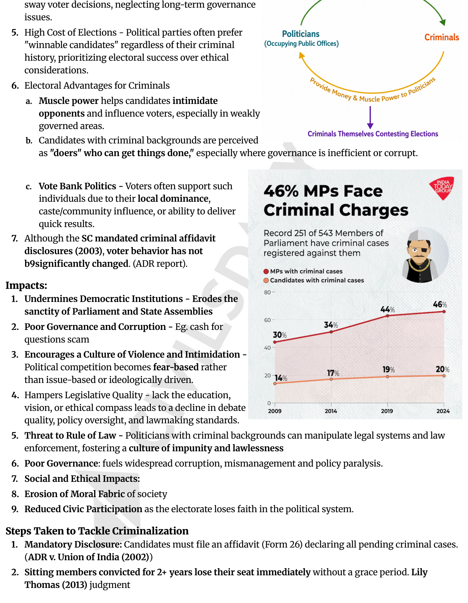
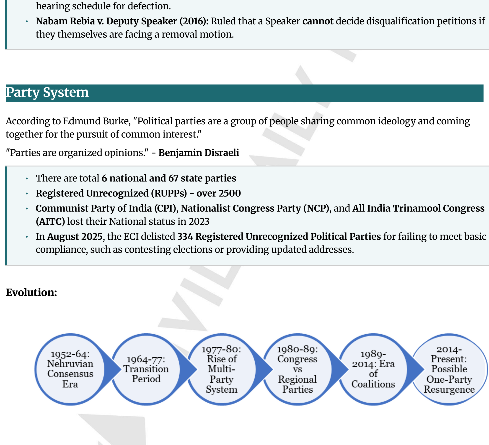

# Elections, Representation of the People Acts, Electoral Reforms, Simultaneous Elections & Anti-Defection Law — Smash Mains Notes (X-Factor Mains'27)

---

### [Smash Mains Source Page 140](../pages/mains/mains_page_140.pdf)

## Chapter 11: Elections

### PYQs

- **[2026]** Is the right to vote a fundamental right? Discuss the position of the Election Commission of India while undertaking the revision of electoral rolls. Can it also examine the question of citizenship of voters? (10)

- **[2025]** Discuss the ‘corrupt practices’ for the purpose of the Representation of the People Act, 1951. Analyze whether the increase in the assets of the legislators and/ or their associates, disproportionate to their known sources of income, would constitute ‘undue influence’ and consequently a corrupt practice. (10)

- **[2024]** Examine the need for electoral reforms as suggested by various committees with particular reference to "one nation -one election" principle. (10)

- **[2022]** Discuss the procedures to decide the disputes arising out of the election of a Member of the Parliament or State Legislature under The Representation of the People Act, 1951. What are the grounds on which the election of any returned candidate may be declared void? What remedy is available to the aggrieved party against the decision? Refer to the case laws. (15)

- **[2022]** Discuss the role of the Election Commission of India in the light of the evolution of the Model Code of Conduct.

- **[2022]** While the national political parties in India favour centralisation, the regional parties are in favour of State autonomy." Comment. (15)

- **[2020]** "There is a need for simplification of procedure for disqualification of persons found guilty of corrupt practices under the Representation of peoples Act" Comment (10)

- **[2019]** On what grounds a people's representative can be disqualified under the Representation of People Act, 1951? Also mention the remedies available to such person against his disqualification. (15)

- **[2018]** In the light of recent controversy regarding the use of Electronic Voting Machines (EVM), what are the challenges before the Election Commission of India to ensure the trustworthiness of elections in India? (10)

> "The ballot is stronger than the bullet." - Abraham Lincoln

> "Elections without discipline are a disaster, elections with integrity are democracy's triumph." - T.N. Seshan (Former CEC) "India's democracy survives not because it is perfect, but because it renews itself at every election." - Ramachandra Guha "Elections in India are less about transferring power and more about reaffirming the idea of India itself." - Pratap Bhanu Mehta

### Constitutional Provisions (Part XV: Articles 324-329)

- **1.** Article 324: Vests the "superintendence, direction, and control" of elections in the ECI for Parliament, State Legislatures, and the offices of President and Vice-President.

- **2.** Article 325: Mandates one general electoral roll. No person can be excluded on grounds of religion, race, caste, or sex.

- **3.** Article 326: Guarantees Universal Adult Suffrage (voting age 18 - 61st Amendment).

- **4.** Article 327: Empowers Parliament to make laws regarding elections. Eg. RPA 1950, 1951.

---

### [Smash Mains Source Page 141](../pages/mains/mains_page_141.pdf)

- **5.** Article 328: Empowers State Legislatures to make laws on elections if Parliament hasn't provided for them.

- **6.** Article 329: Bars courts from interfering in electoral matters (Eg. delimitation), except through an election petition.

### Important Data

| Category | Key Facts |
| --- | --- |
| Voter Base | Approximately 98 crore |
| Voter Turnout | Increased from 44% (1951) → 65.79% (2024) |
| Gender Participation (Voters) | Women voters outnumbered men by 0.23% (2024) |
| Criminal Cases (MPs) | MPs with criminal charges: 24% (2004) → 46% (2024) |
| Women Representation (Candidates & MPs) | 45 women candidates (1957) → 799 (2024) = 9.5% of total - 74 elected (2024) = 13.6% of MPs |
| Political Funding (ADR Data) | - Unknown income sources: 66% (2015-17) → 71% (2019-21) - Electoral Bonds: 56% of donations (2016-21) |
| Black Money & Probes | - 41 firms (₹2,471 crore) to ruling party under probe (CBI, ED, IT) - 30 shell companies purchased bonds worth ₹143 crore |
| Party-wise Electoral Bond Gains | - BJP: ₹6,986.5 crore - TMC: ₹1,397 crore - Congress: ₹615 crore |
| Simultaneous Elections (Logistics) | - EC needs 30 lakh EVMs for nationwide simultaneous polls |
| Simultaneous Elections (Impact) | - 77% chance same party wins Lok Sabha & Assembly elections (IDFC, 2015) |

### Provisions of the Representation of the People Act, 1950

Schedules and Key Sections

- **1.** The First Schedule: Allocation of Seats in the House of the People (Lok Sabha)

  - **a.** Section 3: Governs the allocation of seats to each state and the number of seats reserved for SCs and STs based on census data.

  - **b.** Section 4: Mandates that all seats in the House of the People shall be filled by direct election.

- **2.** The Second Schedule: Total Number of Seats in Legislative Assemblies

  - **a.** Section 7: Determines the total strength of each State Legislative Assembly and the reservation of seats for SCs and STs within those assemblies.

- **3.** The Third Schedule: Allocation of Seats in the Legislative Councils

  - **a.** Section 10: Governs the allocation of seats for states that have a Legislative Council (Vidhan Parishad).

  - **b.** Section 11: Deals with the delimitation of Council constituencies.

- **4.** The Fourth Schedule: List of Local Authorities for Council Elections

  - **a.** Section 27: Identifies the specific local bodies (Municipalities, Zilla Parishads, etc.) whose members form the electoral college for electing members to the Legislative Councils.

---

### [Smash Mains Source Page 142](../pages/mains/mains_page_142.pdf)

Other Key Sections of RPA 1950

- **1.** Section 13A - 13CC: Defines the administrative hierarchy: Chief Electoral Officer (CEO) at the state level, District Election Officer (DEO), and Electoral Registration Officers (ERO).

- **2.** Section 16: Lists disqualifications for registration (Eg. non-citizenship, unsound mind, or crime/corrupt practices).

- **3.** Section 19: Conditions for registration-must be 18+ years of age and an "ordinarily resident" in the constituency.

- **4.** Section 20A: Provisions for Overseas (NRI) Voters to be registered in the electoral rolls.

- **5.** Section 31: Penalty for making false declarations in connection with electoral rolls.

### Representation of the People Act, 1951

- **1.** Section 8: Disqualification on Conviction

  - **a.** Disqualifies a person if convicted of specific offenses (Eg. promoting enmity, rape, or untouchability).

  - **b.** Section 8(3): Any person sentenced to imprisonment for 2+ years is disqualified from the date of conviction and for a further 6 years after release.

- **2.** Section 8A: Disqualification on the ground of Corrupt Practices as determined by a court.

- **3.** Section 9 - Disqualification on the ground of dismissal from government service for corruption or disloyalty.

- **4.** Section 9A: Disqualification on the ground of holding a subsisting contract with the government for the supply of goods or execution of works.

- **5.** Section 10: Disqualification on the ground of being a managing agent, manager, or secretary of a corporation in which the government holds at least 25% share.

- **6.** Section 10A: Disqualification for failure to lodge election expense accounts with the ECI.

- **7.** Section 29A: Mandatory registration of political parties; parties must apply within 30 days of formation.

- **8.** Section 33 & 33A: Candidates must file an affidavit (Form 26) disclosing criminal antecedents, assets, and educational qualifications.

- **9.** Section 77: Every candidate must keep a separate and correct account of all election expenses between the date of nomination and the declaration of result.

- **10.** Section 80-81: Specifies that an election can only be questioned via an Election Petition filed in the High Court within 45 days.

- **11.** Section 100: Grounds for declaring an election void (Eg. if a candidate was not qualified or if corrupt practices were committed).

- **12.** Section 116A - Appeal to Supreme Court against High Court's decision within 30 days

- **13.** Section 123: Corrupt Practices - Lists practices that can invalidate an election: Bribery, Undue Influence, Appeals on grounds of religion/caste, and Booth Capturing.

- **14.** Section 125 - Promoting enmity between groups during elections as punishable offence

- **15.** Section 125A: Penalty for filing false affidavits or concealing information.

- **16.** Section 126: Election Silence-prohibits public meetings/campaigning during the 48 hours ending with the hour fixed for the conclusion of the poll.

- **17.** Section 126A: Restriction on the publication of Exit Polls during the specified period.

---

### [Smash Mains Source Page 143](../pages/mains/mains_page_143.pdf)

### Election Commission of India

ECI, established under Article 324 of the Constitution, oversees the electoral processes for Parliament, State Legislatures, and the executive offices of the President and Vice-President.

### Powers and Functions of ECI

Administrative Functions

- **1.** Delimitation: Determines the territorial areas of electoral constituencies on the basis of the Delimitation Commission Act.

- **2.** Electoral Rolls: Prepares and periodically revises electoral rolls; registers all eligible voters.

- **3.** Election Schedules: Notifies the dates and schedules of elections (General and By-elections).

- **4.** Registration of Parties: Grants recognition to political parties and allots election symbols. Advisory Functions

- **1.** Disqualification: Advises the President and Governor on matters regarding the post-election disqualification of Members of Parliament and MLAs respectively

- **2.** President's Rule: Advises the President on whether elections can be held in a state under President's Rule to extend the period of emergency after one year. Quasi-Judicial Functions

- **1.** Dispute Settlement: Acts as a court for settling disputes related to the granting of recognition to political parties and the allotment of symbols.

- **2.** Inquiry Officers: Appoints officers to inquire into disputes relating to electoral arrangements.

- **3.** Expenditure Monitoring: Disqualifies candidates who fail to lodge their election expenses within the time/manner set by law (Section 10A, RPA 1951). Supervisory Functions

- **1.** Model Code of Conduct (MCC): Ensures strict observance of the MCC by political parties and candidates from the date of election announcement.

- **2.** Monitoring Expenditure: Sets limits and monitors campaign spending to ensure a level playing field.

- **3.** Poll Cancellation: Cancels polls in cases of booth capturing, rigging, violence, or other irregularities.

- **4.** Supervision of Machinery: Directs and controls the entire election staff (including police and civil servants) during the poll period.

### Measures taken by ECI to strengthen the electoral process

- **1.** Electronic Voting Machines (EVMs) & Voter Verifiable Paper Audit Trail (VVPAT)

- **2.** Model Code of Conduct (MCC): to ensure a level playing field, maintaining public order, and preventing practices such as hate speech, vote-buying, and misuse of government resources.

- **3.** ECINET (2026): Launched a "one-stop" digital interface integrating 40+ mobile and web applications to provide a seamless experience for voters and officials.

- **4.** 100% Webcasting: Mandated live webcasting from all polling stations (previously only "sensitive" ones) to monitor critical poll-day activities in real-time.

- **5.** Special Intensive Revision (SIR) 2025: Conducted a massive cleanup of electoral rolls across 12 States, removing deceased voters and duplicate entries for over 51 crore electors. 6. cVIGIL App: Empowered citizens to report MCC violations; the ECI now mandates a 100-minute turnaround time for investigators to respond.

- **7.** National Voters' Services Portal (NVSP): the NVSP helps voters to register, modify, and confirm their electoral details online.

- **8.** Voter Awareness campaigns: Eg. "Chunav ka Parv, Desh ka Garv", for the 2024 LS election.

---

### [Smash Mains Source Page 144](../pages/mains/mains_page_144.pdf)

- **9.** Fast Delivery of EPIC: Implemented a new SOP (2025-26) ensuring that Electronic Photo Identity Cards are delivered within 15 days of an update.

- **10.** Delisting of RUPPs: Delisted over 808 Registered Unrecognised Political Parties (by early 2026) that failed to meet essential conditions, curbing the misuse of tax exemptions.

- **11.** Voter-Centric Booths: Capped voters per booth at 1,200 (down from 1,500) and established "Auxiliary Polling Stations" in high-rise residential complexes.

- **12.** Accessible Voting: Provided Braille-enabled EPICs and free transport for Persons with Disabilities (PwDs), alongside the "Vote-from-Home" facility for senior citizens.

- **13.** Delhi Declaration 2026: Hosted the IICDEM conference leading to a global commitment to clean electoral rolls and ethical technology use (including sharing India's ECINET platform).

### Challenges and Criticisms of the ECI

- **1.** Executive-Led Appointments: The 2023 Act replaced the CJI with a Cabinet Minister in the selection committee.

- **2.** Constitutional limitations

  - **a.** Financial Dependence: Unlike the CAG or SC, the ECI's budget is not "charged" on the Consolidated Fund of India.

  - **b.** Post-Retirement Appointments: There is no constitutional bar on ECs taking government jobs or governorships after their tenure.

  - **c.** Lack of security of tenure for ECs: While the CEC is removed like an SC judge, ECs can be removed on the CEC's recommendation.

- **3.** "Toothless" Model Code (MCC): The MCC lacks statutory backing, making the ECI dependent on "moral suasion" rather than legal force.

- **4.** Impartiality concerns:

  - **a.** Opposition parties frequently allege that the ECI is slower to act against ruling party "Star Campaigners."

  - **b.** Electoral Roll Controversies: Special Intensive Revision (SIR) has faced allegations of "selective disenfranchisement" of specific communities. Eg. press conference by LoP

- **5.** Lack of Deregistration Power: The ECI cannot deregister a political party for violating constitutional principles or failing to contest polls.

- **6.** Data Preservation Issues: The ECI policy to destroy CCTV and webcasting footage after 45 days limits post-election transparency.

- **7.** The rapid rise of AI-generated misinformation outpaces the ECI's current regulatory and technological monitoring capacity.

### Major Supreme Court Judgments

- **1.** Anoop Baranwal v. Union of India (2023): Directed a collegium (PM, LoP, CJI) for appointments until Parliament enacted a law to ensure neutrality.

- **2.** S.S. Dhanoa v. Union of India (1991): Upheld the President's power to abolish the posts of Election Commissioners, highlighting their vulnerable tenure.

- **3.** Mohinder Singh Gill (1978): Confirmed ECI's "plenary powers" under Article 324 to act where the law is silent during elections.

- **4.** ADR v. Union of India (2002): Established the voter's right to know the assets, liabilities, and educational qualifications of candidates.

### Way Forward

- **1.** The Law Commission (255th Report) recommended making ECI expenses "charged" on the Consolidated Fund of India for independence.

---

### [Smash Mains Source Page 145](../pages/mains/mains_page_145.pdf)

- **2.** Both the Tarkunde (1975) and Goswami (1990) Committees suggested that ECs should have the same removal protection as the CEC.

- **3.** The ECI (2016 Reform Proposal) requested the power to deregister parties.

- **4.** 2-year mandatory cooling-off period before retired ECs can accept any government role.

- **5.** Recalling of MPs (UK Model): Implementing a "Recall" mechanism where voters can remove an MP convicted of minor crimes through a petition.

- **6.** The Standing Committee on Personnel (2013) suggested making MCC a part of the RPA 1951 to give it legal "teeth."

- **7.** Permanent Election Tribunal: Establishing a dedicated judicial body to resolve all election petitions within a mandatory 6-month window.

### Model Code of Conduct

The MCC is a set of non-statutory norms agreed upon by political parties to ensure "free and fair" elections by preventing the ruling party from misusing state machinery and curbing unethical campaign practices. Historical Evolution:

- **1.** 1960 (Kerala): Originated as a small set of "Do's and Don'ts" for the Kerala Assembly elections.

- **2.** 1962 (National): Circulated nationwide during the Lok Sabha elections.

- **3.** 1979: A section on the "Party in Power" was added to curb incumbency advantage.

- **4.** 1991: The ECI (under T.N. Seshan) consolidated the MCC into its current robust form.

- **5.** 2014: Guidelines on "Election Manifestos" were added following Supreme Court directions.

### Key Features of the MCC

- **1.** Duration: Becomes effective the moment the ECI announces the election schedule and remains in force until the results are declared.

- **2.** Penalties: The MCC itself has no statutory penal provisions. However, the ECI can issue warnings, censure candidates, or delay polls. Criminal violations (bribery, hate speech) are prosecuted under the RPA 1951 and the BNS 2023 (formerly IPC).

- **3.** Key Provisions:

  - **a.** General Conduct: No caste/communal appeals; no use of places of worship for propaganda.

  - **b.** Party in Power: Prohibition on announcing new schemes, using government aircraft/vehicles for campaigning, or issuing ad-funded achievements.

  - **c.** Campaigning: Meetings and processions require prior police intimation; 48-hour "Election Silence" before polling ends.

### Objectives of the Model Code of Conduct

- **1.** Regulate Party and Candidate Behavior during rallies, speeches, and processions

- **2.** Level Playing Field: Prevents the ruling party from using government machinery

- **3.** Maintaining Purity and fairness of elections

- **4.** Preventing Communal Disharmony: Eg. Notices to "Star Campaigners" for divisive speeches.

- **5.** Curbing Incumbency Advantage: Eg. ban on using state-owned helicopters for campaigning.

- **6.** Regulating Manifestos: Prevents the promise of irrational "freebies"

- **7.** Ensuring Public Order: Eg. advance permission for meetings

- **8.** Ethical Campaigning: Eg. ECI warnings against personal attacks on family of candidates

- **9.** Prohibiting Corrupt Practices: Eg. "Dry Days" 48 hours prior to the close of polling.

---

### [Smash Mains Source Page 146](../pages/mains/mains_page_146.pdf)

### Limitations of the Model Code of Conduct

- **1.** Lack of Statutory Backing ("tiger without teeth")

- **2.** Delayed Action: The ECI's response to violations by top leaders is often perceived as slow.

- **3.** The ECI cannot permanently bar a candidate solely for MCC violations.

- **4.** Digital Disruption: difficult to enforce on social media and encrypted platforms (WhatsApp)

- **5.** Limited Jurisdiction over Media: MCC guidelines for TV/Print are less stringent than for political parties.

- **6.** Freebies Paradox: Distinguishing between "welfare" and "bribes" remains a legal gray area.

- **7.** Inconsistent Enforcement: Eg. Disproportionate number of FIRs filed against independent candidates compared to "Star Campaigners."

### Legalizing the MCC

Arguments In Favour:

- **1.** Clarity - clear, unambiguous guidelines can reduce disputes over what constitutes a violation.

- **2.** Certainty of Punishment: Would provide clear legal consequences (jail/fines) for violations.

- **3.** Better Deterrence: Eg. Criminalizing "Hate Speech" under MCC can act as a stronger barrier.

- **4.** Reduction in post-election Litigation

- **5.** Judicial Oversight: Decisions would be subject to court review, increasing transparency.

- **6.** Defined Timelines: Legal statutes could mandate 24-hour resolution of MCC complaints.

- **7.** Empowerment of ECI: Would grant the ECI the power to disqualify candidates directly.

- **8.** Checks on Social Media: Statutory status can force tech giants to comply with ECI orders.

- **9.** Uniformity: Removes the "discretionary" element of ECI notices.

- Law Commission of India (255th Report, 2015): Recommended that violation of key provisions of the MCC should be made an electoral offence under the RPA, 1951.

- Subhash Kashyap, a noted constitutional expert, supports limited legalisation of MCC to address major violations while keeping flexibility for minor issues. Arguments Against:

- **1.** The SC in Harbans Singh Jalal case opined that legalising MCC may not be a suitable option

- **2.** Judicial Delay in election disputes.

- **3.** Loss of Flexibility: The current "negotiated" nature of MCC allows for quick ECI intervention.

- **4.** Most serious MCC violations (bribery, violence) are already covered under the RPA/BNS.

- **5.** Weaponization of Law: Eg. frivolous FIRs to tie up opponents in court during polls.

- **6.** ECI Autonomy: Can lead to "Judicial Takeover" of the election process.

- **7.** End of Consensus: Parties might refuse to agree to new norms if they are legally binding.

- **8.** Administrative Burden on Police and Judiciary

- **9.** Vagueness: Terms like "decency" and "morality" are hard to define strictly.

- **10.** Conflict with Free Speech: can be challenged as violation of Article 19(1)(a).

### Major SC Judgments on MCC

- **1.** Union of India v. Harbans Singh Jalal (2001): Confirmed that the MCC comes into force the moment the ECI issues the press release announcing the poll dates.

- **2.** S. Subramaniam Balaji v. Govt. of Tamil Nadu (2013): Directed the ECI to include guidelines on Election Manifestos within the MCC to regulate freebies.

---

### [Smash Mains Source Page 147](../pages/mains/mains_page_147.pdf)

- **3.** K.J. Somaiya v. Election Commission of India: Reaffirmed that while the MCC isn't a law, the ECI's power to enforce it is derived from its "plenary powers" under Article 324. Measures taken by ECI

- c-VIGIL App: citizens can report MCC violations. Flying squads to resolve complaints within 100 minutes.

- SUVIDHA Module: A single-window system for political parties to apply for the use of public spaces, maidans, and helipads on a strict "first come, first serve" basis.

- Voluntary Code of Ethics (2019) for social media platforms (like Meta, Google, X) to process legal requests from the ECI within 3 hours during the 48-hour silence period.

### Way Forward

- **1.** "Paid News" and surrogate digital advertising should be explicitly classified as a "Corrupt Practice" under RPA, 1951. (255th Law Commission Report)

- **2.** Section 126 of RPA (ban on campaigning 48 hours before polling) should include the internet, social media, and OTT platforms. (Umesh Sinha Committee)

- **3.** Independent Secretariat: Grant ECI an independent budget and secretariat to reduce reliance on the Law Ministry (Law Commission 255th Report).

- **4.** Statutory Status for Specific Parts: Legalize only sections related to misuse of state machinery while keeping "Conduct" consensual.

- **5.** Establish dedicated election benches in High Courts to resolve MCC-related criminal cases within 30 days.

- **6.** Mandatory AI Watermarking: Global best practice (Eg. EU AI Act) should be adopted to trace digital misinformation during polls.

- **7.** Deregistration Power: Amend the RPA to allow ECI to deregister parties for chronic and severe MCC violations.

### Criminalization of Politics

- **1.** As per ADR, in 18th LS, a record 251 (46%) of the 543 newly elected members have criminal cases registered against them and 27 of them have been convicted. (30% in 15th LS).

- **2.** 31% of MPs and 29% of MLAs have declared serious criminal charges against them.

- **3.** 54% of MPs from UP have criminal cases registered against them

- **4.** Candidates with criminal records have a 15.5% chance of winning, compared to just 4.7% for those with clean records. (ADR)

- **5.** 90% of candidates with criminal cases are "crorepatis" (millionaires). (ADR)

### Reasons

- **1.** Politician-Criminal Nexus - NN Vohra Committee Report, 1993 stated that the cost of contesting elections made politicians depend on the underworld network.

- **2.** Inefficient Legal System: mere 6% conviction rate for politicians involved in crimes. Over 5,000 cases against MPs/MLAs are currently pending in various special courts.

- **3.** Weak Intra - Party Democracy: Centralized candidate selection often overlooks local objections, promoting candidates with criminal records due to their winnability.

---

### [Smash Mains Source Page 148](../pages/mains/mains_page_148.pdf)

*Diagram Screenshot: [Criminalization of Politics: Politician-Criminal Nexus & 46% MPs Facing Criminal Charges](../diagrams/mains_diag_criminalization_politics_p148.png) · [Full Source Page 148](../pages/mains/mains_page_148.pdf)*

- **4.** Voter Apathy and Ignorance: In disadvantaged areas, immediate benefits from criminal-backed candidates sway voter decisions, neglecting long-term governance issues.

- **5.** High Cost of Elections - Political parties often prefer "winnable candidates" regardless of their criminal history, prioritizing electoral success over ethical considerations.

- **6.** Electoral Advantages for Criminals

  - **a.** Muscle power helps candidates intimidate opponents and influence voters, especially in weakly governed areas.

  - **b.** Candidates with criminal backgrounds are perceived as "doers" who can get things done," especially where governance is inefficient or corrupt.

  - **c.** Vote Bank Politics - Voters often support such individuals due to their local dominance, caste/community influence, or ability to deliver quick results.

- **7.** Although the SC mandated criminal affidavit disclosures (2003), voter behavior has not significantly changed. (ADR report).

### Impacts

- **1.** Undermines Democratic Institutions - Erodes the sanctity of Parliament and State Assemblies

- **2.** Poor Governance and Corruption - Eg. cash for questions scam

- **3.** Encourages a Culture of Violence and Intimidation - Political competition becomes fear-based rather than issue-based or ideologically driven.

- **4.** Hampers Legislative Quality - lack the education, vision, or ethical compass leads to a decline in debate quality, policy oversight, and lawmaking standards.

- **5.** Threat to Rule of Law - Politicians with criminal backgrounds can manipulate legal systems and law enforcement, fostering a culture of impunity and lawlessness

- **6.** Poor Governance: fuels widespread corruption, mismanagement and policy paralysis.

- **7.** Social and Ethical Impacts:

- **8.** Erosion of Moral Fabric of society

- **9.** Reduced Civic Participation as the electorate loses faith in the political system.

### Steps Taken to Tackle Criminalization

- **1.** Mandatory Disclosure: Candidates must file an affidavit (Form 26) declaring all pending criminal cases. (ADR v. Union of India (2002))

- **2.** Sitting members convicted for 2+ years lose their seat immediately without a grace period. Lily Thomas (2013) judgment

---

### [Smash Mains Source Page 149](../pages/mains/mains_page_149.pdf)

- **3.** Publicity of Records: Parties must publish criminal backgrounds of candidates on their websites and in newspapers.

- **4.** Establishment of 12+ Special Courts dedicated to to dispose of cases within one year of charges being framed.

- **5.** Voter Awareness: ECI's "Know Your Candidate" (KYC) app

- **6.** PUCL v. UoI (2013) introduced NOTA to pressure parties into fielding clean candidates.

- **7.** Strict enforcement of the 48-hour silence period under MCC to curb corrupt practices

- **8.** Capping Expenditure: ECI periodically raises spending limits to encourage legal funding over "black money" usage. Eg. Recent hike to ₹95 lakh for major Lok Sabha constituencies.

- **9.** Striking Down Sec 8(4): stay on "sentence" doesn't stop disqualification. Only stay on "conviction" works.

- **10.** Digital Surveillance: Integrated cVIGIL app reports allow citizens to report violation of MCC Other SC judgments

- Rambabu Singh Thakur v. Sunil Arora (2020): Parties must explain why they chose a candidate with criminal antecedents over others.

- Ashwini Upadhyay v. UoI (2021): Ordered that criminal cases against legislators cannot be withdrawn by State Governments without High Court permission.

### Various Recommendations

- **1.** Barring at Charge-sheet Stage: The Law Commission (244th Report) recommended barring candidates if "charges are framed" for heinous crimes.

- **2.** Lifetime Ban: Implement a permanent ban on convicted persons from contesting, as suggested by the Election Commission.

- **3.** Intra-Party Reforms: Enact a law making it mandatory for parties to have internal democracy and transparent candidate selection.

- **4.** Partial State Funding of Elections: Explore the Indrajit Gupta Committee report to reduce reliance on "black money" strongmen.

- **5.** False Affidavit Punishment: Increase jail time for hiding criminal records from 6 months to 2 years (triggering disqualification).

- **6.** Dinesh Goswami Committee - Strengthen enforcement and provide statutory status to MCC

### Special Intensive Revision (SIR)

SIR is a focused, time-bound house-to-house enumeration process where Booth Level Officers (BLOs) physically visit households. Unlike the routine annual "Summary Revision," SIR involves physical door-to-door verification of every single voter entry to ensure the integrity of the democratic process. Objectives

- **1.** Verify the physical presence and residency of every registered voter.

- **2.** Remove "Ghost Voters" (deceased, duplicate, or permanently shifted).

- **3.** Register newly eligible citizens (who turned 18) or previously missed residents.

- **4.** Incorporate high-security Electors Photo Identity Cards (EPIC) with 100% coverage. History of SIR in India

- **1.** The first intensive revisions were conducted between 1952-1956 to create the nascent nation's first reliable voter database.

---

### [Smash Mains Source Page 150](../pages/mains/mains_page_150.pdf)

- **2.** SIR has been conducted approximately 14 times in India's history (Eg. 1983, 1995, 2002, 2004, and the current 2025-26 cycle). Legal Provisions

- **1.** Article 324: Grants the ECI the power of "superintendence, direction, and control" over electoral rolls.

- **2.** Representation of the People Act, 1950 (Section 21): Authorizes the ECI to carry out a special revision of the electoral roll at any time for reasons recorded in writing.

- **3.** The Registration of Electors Rules, 1960: Lays down the specific procedural framework for house-to-house enumeration and verification.

- Phase II resulted in a 10.2% reduction in total electors (from 51 crore down to 45.8 crore).

- UP recorded highest net deletion of ~2.05 crore names (13.2% of the state's electorate).

- West Bengal: Purged 91 lakh voters since October 2025

- Bihar: Approximately 47 lakh voters (6% of the electorate) were removed.

### Need for Special Intensive Revision (SIR)

- **1.** Purifying the Rolls: Eliminates "Ghost Voters" who have died or shifted.

- **2.** Preventing Voter Impersonation: 100% physical verification ensures that no one can vote on behalf of a deceased person.

- **3.** Inclusion of Marginalized Groups: Door-to-door visits reach remote tribes or women who may not go to registration centers.

- **4.** Prepares the base for upcoming reforms like the Common Electoral Roll for all three tiers.

- **5.** Ensures only legal citizens are on the roll, a critical mandate under Section 16 of RPA.

- **6.** Provides accurate population-to-voter ratios ahead of the post-2026 delimitation exercise.

- **7.** Regular "cleansing" of the list builds public trust in the "One Person, One Vote" principle.

- **8.** Tracks rural-to-urban migration patterns to adjust polling booth locations and resources.

### Major Challenges in SIR Exercise

- **1.** Risk of Disenfranchisement: Rapid, top-down deletions can mistakenly remove legitimate, poor, or homeless citizens.

- **2.** Administrative Overburden: Booth Level Officers (BLOs) are overwhelmed by tough targets and tight deadlines. Eg. cases of suicides in WB

- **3.** Documentation Hurdles: Requirement of "legacy documents" or birth certificates excludes those without formal records.

- **4.** Political Misuse: Allegations that deletions are used by ruling parties to target specific voter blocks.

- **5.** Verification Subjectivity: BLOs may exercise personal bias during house visits, leading to arbitrary "shifted" markings.

- **6.** Delayed Grievance Redressal: Eg. Only a fraction of the 6 million claims in WB were resolved before poll-freeze.

- **7.** Voter Apathy/Fear: Many residents refuse to provide documents, fearing a "Stealth NRC" or citizenship test.

- **8.** Technological Gaps: Offline data collection by BLOs often leads to manual entry errors during final digital uploading.

### Major Supreme Court Judgments

- **1.** Lal Babu Hussein v. Electoral Registration Officer (1995): Held that the right to be on the electoral roll is not just a statutory right but a key part of democratic participation.

---

### [Smash Mains Source Page 151](../pages/mains/mains_page_151.pdf)

- **2.** Election Commission of India v. Ashok Kumar (2000): Affirmed that the ECI has plenary powers to ensure error-free rolls, provided it follows natural justice.

- **3.** Association for Democratic Reforms v. ECI (2026): The SC emphasized that "conclusive determination" of voter eligibility must not be sacrificed for "procedural timelines."

### Way Forward

- **1.** Automatic Deletion via Death Registry: Link the Civil Registration System (CRS) directly to voter rolls to remove the dead automatically.

- **2.** Provide BLOs with tablets for Geo-tagged house verification to prevent "fake" site visits.

- **3.** Permanent Appellate Tribunals: Establish year-round judicial tribunals for voter rolls instead of last-minute temporary setups.

- **4.** Independent Audit: Allow Civil Society Organizations to conduct post-revision sample audits to check for bias.

- **5.** Flexible Documentation: Accept a wider range of residency proofs (like electricity bills or community certificates).

- **6.** Use blockchain to track the audit trail of every deletion, making officials accountable for arbitrary removals.

### Proxy voting in India

Proxy Voting is a facility where a registered voter can delegate their voting power to a representative (proxy) to cast the vote on their behalf. Currently, proxy voting is strictly limited to "Classified Service Voters" (CSVs). This includes:

- **1.** Armed Forces: Members of the Army, Navy, and Air Force.

- **2.** Paramilitary Forces: Members of the BSF, CRPF, CISF, ITBP, etc.

- **3.** State Armed Police: Personnel serving outside their state.

- **4.** Government Employees: Those posted abroad in Indian Missions.

- **5.** Spouses: The spouse of a service voter (if residing with them) is also eligible for the proxy facility.

- **6.** While the Representation of the People (Amendment) Bill to allow NRIs proxy voting has been discussed, the primary legal mechanism for overseas voters remains in-person voting or the Electronically Transmitted Postal Ballot System (ETPBS).

### Legal Provisions

- **1.** Representation of the People Act, 1951: Section 60 was amended in 2003 to allow for the appointment of a proxy by service voters.

- **2.** Conduct of Election Rules, 1961: Rules 27L to 27V lay down the specific procedure for appointing, revoking, and voting via proxy.

- **3.** Form 13F: The legal instrument used to nominate a proxy, which must be signed before a First Class Magistrate or a Notary.

### Benefits of Proxy Voting

- **1.** Ensuring Franchise Rights to service voters

- **2.** Avoids the "postal delay"- proxy voting ensures the vote is cast on election day itself day.

- **3.** Administrative Ease: Reduces burden on ECI to set up booths in restricted military areas.

- **4.** Gender Neutrality: Recent amendments (2025-26) replaced "wife" with "spouse", allowing male spouses of female officers equal rights.

---

### [Smash Mains Source Page 152](../pages/mains/mains_page_152.pdf)

- **5.** Constitutional Validity: Upholds Article 326

- **6.** Reliability: Proxies are usually family members, ensuring the voter's trust is maintained in the choice made.

- **7.** Cost-Effective for Voters: Saves the financial burden of travel to vote.

### Major Challenges in Proxy Voting

- **1.** Violation of "Secret Ballot" principle

- **2.** "One Man, One Vote" Risk: A single person acting as a proxy for multiple people.

- **3.** Trust Deficit: Political parties often object to proxy voting, fearing it could be used for "proxy booth capturing."

- **4.** Exclusion of Domestic Migrants: Currently, the facility is for service voters only, leaving 45 crore internal migrants without options.

- **5.** Potential for Fraud: Forged identity documents to impersonation at the polling booth.

- **6.** Administrative Complexity: Maintaining a separate "Proxy Register" at every booth increases the workload of the Booth Level Officer.

### Way Forward

- **1.** Move toward Electronic Postal Ballots (ETPBS).

- **2.** Explore blockchain-based remote voting to eliminate the need for a physical proxy.

- **3.** French Model: voter can give "Power of Attorney" to any other registered voter via a simple police-verified form.

- **4.** Use Aadhaar-based biometric checks for proxies at the booth.

- **5.** Extend proxy facilities to senior citizens (80+) and PwDs to improve accessibility.

### Hate Speeches

- **1.** Law Commission (267th Report): Defines hate speech as an incitement to hatred primarily against a group of persons defined in terms of race, ethnicity, gender, sexual orientation, or religious belief.

- **2.** UN Framework: Characterizes it as any communication that attacks or uses pejorative/discriminatory language against a person/group based on "who they are."

- India Hate Lab Report (January 2026): Recorded a 13% rise in hate speech incidents in 2025 (1,318 events) compared to 2024 (1,165 events). (668 in 2023)

- Odisha and Karnataka proposed dedicated "Hate Speech and Hate Crimes (Prevention) Acts" to fill gaps in the Bharatiya Nyaya Sanhita (BNS).

- Approximately 98.5% of these incidents targeted Muslims

- As per Association for Democratic Reforms (ADR) and National Election Watch (NEW), 107 MPs and MLAs have hate speech cases registered against them.

### Legal Provisions in India

- **1.** Bharatiya Nyaya Sanhita, 2023: Section 196 (formerly IPC 153A) penalizes promoting enmity between groups; Section 299 (formerly IPC 295A) punishes acts outraging religious feelings.

- **2.** Representation of the People Act (RPA), 1951: Sections 123(3A) and 125 classify the promotion of enmity as a "corrupt practice" and an electoral offense.

- **3.** SC/ST Act, 1989: Penalizes hate speech targeting Scheduled Castes or Tribes in public view.

---

### [Smash Mains Source Page 153](../pages/mains/mains_page_153.pdf)

### Reasons

- **1.** Vote Bank Politics - "Us vs. Them" narratives are crafted to consolidate vote banks

- **2.** Used as strategic tools to divert attention from governance failures or corruption.

- **3.** Deep-rooted religious and caste identities create fertile ground for identity-based rhetoric.

- **4.** Social Media Amplification - Hate speech spreads virally, driven by algorithms that favor sensationalism.

- **5.** Weak Legal Enforcement - selective, delayed, or politically influenced enforcement of laws

- **6.** Media Sensationalism - it gets prime-time coverage, providing a platform for provocative figures

- **7.** Growth of religious nationalism and cultural majoritarianism emboldens hate speech. Eg. "defense of culture" narratives.

- **8.** Competitive Populism - near elections parties compete to appear "strong" on identity issues

### Impact

- **1.** Threat to Social Harmony and Communal Peace - Eg. Muslim Migration after Muzaffarnagar (2013) riots

- **2.** Policy Distortion: Eg. Legislative focus on "Land Jihad" laws over economic or developmental issues.

- **3.** Economic Boycotts: Speeches often include calls for the financial exclusion of minority-run businesses.

- **4.** Psychological Harm: Eg. Dehumanizing language like "parasites" causes deep social alienation among minority youth.

- **5.** Undermines the principles of secularism, equality, and fraternity enshrined in the Constitution.

- **6.** Erodes Rule of Law - Repeated hate speeches with no consequences create a culture of impunity.

- **7.** Destabilizes Governance and Public Order - Hate speech provokes mob violence or vigilante attacks.

- **8.** Misinformation and Radicalization via Social Media, leading to echo chambers and mob mentality.

- **9.** Shrinks Civic Space and Free Expression - Critics of hate speech face online abuse, threats, or violence.

- **10.** Damages India's Global Image as a tolerant, pluralistic democracy.

- **11.** Long-Term Societal Impact - Normalizes prejudice, discrimination, and dehumanization.

### Steps Taken

- **1.** Suo Motu Action: The SC (Shaheen Abdulla v. UoI) directed police to register FIRs even without a complaint.

- **2.** C-Vigil App: ECI's tool for citizens to report "inflammatory speeches" with a 100-minute response time.

- **3.** ECINET Social Media Cells: Specialized units (2025-26) to track and request take-downs of viral hate content.

- **4.** Nodal Officers: Appointment of district-level officers to prevent mob violence and hate gatherings (Tehseen Poonawalla guidelines).

- **5.** Temporary Campaign Bans: ECI (2026) used "silent periods" and 72-hour bans for repeat hate-speech offenders.

- **6.** State-level Bills: Introduction of the Odisha Hate Speech Bill (2026) with 7-year jail terms.

- **7.** Media Ethics Guidelines: NBA and ECI (2025) issued fresh codes to stop TV channels from hosting divisive debates.

### Supreme Court Judgments

- **1.** Shaheen Abdulla v. Union of India (2022/2023): Mandated police to take Suo Motu action against hate speech regardless of religion.

- **2.** Shreya Singhal v. UoI (2015): Differentiated between "advocacy" and "incitement," holding only the latter as punishable.

---

### [Smash Mains Source Page 154](../pages/mains/mains_page_154.pdf)

- **3.** Pravasi Bhalai Sangathan (2014): Urged the Law Commission to define hate speech to avoid judicial overreach.

- **4.** Tehseen Poonawalla v. UoI (2018): Issued comprehensive guidelines against lynching and mob speech, including nodal officers.

### Way Forward

- **1.** Use the UN's 6-part test (Context, Speaker, Intent, Content, Extent, Likelihood) to identify hate speech.

- **2.** Statutory Status for MCC: Give the ECI the legal power to deregister parties for chronic hate-speech violations.

- **3.** Fast-Track Courts: Establish dedicated benches to resolve hate-speech cases within 6 months to prevent "electoral gain."

- **4.** Media Literacy: Integrate "propaganda identification" into the NCERT curriculum

- **5.** Mandatory Sensitivity Training: For police and magistrates to identify "othering" narratives accurately.

### Opinion Polls and Exit Polls

While Opinion Polls (conducted before voting) and Exit Polls (conducted after voters leave the booth) provide data-driven insights, they have potential to sway the elections..

### Legal Provisions

- **1.** Section 126(1)(b) of RPA, 1951: Prohibits the display of any "election matter" (including Opinion Polls) on TV or similar apparatus during the 48-hour "Silence Period" before the conclusion of the poll.

- **2.** Section 126A of RPA, 1951: Specifically restricts Exit Polls. It prohibits the conduct and dissemination of exit poll results from the commencement of the first phase of polling until half an hour after the close of polling in the final phase.

- **3.** Penalty: Violation of Section 126A is punishable by up to two years of imprisonment, a fine, or both.

- **4.** Article 324: The Election Commission (ECI) uses its plenary powers to issue guidelines for print media (which is not strictly covered by Sec 126) to ensure they don't publish polls during the prohibited window.

### Objectives of Opinion and Exit Polls

- **1.** Voter Sentiment Mapping

- **2.** Early Result Indication

- **3.** Demographic Analysis

- **4.** Issue Identification

- **5.** Campaign Success Assessment

- **6.** Democratic Engagement

- **7.** Academic/Sociological Research

- **8.** Fraud Deterrence (Indicator of anomalies)

### Issues with Opinion and Exit Polls in India

- **1.** The "Bandwagon Effect": Polls can influence undecided voters to "join the winner," distorting free choice.

- **2.** Sampling Errors: Eg. Many 2024 polls used samples of <0.1% of the electorate, leading to significant seat-projection misses.

- **3.** Media Sensationalism: Channels often present "raw data" as "final seats" to increase TRPs, causing public confusion.

---

### [Smash Mains Source Page 155](../pages/mains/mains_page_155.pdf)

- **4.** Lack of Transparency: Most agencies do not disclose their methodology, weighting, or funding sources.

- **5.** Stock Market Volatility: Premature or inaccurate exit polls lead to massive fluctuations in the sensex/nifty.

- **6.** "Paid Polls" Risk: Potential for political parties to fund "biased polls" to demoralize opposition cadres.

- **7.** Complexity of Multi-Phase Elections: Exit polls for Phase 1 can indirectly influence voters in Phase 7 if leaked.

- **8.** Voter Fatigue: Constant polling and "doorstep surveys" lead to voter irritation and dishonest responses.

- **9.** Inadequate Rural Representation: "Urban Bias" in sample collection.

### Way Forward

- **1.** Mandate agencies to publish sample size, margin of error, and funding alongside results.

- **2.** Empower ECI to audit the methodologies of polling agencies to ensure scientific rigor.

- **3.** Rules to prevent "insider trading" based on advance knowledge of exit poll data.

- **4.** Establish a Professional Body for Pollsters (like the AAPOR in the USA) to set ethical codes.

- **5.** Voter Literacy: ECI campaigns to educate voters that polls are predictions, not results.

- **6.** Encourage University-led polling (like CSDS-Lokniti) which is traditionally more transparent.

- **7.** Digital Watermarking of "official" poll graphics to prevent the spread of fake/edited polls.

### Disqualification of candidates

Grounds for Disqualification under RPA, 1951

- **1.** Conviction for Specific Offenses (Section 8):

- **2.** Corrupt Practices (Section 8A)

- **3.** Dismissal for Corruption (Section 9)

- **4.** Government Contracts (Section 9A)

- **5.** Failure to Lodge Election Expenses (Section 10A)

- **6.** False Affidavit (Section 125A) Grounds for Declaring an Election Void (Section 100) by HC

- **1.** Lack of Qualification (Sec 100(1)(a)): On the date of the election, the candidate was not qualified or was disqualified under the Constitution or the RPA.

- **2.** Corrupt Practices (Sec 100(1)(b)): Any corrupt practice (as defined in Section 123) was committed by the candidate, their election agent, or any other person with their consent. Eg. Bribery, undue influence, or appealing to religion/caste.

- **3.** Improper Rejection (Sec 100(1)(c)): Any nomination was improperly rejected by the Returning Officer.

- **4.** Materially Affected Result (Sec 100(1)(d)): The result was "materially affected" by:

  - **a.** Improper acceptance of any nomination.

  - **b.** Corrupt practices by an agent (without the candidate's consent).

  - **c.** Improper reception or refusal of any vote.

  - **d.** Non-compliance with the Constitution or the Act/Rules.

### Procedure for Disqualification

- **1.** At the Nomination Stage:

  - **a.** Scrutiny (Section 36): The Returning Officer (RO) examines nomination papers. If the candidate is disqualified under the Constitution or RPA, the RO rejects the nomination.

- **2.** For Sitting Members:

---

### [Smash Mains Source Page 156](../pages/mains/mains_page_156.pdf)

  - **a.** Immediate Disqualification: Per the Lily Thomas (2013) judgment, any member convicted for 2+ years stands disqualified immediately, without the 3-month grace period previously allowed.

  - **b.** Constitutional Authority: The final decision rests with the President (for MPs) or the Governor (for MLAs), who must act as per the mandatory advice of the Election Commission (Articles 103 and 192).

- **3.** Election Petition (Section 80): A post-election procedure where a voter or candidate challenges the result in the High Court within 45 days.

  - **a.** Who can file? A candidate or any elector of the constituency can challenge the election.

  - **b.** Trial Procedure (Section 86-87):

  - **c.** The High Court must endeavor to conclude the trial within six months.

  - **d.** The High Court has the power to dismiss a petition summarily if it does not comply with the provisions of the Act (Eg. failure to join necessary parties). Examples of Election Petitions:

- Mamata Banerjee (2021), filed an election petition in the Calcutta High Court challenging the results of the Nandigram Assembly election.

- Allahabad High Court invalidated Indira Gandhi's election from Rae Bareli due to allegations of corruption.

- Congress leader C P Joshi filed an election petition after losing the 2008 Rajasthan Assembly election by a single vote.

### Remedial Measures Available

- **1.** Stay on Conviction (Not just Sentence):

  - **a.** To stop or reverse an automatic disqualification under Section 8, the candidate must obtain a stay on the conviction from an appellate court.

  - **b.** Eg. In 2023, the Supreme Court stayed the conviction of Rahul Gandhi in a defamation case, which subsequently restored his Lok Sabha membership.

- **2.** Election Petition against RO's Decision: If a nomination is rejected, the candidate cannot immediately go to court due to Article 329(b). They can file an Election Petition in HC after the election (Section 80) within 45 days. If successful, the election of the winner is declared void, and a by-election may be ordered.

- **3.** Appeals (Section 116A): Decisions of the High Court on election petitions can be appealed to the Supreme Court within 30 days.

- **4.** Power of the Election Commission (Section 11):

  - **a.** The ECI has the power to remove or reduce the period of disqualification (except for those disqualified under Section 8A for corrupt practices).

  - **b.** Eg. The ECI reduced the disqualification period of a former Sikkim Chief Minister to allow him to contest elections.

- **5.** Representation to the ECI (Section 10A cases): If disqualified for failing to file expense accounts, the candidate can apply to the ECI for a "removal of disqualification" by showing "sufficient reason" for the delay or failure.

### Challenges Related to Legislative Disqualification

- **1.** Low Conviction Rate: The conviction rate for MPs/MLAs is only 6%.

- **2.** Ambiguity in Grounds for Disqualification

---

### [Smash Mains Source Page 157](../pages/mains/mains_page_157.pdf)

  - **a.** Multiple Sources of Disqualification: Articles 102 and 191 of the Constitution, the Representation of the People Act, 1951, and the Tenth Schedule (Anti-Defection Law). This multiplicity often leads to confusion and interpretational disputes.

  - **b.** Vague definition of corrupt practices (Sec. 123) leads to inconsistent rulings.

  - **c.** Ambiguity in the office of profit causes arbitrary disqualifications. Eg. Delhi (2018): 20 AAP MLAs disqualified, later reinstated.

- **3.** Legal and Constitutional Loopholes

  - **a.** No Interim Measures: There's no provision to suspend a legislator's functions pending the outcome of disqualification proceedings.

  - **b.** Conflict of Roles: The dual role of political and constitutional actors (like the Speaker or Governor) creates conflicts of interest.

- **4.** Loopholes in anti-defection law

  - **a.** Delays in decisions

  - **b.** Political bias of the Speaker

- **5.** Judicial delays prolong uncertainty in representation. Eg. Shiv Sena case pending since 2022

### Recommendations for the Future

Law Commission of India

- **1.** 244th Report (2014):

  - **a.** Disqualify candidates at the stage of framing of charges (serious offences with ≥5 years punishment).

  - **b.** Exempt cases where charges are filed within 1 year before elections to prevent misuse.

  - **c.** Mandate fast-track courts to conclude trials of legislators within a year.

  - **d.** Introduce stricter penalties for false affidavits, including criminal penalties (≥2 years).

- **2.** 255th Report (2015):

  - **a.** Shift decision-making on defection from Speaker to President/Governor, acting on Election Commission's advice.

  - **b.** Suggested repealing the merger clause (two-thirds provision). Election Commission of India

- **1.** Advocates charge-sheet-based disqualification for serious criminal offences.

- **2.** Endorses binding time limits for decision-making on disqualification matters. Parliamentary & Other Committees

- **1.** Dinesh Goswami Committee (1990): Delete provisions allowing group defections.

- **2.** NCRWC (2002):

  - **a.** Suggests independent tribunals for adjudicating disqualification.

  - **b.** Recommends constructive vote of no confidence to maintain stability.

- **3.** 2nd Administrative Reforms Commission (ARC, 2007):

  - **a.** Anti-defection law should apply only to votes impacting government survival.

  - **b.** Define ambiguous terms like "office of profit" and "voluntarily give up membership." SC Judgments Related to Disqualification:

- Lily Thomas v. Union of India (2013): Struck down Section 8(4) of RPA, making disqualification immediate upon a 2+ year conviction.

- Kihoto Hollohan v. Zachillhu (1992): Declared the Speaker a "Tribunal" for defection cases, making their decisions subject to Judicial Review.

---

### [Smash Mains Source Page 158](../pages/mains/mains_page_158.pdf)

*Diagram Screenshot: [Evolution of the Party System in India Timeline](../diagrams/mains_diag_party_system_evolution_p158.png) · [Full Source Page 158](../pages/mains/mains_page_158.pdf)*

- Public Interest Foundation v. Union of India (2018): Directed Parliament to legislate to bar criminals from contesting; mandated candidates to publicize criminal antecedents.

- Abhiram Singh v. C.D. Commachen (2017): Held that appealing for votes based on religion or caste is a "corrupt practice" (Sec 123).

- Keisham Meghachandra v. Hon'ble Speaker Manipur (2020): Ruled that the Speaker must decide disqualification petitions within a "reasonable time" (3 months).

- Padi Kaushik Reddy v. State of Telangana (2025): The SC fixed a 4-week timeline for Speakers to set a hearing schedule for defection.

- Nabam Rebia v. Deputy Speaker (2016): Ruled that a Speaker cannot decide disqualification petitions if they themselves are facing a removal motion.

### Party System

According to Edmund Burke, "Political parties are a group of people sharing common ideology and coming together for the pursuit of common interest."

> "Parties are organized opinions." - Benjamin Disraeli

- There are total 6 national and 67 state parties

- Registered Unrecognized (RUPPs) - over 2500

- Communist Party of India (CPI), Nationalist Congress Party (NCP), and All India Trinamool Congress (AITC) lost their National status in 2023

- In August 2025, the ECI delisted 334 Registered Unrecognized Political Parties for failing to meet basic compliance, such as contesting elections or providing updated addresses.

### Evolution

### Recognition of political parties

Criteria for Recognition as a National Party

- **1.** Four-State Rule: The party is recognized as a "State Party" in at least four states.

- **2.** Performance in Lok Sabha & Assembly: The party wins at least 6% of the total valid votes in any four or more states in a General Election (Lok Sabha or State Assembly) AND, in addition, it wins at least four seats in the Lok Sabha from any state or states.

- **3.** Three-State Lok Sabha Rule: The party wins at least 2% of the total seats in the Lok Sabha (11 seats out of 543), and these members are elected from at least three different states.

---

### [Smash Mains Source Page 159](../pages/mains/mains_page_159.pdf)

Criteria for Recognition as a State Party

- **1.** The party secures at least 6% of the valid votes polled in the State Legislative Assembly election AND wins at least two seats in that Assembly.

- **2.** The party secures at least 6% of the valid votes polled in the state during a Lok Sabha General Election AND wins at least one seat in the Lok Sabha from that state.

- **3.** The party wins at least 3% of the total number of seats in the Legislative Assembly OR at least three seats in the Assembly, whichever is more.

- **4.** The party wins at least one seat in the Lok Sabha for every 25 seats (or any fraction thereof) allotted to that state.

- **5.** If a party fails to win any seats but secures at least 8% of the total valid votes polled in the state (either in Lok Sabha or Assembly elections), it is eligible for State Party status. Key Benefits of Recognition

- **1.** Exclusive Symbols: National parties have a reserved symbol used across India. State parties have a reserved symbol for use within that specific state.

- **2.** Free Airtime: free broadcast time on Akashvani (AIR) and Doordarshan during elections.

- **3.** Electoral Rolls: Recognized parties receive two free copies of the electoral rolls.

- **4.** Star Campaigners: They are allowed up to 40 star campaigners (unrecognized parties get only 20), whose travel expenses are not added to the candidate's election budget.

- **5.** Eligible for government land/bungalows for party headquarters at subsidized rates.

### Significance of the Party System in a Democracy

- **1.** Institutionalization of Political Competition (Sartori)

- **2.** Act as a link Between State and Citizens, ensuring participation and pluralism.

- **3.** Simplifies Political Choice (Duverger) - simplify voter decisions by organizing ideologies and candidates under identifiable labels. Eg. BJP's hindutva vs. Congress's secularism

- **4.** Collective accountability - Voters can reward or punish parties in government. Eg. Voters punished UPA in 2014 for corruption issues.

- **5.** Promotes Political Socialization (David Easton) - Eg. Youth wings like NSUI, ABVP train future leaders.

- **6.** Aggregates and Articulates Interests - Almond & Verba (Civic Culture) - Parties convert diverse interests into coherent policies in their manifesto.

- **7.** Provides a legitimate channel for dissent through organized opposition in Parliament.

- **8.** Institutionalized party systems ensure predictable competition and government stability.

- **9.** Representation of Diversity - Parties allow minorities and regions to participate through inclusive, coalition-based politics.

- **10.** Samuel Huntington (Political Order Theory) - Parties channel social conflicts into legitimate political competition, preventing instability.

- **11.** Facilitates Peaceful Transfer of Power - Party competition provides a stable mechanism for leadership change without violence.

### Issues with Party System in India

- **1.** Rise of Personality-Driven and Dynastic Politics - Eg. RJD, DMK.

- **2.** Criminalization of Politics - As per ADR, 46% of sitting Lok Sabha MPs face criminal charges, with 31% involving serious offences like murder, attempt to murder, and rape.

- **3.** Weak Intra-Party Democracy - Most parties lack internal elections, policy debates, or grassroots involvement. Eg. high command culture

---

### [Smash Mains Source Page 160](../pages/mains/mains_page_160.pdf)

- **4.** Lack of Transparency in Candidate Selection - opaque ticket distribution processes favor wealthy, connected, or loyal candidates over capable ones.

- **5.** Defections - Eg. "Horse trading" during floor tests or Rajya Sabha elections.

- **6.** Regionalization and Fragmentation - Proliferation of regional parties has led to coalition politics and policy paralysis. Eg. UPA-II

- **7.** Decline of Mass-Based Party Structures

  - **a.** Christophe Jaffrelot highlights the decline of ideology-driven mass movements and rise of electoral machines.

  - **b.** Many parties are no longer rooted in social movements or worker participation (Eg. decline of CPI(M) cadre model).

- **8.** Frequent suspensions, limited speaking time, and surveillance have weakened the deliberative function of opposition parties.

- **9.** Yogendra Yadav - identity-based mobilization (caste, religion, region) has overtaken program-based politics.

- **10.** Erosion of Party Ideologies due to rise of catch all parties. Eg. cash transfer policies by both BJP and Congress

- **11.** Opportunistic pre-poll or post-poll alliances without common minimum programs. Eg. The Maha Vikas Aghadi (MVA) alliance in Maharashtra

- **12.** Freebies Culture - distribution state resources in exchange for loyalty, creating systems of patron-client relations. (Atul Kohli) Eg. Ladli behna scheme

### Political Parties under RTI

In 2013, CIC declared six national parties as "public authorities" under Section 2(h) of the RTI Act as they receive indirect government funding (land at concessional rates, tax exemptions, free airtime). Political parties have consistently refused to comply, arguing they are not "public authorities." They have not appointed Public Information Officers (PIOs) as required. A PIL filed by ADR and Ashwini Upadhyay is currently pending in the Supreme Court.

### Arguments in favour

- **1.** Financial Transparency: Citizens can track the exact source of funding, including small donations currently hidden under the ₹20,000 threshold.

- **2.** Institutionalizing Parties: RTI encourages parties to maintain better records, professionalizing their internal administration.

- **3.** Curbing Corruption: Eg. Scrutiny of funds could prevent the "Crony Capitalism".

- **4.** Informed Electorate: allows voters to judge party's true intent and democratic functioning

- **5.** Public trust increases when selection criteria for candidates are made transparent.

- **6.** Checks on Criminalization: RTI could reveal the internal deliberations for fielding candidates with criminal backgrounds.

- **7.** Public Accountability: Parties enjoy 100% tax exemption under Section 13A of the IT Act. RTI ensures this public subsidy is audited.

- **8.** Reducing Black Money: Transparency forces parties to move away from cash-heavy transactions to digital, traceable formats.

- **9.** Global Alignment: It brings India in line with advanced democracies like Germany and the UK, where party finances are public.

---

### [Smash Mains Source Page 161](../pages/mains/mains_page_161.pdf)

- **10.** Foreign Contributions: need for transparency to prevent external influence on policies.

- **11.** Legal Safeguards: Section 8(1) of the RTI Act ensures sensitive information remains protected, balancing transparency with confidentiality for political parties.

### Arguments Against

- **1.** Political Vendetta: Parties fear that rivals will use "frivolous" RTI queries to stall their functioning

- **2.** Strategic Secrecy: Disclosure of "strategy meetings" or alliance talks could compromise a party's competitive edge.

- **3.** Privacy of Donors: Fear of harassment by the ruling party can discourage donors.

- **4.** Conflict with Free Speech: Parties argue they are voluntary associations protected under Article 19(1)(c).

- **5.** Administrative Burden: Most parties lack the infrastructure to handle the volume of RTI applications.

- **6.** Disclosure of internal deliberations on "ticket distribution" could lead to internal rebellions.

### Way forward

- **1.** Enact a separate "Political Party Transparency Law" to bring parties under RTI ambit. Restrict the RTI scope to:

  - **a.** Financial disclosures (donations, expenditure, electoral bonds)

  - **b.** Organizational details (internal elections, constitution, office-bearers)

  - **c.** Public resource usage (land, subsidies, free airtime)

- **2.** Mandate Annual Transparency Reports on funding, and decision-making processes

- **3.** Empower ECI to audit party accounts through CAG-approved auditors. (Venkatachaliah Commission)

- **4.** Digital Transparency: Mandate real-time disclosure of all donations over ₹2,000 on party websites.

- **5.** Global Best Practice (Germany): Parties receive state funding only if they follow strict transparency and internal democracy laws.

### Intra-party democracy

Intra-party democracy refers to the practice of democracy within political parties, ensuring that decision-making is carried out in a transparent, participatory, and accountable manner by party members. Presently, there is no statutory backing for internal democratic regulation of political parties in India and the only governing provision is under Section 29A of the Representation of the Peoples' Act, 1951 (dealing with registration of political parties).

### Key Features

- **1.** Regular internal elections for leadership posts.

- **2.** Transparent candidate selection for elections.

- **3.** Inclusive decision-making through debates and consultations.

- **4.** Accountability of leadership to party members.

- **5.** Protection of dissent and internal criticism.

### Significance

- **1.** Prevents Hero Worship - As Dr. B.R. Ambedkar stated, "In politics, Bhakti or hero worship is a sure road to degradation and eventual dictatorship."

- **2.** Reducing Criminalization in Politics

- **3.** Strengthens Internal Accountability- Ensures party leaders remain answerable to members

- **4.** Prevents Dynastic Politics and Concentration of Power (High Command Culture)

---

### [Smash Mains Source Page 162](../pages/mains/mains_page_162.pdf)

- **5.** Promotes Transparency and Openness- Eg. collective protest by group of 23, or the G 23 led to presidential polls in Congress

- **6.** Improves Candidate Selection- merit-based nominations instead of nepotism or favoritism.

- **7.** Enhances Representation- Provides space for youth, women, and marginalized groups.

- **8.** Encourages Policy Responsiveness as Party decisions reflect grassroots opinions

- **9.** Prevention of Defections as leaders as loyal to party

### Issues

- **1.** Weak Role of Election Commission- Though parties must submit constitutions under Section 29A of RPA, 1951, the ECI lacks enforcement power to ensure genuine internal democracy.

- **2.** Lack of Internal Elections- Most parties avoid regular internal elections or conduct them superficially to show compliance.

- **3.** Local leadership determined by dominant caste rather than democratic voting.

- **4.** Dynastic Politics - Eg. Congress, Samajwadi Party, DMK, RJD, Shiv Sena etc.

- **5.** Centralisation of Power in the hands of a few top leaders; grassroots members have little say.

- **6.** Absence of Transparency in Party finances, candidate selection, and policy decisions.

- **7.** Weak Institutional Structures- Many parties lack internal mechanisms like disciplinary committees, grievance redressal forums, or decision-making councils.

- **8.** Suppression of Dissent- Members who question leadership face expulsion or marginalisation.

- **9.** Money and Muscle Power skews candidate selection and internal decisions.

- **10.** Personality Cult Politics reduces collective decision-making and accountability.

### Way Forward

- **1.** Amend RPA 1951: Give ECI the statutory power to deregister parties that fail to hold genuine internal elections.

- **2.** Law Commission (170th Report): Recommended a legal framework to ensure mandatory internal democracy and financial transparency.

- **3.** Link state funding of elections to the practice of internal democracy by parties. (Indrajit Gupta Committee)

- **4.** The "Primary" System (USA): Adopt a model where party supporters (not just leaders) vote to select their election candidates.

- **5.** Independent Audit: Empower the CAG or a neutral body to audit the membership rolls and election records of political parties.

- **6.** Grievance Redressal: Establish a "Party Ombudsman"—an independent internal body to hear complaints from disgruntled party workers.

### Coalition Government

Coalition governments are formed when no single political party secures an absolute majority in the parliament, leading to the need for two or more political parties to come together to form a government.

### Types

- **1.** Minority Coalition Governments: Eg. V.P. Singh Government (1989-1990), P.V. Narasimha Rao Government (1991-1996)

- **2.** Majority Coalition Governments: Eg. United Progressive Alliance (2004-2014), National Democratic Alliance (2014-present)

---

### [Smash Mains Source Page 163](../pages/mains/mains_page_163.pdf)

### Features of Coalition Governments

- **1.** Alliance of Multiple Parties

- **2.** Common Minimum Programme

- **3.** Power Sharing Arrangement

- **4.** Collective Decision-Making

- **5.** Consensus-Based Governance

- **6.** Political Instability

- **7.** Checks and Balances

- **8.** Frequent Renegotiations

- **9.** Enhanced Representation

### Difference between western and Indian Coalition politics

| Aspect | Western Countries | India |
| --- | --- | --- |
| Type of Coalition | Coalition by design | Coalition by political calculations |
| Power Sharing | Minimum winning coalition | Oversized coalition |
| Ideological Basis | Ideological convergence | Rainbow coalition with different ideologies |
| Purpose of Coalition | Formed to run the government effectively | Often negative, aimed at preventing others from gaining power |
| Internal Consultation | Regular practice of consultation among partners | Core party often neglects consultation with coalition partners |

### Benefits of Coalition Governments

- **1.** Promotes power sharing -Prevents one-party dominance by distributing power among allies.

- **2.** Encourages consensus-based governance -Policies require joint approval from partners, ensuring balance. Eg. MGNREGA.

- **3.** Represents diverse interests -Includes regional and social groups in decision-making. Eg. DMK and TDP.

- **4.** Strengthens federalism -Gives regional parties a voice in central policies.

- **5.** Prevents authoritarianism -Limits concentration of power in one party or leader.

- **6.** Promotes political moderation -Partners with differing ideologies adopt moderate policies.

- **7.** Increases democratic participation -Involves multiple parties, enhancing representation. Eg. NDA has more than 20 Parties

- **8.** Promotes issue-based politics - Eg. Common Minimum Programme under UPA-I emphasized social welfare.

- **9.** Facilitates inclusive governance -Minorities and smaller groups get policy representation.

- **10.** Encourages negotiation and cooperation -Develops political culture of dialogue and compromise.

- **11.** Reflects true electoral mandate -Mirrors the multi-party choices of Indian voters.

---

### [Smash Mains Source Page 164](../pages/mains/mains_page_164.pdf)

### Challenges of Coalition Governments

- **1.** Policy Paralysis: Ideological differences can stall decision-making.

- **2.** Instability: Coalitions can be fragile and prone to collapse. Eg. Frequent changes in government in 1990s

- **3.** Compromise on Ideologies: Eg. BJP and PDP's coalition in Jammu and Kashmir

- **4.** Corruption and Opportunism: Eg. scams like 2G scan, Coal Scam during UPA.

- **5.** Fragmented Governance - Different coalition partners may control different ministries, leading to lack of coherence and coordination in governance.

- **6.** Populism and Short-Term Focus - Coalition partners may push for populist measures to appease their voter bases, focusing on short-term gains rather than long-term planning.

### Way Forward

- **1.** Institutionalize Pre-Poll Alliances with clear agendas and power-sharing agreements.

- **2.** Legal Framework for Coalition Ethics - Formulate a Coalition Code of Conduct defining roles, responsibilities, and conflict-resolution mechanisms.

- **3.** Adopt a Common Minimum Programme (CMP) - Formalize a written CMP to guide coalition policy and reduce ideological clashes.

- **4.** Create joint coordination bodies for dispute resolution and regular consultation.

- **5.** Promote Intra-party and Inter-party Democracy

- **6.** Ensure Transparency in Coalition Agreements - Make coalition terms public to enhance accountability and voter trust.

- **7.** Political Consensus on National Issues - Build cross-party consensus on critical national policies (Eg. national security, economic reforms).

- Election Commission of India - Proposed a "Coalition Conduct Charter" and stronger enforcement powers for the ECI to handle alliance-related violations.

- Germany - Coalition partners sign a formal coalition agreement detailing policy priorities, portfolios, and dispute mechanisms.

- Netherlands - Governments formed based on Coalition Accords, which are public documents ensuring transparency and accountability.

### Electoral Funding

Political funding refers to the methods used by political parties and candidates to raise money for their activities and election campaigns.

### Key Data Points

- **1.** ADR 2025-26 report - Total donations (above Rs 20,000) to National parties rose by 161% to Rs 6,648 crore. (Over 91% of the total went to BJP)

- **2.** Corporate houses account for over 92.18% of the "declared" donations to national parties.

- **3.** BSP declared zero donations above Rs 20,000 for 19th year.

- **4.** Rising Election Costs: Estimates for the 2024 General Elections put the total expenditure at over ₹1 lakh crore (approx. $12 billion)

- **5.** "Unknown" Sources: Despite reforms, nearly over 65% of regional party incomes still come from "unknown sources" (donations below ₹20,000), according to ADR reports.

---

### [Smash Mains Source Page 165](../pages/mains/mains_page_165.pdf)

### Key Legal Provisions Regulating Political Funding

#### A. Representation of the People Act (RPA), 1951

- **1.** Section 29B: Entitles political parties to accept voluntary contributions from any person or company (excluding foreign sources and government companies).

- **2.** Section 29C: Mandates parties to report all donations exceeding ₹20,000 to the Election Commission (ECI) annually. If they fail to report, they lose tax exemptions.

- **3.** Section 77: Requires every candidate to keep a separate and correct account of all expenditure incurred between the date of nomination and the date of declaration of result.

#### B. Income Tax Act, 1961

- **1.** Section 13A: Grants 100% tax exemption to political parties on their income (from house property, voluntary contributions, capital gains) provided they:

  - **a.** Maintain detailed books of account.

  - **b.** Record the name and address of every person who contributes more than ₹20,000.

  - **c.** Do not accept cash donations exceeding ₹2,000.

#### C. Companies Act, 2013

- **1.** Section 182: Regulates corporate funding.

  - **a.** Pre-2017: Companies could only donate up to 7.5% of their average net profits.

  - **b.** Post-2017: The 7.5% cap was removed, allowing unlimited corporate funding.

- **2.** Any donation must be authorized by a resolution passed by the Board of Directors.

#### D. Foreign Contribution Regulation Act (FCRA), 2010

- **1.** Political parties and candidates are strictly prohibited from accepting foreign contributions.

- **2.** 2016/2018 Retroactive Amendment: The definition of "foreign source" was changed to exempt Indian-owned subsidiaries of foreign companies. In Association for Democratic Reforms & Anr. v. Union of India & Ors Case, a 5-judge bench struck down the Electoral Bond Scheme as unconstitutional (). The court ruled that:

- It violated the Voter's Right to Information under Article 19(1)(a).

- The Anonymity provided by the bonds allowed for secret corruption and "crony capitalism."

- Amendments to the Companies Act (allowing unlimited funding) and the RPA (exempting bond reporting) were also declared void.

### Issues

- **1.** Involvement of black money: According to SBI data on Electoral Bonds (EBs)-

- **2.** 41 firms which donated ₹2,471 crore to the ruling party at centre under the EBs scheme are facing probe by government agencies

- **3.** At least 30 shell companies purchased electoral bonds worth over ₹143 crore.

- **4.** Weak Regulation - The Election Commission of India (ECI) has limited power to audit or penalize parties for funding violations.

- **5.** Uncapped Party Expenditure: While individual candidates have spending limits, political parties can spend unlimited amounts on campaigns.

- **6.** Institutionalized Quid Pro Quo: Removing corporate donation caps (7.5% of profits) has led to fears of "policy-for-funding swaps" and crony capitalism

- **7.** "Unknown" Income Streams: Parties exploit the ₹20,000 threshold to keep a massive chunk of their income anonymous. Eg. 65% of regional party funds come from "unknown sources."

---

### [Smash Mains Source Page 166](../pages/mains/mains_page_166.pdf)

- **8.** Rise of Shadow Funding: Funds are increasingly diverted to "IT Cells" and "Third-party" social media campaigners without disclosure.

- **9.** Inequitable Funding Distribution: Corporate donations are heavily skewed toward the ruling party. In 2024-25, the BJP received 83% of all donations made through Electoral Trusts.

- **10.** Foreign Influence Risks: Retroactive FCRA amendments allow foreign-owned Indian subsidiaries to fund parties, risking national sovereignty.

- **11.** Inadequate Audit Mechanism: Parties choose their own private auditors, leading to potential "friendly audits" and lack of rigor.

### Way Forward

- **1.** ECI has suggested that parties should be made to disclose contributions received in cash for smaller sums in case they exceed 20% of total funds raised.

- **2.** Lower Disclosure Threshold: Reduce the anonymous donation limit from ₹20,000 to ₹2,000.

- **3.** Real-time Digital Disclosure: Use the IEMS portal (2026) to mandate uploading of every donation over ₹2,000 within 48 hours.

- **4.** Cap on Party Expenditure: Amend the RPA, 1951 to impose a statutory limit on total party spending (Law Commission 255th Report).

- **5.** Partial State Funding (In-Kind): Provide facilities like fuel, airtime, and paper instead of cash to parties (Indrajit Gupta Committee).

- **6.** National Election Fund: Establish a central pool where corporates donate; the ECI then distributes funds based on vote share.

- **7.** CAG-Approved Audits: Mandate that all political party accounts be audited by a panel of auditors approved by the CAG.

- **8.** Global Best Practice (Germany): Adopt the "Parteienfinanzierung" model where public funds are allocated based on verified vote shares.

- **9.** Re-implement the cap on corporate donations to prevent "shell company" influence.

- **10.** Bring political parties formally under the RTI for all financial and donor-related queries.

- **11.** Enforce Campaign Expenditure Limits

  - **a.** Monitor actual spending on social media ads, surrogate advertising, influencers etc.

  - **b.** Link expenditure data to election affidavits and IT returns

### One Nation One Election

ONOE refers to the proposal to synchronize the timing of all elections in India to occur within a single timeframe or cycle.

### History of ONOE

- **1.** Simultaneous elections were the norm in India for the first four general election cycles (1952, 1957, 1962, and 1967).

- **2.** The cycle was broken due to the premature dissolution of several State Assemblies in 1968 and 1969, followed by the dissolution of the Lok Sabha in 1970 and fresh polls in 1971.

- **3.** The Law Commission (170th Report, 1999) and the Parliamentary Standing Committee (2015) strongly advocated for returning to simultaneous polls to ensure governance stability.

### Key Benefits of One Nation One Election

- **1.** Reduced Financial Burden for the exchequer - costs of logistics, polling staff, and security.

- **2.** Continuity in Governance: Prevents "policy paralysis" caused by the frequent imposition of the Model Code of Conduct (MCC).

---

### [Smash Mains Source Page 167](../pages/mains/mains_page_167.pdf)

- **3.** Reduced Administrative Strain: Teachers and police officers can focus on their primary duties rather than frequent election duty.

- **4.** Higher Voter Turnout: Consolidating elections reduces "voter fatigue" and encourages citizens to vote for all tiers at once.

- **5.** Curbing Black Money: Limits the opportunities for political parties to raise and spend unaccounted cash in multiple cycles.

- **6.** Focus on Long-term Policy: Parties can focus on nation-building for five years rather than staying in "perpetual campaign mode."

- **7.** Social Cohesion: Reduces frequency of communal or caste-based mobilization during election periods.

- **8.** Supply Chain Stability: Minimizes disruptions to businesses and production cycles caused by frequent holidays and rallies.

- **9.** Predictable Investment Climate: Stability in governance timelines provides certainty to global investors regarding policy consistency.

- **10.** Efficiency for Parties: Smaller parties save on repetitive campaigning, allowing a more level playing field against wealthy national parties.

### Major Challenges in One Nation One Election

- **1.** Constitutional Amendments: Requires amending Articles 83, 85, 172, and 174, which require political consensus.

- **2.** Impact on Federalism: Critics argue it undermines state autonomy by making regional polls subservient to the national narrative.

- **3.** Voter Confusion: Simultaneous polls might lead to voters mixing up local, state, and national issues.

- **4.** A state might face frequent mid-term polls as, if a government falls mid-term, the replacement would only serve the "unexpired term.

- **5.** Logistical issue: ECI would need nearly double the current inventory of machines to support 1 million+ booths.

- **6.** Regional Issues Sidelined: National security or foreign policy can overshadow local issues like water or electricity.

- **7.** Accountability Deficit: Voters only get to "punish" or "reward" politicians once in five years rather than more frequently.

- **8.** Security Deployment: Providing high-level security for all booths across India simultaneously is a massive paramilitary challenge.

- **9.** Judicial Workload: A surge in election petitions all at once could overwhelm the High Courts.

### Key Provisions of the ONOE Bill

- **1.** Article 82A (Appointed Date): The President will notify an "Appointed Date" (expected after 2024 polls) to trigger the synchronization.

- **2.** Article 83 & 172 Amendments: Stipulates that if the Lok Sabha or Assembly is dissolved prematurely, the new House serves only the unexpired term.

- **3.** Phased Implementation:

  - **a.** Phase 1: Simultaneous elections for Lok Sabha and State Assemblies.

  - **b.** Phase 2: Local body (Panchayat/Municipality) elections to be held within 100 days of the general polls.

- **4.** Common Electoral Roll: Amendment to Article 325 to allow ECI to prepare a single roll for all three tiers of government.

### Way Forward

- **1.** Building Consensus: Engage with regional parties through the Joint Parliamentary Committee to address federalism concerns.

- **2.** Scale up the production of M3-version EVMs to meet the massive simultaneous demand.

- **3.** Explore the German "Constructive Vote of No Confidence" model to prevent premature dissolutions.

- **4.** Voter Education: nationwide awareness drive to help voters distinguish between local and national issues.

---

### [Smash Mains Source Page 168](../pages/mains/mains_page_168.pdf)

- **5.** Administrative Audit: Conduct a dry run in 4-5 states before the 2029 national rollout.

- **6.** Judicial Benches: Set up special election tribunals to resolve all disputes from a single cycle within six months.

- **7.** Indrajit Gupta Recommendations: Combine ONOE with partial state funding to further reduce the influence of black money.
