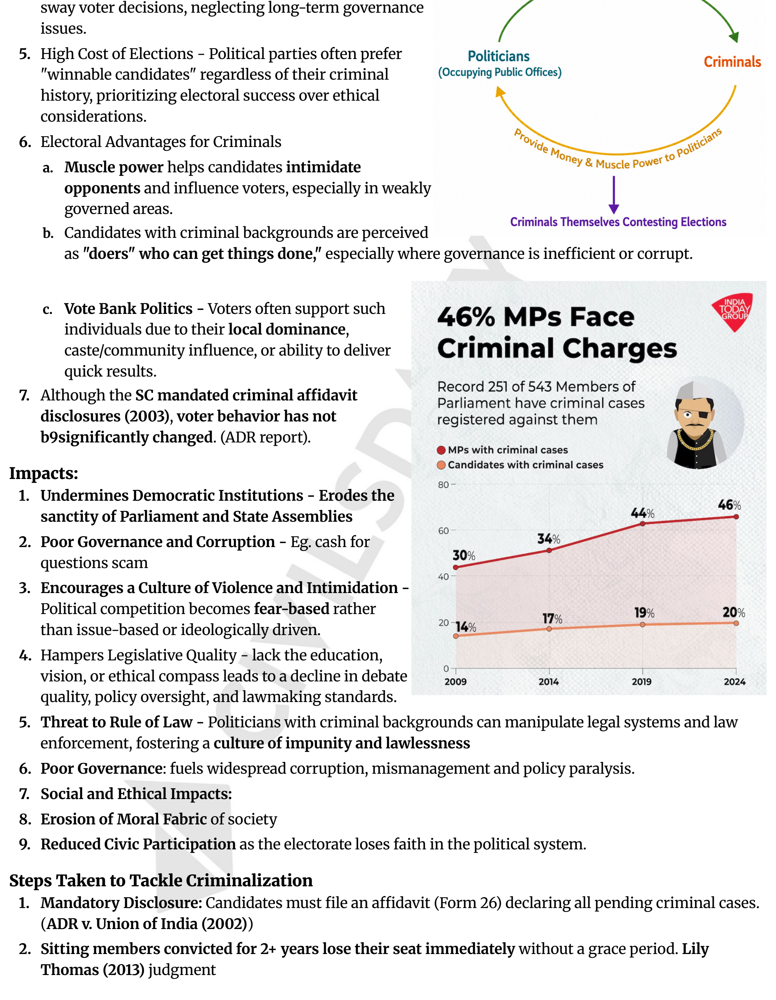

### [Smash Mains Source Page 148](../../pages/mains/mains_page_148.pdf)

### [Smash Mains Source Page 148](../../pages/mains/mains_page_148.pdf)

*Diagram Screenshot: [Criminalization of Politics: Politician-Criminal Nexus & 46% MPs Facing Criminal Charges](../../diagrams/mains_diag_criminalization_politics_p148.png) · [Full Source Page 148](../../pages/mains/mains_page_148.pdf)*

- **4.** Voter Apathy and Ignorance: In disadvantaged areas, immediate benefits from criminal-backed candidates sway voter decisions, neglecting long-term governance issues.

- **5.** High Cost of Elections - Political parties often prefer "winnable candidates" regardless of their criminal history, prioritizing electoral success over ethical considerations.

- **6.** Electoral Advantages for Criminals

  - **a.** Muscle power helps candidates intimidate opponents and influence voters, especially in weakly governed areas.

  - **b.** Candidates with criminal backgrounds are perceived as "doers" who can get things done," especially where governance is inefficient or corrupt.

  - **c.** Vote Bank Politics - Voters often support such individuals due to their local dominance, caste/community influence, or ability to deliver quick results.

- **7.** Although the SC mandated criminal affidavit disclosures (2003), voter behavior has not significantly changed. (ADR report).

### Impacts

- **1.** Undermines Democratic Institutions - Erodes the sanctity of Parliament and State Assemblies

- **2.** Poor Governance and Corruption - Eg. cash for questions scam

- **3.** Encourages a Culture of Violence and Intimidation - Political competition becomes fear-based rather than issue-based or ideologically driven.

- **4.** Hampers Legislative Quality - lack the education, vision, or ethical compass leads to a decline in debate quality, policy oversight, and lawmaking standards.

- **5.** Threat to Rule of Law - Politicians with criminal backgrounds can manipulate legal systems and law enforcement, fostering a culture of impunity and lawlessness

- **6.** Poor Governance: fuels widespread corruption, mismanagement and policy paralysis.

- **7.** Social and Ethical Impacts:

- **8.** Erosion of Moral Fabric of society

- **9.** Reduced Civic Participation as the electorate loses faith in the political system.

### Steps Taken to Tackle Criminalization

- **1.** Mandatory Disclosure: Candidates must file an affidavit (Form 26) declaring all pending criminal cases. (ADR v. Union of India (2002))

- **2.** Sitting members convicted for 2+ years lose their seat immediately without a grace period. Lily Thomas (2013) judgment
