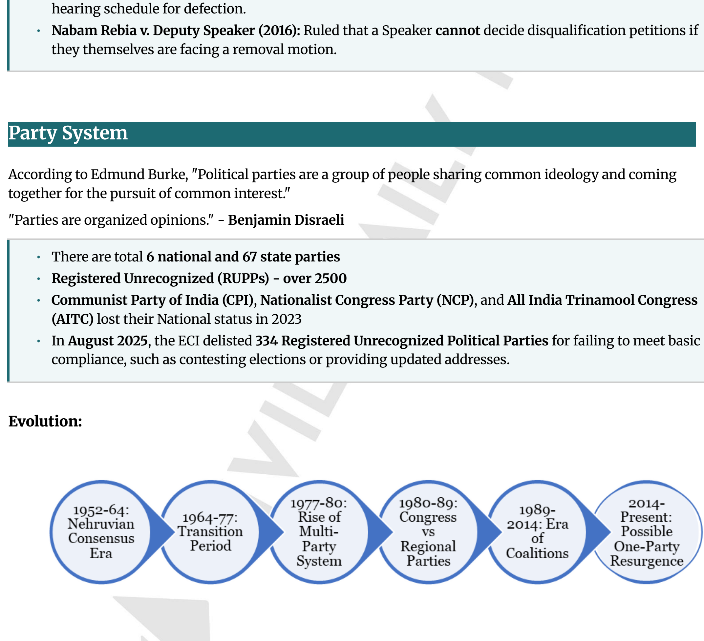

### [Smash Mains Source Page 158](../../pages/mains/mains_page_158.pdf)

### [Smash Mains Source Page 158](../../pages/mains/mains_page_158.pdf)

*Diagram Screenshot: [Evolution of the Party System in India Timeline](../../diagrams/mains_diag_party_system_evolution_p158.png) · [Full Source Page 158](../../pages/mains/mains_page_158.pdf)*

- Public Interest Foundation v. Union of India (2018): Directed Parliament to legislate to bar criminals from contesting; mandated candidates to publicize criminal antecedents.

- Abhiram Singh v. C.D. Commachen (2017): Held that appealing for votes based on religion or caste is a "corrupt practice" (Sec 123).

- Keisham Meghachandra v. Hon'ble Speaker Manipur (2020): Ruled that the Speaker must decide disqualification petitions within a "reasonable time" (3 months).

- Padi Kaushik Reddy v. State of Telangana (2025): The SC fixed a 4-week timeline for Speakers to set a hearing schedule for defection.

- Nabam Rebia v. Deputy Speaker (2016): Ruled that a Speaker cannot decide disqualification petitions if they themselves are facing a removal motion.

### Party System

According to Edmund Burke, "Political parties are a group of people sharing common ideology and coming together for the pursuit of common interest."

> "Parties are organized opinions." - Benjamin Disraeli

- There are total 6 national and 67 state parties

- Registered Unrecognized (RUPPs) - over 2500

- Communist Party of India (CPI), Nationalist Congress Party (NCP), and All India Trinamool Congress (AITC) lost their National status in 2023

- In August 2025, the ECI delisted 334 Registered Unrecognized Political Parties for failing to meet basic compliance, such as contesting elections or providing updated addresses.

### Evolution

### Recognition of political parties

Criteria for Recognition as a National Party

- **1.** Four-State Rule: The party is recognized as a "State Party" in at least four states.

- **2.** Performance in Lok Sabha & Assembly: The party wins at least 6% of the total valid votes in any four or more states in a General Election (Lok Sabha or State Assembly) AND, in addition, it wins at least four seats in the Lok Sabha from any state or states.

- **3.** Three-State Lok Sabha Rule: The party wins at least 2% of the total seats in the Lok Sabha (11 seats out of 543), and these members are elected from at least three different states.
