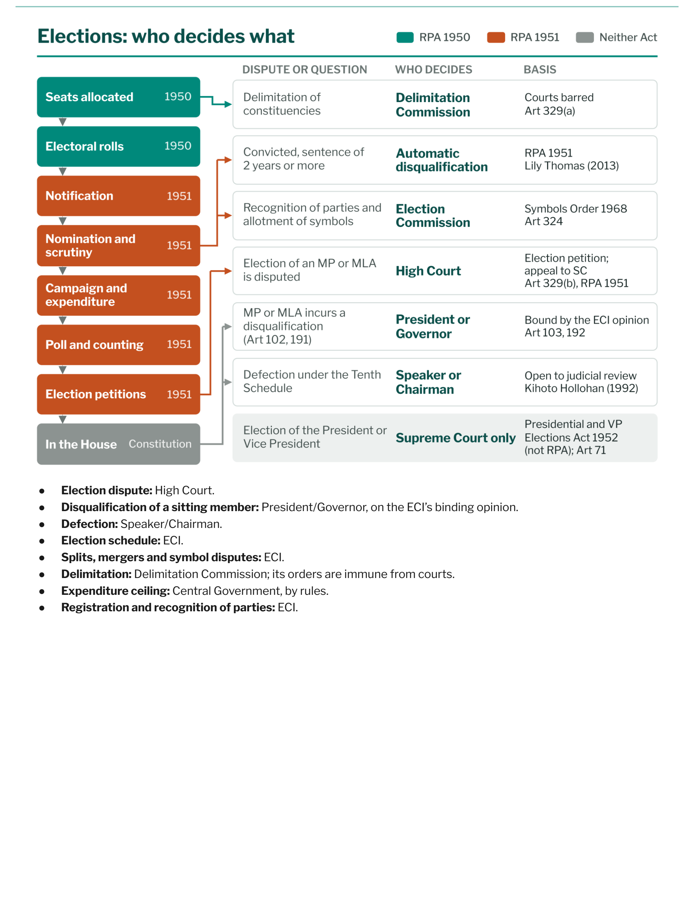

### [Prelims Source Page 164](../../pages/prelims/prelims_page_164.pdf)

### [Prelims Source Page 164](../../pages/prelims/prelims_page_164.pdf)

*Diagram Screenshot: [Elections: Who Decides What (Disqualification & Disputes Matrix)](../../diagrams/pre_diag_elections_who_decides_what_p164.png) · [Full Source Page 164](../../pages/prelims/prelims_page_164.pdf)*

Who decides what

- Election dispute: High Court.

- Disqualification of a sitting member: President/Governor, on the ECI’s binding opinion.

- Defection: Speaker/Chairman.

- Election schedule: ECI.

- Splits, mergers and symbol disputes: ECI.

- Delimitation: Delimitation Commission; its orders are immune from courts.

- Expenditure ceiling: Central Government, by rules.

- Registration and recognition of parties: ECI.
