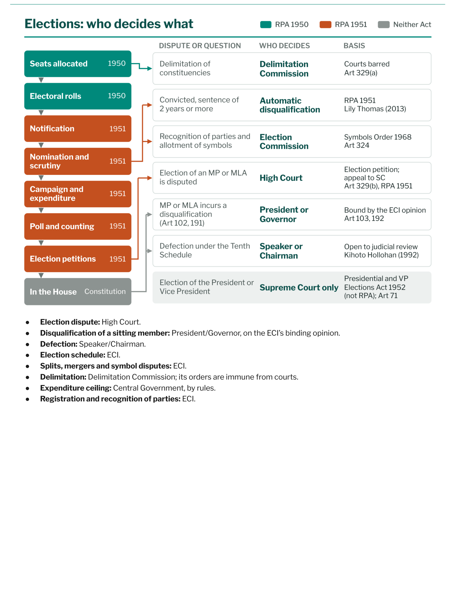

# Anti-Defection Law (Tenth Schedule, 52nd & 91st Amendments, Kihoto Hollohan Case) & Disqualification Matrix — Prelims Notes (Ch11_Sub02_Anti_Defection_Law_Tenth_Schedule)

---

### [Prelims Source Page 161](../../pages/prelims/prelims_page_161.pdf)

- The ceiling binds the candidate, never the party: the most repeated trap in this area.

- Travel by a party’s star campaigners is not counted against the candidate.

- The ceiling is set by the Central Government, not the ECI. Contributions (RPA, 1951)

- Sec 29C: Contributions above ₹20,000 are reported to the ECI to claim income tax exemption (Sec 13A, Income Tax Act).

- Sec 29B: Parties may accept contributions from any person or company except a government company; foreign sources are barred (FCRA, 2010), though the Finance Acts of 2016 and 2018 retrospectively let Indian subsidiaries of foreign companies donate.

- Cash is capped at ₹2,000 per donor (Finance Act, 2017); electoral trusts since 2013.

- Companies (Sec 182, Companies Act, 2013): At least 3 years old, giving up to 7.5% of average net profits. Traps

- Failure to file the contribution report costs the tax exemption; it does not deregister the party.

- Amounts below ₹20,000 need not be itemised, which is how large “unknown” income persists.

- Government companies and companies under 3 years old cannot contribute at all. Electoral bonds struck down (ADR v Union of India, 15 February 2024)

- A unanimous five judge Constitution Bench (CJI D.Y. Chandrachud) struck down the Electoral Bond Scheme, 2018 and the enabling amendments to the RPA, 1951, the Companies Act, 2013 (which had removed the 7.5% cap and the duty to disclose) and the Income Tax Act, 1961.

- Grounds: The voter’s right to information under Art 19(1)(a), and manifest arbitrariness under Art 14 in allowing unlimited corporate donations, even by loss making companies.

- SBI was told to stop issuing bonds and report the details to the ECI by March 2024. Traps

- Bonds were issued only by SBI, as bearer instruments valid for 15 days, carrying no interest, and were introduced through the Finance Act, 2017 as a Money Bill.

### NOMINATION, POLL AND COUNTING

Nomination and scrutiny (RPA, 1951)

- Proposers: A recognised National or State party candidate needs one; anyone else, including a registered unrecognised party’s candidate, needs ten (or one tenth of the electors, if fewer).

- Up to 4 nomination papers. The Returning Officer may reject only for disqualification, non compliance with the nomination or deposit rules, or a non genuine signature; defects not of a substantial character are ignored. Traps

- The one proposer concession comes with recognition, not registration.

- Improper rejection voids the election, but only through an election petition after the result, never a writ. Security deposit (Secs 34, 158)

- Lok Sabha ₹25,000 (₹12,500 for SC/ST); Assembly or Council ₹10,000 (₹5,000 for SC/ST); paid with the nomination.

- Forfeited unless the candidate polls more than one sixth of the total valid votes; returned if he withdraws in time, his nomination is rejected, or he dies before the poll. Traps

- The test is one sixth of the total valid votes polled, not of the winner’s votes. Two constituency cap (Sec 33(7)) [PRELIMS 2021]

- Since the RP (Amendment) Act, 1996, no one may contest more than two constituencies in a general election, a group of by elections or biennial elections; this covers the Lok Sabha, Assembly, Rajya Sabha and Council.

- Elected from both, he must resign one within 14 days, or both fall vacant; the vacated seat goes to a by election. Traps

- Devi Lal contested three seats in 1991, which was lawful before the cap.

---

### [Prelims Source Page 162](../../pages/prelims/prelims_page_162.pdf)

- The ECI’s proposal that the candidate pay ₹5 lakh (Assembly) or ₹10 lakh (Lok Sabha) towards the by election is not law; the Supreme Court (2023) refused to strike down the two seat option and left it to Parliament. First past the post and NOTA

- Simple plurality decides Lok Sabha, Assembly and local body seats; there is no 50% threshold and no run off.

- PUCL v Union of India (27 September 2013): Abstaining must stay secret (Art 19(1)(a)), so the Court directed a NOTA button; first used in the 2013 Assembly elections and placed on the ballot through the Conduct of Election Rules. Traps

- NOTA is not a right to reject: if it polls highest, the leading candidate still wins, with no repoll.

- No NOTA in Rajya Sabha and Council elections (Shailesh Manubhai Parmar, 2018).

- The President, Vice President, Rajya Sabha and Councils are elected by proportional representation by single transferable vote, where a quota must be crossed. EVMs and VVPAT

- Statutory backing: Sec 61A, RPA 1951, from 15 March 1989; EVMs in all 543 seats from 2004.

- First pilot: Paravur, Kerala (1982), set aside in A.C. Jose (1984) for want of statutory backing.

- VVPAT: Added through the Conduct of Election Rules, 1961 (14 August 2013) after Subramanian Swamy v ECI (2013); first used in Noksen, Nagaland (2013). Since 2019, slips from 5 random polling stations per constituency or segment are counted.

- ADR v ECI (26 April 2024): Rejected 100% VVPAT counting and a return to paper ballots; ordered Symbol Loading Units to be sealed and stored after results. Traps

- VVPAT comes from the Rules, not the Act.

- EVMs are standalone, not networked, and made only by BEL and ECIL. By elections (Sec 151A)

- A casual vacancy is filled within six months, unless less than one year of the term remains.

- The member serves only the unexpired term, not a fresh five years. Traps

- Both conditions matter: with less than a year left, no by election need be held.

### CAMPAIGN REGULATION AND ELECTORAL OFFENCES

Model Code of Conduct

- No statute: Evolved by consensus among parties and enforced by the ECI under Art 324; traces to a code drawn up in Kerala, 1960.

- In force from the announcement of the schedule until the election process is complete; binds parties, candidates and the party in power.

- Eight parts: General conduct, meetings, processions, polling day, polling booths, observers, the party in power, election manifestos. Traps

- It has no penalty of its own: it bites through censure, campaign bans or Art 324 powers. Conduct that is also an offence is punished under the BNS or the RPA, 1951.

- The ECI has itself opposed making it statutory, preferring speed to litigation. Silence period and exit polls (Secs 126, 126A)

- Silence period: In the 48 hours ending with the close of poll in an area, no public meeting or procession, and no election matter on cinema, television or similar apparatus.

- Exit polls: None conducted or published from the start of the poll in the first phase until half an hour after the close of the last phase (RP (Amendment) Act, 2009). Traps

- The silence period does not cover print media, and it runs constituency wise, so it differs by phase.

- Exit polls are banned by statute; opinion polls are not, except during the 48 hour silence.

- The exit poll window is notified by the ECI and can run for weeks.

---

### [Prelims Source Page 163](../../pages/prelims/prelims_page_163.pdf)

Corrupt practices and electoral offences

- Corrupt practices (Sec 123, RPA 1951): Bribery, undue influence, appeal on grounds of religion, race, caste, community or language, promoting enmity, false statements about a candidate’s personal character, hiring vehicles for voters, expenditure beyond the ceiling, booth capturing, and seeking help from government servants.

- Electoral offences (RPA, 1951): Disorderly conduct at meetings (Sec 127), canvassing within 100 metres of a polling station (Sec 130), booth capturing (Sec 135A).

- The RPA, 1950 has only two offences, false declaration and breach of official duty, both about the roll. Traps

- A corrupt practice voids the election and can disqualify; an electoral offence is punished as a crime. Booth capturing is both.

- Abhiram Singh v C.D. Commachen (2017): An appeal to the voter’s religion is as much a corrupt practice as an appeal to the candidate’s.

### DISPUTES AND WHO DECIDES WHAT

Election petitions (Art 329(b); RPA, 1951)

- An election to Parliament or a State Legislature can be questioned only by an election petition in the High Court (single judge), within 45 days of the result.

- Grounds (Sec 100): Disqualification of the winner, corrupt practice, improper acceptance or rejection of a nomination, or non compliance materially affecting the result.

- Outcomes: Dismissal; the election declared void; another candidate declared elected; persons guilty of corrupt practice named. Appeal lies to the Supreme Court within 30 days (Sec 116A).

- “Election” covers the whole process from notification to result; no writ lies midway, even for wrongful rejection of a nomination (N.P. Ponnuswami, 1952). Traps

- Before notification, writ jurisdiction is open. The Art 329(a) bar covers only delimitation laws and orders, so ordinary ECI decisions remain open to writ.

- Art 329(b) names no court; the High Court hears petitions because the RPA, 1951 says so. Election Tribunals were abolished in 1966.

- President and Vice President election disputes go directly to the Supreme Court (Art 71).

---

### [Prelims Source Page 164](../../pages/prelims/prelims_page_164.pdf)

*Diagram Screenshot: [Elections: Who Decides What (Disqualification & Disputes Matrix)](../../diagrams/pre_diag_elections_who_decides_what_p164.png) · [Full Source Page 164](../../pages/prelims/prelims_page_164.pdf)*

Who decides what

- Election dispute: High Court.

- Disqualification of a sitting member: President/Governor, on the ECI’s binding opinion.

- Defection: Speaker/Chairman.

- Election schedule: ECI.

- Splits, mergers and symbol disputes: ECI.

- Delimitation: Delimitation Commission; its orders are immune from courts.

- Expenditure ceiling: Central Government, by rules.

- Registration and recognition of parties: ECI.
