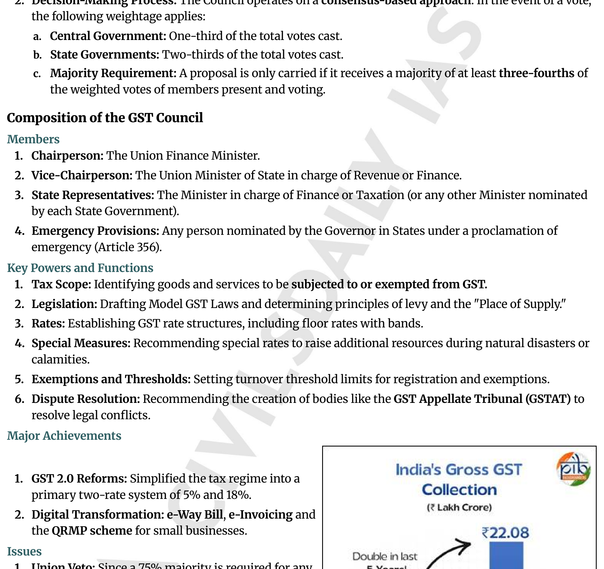

### [Smash Mains Source Page 226](../../pages/mains/mains_page_226.pdf)

### [Smash Mains Source Page 226](../../pages/mains/mains_page_226.pdf)

*Diagram Screenshot: [India's Gross GST Collection Trend & Fiscal Impact (Article 279A)](../../diagrams/mains_diag_gst_collection_trend_p226.png) · [Full Source Page 226](../../pages/mains/mains_page_226.pdf)*

### GST Council

- **1.** GST Council is a constitutional body established to make recommendations to the Union and State Governments on issues related to GST. It is the centerpiece of India's fiscal federalism.

- **2.** Decision-Making Process: The Council operates on a consensus-based approach. In the event of a vote, the following weightage applies:

  - **a.** Central Government: One-third of the total votes cast.

  - **b.** State Governments: Two-thirds of the total votes cast.

  - **c.** Majority Requirement: A proposal is only carried if it receives a majority of at least three-fourths of the weighted votes of members present and voting.

### Composition of the GST Council

### Members

- **1.** Chairperson: The Union Finance Minister.

- **2.** Vice-Chairperson: The Union Minister of State in charge of Revenue or Finance.

- **3.** State Representatives: The Minister in charge of Finance or Taxation (or any other Minister nominated by each State Government).

- **4.** Emergency Provisions: Any person nominated by the Governor in States under a proclamation of emergency (Article 356).

### Key Powers and Functions

- **1.** Tax Scope: Identifying goods and services to be subjected to or exempted from GST.

- **2.** Legislation: Drafting Model GST Laws and determining principles of levy and the "Place of Supply."

- **3.** Rates: Establishing GST rate structures, including floor rates with bands.

- **4.** Special Measures: Recommending special rates to raise additional resources during natural disasters or calamities.

- **5.** Exemptions and Thresholds: Setting turnover threshold limits for registration and exemptions.

- **6.** Dispute Resolution: Recommending the creation of bodies like the GST Appellate Tribunal (GSTAT) to resolve legal conflicts.

### Major Achievements

- **1.** GST 2.0 Reforms: Simplified the tax regime into a primary two-rate system of 5% and 18%.

- **2.** Digital Transformation: e-Way Bill, e-Invoicing and the QRMP scheme for small businesses.

### Issues

- **1.** Union Veto: Since a 75% majority is required for any decision, the Union holds a de facto veto.

- **2.** Democratic Deficit: State legislatures have lost fiscal autonomy, as an executive body now determines more than 40% of their own-tax revenue.

- **3.** High complexity and compliance burden due to multiple tax slabs.

- **4.** Nearly half the economy remains outside GST. Eg. petroleum, real estate, electricity duties

- **5.** Fiscal Cliff: The expiry of revenue compensation has left several states facing revenue shortfall.
