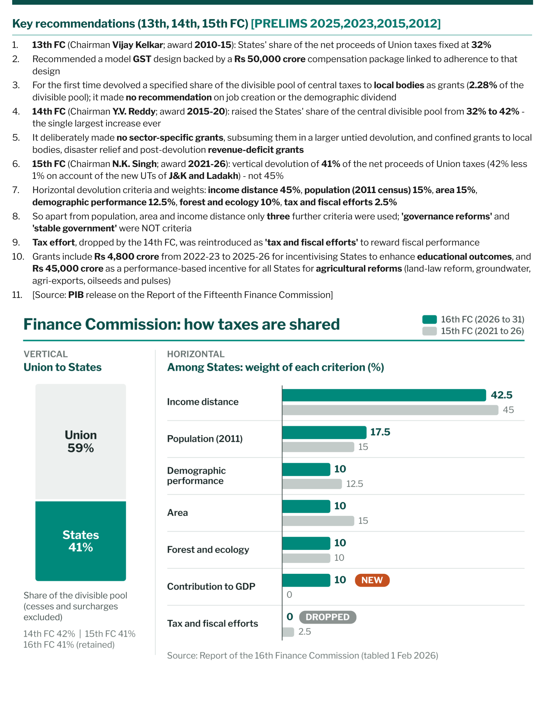

### [Prelims Source Page 172](../../pages/prelims/prelims_page_172.pdf)

### [Prelims Source Page 172](../../pages/prelims/prelims_page_172.pdf)

*Diagram Screenshot: [Finance Commission: How Taxes Are Shared (Vertical & Horizontal Devolution)](../../diagrams/pre_diag_finance_commission_tax_sharing_p172.png) · [Full Source Page 172](../../pages/prelims/prelims_page_172.pdf)*

### DETAILED NOTES

Key recommendations (13th, 14th, 15th FC) [PRELIMS 2025,2023,2015,2012]

- **1.** 13th FC (Chairman Vijay Kelkar; award 2010-15): States' share of the net proceeds of Union taxes fixed at 32%

- **2.** Recommended a model GST design backed by a Rs 50,000 crore compensation package linked to adherence to that design

- **3.** For the first time devolved a specified share of the divisible pool of central taxes to local bodies as grants (2.28% of the divisible pool); it made no recommendation on job creation or the demographic dividend

- **4.** 14th FC (Chairman Y.V. Reddy; award 2015-20): raised the States' share of the central divisible pool from 32% to 42% - the single largest increase ever

- **5.** It deliberately made no sector-specific grants, subsuming them in a larger untied devolution, and confined grants to local bodies, disaster relief and post-devolution revenue-deficit grants

- **6.** 15th FC (Chairman N.K. Singh; award 2021-26): vertical devolution of 41% of the net proceeds of Union taxes (42% less 1% on account of the new UTs of J&K and Ladakh) - not 45%

- **7.** Horizontal devolution criteria and weights: income distance 45%, population (2011 census) 15%, area 15%, demographic performance 12.5%, forest and ecology 10%, tax and fiscal efforts 2.5%

- **8.** So apart from population, area and income distance only three further criteria were used; 'governance reforms' and 'stable government' were NOT criteria

- **9.** Tax effort, dropped by the 14th FC, was reintroduced as 'tax and fiscal efforts' to reward fiscal performance

- **10.** Grants include Rs 4,800 crore from 2022-23 to 2025-26 for incentivising States to enhance educational outcomes, and Rs 45,000 crore as a performance-based incentive for all States for agricultural reforms (land-law reform, groundwater, agri-exports, oilseeds and pulses) 11. [Source: PIB release on the Report of the Fifteenth Finance Commission]
