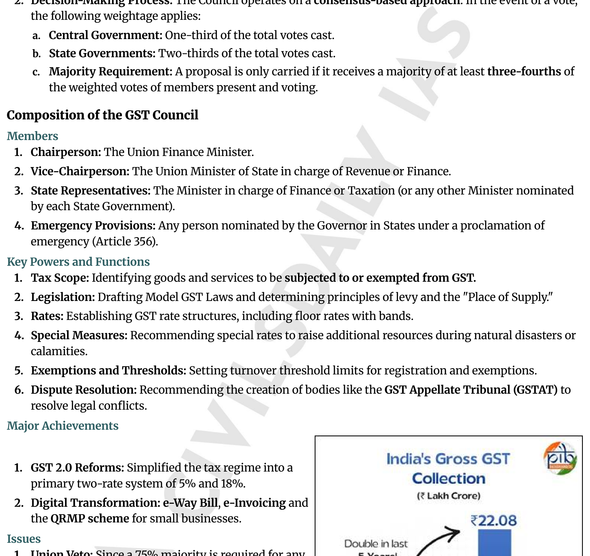

# Finance Commission (Art 280), GST Council (Art 279A) & Comptroller and Auditor General of India (CAG, Art 148–151) — Smash Mains Notes (Ch12_Sub01_Finance_Commission_GST_Council_and_CAG)

---

### [Smash Mains Source Page 225](../../pages/mains/mains_page_225.pdf)

## Chapter 14: Constitutional And Statutory Bodies

### PYQs

- **[2024]** "The duty of the Comptroller and Auditor General is not merely to ensure the legality of expenditure but also its propriety." Comment.(10)

- **[2025]** The National Commission for Protection of Child Rights has to address the challenges faced by children in the digital era. Examine the existing policies and suggest measures the Commission can initiate to tackle the issue. (15)

- **[2024]** "The duty of the Comptroller and Auditor General is not merely to ensure the legality of expenditure but also its propriety." Comment. (10)

- **[2023]** Discuss the role of the Competition Commission of India in containing the abuse of dominant position by the Multi-National Corporations in India. Refer to the recent decisions. (10)

- **[2022]** Discuss the role of the National Commission for Backward Classes in the wake of its transformation from a statutory body to a constitutional body. (10)

- **[2021]** Though the Human Rights Commissions have contributed immensely to the protection of human rights in India, yet they have failed to assert themselves against the mighty and powerful. Analyzing their structural and practical limitations, suggest remedial measures. (15)

- **[2020]** Which steps are required for constitutionalization of a commission? Do you think imparting constitutionality to the National Commission for Women would ensure greater gender justice and empowerment in India? Give reasons. (15)

- **[2020]** "Recent amendments to the Right to Information Act will have a profound impact on the autonomy and independence of the Information Commission". Discuss (10)

- **[2018]** Multiplicity of various commissions for the vulnerable sections of the society leads to problems of overlapping jurisdiction and duplication of functions. Is it better to merge all commissions into an umbrella Human Rights Commission? Argue your case. (15)

- **[2018]** Whether the National Commission for Scheduled Castes (NCSC) can enforce the implementation of constitutional reservation for the Scheduled Castes in the religious minority institutions? Examine. (10)

- **[2018]** "The Comptroller and Auditor General (CAG) has a very vital role to play." Explain how this is reflected in the method and terms of his appointment as well as the range of powers he can exercise. (10)

- **[2018]** How is the Finance Commission of India constituted? What do you know about the terms of reference of the recently constituted Finance Commission? Discuss. (15)

- **[2016]** Exercise of CAG's powers in relation to the accounts of the Union and the States is derived from Article 149 of the Indian Constitution. Discuss whether audit of the Government's policy implementation could amount to overstepping its own (CAG) jurisdiction. [12.5 Marks]

- **[2013]** 'A national Lokpal, however strong it may be, cannot resolve the problems of immorality in public affairs.' Discuss. (10)

---

### [Smash Mains Source Page 226](../../pages/mains/mains_page_226.pdf)

*Diagram Screenshot: [India's Gross GST Collection Trend & Fiscal Impact (Article 279A)](../../diagrams/mains_diag_gst_collection_trend_p226.png) · [Full Source Page 226](../../pages/mains/mains_page_226.pdf)*

### GST Council

- **1.** GST Council is a constitutional body established to make recommendations to the Union and State Governments on issues related to GST. It is the centerpiece of India's fiscal federalism.

- **2.** Decision-Making Process: The Council operates on a consensus-based approach. In the event of a vote, the following weightage applies:

  - **a.** Central Government: One-third of the total votes cast.

  - **b.** State Governments: Two-thirds of the total votes cast.

  - **c.** Majority Requirement: A proposal is only carried if it receives a majority of at least three-fourths of the weighted votes of members present and voting.

### Composition of the GST Council

### Members

- **1.** Chairperson: The Union Finance Minister.

- **2.** Vice-Chairperson: The Union Minister of State in charge of Revenue or Finance.

- **3.** State Representatives: The Minister in charge of Finance or Taxation (or any other Minister nominated by each State Government).

- **4.** Emergency Provisions: Any person nominated by the Governor in States under a proclamation of emergency (Article 356).

### Key Powers and Functions

- **1.** Tax Scope: Identifying goods and services to be subjected to or exempted from GST.

- **2.** Legislation: Drafting Model GST Laws and determining principles of levy and the "Place of Supply."

- **3.** Rates: Establishing GST rate structures, including floor rates with bands.

- **4.** Special Measures: Recommending special rates to raise additional resources during natural disasters or calamities.

- **5.** Exemptions and Thresholds: Setting turnover threshold limits for registration and exemptions.

- **6.** Dispute Resolution: Recommending the creation of bodies like the GST Appellate Tribunal (GSTAT) to resolve legal conflicts.

### Major Achievements

- **1.** GST 2.0 Reforms: Simplified the tax regime into a primary two-rate system of 5% and 18%.

- **2.** Digital Transformation: e-Way Bill, e-Invoicing and the QRMP scheme for small businesses.

### Issues

- **1.** Union Veto: Since a 75% majority is required for any decision, the Union holds a de facto veto.

- **2.** Democratic Deficit: State legislatures have lost fiscal autonomy, as an executive body now determines more than 40% of their own-tax revenue.

- **3.** High complexity and compliance burden due to multiple tax slabs.

- **4.** Nearly half the economy remains outside GST. Eg. petroleum, real estate, electricity duties

- **5.** Fiscal Cliff: The expiry of revenue compensation has left several states facing revenue shortfall.

---

### [Smash Mains Source Page 227](../../pages/mains/mains_page_227.pdf)

- **6.** Committee Opacity: Substantive policies are settled in officer-level committees that lack codified rules, transparency, or fair regional representation.

- **7.** Broken Tech Backbone: Suspension of automated invoice matching has enabled massive fraud and turned IGST settlements into an opaque "black box."

### Way Forward

- **1.** Recalibrated Voting: Reduce Union weight to 20% or adopt a "one member, one vote" model to ensure genuine federal partnership.

- **2.** Rotational Leadership: Implement a five-year rotational chairpersonship between the Union Finance Minister and State Ministers to democratize the agenda.

- **3.** Rate Flexibility: Allow States to vary SGST rates within a narrow "band" above floor rates to restore local fiscal agency.

- **4.** Independent Secretariat: Establish an autonomous Secretariat with balanced Union-State staffing to provide neutral data and professional, unbiased research.

- **5.** Legislative Oversight: Form a Joint Standing Committee of Parliament and State Legislatures to provide democratic supervision over executive tax decisions.

### Comptroller and Auditor General of India (CAG)

'The CAG is the conscience keeper of the government, ensuring that taxpayers' money is spent wisely and for the benefit of the public.'

### Constitutional and Legal Provisions

- **1.** Articles 148-151: Outline the appointment, oath, duties, and the process of laying audit reports before Parliament

- **2.** Tenure: Six years or up to 65 years of age. Removed like a Supreme Court judge.

- **3.** DPC Act, 1971: detail the CAG's specific duties, powers, and service conditions

- **4.** Independence: Salary charged on the Consolidated Fund of India. Ineligible for further government office after retirement

### Powers and Functions

- **1.** Audit of Expenditure: Audits all expenditure from the Consolidated, Contingency, and Public Accounts of India and States. (Article 149).

- **2.** Receipts and Stock: Examines all receipts and stores of the Union and State departments to check for leakages.

- **3.** Performance Audit: Evaluates the "3 E's" - Economy, Efficiency, and Effectiveness of government programs and social schemes.

- **4.** Propriety Audit: Goes beyond legality to comment on the "wisdom" and "faithfulness" of government spending.

- **5.** Certifying Net Proceeds: Acting as a final authority, the CAG certifies the net proceeds of any tax or duty (Article 279).

- **6.** Acts as the "friend, philosopher, and guide" to the Public Accounts Committee (PAC) during report scrutiny.

- **7.** Advises the President on the form/format in which accounts of the Union and States are kept (Article 150).

---

### [Smash Mains Source Page 228](../../pages/mains/mains_page_228.pdf)

### Significance of Office of CAG

Significance of the Office of CAG

- **1.** Guardian of the Public Purse

- **2.** Upholding Financial Accountability by scrutinizing how public funds are utilized.

- **3.** Bulwark of Democracy: protect the integrity of India's democratic structure.

- **4.** Promoting Transparency: By publishing detailed audit reports & exposing systemic leakages and administrative failures. Eg. Coal and Fodder scams

- **5.** Beyond mere legal compliance, the CAG conducts Performance Audits to evaluate the "3 E's": Economy, Efficiency, and Effectiveness of government schemes and programs.

- **6.** Advisor to the PAC: "friend, philosopher, and guide" to the Public Accounts Committee

- **7.** Strengthening Local Governance: assesses local government performance in service delivery through through Annual Technical Inspection Reports (ATIR)

- **8.** Safeguarding Separation of Powers: ensure that executive's financial activities align with legislative intent Major Challenges and Limitations

- **1.** Ex-Post Facto Audit: CAG audits after the money is spent; it cannot stop a "wasteful" transaction in real-time.

- **2.** No Comptroller Power: Unlike the UK, the Indian CAG has no control over the actual withdrawal of funds.

- **3.** Secret Service Limit: Executive agencies can withhold specific details of secret service expenditure, providing only a certificate.

- **4.** Information Delays: Departments often delay providing files; the CAG lacks punitive powers to penalize such non-cooperation.

- **5.** Executive-Led Selection: potential concerns about institutional neutrality.

- **6.** Audit of PPPs: Legal ambiguity persists regarding the CAG's power to audit private partners in Public-Private Partnership projects.

- **7.** Falling Report Numbers: RTI data shows a 75% drop in central audit reports between 2015 and 2025.

- **8.** Limited Local Reach: Auditing lakhs of Panchayats and Urban Bodies is a massive administrative burden with limited staff.

- **9.** NGO/Society Ambit: Many government-funded NGOs and societies remain outside the CAG's mandatory audit jurisdiction.

- **10.** Delayed Tabling: Reports submitted to the President/Governor are often not tabled in the legislature for months. Case Studies

- Direct Tax Deductions (2026): Identified ₹74,766 crore in probable tax effects from 1,847 audit observations involving Banks and NBFCs.

- Ayushman Bharat (2024): Exposed 7.5 lakh beneficiaries linked to a single mobile number.

- 2G Spectrum: exposed presumptive losses of ₹1.76 lakh crore

- Scholarship Audits (2025): 20% of beneficiaries lacked caste/income verification.

- Indian Railways: Flagged ₹4,087 crore as unrecovered from 269 private siding owners

### Way Forward

- **1.** Adopt a committee-based appointment (PM, CJI, LoP) to ensure the CAG's independence.

---

### [Smash Mains Source Page 229](../../pages/mains/mains_page_229.pdf)

- **2.** Amend the DPC Act to bring all PPPs and large NGOs under mandatory CAG scrutiny. (Vinod Rai)

- **3.** Grant the CAG power to impose fines on officials who delay or refuse to provide files.

- **4.** Mandate that all audit reports must be tabled in the legislature within 30 days of submission

- **5.** Real-time Auditing: Integrate the CAG's "AMPS" system with the government's PFMS for continuous, real-time financial monitoring

- **6.** Citizen Participation: Launch a portal for citizens to "flag" wasteful local expenditure for CAG's performance audits.

- **7.** Expanding Scope: Explicitly include the audit of "Sustainable Development Goals" (SDGs) and "Blue Economy" in the annual plan. CAG and audits of local bodies

- Article 243J & 243Z: These articles empower State Legislatures to make provisions for the maintenance of accounts and auditing of Panchayats and Municipalities respectively.

- Under CAG (DPC) Act, 1971, CAG exercises control and supervision over proper maintenance of accounts and auditing for all three levels of PRIs/ULBs.

- CAG provides "Technical Guidance and Supervision" to the Director of Local Fund Audit (DLFA) of various states. Powers and Functions in Local Audit

- Standardizing Formats: The CAG prescribes the budget and accounting formats (Eg. Model Accounting System for Panchayats) to ensure uniformity across India.

- Certification of Grants: The CAG certifies the utilization of grants released under Central Finance Commissions.

- Performance Audits: Eg. 2025-26 reports on "Solid Waste Management" in cities like Hyderabad and Raipur. Major Challenges and Limitations

- Arrears in Accounting: Many local bodies have not finalized their accounts for 3-5 years, making audit impossible.

- Manpower Crisis: The CAG has only one Auditor for every ~2,500 local bodies

- Non-Tabling of Reports in State Assemblies. Way Forward

- The CAG should audit the 500 largest ULBs to enable them to issue Municipal Bonds.

- Mandate the integration of Gram Sabha-led social audits with the CAG's statutory audit.

- Linking Funds to Audit (16th Finance Commission's recommendation).

- Deploy AI-based anomaly detection on the e-GramSwaraj portal to flag suspicious village-level spending automatically.

| Feature | CAG of India | CAG of United Kingdom |
| --- | --- | --- |
| Origin of Power | Constitutional - Directly derived from Article 148 of the Constitution. | Statutory - Derived from Acts of Parliament (National Audit Act, 1983). |
| Comptroller Role | Audit-only - Does not control the withdrawal of money; expenditure happens first. | Active Control - No money can be drawn from the Exchequer without approval. |

---

### [Smash Mains Source Page 230](../../pages/mains/mains_page_230.pdf)

| Feature | CAG of India | CAG of United Kingdom |
| --- | --- | --- |
| Nature of Audit | Ex-post Facto - A "post-mortem" audit conducted after the money is spent. | Concurrent / Prior - Functions as a gatekeeper before and during expenditure. |
| Membership | Non-Member - Not a member of Parliament (Article 148). | MP Status - Officer of the House of Commons (historically an MP). |
| Accounting | Separated - Relieved of accounting functions in 1976 (Union level). | Integrated - Closely oversees both the accounting and auditing phases. |
| Tenure | 6 Years / 65 Years - Shorter tenure; limits institutional continuity. | 10 Years - Longer fixed tenure provides greater stability and expertise. |

Recent initiatives

- Artificial Intelligence Strategy Framework: using AI for anomaly detection, risk assessment, and predictive insights to enhance audit precision.

- CAG-LLM (Large Language Model): to help auditors access decades of institutional knowledge and analyze large datasets.

- CAG-Connect Portal: A unified digital interface providing auditee entities (government departments and PSUs) a platform to directly respond to audit queries, observations, and inspection reports.

- One IAAD, One Audit: A structural initiative aimed at standardizing audit methodologies across all field offices of the Indian Audit and Accounts Department (IAAD).

- Implementation of an accounting framework for the "Blue Economy," focusing on the sustainable valuation of coastal and marine resources.

- The CAG of India currently holds prestigious external auditor roles for several global organizations:

- WHO: Reappointed for a second four-year term (2024-2027).

- ILO: Selected as External Auditor for the term 2024-2027.

- IAEA: Serving as External Auditor for the term 2022-2027.

- OPCW (Organization for the Prohibition of Chemical Weapons)

### Union Public Service Commission (UPSC)

The Union Public Service Commission (UPSC) is India's premier central recruiting agency, established under Articles 315 to 323 of the Constitution.

- The Puja Khedkar Scandal: A trainee IAS officer was accused of faking her identity and misusing disability/OBC quotas. This led to her dismissal and a criminal FIR by UPSC.

- Lateral Entry Withdrawal (2024): UPSC cancelled an advertisement for 45 specialized posts (Joint Secretary/Director) following government directives

---

### [Smash Mains Source Page 231](../../pages/mains/mains_page_231.pdf)

### Key Powers and Functions

- **1.** Conducting Examinations for Civil Services, Engineering, Medical, and Defense services.

- **2.** Advises the President on all matters relating to methods of recruitment to civil services.

- **3.** Consulted on the suitability of officers for promotion and transfer from one service to another

- **4.** Mandatorily consulted before taking disciplinary action (like dismissal) against a serving civil servant.

- **5.** Framing Recruitment Rules: Assists in drafting and amending rules for recruitment to various central posts.

- **6.** Lateral Entry Selection: Handles the selection process for private-sector experts into senior bureaucracy when tasked by the government.

- **7.** Joint Recruitment: Can assist two or more states in framing recruitment schemes if requested by State Governors.

- **8.** Submits an annual performance report to the President, which is then laid before Parliament.

### Major Issues Faced

- **1.** Quota Misuse: Eg. Puja Khedkar case

- **2.** Increasing CSAT Difficulty Skew favoring engineers over humanities students.

- **3.** Identity Fraud: Candidates appearing multiple times by faking names or birth dates.

- **4.** Verification Gaps: Reliance on state-issued certificates that UPSC lacks the machinery to verify.

- **5.** Lateral Entry Friction: Lack of reservation in specialized posts causing political and social backlash.

- **6.** Lengthy Cycle: The 12-month-long recruitment process causes significant "human capital drain."

### Way Forward

- **1.** 2nd ARC: Introduce specialization in recruitment, particularly for technical and specialized services such as Indian Engineering Services (IES) and Indian Economic Services (IES).

- **2.** Baswan Committee (2016):

  - **a.** Gradually reduce the upper age limit for appearing in the Civil Services Examination from 32 years to 27 years.

  - **b.** Reform the Mains examination by reducing the number of optional subjects, to focus more on general studies and governance-related topics.

- **3.** Hota Committee (2004): reducing the time lag between the preliminary examination, mains, and interview stages to ensure quicker recruitment of officers.

### Finance Commission of India

The Finance Commission of India is a Quasi-Judicial constitutional body that defines the financial relations between the Union and the States. The focus has shifted towards "Compliance-driven Federalism" under the 16th Finance Commission (FC).

### Constitutional Provisions

- **1.** Article 280: Mandates the President to constitute a Finance Commission every five years (or earlier).

- **2.** Article 281: Requires the President to lay the Commission's recommendations and the "Action Taken Report" before Parliament.

- **3.** Article 243-I & 243-Y: Mandate State Finance Commissions to review the financial position of Panchayats and Municipalities.

---

### [Smash Mains Source Page 232](../../pages/mains/mains_page_232.pdf)

### Key Powers and Functions

- **1.** Vertical Devolution: Recommends the percentage of central taxes to be shared with States

- **2.** Horizontal Devolution: Designates the formula (population, income distance, etc.) to distribute the 41% share among different States.

- **3.** Grants-in-Aid: Determines the principles and amounts for grants to States under Article 275.

- **4.** Suggests measures to augment the State Consolidated Fund to assist Panchayats and Municipalities.

- **5.** Fiscal Consolidation: Reviews the debt levels of the Union and States and recommends a "Fiscal Roadmap."

- **6.** Disaster Management: Recommends the funding patterns and allocations for Disaster Risk Management Funds (SDRF/NDRF).

- **7.** Advisory Role: Provides recommendations on any other matter referred to it by the President in the interest of "Sound Finance."

### Key Achievements

- **1.** Successfully maintained the 41% vertical share for States, ensuring financial predictability despite global economic shifts.

- **2.** Digital Transparency: Mandatory CAG-certified disclosure of "Net Tax Proceeds" was accepted to ensure States receive their fair share.

- **3.** Allocated ₹2.04 lakh crore for state disaster funds, enhancing climate resilience.

- **4.** Urbanization Premium: Introduced a first-of-its-kind grant to support the transition of rural clusters into organized urban local bodies.

- **5.** Brought "Off-budget borrowings" into the main fiscal deficit calculations for both Union and States.

### Major Limitations

- **1.** North-South Equity Gap: Southern states feel "penalized" for successful population control under the 2011 Census-based devolution formulas.

- **2.** Advisory Nature: Recommendations are not legally binding

- **3.** Cess and Surcharges are excluded from the divisible pool, reducing the States' effective tax share. (35% against recommended 41%)

- **4.** Central Dominance: The Centre unilaterally appoints the Chairman and members and sets the "Terms of Reference" (ToR).

- **5.** The 16th FC had to rely on 2011 Census data due to the delayed 2021 Census.

- **6.** Weak State Finance Commissions (SFCs) prevents the Central Commission from accurately funding local bodies.

- **7.** One-Size-Fits-All Roadmap: Imposing a strict 3% GSDP deficit cap may hinder capital expenditure in debt-stressed States.

- **8.** Exclusion of CSS: Centrally Sponsored Schemes (CSS) remain outside the FC's scope

- **9.** Temporary Nature: Being an ad hoc body every five years prevents continuous monitoring of fiscal developments.

### Way Forward

- **1.** Permanent Status: Convert the Finance Commission into a permanent body to ensure year-round monitoring of federal finances.

- **2.** Amend the Constitution to include Cess and Surcharges in the divisible pool beyond a certain percentage.

- **3.** Independent Selection: Create a bipartisan committee (including States) to select the FC Chairman and members.

---

### [Smash Mains Source Page 233](../../pages/mains/mains_page_233.pdf)

- **4.** Empowering SFCs: Link Central grants to the mandatory and timely submission of State Finance Commission reports.

- **5.** Customized Fiscal Limits: Adopt state-specific debt-pathways instead of a uniform 3% cap for all.

- **6.** Harmonization with GST Council: Establish a formal coordination mechanism between the FC and the GST Council to avoid policy overlap.

### NITI Aayog

NITI Aayog, established on January 1, 2015, is the policy think tank of the Indian government, replacing the Planning Commission. It is supported by the attached and autonomous bodies of Development Monitoring and Evaluation Organisation (DMEO), Atal Innovation Mission (AIM) and National Institute of Labour Economics Research and Development (NILERD).

### Difference Between NITI Aayog & Planning Commission

| Feature | NITI Aayog | Planning Commission |
| --- | --- | --- |
| Status | Advisory Think Tank | Extra-constitutional, centralized body |
| Constitution | Established by Executive Resolution (2015) | Established by Executive Order (1950) |
| Approach to Planning | Bottom-Up Approach, participatory planning involving states | Top-Down Approach, central control with minimal state inputs |
| Federal Structure Role | Promotes Cooperative Federalism; states are equal partners | States participated as spectators in annual plans |
| Policy Powers | No mandate to impose policies | Imposed policies on states with tied funds |
| Fund Allocation Powers | No fund allocation power; Finance Ministry holds that responsibility | Had powers to allocate funds to ministries & states |
| Planning | No fixed plans; issues policy recommendations and long-term visions like Strategy@75 | Fixed Five-Year Plans, centralized development targets |

### Functions

- **1.** Formulating Strategic and Long-Term Policies: Eg. Strategy for New India @75

- **2.** Cooperative & Competitive Federalism: Eg. Aspirational Districts Programme (ADP)

- **3.** Think Tank & Knowledge Hub: Acting as a funnel for global best practices and technical advice to Central/State governments.

- **4.** Monitoring and Evaluation: Assessing the implementation of schemes via the Development Monitoring and Evaluation Office (DMEO).

---

### [Smash Mains Source Page 234](../../pages/mains/mains_page_234.pdf)

- **5.** Innovation Promotion: Creating an entrepreneurial ecosystem through flagship programs like the Atal Innovation Mission (AIM).

- **6.** Facilitating Capacity Building and Knowledge Sharing: Eg.. SATH initiative

- **7.** Sustainable Development Goals (SDGs) Implementation: Eg. Publishes SDG India Index annually to rank states

- **8.** International Cooperation: Collaboration with World Bank, OECD, Bill & Melinda Gates Foundation for best practices in health, education.

### Achievements of NITI Aayog

- **1.** Enhanced cooperative federalism: Act as a linking bridge between central and state governments. Eg. NITI Aayog's 'Team India Hub'

- **2.** Aspirational Districts Programme (ADP) to transform 112 most under-developed districts across the country..

- **3.** Strengthened competitive federalism: Eg. Fiscal Health Index, Composite Water Management Index, State Energy and Climate Index etc.

- **4.** Governance and policy advice: assisting over 25 States in establishing State Institutions for Transformation (SITs). Eg. MITRA in Maharashtra, TIFT in Tripura

- **5.** Promoting innovation, entrepreneurship and digital transformation through initiatives like Atal Innovation Mission, Knowledge and Innovation Hub etc.

- **6.** Sustainable Developments Goals (SDGs) monitoring: plays a crucial role in synchronizing nation's developmental programs in line with the targets. Eg. SDG India Index.

- **7.** Sampoornata Abhiyan 2.0: to achieve 100% saturation of critical KPIs (like bovine vaccination and maternal health) in 112 Aspirational Districts and 513 Aspirational Blocks

- **8.** Aspirational Blocks Programme (ABP): Expanded the success of districts to the block level, monitoring 40 indicators across 513 blocks to improve last-mile delivery

### Criticism

- **1.** Lack of Statutory Status: Unlike the Planning Commission, which had statutory standing, NITI Aayog operates merely as an executive body.

- **2.** Lack of Financial Power: Unlike the Planning Commission, NITI cannot allocate funds, making it a "toothless" advisory body

- **3.** Implementation Gap: It formulates policies, but the actual execution remains with Ministries/States

- **4.** Advisory Nature: Recommendations are non-binding

- **5.** Limited Staffing: Heavy reliance on young professionals and consultants rather than permanent specialized cadres

- **6.** Political Friction: Opposition-ruled states sometimes boycott Governing Council meetings, stalling the "Cooperative Federalism" goal

- **7.** Overlap of Roles: Functions often overlap with the Finance Commission or Inter-State Council, causing administrative redundancy.

### Way Forward

- **1.** Consider giving NITI Aayog a statutory basis to increase its institutional weight.

- **2.** Limited Funding Role: Allow NITI to recommend "Innovation Grants" directly to States for successful pilot projects.

- **3.** Develop a permanent "National Policy Cadre" to reduce over-dependence on short-term consultants.

- **4.** Shift from "Ranking States" to "Hand-holding States" through dedicated SITs in every state.
