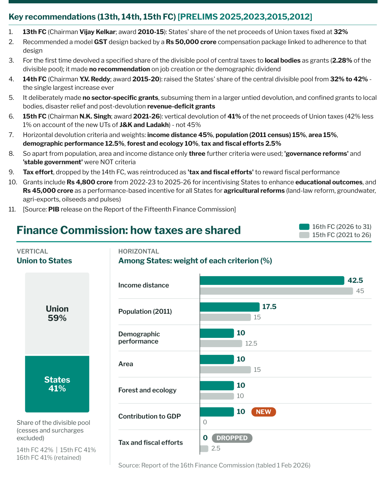

### [Prelims Source Page 165](../pages/prelims/prelims_page_165.pdf)

## CHAPTER 20
CONSTITUTIONAL BODIES (1)
THEME ANALYSIS PYQ pattern for this chapter
1. REPEATS

#### A. Oversight and the Audit Chain
- CAG reports reach the President under Art 151 and are then examined by the Public Accounts Committee [2012].
- The CAG exercises no exchequer control and holds no power to prosecute [2012].
- UPSC lays its annual report before Parliament with a memorandum on rejected advice (Art 323).

#### B. Powers Claimed Versus Powers Held
- The Finance Commission neither draws foreign capital nor divides finances among PSUs [2011].
- The Election Commission settles disputes on splits and mergers of recognised parties [2017].
- The Home Ministry never fixes the poll schedule; the ECI alone does [2017].

#### C. Finance Commission Awards by Number
- 13th FC: a GST design with compensation, plus local body grants from central taxes [2012].
- 14th FC raised the state share from 32 percent to 42 percent [2015].
- 15th FC added forest and ecology, demographic performance and tax effort as criteria [2023].
- 15th FC grants for educational outcomes and agricultural reform returned again [2025].

#### D. Strength, Tenure and Age Ceilings
- The ECI is a three member body under Art 324, not five [2017].
- CAG and UPSC members serve six years or age 65; a State PSC member stops at 62.
- Only the CEC and the CAG enjoy Supreme Court judge removal protection.
2. HOW THE FORMAT HAS CHANGED
- 2011 to 2015: single answer and code recall on the Finance Commission and CAG [2011, 2012, 2015]
- 2017: a three statement set on the ECI [2017]
- 2023 to 2025: counting and four statement sets on the 15th FC [2023, 2025]
3. WHAT IS BEING ASKED NOW
- 15th FC devolution criteria and grants [2023, 2025]
- Expect the 16th FC (2026 to 2031) next

#### Structured Tables on Page 165

| CHAPTER 20 |
| --- |
| CONSTITUTIONAL BODIES (1) |
| THEME ANALYSIS PYQ pattern for this chapter |
| 1. REPEATS A. Oversight and the Audit Chain • CAG reports reach the President under Art 151 and are then examined by the Public Accounts Committee [2012]. • The CAG exercises no exchequer control and holds no power to prosecute [2012]. • UPSC lays its annual report before Parliament with a memorandum on rejected advice (Art 323). B. Powers Claimed Versus Powers Held • The Finance Commission neither draws foreign capital nor divides finances among PSUs [2011]. • The Election Commission settles disputes on splits and mergers of recognised parties [2017]. • The Home Ministry never fixes the poll schedule; the ECI alone does [2017]. C. Finance Commission Awards by Number • 13th FC: a GST design with compensation, plus local body grants from central taxes [2012]. • 14th FC raised the state share from 32 percent to 42 percent [2015]. • 15th FC added forest and ecology, demographic performance and tax effort as criteria [2023]. • 15th FC grants for educational outcomes and agricultural reform returned again [2025]. D. Strength, Tenure and Age Ceilings • The ECI is a three member body under Art 324, not five [2017]. • CAG and UPSC members serve six years or age 65; a State PSC member stops at 62. • Only the CEC and the CAG enjoy Supreme Court judge removal protection. 2. HOW THE FORMAT HAS CHANGED • 2011 to 2015: single answer and code recall on the Finance Commission and CAG [2011, 2012, 2015] • 2017: a three statement set on the ECI [2017] • 2023 to 2025: counting and four statement sets on the 15th FC [2023, 2025] 3. WHAT IS BEING ASKED NOW • 15th FC devolution criteria and grants [2023, 2025] • Expect the 16th FC (2026 to 2031) next |

---

### [Prelims Source Page 166](../pages/prelims/prelims_page_166.pdf)

### PRELIMS PREVIOUS YEAR QUESTIONS

**Q1. Which of the following statements with regard to**
recommendations of the 15th Finance Commission of
India are correct? [2025]

#### I. It has recommended grants of ₹4,800 crores
from the year 2022–23 to 2025–26 for
incentivizing States to enhance educational
outcomes.
II. 45% of the net proceeds of Union taxes are to be
shared with States.
III. ₹45,000 crores are to be kept as
performance-based incentive for all States for
carrying out agricultural reforms.
IV. It reintroduced tax effort criteria to reward fiscal
performance.
SELECT THE CORRECT ANSWER USING THE CODE
GIVEN BELOW:
(a) I, II and III
(b) I, II and IV
(c) I, III and IV
(d) II, III and IV
**`ANSWER (c)`**

**Q2. Consider the following : [2023]**
1. Demographic performance
2. Forest and ecology
3. Governance reforms
4. Stable government
5. Tax and fiscal efforts For the horizontal tax
devolution, the Fifteenth Finance Commission
used how many of the above as criteria other than
population area and income distance?
(a) Only two
(b) Only three
(c) only four
(d) All five
**`ANSWER (b)`**

**Q3. Consider the following statements: [2017]**
1. The Election Commission of India is a ‘
five-member body.
2. Union Ministry of Home Affairs decides the
election schedule for the conduct of both general
elections and bye-elections.
3. Election Commission resolves the disputes
relating to splits/mergers of recognized political
parties.
Which of the statements given above is/are correct ?
(a) 1 and 2 only
(b) 2 only
(c) 2 and 3 only
(d) 3 only
**`ANSWER (d)`**

**Q4. With reference to the Fourteenth Finance**
Commission, which of the following statements is/are
correct? [2015]
(1) It has increased the share of States in the central
divisible pool from 32 percent to 42 percent
(2) It has made recommendations concerning
sector-specific grants Select the correct answer
using the code given below.
(a) 1 only
(b) 2 only
(c) Both 1 and 2
(d) Neither 1 nor 2
**`ANSWER (a)`**

**Q5. In India, other than ensuring that public funds are used**
efficiently and for intended purpose, what is the
importance of the office of the Comptroller and
Auditor General (CAG)? [2012]
1. CAG exercises exchequer control on behalf of the
Parliament when the President of India declares
national emergency/financial emergency.
2. CAG reports on the execution of projects or
programmes by the ministries are discussed by
the Public Accounts Committee.
3. Information from CAG reports can be used by
investigating agencies to press charges against
those who have violated the law while managing
public finances.
4. While dealing with the audit and accounting of
government companies, CAG has certain judicial
powers for prosecuting those who violate the law.
Which of the statements given above is/are correct?
(a) 1, 3 and 4 only
(b) 2 only
(c) 2 and 3 only
(d) 1, 2, 3 and 4
**`ANSWER (c)`**

---

### [Prelims Source Page 167](../pages/prelims/prelims_page_167.pdf)

**Q6. Which of the following is /are among the noticeable**
features of the recommendations of the Thirteenth
Finance Commission? [2012]
1. A design for the Goods and Services Tax, and a
compensation package linked to adherence to
the proposed design.
2. A design for the creation of lakhs of jobs in the
next ten years in consonance with India’s
demographic dividend.
3. Devolution of a specified share of central taxes to
local bodies as grants.
SELECT THE CORRECT ANSWER USING THE CODE
GIVEN BELOW:
(a) 1 only
(b) 2 and 3 only
(c) 1 and 3 only
(d) 1, 2 and 3
**`ANSWER (c)`**

**Q7. With reference to the Finance Commission of India,**
which of the following statements is correct? [2011]
(a) It encourages the inflow of foreign capital for
infrastructure development
(b) It facilitates the proper distribution of finances
among the Public Sector Undertakings
(c) It ensures transparency in financial administration
(d) None of the statements (a), (b) and (c) given above
is correct in this context
**`ANSWER (d)`**

---

### [Prelims Source Page 168](../pages/prelims/prelims_page_168.pdf)

PARAMETERS ELECTION COMMISSION UPSC SPSC CAG FC
Established Constitutional body from
1950, under Art 324
1. Constitutional body from
1950, under Art 315
2. Set up 1 Oct 1926 as the
Public Service Commission
under the GoI Act, 1919, on
the Lee Commission (1924)
recommendation
3. Renamed Federal Public
Service Commission by the
GoI Act, 1935
4. HQ: Dholpur House, New
Delhi
1. Constitutional body
from 1950, under Art
315
2. First provided for at
the provincial level by
the GoI Act, 1935;
given constitutional
status by the
Constitution
Constitutional office under Art
148, with duties, powers, tenure
and salary fixed by Parliament
through the CAG (DPC) Act,
1971
1. Constitutional body under Art
280
2. First Finance Commission
constituted 22 Nov 1951
(Chairman K.C. Neogy)
3. Qualifications and service
conditions laid down in the FC
(Miscellaneous Provisions)
Act, 1951
Purpose
[PRELIMS 2011]
Conducting free and fair
elections to Parliament and
State Legislatures
Recruitment to All India and
higher Central Services;
advising the President on
disciplinary matters
Recruitment to State
services; advising the
Governor on disciplinary
matters
Transparency and
accountability in government
finances by auditing receipts
and expenditure
Defining financial relations
between Centre and States;
recommendations on distribution
of taxes
Composition 1. CEC + 2 ECs at present
2. The number is not fixed
by convention - the
President may fix the
number of other ECs
from time to time (Art
324(2))
Strength not fixed by the
Constitution - the President
appoints the Chairman +
Members, usually 9-11
including the Chairman (Art
316(1))
Left to the Governor - he
appoints the Chairman +
Members
Single-member body - the CAG
alone, assisted by Deputy CAGs
/ Additional Deputy CAGs
Chairman + 4 Members
Qualifications 1. Persons of integrity who
hold or have held a post
equivalent to Secretary
to GoI, with knowledge
and experience in the
management and
conduct of elections
(CEC and other ECs Act,
2023)
2. The Constitution itself
prescribes none
Half the members must have
held office for 10 years under
the Union or a State
Government
Half the members must
have held office for 10
years under the Union or
a State Government
1. Not expressly prescribed
(Art 148); traditionally a
person with extensive
experience in accounting,
financial management and
public administration
2. Often an appointee from the
IAS or other senior
government roles related to
finance and administration
1. The Constitution leaves
qualifications to Parliament
(Art 280(2)); laid down in the
FC (Miscellaneous
Provisions) Act, 1951
2. Chairman - experience in
public affairs
3. The 4 Members are selected
from persons who:
(a) are, have been, or are
qualified to be appointed
a Judge of a High Court

#### Structured Tables on Page 168

| PARAMETERS | ELECTION COMMISSION | UPSC | SPSC | CAG | FC |
| --- | --- | --- | --- | --- | --- |
| Established | Constitutional body from 1950, under Art 324 | 1. Constitutional body from 1950, under Art 315 2. Set up 1 Oct 1926 as the Public Service Commission under the GoI Act, 1919, on the Lee Commission (1924) recommendation 3. Renamed Federal Public Service Commission by the GoI Act, 1935 4. HQ: Dholpur House, New Delhi | 1. Constitutional body from 1950, under Art 315 2. First provided for at the provincial level by the GoI Act, 1935; given constitutional status by the Constitution | Constitutional office under Art 148, with duties, powers, tenure and salary fixed by Parliament through the CAG (DPC) Act, 1971 | 1. Constitutional body under Art 280 2. First Finance Commission constituted 22 Nov 1951 (Chairman K.C. Neogy) 3. Qualifications and service conditions laid down in the FC (Miscellaneous Provisions) Act, 1951 |
| Purpose [PRELIMS 2011] | Conducting free and fair elections to Parliament and State Legislatures | Recruitment to All India and higher Central Services; advising the President on disciplinary matters | Recruitment to State services; advising the Governor on disciplinary matters | Transparency and accountability in government finances by auditing receipts and expenditure | Defining financial relations between Centre and States; recommendations on distribution of taxes |
| Composition | 1. CEC + 2 ECs at present 2. The number is not fixed by convention - the President may fix the number of other ECs from time to time (Art 324(2)) | Strength not fixed by the Constitution - the President appoints the Chairman + Members, usually 9-11 including the Chairman (Art 316(1)) | Left to the Governor - he appoints the Chairman + Members | Single-member body - the CAG alone, assisted by Deputy CAGs / Additional Deputy CAGs | Chairman + 4 Members |
| Qualifications | 1. Persons of integrity who hold or have held a post equivalent to Secretary to GoI, with knowledge and experience in the management and conduct of elections (CEC and other ECs Act, 2023) 2. The Constitution itself prescribes none | Half the members must have held office for 10 years under the Union or a State Government | Half the members must have held office for 10 years under the Union or a State Government | 1. Not expressly prescribed (Art 148); traditionally a person with extensive experience in accounting, financial management and public administration 2. Often an appointee from the IAS or other senior government roles related to finance and administration | 1. The Constitution leaves qualifications to Parliament (Art 280(2)); laid down in the FC (Miscellaneous Provisions) Act, 1951 2. Chairman - experience in public affairs 3. The 4 Members are selected from persons who: (a) are, have been, or are qualified to be appointed a Judge of a High Court |

---

### [Prelims Source Page 169](../pages/prelims/prelims_page_169.pdf)

PARAMETERS ELECTION COMMISSION UPSC SPSC CAG FC
(b) have special knowledge
of the finances and
accounts of Government
(c) have wide experience in
financial matters and
administration
(d) have special knowledge
of economics
Tenure (Years) 1. 6 years or till 65 years,
whichever is earlier - now
statutory, no longer left
to the President (CEC
and other ECs Act,
2023)
2. An EC appointed as CEC
gets a maximum of 6
years in aggregate
6 years or up to age 65 6 years or up to age 62 1. Fixed tenure - not during
the pleasure of the
President
2. 6 years or till 65 years,
whichever is earlier - fixed
by the CAG (DPC) Act, 1971,
NOT by the Constitution
The President must constitute a
Finance Commission at the
expiration of every fifth year, or
earlier if necessary (Art 280)
Reports None prescribed - no
reporting duty is cast on the
ECI (Art 324); contrast Arts
323, 151 and 281
Annual report to the President;
laid before Parliament with a
memorandum on cases where
UPSC advice was not accepted
(Art 323(1))
Annual report to the
Governor; laid before the
State Legislature, not
before the President (Art
323(2))
3 reports to the President (Art
151)
1. Appropriation Accounts
2. Finance Accounts
3. Audit Report on Public
Undertakings
All three are tabled in
Parliament and examined by
the PAC and the COPU.
Report to the President (Art
280(3)); laid before Parliament
with an explanatory
memorandum on action taken
(Art 281)
Removal 1. CEC: removable only in
like manner and on like
grounds as a Judge of
the SC (Art 324(5); CEC
and other ECs Act,
2023)
2. Other ECs: removable by
the President only on the
recommendation of the
1. Removal by the President if
he is adjudged an insolvent,
engages in paid
employment outside his
duties, or is unfit to continue
by reason of infirmity of
mind or body (Art 317(3))
2. For misbehaviour, the
President must refer the
case to the SC, whose
1. Though appointed by
the Governor, an SPSC
Chairman/Member
can be removed only
by the President - for
misbehaviour after an
SC inquiry (advice
binding), or for
insolvency / paid
Same as a Judge of the SC. 1. Disqualified or removable if of
unsound mind, an
undischarged insolvent,
convicted of an offence
involving moral turpitude, or
holding a financial or other
interest prejudicial to his
functions (FC (Miscellaneous
Provisions) Act, 1951)

#### Structured Tables on Page 169

| PARAMETERS | ELECTION COMMISSION | UPSC | SPSC | CAG | FC |
| --- | --- | --- | --- | --- | --- |
|  |  |  |  |  | (b) have special knowledge of the finances and accounts of Government (c) have wide experience in financial matters and administration (d) have special knowledge of economics |
| Tenure (Years) | 1. 6 years or till 65 years, whichever is earlier - now statutory, no longer left to the President (CEC and other ECs Act, 2023) 2. An EC appointed as CEC gets a maximum of 6 years in aggregate | 6 years or up to age 65 | 6 years or up to age 62 | 1. Fixed tenure - not during the pleasure of the President 2. 6 years or till 65 years, whichever is earlier - fixed by the CAG (DPC) Act, 1971, NOT by the Constitution | The President must constitute a Finance Commission at the expiration of every fifth year, or earlier if necessary (Art 280) |
| Reports | None prescribed - no reporting duty is cast on the ECI (Art 324); contrast Arts 323, 151 and 281 | Annual report to the President; laid before Parliament with a memorandum on cases where UPSC advice was not accepted (Art 323(1)) | Annual report to the Governor; laid before the State Legislature, not before the President (Art 323(2)) | 3 reports to the President (Art 151) 1. Appropriation Accounts 2. Finance Accounts 3. Audit Report on Public Undertakings All three are tabled in Parliament and examined by the PAC and the COPU. | Report to the President (Art 280(3)); laid before Parliament with an explanatory memorandum on action taken (Art 281) |
| Removal | 1. CEC: removable only in like manner and on like grounds as a Judge of the SC (Art 324(5); CEC and other ECs Act, 2023) 2. Other ECs: removable by the President only on the recommendation of the | 1. Removal by the President if he is adjudged an insolvent, engages in paid employment outside his duties, or is unfit to continue by reason of infirmity of mind or body (Art 317(3)) 2. For misbehaviour, the President must refer the case to the SC, whose | 1. Though appointed by the Governor, an SPSC Chairman/Member can be removed only by the President - for misbehaviour after an SC inquiry (advice binding), or for insolvency / paid | Same as a Judge of the SC. | 1. Disqualified or removable if of unsound mind, an undischarged insolvent, convicted of an offence involving moral turpitude, or holding a financial or other interest prejudicial to his functions (FC (Miscellaneous Provisions) Act, 1951) |

---

### [Prelims Source Page 170](../pages/prelims/prelims_page_170.pdf)

PARAMETERS ELECTION COMMISSION UPSC SPSC CAG FC
CEC - they do NOT enjoy
SC-judge protection
advice is binding (Art
317(1))
3. Removal in every case is by
the President
4. Being interested in a
Government contract or
sharing in its profits is
deemed misbehaviour (Art
317(4))
employment / infirmity
(Art 317)
2. The Governor may
only suspend pending
the President's order
2. FC members get no
SC-judge-like protection
Post-retirement /
Re-appointment
1. Not eligible for
re-appointment (CEC
and other ECs Act,
2023);
2. No bar, however, on
other post-retirement
Government office
1. Chairman: ineligible for
further employment under
the Union or any State
Government (Art 319(a));
2. Members: eligible only to
become Chairman of UPSC
or Chairman of any SPSC
(Art 319(c));
3. Not eligible for
re-appointment to the
same office (Art 316(3))
1. Chairman: can
become Chairman or
Member of UPSC, or
Chairman of any
other SPSC, and no
other employment
(Art 319(b));
2. Member: can become
Chairman or Member
of UPSC, or Chairman
of that or any other
SPSC (Art 319(d));
3. Not eligible for
re-appointment to the
same office (Art
316(3))
Not eligible for any further
office under the Government of
India or of any State (Art
148(4))
There is no bar on
post-retirement Government
office
Appointed by /
Recommending
Committee
1. President, on the
recommendation of a
Selection Committee
(CEC and other ECs Act,
2023): PM (Chair) + a
Union Cabinet Minister
nominated by the PM +
Leader of Opposition in
Lok Sabha
2. A Search Committee
under the Law Minister
President Governor President, by warrant under his
hand and seal (Art 148(1)); no
committee prescribed
President, every 5th year or at an
earlier time as he considers
necessary

#### Structured Tables on Page 170

| PARAMETERS | ELECTION COMMISSION | UPSC | SPSC | CAG | FC |
| --- | --- | --- | --- | --- | --- |
|  | CEC - they do NOT enjoy SC-judge protection | advice is binding (Art 317(1)) 3. Removal in every case is by the President 4. Being interested in a Government contract or sharing in its profits is deemed misbehaviour (Art 317(4)) | employment / infirmity (Art 317) 2. The Governor may only suspend pending the President's order |  | 2. FC members get no SC-judge-like protection |
| Post-retirement / Re-appointment | 1. Not eligible for re-appointment (CEC and other ECs Act, 2023); 2. No bar, however, on other post-retirement Government office | 1. Chairman: ineligible for further employment under the Union or any State Government (Art 319(a)); 2. Members: eligible only to become Chairman of UPSC or Chairman of any SPSC (Art 319(c)); 3. Not eligible for re-appointment to the same office (Art 316(3)) | 1. Chairman: can become Chairman or Member of UPSC, or Chairman of any other SPSC, and no other employment (Art 319(b)); 2. Member: can become Chairman or Member of UPSC, or Chairman of that or any other SPSC (Art 319(d)); 3. Not eligible for re-appointment to the same office (Art 316(3)) | Not eligible for any further office under the Government of India or of any State (Art 148(4)) | There is no bar on post-retirement Government office |
| Appointed by / Recommending Committee | 1. President, on the recommendation of a Selection Committee (CEC and other ECs Act, 2023): PM (Chair) + a Union Cabinet Minister nominated by the PM + Leader of Opposition in Lok Sabha 2. A Search Committee under the Law Minister | President | Governor | President, by warrant under his hand and seal (Art 148(1)); no committee prescribed | President, every 5th year or at an earlier time as he considers necessary |

---

### [Prelims Source Page 171](../pages/prelims/prelims_page_171.pdf)

PARAMETERS ELECTION COMMISSION UPSC SPSC CAG FC
sends a panel of 5
names
Salary, Pension,
Allowance
Salary, allowances and
conditions of service same
as a Judge of the Supreme
Court (CEC and other ECs
Act, 2023); but the ECI's
own expenditure is voted,
not charged on the
Consolidated Fund
Salaries, allowances and
pensions of the Chairman and
Members are charged on the
Consolidated Fund of India (Art
322); conditions of service are
made by the President (Art
318)
Salaries, allowances and
pensions of the SPSC
Chairman and Members
are charged on the
Consolidated Fund of the
State (Art 322);
conditions of service are
made by the Governor
(Art 318)
1. Salary equal to a Judge of
the Supreme Court (CAG
(DPC) Act, 1971)
2. The CAG’s own salary is
charged under Art 112(3)(e).
Art 148(6) covers the
administrative expenses of
his office.
1. Fees, salaries and allowances
are determined by the Central
Government by rules under
the FC (Miscellaneous
Provisions) Act, 1951
2. The President only specifies
whether service is
whole-time or part-time
Working /
Functions
[PRELIMS
2017,2012]
Conducts free and fair
elections, supervises
election machinery,
prepares electoral rolls,
grants recognition to
political parties, etc.
Conducts examinations for
recruitment to All India
Services and Central Services;
advises the government on
personnel matters such as
promotions, transfers and
disciplinary actions
Conducts examinations
for appointments to State
services; advises the
State Government on
personnel matters such
as promotions, transfers
and disciplinary actions -
similar to the UPSC but at
the State level
Audits government receipts
and expenditure; ensures
transparency and
accountability in government
financial operations
Advises the government on
financial matters such as
distribution of funds between
Centre and States, tax division,
grants-in-aid to States, etc.
Oath and
resignation
1. CEC and ECs resign by
writing addressed to the
President
2. No oath is prescribed for
them by the Constitution
or by the CEC and other
ECs Act, 2023
1. Chairman and Members
resign by writing addressed
to the President (first
proviso to Art 316(2))
2. No constitutional oath
Chairman and Members
of an SPSC resign by
writing addressed to the
Governor (first proviso to
Art 316(2)) - even though
only the President can
remove them
1. Resigns by writing
addressed to the President
2. The CAG takes an oath or
affirmation before the
President in the form set
out in the Third Schedule
(Art 148(2))
1. Members resign to the
President
2. The Commission is dissolved
once it submits its report, so
resignation rarely arises
3. No prescribed oath

#### Structured Tables on Page 171

| PARAMETERS | ELECTION COMMISSION | UPSC | SPSC | CAG | FC |
| --- | --- | --- | --- | --- | --- |
|  | sends a panel of 5 names |  |  |  |  |
| Salary, Pension, Allowance | Salary, allowances and conditions of service same as a Judge of the Supreme Court (CEC and other ECs Act, 2023); but the ECI's own expenditure is voted, not charged on the Consolidated Fund | Salaries, allowances and pensions of the Chairman and Members are charged on the Consolidated Fund of India (Art 322); conditions of service are made by the President (Art 318) | Salaries, allowances and pensions of the SPSC Chairman and Members are charged on the Consolidated Fund of the State (Art 322); conditions of service are made by the Governor (Art 318) | 1. Salary equal to a Judge of the Supreme Court (CAG (DPC) Act, 1971) 2. The CAG’s own salary is charged under Art 112(3)(e). Art 148(6) covers the administrative expenses of his office. | 1. Fees, salaries and allowances are determined by the Central Government by rules under the FC (Miscellaneous Provisions) Act, 1951 2. The President only specifies whether service is whole-time or part-time |
| Working / Functions [PRELIMS 2017,2012] | Conducts free and fair elections, supervises election machinery, prepares electoral rolls, grants recognition to political parties, etc. | Conducts examinations for recruitment to All India Services and Central Services; advises the government on personnel matters such as promotions, transfers and disciplinary actions | Conducts examinations for appointments to State services; advises the State Government on personnel matters such as promotions, transfers and disciplinary actions - similar to the UPSC but at the State level | Audits government receipts and expenditure; ensures transparency and accountability in government financial operations | Advises the government on financial matters such as distribution of funds between Centre and States, tax division, grants-in-aid to States, etc. |
| Oath and resignation | 1. CEC and ECs resign by writing addressed to the President 2. No oath is prescribed for them by the Constitution or by the CEC and other ECs Act, 2023 | 1. Chairman and Members resign by writing addressed to the President (first proviso to Art 316(2)) 2. No constitutional oath | Chairman and Members of an SPSC resign by writing addressed to the Governor (first proviso to Art 316(2)) - even though only the President can remove them | 1. Resigns by writing addressed to the President 2. The CAG takes an oath or affirmation before the President in the form set out in the Third Schedule (Art 148(2)) | 1. Members resign to the President 2. The Commission is dissolved once it submits its report, so resignation rarely arises 3. No prescribed oath |

---

### [Prelims Source Page 172](../pages/prelims/prelims_page_172.pdf)

*Diagram Screenshot: [Finance Commission: How Taxes Are Shared (Vertical & Horizontal Devolution)](../diagrams/pre_diag_finance_commission_tax_sharing_p172.png) | [Full Source Page 172](../pages/prelims/prelims_page_172.pdf)*

DETAILED NOTES
Key recommendations (13th, 14th, 15th FC) [PRELIMS 2025,2023,2015,2012]
1. 13th FC (Chairman Vijay Kelkar; award 2010-15): States' share of the net proceeds of Union taxes fixed at 32%
2. Recommended a model GST design backed by a Rs 50,000 crore compensation package linked to adherence to that
design
3. For the first time devolved a specified share of the divisible pool of central taxes to local bodies as grants (2.28% of the
divisible pool); it made no recommendation on job creation or the demographic dividend
4. 14th FC (Chairman Y.V. Reddy; award 2015-20): raised the States' share of the central divisible pool from 32% to 42% -
the single largest increase ever
5. It deliberately made no sector-specific grants, subsuming them in a larger untied devolution, and confined grants to local
bodies, disaster relief and post-devolution revenue-deficit grants
6. 15th FC (Chairman N.K. Singh; award 2021-26): vertical devolution of 41% of the net proceeds of Union taxes (42% less
1% on account of the new UTs of J&K and Ladakh) - not 45%
7. Horizontal devolution criteria and weights: income distance 45%, population (2011 census) 15%, area 15%,
demographic performance 12.5%, forest and ecology 10%, tax and fiscal efforts 2.5%
8. So apart from population, area and income distance only three further criteria were used; 'governance reforms' and
'stable government' were NOT criteria
9. Tax effort, dropped by the 14th FC, was reintroduced as 'tax and fiscal efforts' to reward fiscal performance
10. Grants include Rs 4,800 crore from 2022-23 to 2025-26 for incentivising States to enhance educational outcomes, and
Rs 45,000 crore as a performance-based incentive for all States for agricultural reforms (land-law reform, groundwater,
agri-exports, oilseeds and pulses)
11. [Source: PIB release on the Report of the Fifteenth Finance Commission]

---

### [Prelims Source Page 173](../pages/prelims/prelims_page_173.pdf)

Matters on which consultation is NOT required (Art 320)
UPSC
1. Consultation is compulsory (Art 320(3)) on:
- (a) methods of recruitment to civil services and posts;
- (b) principles for appointments, promotions and transfers, and the suitability of candidates;
- (c) all disciplinary matters, including memorials and petitions;
- (d) claims for legal costs incurred by a civil servant in defending acts done in the discharge of duty;
- (e) claims for an injury pension.
2. The President may also refer any other matter to the UPSC for advice.
3. Three carve-outs:
- (i) Exemption regulations: the President may make regulations specifying matters on which the UPSC need
not be consulted, the UPSC (Exemption from Consultation) Regulations (proviso to Art 320(3)).
- (ii) Reservations: the UPSC need not be consulted on the manner of making reservations under Art 16(4) or
on giving effect to Art 335 (SC/ST claims to services) (Art 320(4)).
- (iii) Non-civil posts: its remit is confined to civil services and civil posts, so it has no role in appointments to
the higher judiciary, the armed forces, or constitutional and statutory offices.
4. Parliamentary control: every exemption regulation must be laid before each House of Parliament for not less than
14 days, and Parliament may modify or repeal it (Art 320(5)).
SPSC
1. Same structure at State level: the same compulsory matters apply, and the Governor may refer any other matter for
advice.
2. Carve-outs:
- (i) the Governor makes the exemption regulations (proviso to Art 320(3));
- (ii) the exclusion for reservations under Art 16(4) and Art 335 applies identically to SPSCs (Art 320(4));
- (iii) the remit is likewise confined to civil services and posts of the State.
3. Legislative control: exemption regulations must be laid before the State Legislature for not less than 14 days (Art
320(5)).
Joint State PSC and UPSC serving a State (Art 315(2)-(4))
UPSC
1. Two or more States may agree to have one Public Service Commission for the group (Art 315(2))
2. Parliament may by law provide for such a Joint State Public Service Commission (JSPSC), but only if the Legislature of
each of those States first passes a resolution to that effect
3. A JSPSC is therefore a statutory body created by Parliament, not a constitutional one like the UPSC and SPSCs
4. Its Chairman and Members are appointed by the President (Art 316(1)), but its annual report goes to the Governor of
each participating State, who lays it before that State's legislature (Art 323(2))
5. The UPSC may, if requested by the Governor of a State and with the approval of the President, agree to serve all or any of
the needs of that State (Art 315(4))
SPSC
1. An SPSC ceases to exist for a State that joins a JSPSC
2. Only two Joint Commissions have ever been notified in practice
3. The usual arrangement for small States/UTs is instead the UPSC serving the State's needs on the Governor's request
with the President's approval (Art 315(4)) - how recruitment for several UTs and smaller States has been handled
Extension of functions and acting Chairman (Arts 321, 316(1A))
UPSC
1. The additional route by which a Commission's mandate can be enlarged: an Act of Parliament may provide for additional
functions to be exercised by the UPSC as respects Union services and also the services of any local authority, other
body corporate constituted by law, or public institution (Art 321)
2. An executive order cannot do this
3. If the office of Chairman falls vacant, or the Chairman is unable to act by reason of absence or otherwise, the President
appoints one of the other Members to act as Chairman until a regular appointment is made (Art 316(1A))

---

### [Prelims Source Page 174](../pages/prelims/prelims_page_174.pdf)

SPSC
1. An Act of the State Legislature may confer additional functions on the SPSC, including as respects the services of a
local authority or public institution in the State (Art 321)
2. The Governor appoints one of the Members to act as SPSC Chairman during a vacancy or the Chairman's inability to act
(Art 316(1A))
Is the advice / report binding?
UPSC
1. No. UPSC advice is advisory only.
2. State of U.P. v. Manbodhan Lal Srivastava (1957): the SC held that Art 320(3)(c) is directory, not mandatory. Failure
to consult the UPSC does not by itself invalidate a government order and gives the civil servant no cause of action.
3. The only safeguard is political. The annual report must be laid before Parliament with a memorandum explaining
every case in which the UPSC’s advice was not accepted (Art 323(1)).
SPSC
1. No. The same rule applies; the SPSC’s advice does not bind the State Government.
2. The memorandum on non-acceptance of SPSC advice must be laid before the State Legislature (Art 323(2)).
CAG
1. No. The CAG’s reports are recommendatory.
2. He has no power to prosecute, punish or recover money; he can only report.
3. Investigating agencies may use his findings, and Parliament acts through the PAC and COPU, but the CAG himself
has no judicial or quasi-judicial power [PRELIMS 2012].
4. The Constitution imposes no compliance obligation. But on the PAC’s directions, Ministries must submit Action
Taken Notes (ATNs) on his reports, conventionally within 4 months of tabling.
Types of CAG audit
1. The CAG’s own Auditing Standards (2017) recognise three types of audit.

#### A. Financial (attest) audit: checks whether the entity’s financial statements and accounts are presented fairly, in line
with the applicable financial reporting framework.

#### B. Compliance (regularity) audit: checks whether transactions, activities and information conform, in all material
respects, to the governing laws, rules, sanctions and authorities.

#### C. Performance audit: checks whether a programme, scheme or institution delivers economy, efficiency and
effectiveness (the “3 Es”).
2. Propriety audit: a lens, not a fourth type
- It asks whether public spending was wise, faithful and economical.
- It is applied within compliance and performance audits.
- Unlike legal and regulatory audit, which is obligatory, it is discretionary. This is why the CAG is criticised as
selective in using it.
3. Specialised streams include IT/systems audit and environment audit.
4. Once tabled, reports of all three kinds are examined by the PAC (Union and State accounts) and the COPU (public
undertakings).
What the CAG audits - and what he does not
What he audits
1. Duties are left to Parliament (Art 149). The CAG (DPC) Act, 1971 sets the perimeter.
2. Under that Act, he audits:
- all receipts and expenditure from the Consolidated Fund of the Union, States and UTs with a legislature;
- Contingency Fund and Public Account transactions;
- trading, manufacturing, profit-and-loss and stores and stock accounts;
- bodies and authorities substantially financed by government grants or loans (₹25 lakh or more, making up
at least 75% of their expenditure).
3. Government companies: the CAG appoints or re-appoints the statutory auditor under the Companies Act, 2013,
issues directions to him, and may conduct a supplementary audit. Government corporations are audited as their
governing Acts provide.
4. Any other body entrusted to him by the President or Governor after consulting him.

---

### [Prelims Source Page 175](../pages/prelims/prelims_page_175.pdf)

5. Sixth Schedule autonomous district councils: he audits them and reports to the Governor.
What he does not do
1. Panchayats and municipalities: there is no statutory CAG audit. Since the 11th Finance Commission, he provides
only Technical Guidance and Supervision (TGS) over the State’s Local Fund Audit. Individual local bodies can still be
entrusted to him under the CAG (DPC) Act, 1971.
2. Secret service expenditure: he cannot call for the details. He accepts a certificate from the competent executive
authority that the money was spent under its authority.
3. “Comptroller” is a misnomer: unlike the British CAG, he has no control over the issue of money from the
Consolidated Fund. The executive draws money without his sanction, so in substance he is only an Auditor General.