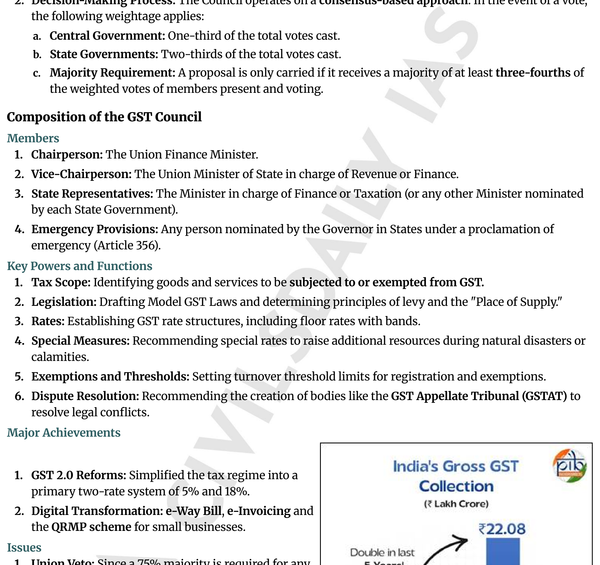

# Statutory, Non-Constitutional, Regulatory & Anti-Corruption Bodies (NITI Aayog, NHRC, CIC, Lokpal, CVC, CBI, ED, NIA) — Smash Mains Notes (X-Factor Mains'27)

---

### [Smash Mains Source Page 225](../pages/mains/mains_page_225.pdf)

## Chapter 14: Constitutional And Statutory Bodies

### PYQs

- **[2024]** "The duty of the Comptroller and Auditor General is not merely to ensure the legality of expenditure but also its propriety." Comment.(10)

- **[2025]** The National Commission for Protection of Child Rights has to address the challenges faced by children in the digital era. Examine the existing policies and suggest measures the Commission can initiate to tackle the issue. (15)

- **[2024]** "The duty of the Comptroller and Auditor General is not merely to ensure the legality of expenditure but also its propriety." Comment. (10)

- **[2023]** Discuss the role of the Competition Commission of India in containing the abuse of dominant position by the Multi-National Corporations in India. Refer to the recent decisions. (10)

- **[2022]** Discuss the role of the National Commission for Backward Classes in the wake of its transformation from a statutory body to a constitutional body. (10)

- **[2021]** Though the Human Rights Commissions have contributed immensely to the protection of human rights in India, yet they have failed to assert themselves against the mighty and powerful. Analyzing their structural and practical limitations, suggest remedial measures. (15)

- **[2020]** Which steps are required for constitutionalization of a commission? Do you think imparting constitutionality to the National Commission for Women would ensure greater gender justice and empowerment in India? Give reasons. (15)

- **[2020]** "Recent amendments to the Right to Information Act will have a profound impact on the autonomy and independence of the Information Commission". Discuss (10)

- **[2018]** Multiplicity of various commissions for the vulnerable sections of the society leads to problems of overlapping jurisdiction and duplication of functions. Is it better to merge all commissions into an umbrella Human Rights Commission? Argue your case. (15)

- **[2018]** Whether the National Commission for Scheduled Castes (NCSC) can enforce the implementation of constitutional reservation for the Scheduled Castes in the religious minority institutions? Examine. (10)

- **[2018]** "The Comptroller and Auditor General (CAG) has a very vital role to play." Explain how this is reflected in the method and terms of his appointment as well as the range of powers he can exercise. (10)

- **[2018]** How is the Finance Commission of India constituted? What do you know about the terms of reference of the recently constituted Finance Commission? Discuss. (15)

- **[2016]** Exercise of CAG's powers in relation to the accounts of the Union and the States is derived from Article 149 of the Indian Constitution. Discuss whether audit of the Government's policy implementation could amount to overstepping its own (CAG) jurisdiction. [12.5 Marks]

- **[2013]** 'A national Lokpal, however strong it may be, cannot resolve the problems of immorality in public affairs.' Discuss. (10)

---

### [Smash Mains Source Page 226](../pages/mains/mains_page_226.pdf)

*Diagram Screenshot: [India's Gross GST Collection Trend & Fiscal Impact (Article 279A)](../diagrams/mains_diag_gst_collection_trend_p226.png) · [Full Source Page 226](../pages/mains/mains_page_226.pdf)*

### GST Council

- **1.** GST Council is a constitutional body established to make recommendations to the Union and State Governments on issues related to GST. It is the centerpiece of India's fiscal federalism.

- **2.** Decision-Making Process: The Council operates on a consensus-based approach. In the event of a vote, the following weightage applies:

  - **a.** Central Government: One-third of the total votes cast.

  - **b.** State Governments: Two-thirds of the total votes cast.

  - **c.** Majority Requirement: A proposal is only carried if it receives a majority of at least three-fourths of the weighted votes of members present and voting.

### Composition of the GST Council

### Members

- **1.** Chairperson: The Union Finance Minister.

- **2.** Vice-Chairperson: The Union Minister of State in charge of Revenue or Finance.

- **3.** State Representatives: The Minister in charge of Finance or Taxation (or any other Minister nominated by each State Government).

- **4.** Emergency Provisions: Any person nominated by the Governor in States under a proclamation of emergency (Article 356).

### Key Powers and Functions

- **1.** Tax Scope: Identifying goods and services to be subjected to or exempted from GST.

- **2.** Legislation: Drafting Model GST Laws and determining principles of levy and the "Place of Supply."

- **3.** Rates: Establishing GST rate structures, including floor rates with bands.

- **4.** Special Measures: Recommending special rates to raise additional resources during natural disasters or calamities.

- **5.** Exemptions and Thresholds: Setting turnover threshold limits for registration and exemptions.

- **6.** Dispute Resolution: Recommending the creation of bodies like the GST Appellate Tribunal (GSTAT) to resolve legal conflicts.

### Major Achievements

- **1.** GST 2.0 Reforms: Simplified the tax regime into a primary two-rate system of 5% and 18%.

- **2.** Digital Transformation: e-Way Bill, e-Invoicing and the QRMP scheme for small businesses.

### Issues

- **1.** Union Veto: Since a 75% majority is required for any decision, the Union holds a de facto veto.

- **2.** Democratic Deficit: State legislatures have lost fiscal autonomy, as an executive body now determines more than 40% of their own-tax revenue.

- **3.** High complexity and compliance burden due to multiple tax slabs.

- **4.** Nearly half the economy remains outside GST. Eg. petroleum, real estate, electricity duties

- **5.** Fiscal Cliff: The expiry of revenue compensation has left several states facing revenue shortfall.

---

### [Smash Mains Source Page 227](../pages/mains/mains_page_227.pdf)

- **6.** Committee Opacity: Substantive policies are settled in officer-level committees that lack codified rules, transparency, or fair regional representation.

- **7.** Broken Tech Backbone: Suspension of automated invoice matching has enabled massive fraud and turned IGST settlements into an opaque "black box."

### Way Forward

- **1.** Recalibrated Voting: Reduce Union weight to 20% or adopt a "one member, one vote" model to ensure genuine federal partnership.

- **2.** Rotational Leadership: Implement a five-year rotational chairpersonship between the Union Finance Minister and State Ministers to democratize the agenda.

- **3.** Rate Flexibility: Allow States to vary SGST rates within a narrow "band" above floor rates to restore local fiscal agency.

- **4.** Independent Secretariat: Establish an autonomous Secretariat with balanced Union-State staffing to provide neutral data and professional, unbiased research.

- **5.** Legislative Oversight: Form a Joint Standing Committee of Parliament and State Legislatures to provide democratic supervision over executive tax decisions.

### Comptroller and Auditor General of India (CAG)

'The CAG is the conscience keeper of the government, ensuring that taxpayers' money is spent wisely and for the benefit of the public.'

### Constitutional and Legal Provisions

- **1.** Articles 148-151: Outline the appointment, oath, duties, and the process of laying audit reports before Parliament

- **2.** Tenure: Six years or up to 65 years of age. Removed like a Supreme Court judge.

- **3.** DPC Act, 1971: detail the CAG's specific duties, powers, and service conditions

- **4.** Independence: Salary charged on the Consolidated Fund of India. Ineligible for further government office after retirement

### Powers and Functions

- **1.** Audit of Expenditure: Audits all expenditure from the Consolidated, Contingency, and Public Accounts of India and States. (Article 149).

- **2.** Receipts and Stock: Examines all receipts and stores of the Union and State departments to check for leakages.

- **3.** Performance Audit: Evaluates the "3 E's" - Economy, Efficiency, and Effectiveness of government programs and social schemes.

- **4.** Propriety Audit: Goes beyond legality to comment on the "wisdom" and "faithfulness" of government spending.

- **5.** Certifying Net Proceeds: Acting as a final authority, the CAG certifies the net proceeds of any tax or duty (Article 279).

- **6.** Acts as the "friend, philosopher, and guide" to the Public Accounts Committee (PAC) during report scrutiny.

- **7.** Advises the President on the form/format in which accounts of the Union and States are kept (Article 150).

---

### [Smash Mains Source Page 228](../pages/mains/mains_page_228.pdf)

### Significance of Office of CAG

Significance of the Office of CAG

- **1.** Guardian of the Public Purse

- **2.** Upholding Financial Accountability by scrutinizing how public funds are utilized.

- **3.** Bulwark of Democracy: protect the integrity of India's democratic structure.

- **4.** Promoting Transparency: By publishing detailed audit reports & exposing systemic leakages and administrative failures. Eg. Coal and Fodder scams

- **5.** Beyond mere legal compliance, the CAG conducts Performance Audits to evaluate the "3 E's": Economy, Efficiency, and Effectiveness of government schemes and programs.

- **6.** Advisor to the PAC: "friend, philosopher, and guide" to the Public Accounts Committee

- **7.** Strengthening Local Governance: assesses local government performance in service delivery through through Annual Technical Inspection Reports (ATIR)

- **8.** Safeguarding Separation of Powers: ensure that executive's financial activities align with legislative intent Major Challenges and Limitations

- **1.** Ex-Post Facto Audit: CAG audits after the money is spent; it cannot stop a "wasteful" transaction in real-time.

- **2.** No Comptroller Power: Unlike the UK, the Indian CAG has no control over the actual withdrawal of funds.

- **3.** Secret Service Limit: Executive agencies can withhold specific details of secret service expenditure, providing only a certificate.

- **4.** Information Delays: Departments often delay providing files; the CAG lacks punitive powers to penalize such non-cooperation.

- **5.** Executive-Led Selection: potential concerns about institutional neutrality.

- **6.** Audit of PPPs: Legal ambiguity persists regarding the CAG's power to audit private partners in Public-Private Partnership projects.

- **7.** Falling Report Numbers: RTI data shows a 75% drop in central audit reports between 2015 and 2025.

- **8.** Limited Local Reach: Auditing lakhs of Panchayats and Urban Bodies is a massive administrative burden with limited staff.

- **9.** NGO/Society Ambit: Many government-funded NGOs and societies remain outside the CAG's mandatory audit jurisdiction.

- **10.** Delayed Tabling: Reports submitted to the President/Governor are often not tabled in the legislature for months. Case Studies

- Direct Tax Deductions (2026): Identified ₹74,766 crore in probable tax effects from 1,847 audit observations involving Banks and NBFCs.

- Ayushman Bharat (2024): Exposed 7.5 lakh beneficiaries linked to a single mobile number.

- 2G Spectrum: exposed presumptive losses of ₹1.76 lakh crore

- Scholarship Audits (2025): 20% of beneficiaries lacked caste/income verification.

- Indian Railways: Flagged ₹4,087 crore as unrecovered from 269 private siding owners

### Way Forward

- **1.** Adopt a committee-based appointment (PM, CJI, LoP) to ensure the CAG's independence.

---

### [Smash Mains Source Page 229](../pages/mains/mains_page_229.pdf)

- **2.** Amend the DPC Act to bring all PPPs and large NGOs under mandatory CAG scrutiny. (Vinod Rai)

- **3.** Grant the CAG power to impose fines on officials who delay or refuse to provide files.

- **4.** Mandate that all audit reports must be tabled in the legislature within 30 days of submission

- **5.** Real-time Auditing: Integrate the CAG's "AMPS" system with the government's PFMS for continuous, real-time financial monitoring

- **6.** Citizen Participation: Launch a portal for citizens to "flag" wasteful local expenditure for CAG's performance audits.

- **7.** Expanding Scope: Explicitly include the audit of "Sustainable Development Goals" (SDGs) and "Blue Economy" in the annual plan. CAG and audits of local bodies

- Article 243J & 243Z: These articles empower State Legislatures to make provisions for the maintenance of accounts and auditing of Panchayats and Municipalities respectively.

- Under CAG (DPC) Act, 1971, CAG exercises control and supervision over proper maintenance of accounts and auditing for all three levels of PRIs/ULBs.

- CAG provides "Technical Guidance and Supervision" to the Director of Local Fund Audit (DLFA) of various states. Powers and Functions in Local Audit

- Standardizing Formats: The CAG prescribes the budget and accounting formats (Eg. Model Accounting System for Panchayats) to ensure uniformity across India.

- Certification of Grants: The CAG certifies the utilization of grants released under Central Finance Commissions.

- Performance Audits: Eg. 2025-26 reports on "Solid Waste Management" in cities like Hyderabad and Raipur. Major Challenges and Limitations

- Arrears in Accounting: Many local bodies have not finalized their accounts for 3-5 years, making audit impossible.

- Manpower Crisis: The CAG has only one Auditor for every ~2,500 local bodies

- Non-Tabling of Reports in State Assemblies. Way Forward

- The CAG should audit the 500 largest ULBs to enable them to issue Municipal Bonds.

- Mandate the integration of Gram Sabha-led social audits with the CAG's statutory audit.

- Linking Funds to Audit (16th Finance Commission's recommendation).

- Deploy AI-based anomaly detection on the e-GramSwaraj portal to flag suspicious village-level spending automatically.

| Feature | CAG of India | CAG of United Kingdom |
| --- | --- | --- |
| Origin of Power | Constitutional - Directly derived from Article 148 of the Constitution. | Statutory - Derived from Acts of Parliament (National Audit Act, 1983). |
| Comptroller Role | Audit-only - Does not control the withdrawal of money; expenditure happens first. | Active Control - No money can be drawn from the Exchequer without approval. |

---

### [Smash Mains Source Page 230](../pages/mains/mains_page_230.pdf)

| Feature | CAG of India | CAG of United Kingdom |
| --- | --- | --- |
| Nature of Audit | Ex-post Facto - A "post-mortem" audit conducted after the money is spent. | Concurrent / Prior - Functions as a gatekeeper before and during expenditure. |
| Membership | Non-Member - Not a member of Parliament (Article 148). | MP Status - Officer of the House of Commons (historically an MP). |
| Accounting | Separated - Relieved of accounting functions in 1976 (Union level). | Integrated - Closely oversees both the accounting and auditing phases. |
| Tenure | 6 Years / 65 Years - Shorter tenure; limits institutional continuity. | 10 Years - Longer fixed tenure provides greater stability and expertise. |

Recent initiatives

- Artificial Intelligence Strategy Framework: using AI for anomaly detection, risk assessment, and predictive insights to enhance audit precision.

- CAG-LLM (Large Language Model): to help auditors access decades of institutional knowledge and analyze large datasets.

- CAG-Connect Portal: A unified digital interface providing auditee entities (government departments and PSUs) a platform to directly respond to audit queries, observations, and inspection reports.

- One IAAD, One Audit: A structural initiative aimed at standardizing audit methodologies across all field offices of the Indian Audit and Accounts Department (IAAD).

- Implementation of an accounting framework for the "Blue Economy," focusing on the sustainable valuation of coastal and marine resources.

- The CAG of India currently holds prestigious external auditor roles for several global organizations:

- WHO: Reappointed for a second four-year term (2024-2027).

- ILO: Selected as External Auditor for the term 2024-2027.

- IAEA: Serving as External Auditor for the term 2022-2027.

- OPCW (Organization for the Prohibition of Chemical Weapons)

### Union Public Service Commission (UPSC)

The Union Public Service Commission (UPSC) is India's premier central recruiting agency, established under Articles 315 to 323 of the Constitution.

- The Puja Khedkar Scandal: A trainee IAS officer was accused of faking her identity and misusing disability/OBC quotas. This led to her dismissal and a criminal FIR by UPSC.

- Lateral Entry Withdrawal (2024): UPSC cancelled an advertisement for 45 specialized posts (Joint Secretary/Director) following government directives

---

### [Smash Mains Source Page 231](../pages/mains/mains_page_231.pdf)

### Key Powers and Functions

- **1.** Conducting Examinations for Civil Services, Engineering, Medical, and Defense services.

- **2.** Advises the President on all matters relating to methods of recruitment to civil services.

- **3.** Consulted on the suitability of officers for promotion and transfer from one service to another

- **4.** Mandatorily consulted before taking disciplinary action (like dismissal) against a serving civil servant.

- **5.** Framing Recruitment Rules: Assists in drafting and amending rules for recruitment to various central posts.

- **6.** Lateral Entry Selection: Handles the selection process for private-sector experts into senior bureaucracy when tasked by the government.

- **7.** Joint Recruitment: Can assist two or more states in framing recruitment schemes if requested by State Governors.

- **8.** Submits an annual performance report to the President, which is then laid before Parliament.

### Major Issues Faced

- **1.** Quota Misuse: Eg. Puja Khedkar case

- **2.** Increasing CSAT Difficulty Skew favoring engineers over humanities students.

- **3.** Identity Fraud: Candidates appearing multiple times by faking names or birth dates.

- **4.** Verification Gaps: Reliance on state-issued certificates that UPSC lacks the machinery to verify.

- **5.** Lateral Entry Friction: Lack of reservation in specialized posts causing political and social backlash.

- **6.** Lengthy Cycle: The 12-month-long recruitment process causes significant "human capital drain."

### Way Forward

- **1.** 2nd ARC: Introduce specialization in recruitment, particularly for technical and specialized services such as Indian Engineering Services (IES) and Indian Economic Services (IES).

- **2.** Baswan Committee (2016):

  - **a.** Gradually reduce the upper age limit for appearing in the Civil Services Examination from 32 years to 27 years.

  - **b.** Reform the Mains examination by reducing the number of optional subjects, to focus more on general studies and governance-related topics.

- **3.** Hota Committee (2004): reducing the time lag between the preliminary examination, mains, and interview stages to ensure quicker recruitment of officers.

### Finance Commission of India

The Finance Commission of India is a Quasi-Judicial constitutional body that defines the financial relations between the Union and the States. The focus has shifted towards "Compliance-driven Federalism" under the 16th Finance Commission (FC).

### Constitutional Provisions

- **1.** Article 280: Mandates the President to constitute a Finance Commission every five years (or earlier).

- **2.** Article 281: Requires the President to lay the Commission's recommendations and the "Action Taken Report" before Parliament.

- **3.** Article 243-I & 243-Y: Mandate State Finance Commissions to review the financial position of Panchayats and Municipalities.

---

### [Smash Mains Source Page 232](../pages/mains/mains_page_232.pdf)

### Key Powers and Functions

- **1.** Vertical Devolution: Recommends the percentage of central taxes to be shared with States

- **2.** Horizontal Devolution: Designates the formula (population, income distance, etc.) to distribute the 41% share among different States.

- **3.** Grants-in-Aid: Determines the principles and amounts for grants to States under Article 275.

- **4.** Suggests measures to augment the State Consolidated Fund to assist Panchayats and Municipalities.

- **5.** Fiscal Consolidation: Reviews the debt levels of the Union and States and recommends a "Fiscal Roadmap."

- **6.** Disaster Management: Recommends the funding patterns and allocations for Disaster Risk Management Funds (SDRF/NDRF).

- **7.** Advisory Role: Provides recommendations on any other matter referred to it by the President in the interest of "Sound Finance."

### Key Achievements

- **1.** Successfully maintained the 41% vertical share for States, ensuring financial predictability despite global economic shifts.

- **2.** Digital Transparency: Mandatory CAG-certified disclosure of "Net Tax Proceeds" was accepted to ensure States receive their fair share.

- **3.** Allocated ₹2.04 lakh crore for state disaster funds, enhancing climate resilience.

- **4.** Urbanization Premium: Introduced a first-of-its-kind grant to support the transition of rural clusters into organized urban local bodies.

- **5.** Brought "Off-budget borrowings" into the main fiscal deficit calculations for both Union and States.

### Major Limitations

- **1.** North-South Equity Gap: Southern states feel "penalized" for successful population control under the 2011 Census-based devolution formulas.

- **2.** Advisory Nature: Recommendations are not legally binding

- **3.** Cess and Surcharges are excluded from the divisible pool, reducing the States' effective tax share. (35% against recommended 41%)

- **4.** Central Dominance: The Centre unilaterally appoints the Chairman and members and sets the "Terms of Reference" (ToR).

- **5.** The 16th FC had to rely on 2011 Census data due to the delayed 2021 Census.

- **6.** Weak State Finance Commissions (SFCs) prevents the Central Commission from accurately funding local bodies.

- **7.** One-Size-Fits-All Roadmap: Imposing a strict 3% GSDP deficit cap may hinder capital expenditure in debt-stressed States.

- **8.** Exclusion of CSS: Centrally Sponsored Schemes (CSS) remain outside the FC's scope

- **9.** Temporary Nature: Being an ad hoc body every five years prevents continuous monitoring of fiscal developments.

### Way Forward

- **1.** Permanent Status: Convert the Finance Commission into a permanent body to ensure year-round monitoring of federal finances.

- **2.** Amend the Constitution to include Cess and Surcharges in the divisible pool beyond a certain percentage.

- **3.** Independent Selection: Create a bipartisan committee (including States) to select the FC Chairman and members.

---

### [Smash Mains Source Page 233](../pages/mains/mains_page_233.pdf)

- **4.** Empowering SFCs: Link Central grants to the mandatory and timely submission of State Finance Commission reports.

- **5.** Customized Fiscal Limits: Adopt state-specific debt-pathways instead of a uniform 3% cap for all.

- **6.** Harmonization with GST Council: Establish a formal coordination mechanism between the FC and the GST Council to avoid policy overlap.

### NITI Aayog

NITI Aayog, established on January 1, 2015, is the policy think tank of the Indian government, replacing the Planning Commission. It is supported by the attached and autonomous bodies of Development Monitoring and Evaluation Organisation (DMEO), Atal Innovation Mission (AIM) and National Institute of Labour Economics Research and Development (NILERD).

### Difference Between NITI Aayog & Planning Commission

| Feature | NITI Aayog | Planning Commission |
| --- | --- | --- |
| Status | Advisory Think Tank | Extra-constitutional, centralized body |
| Constitution | Established by Executive Resolution (2015) | Established by Executive Order (1950) |
| Approach to Planning | Bottom-Up Approach, participatory planning involving states | Top-Down Approach, central control with minimal state inputs |
| Federal Structure Role | Promotes Cooperative Federalism; states are equal partners | States participated as spectators in annual plans |
| Policy Powers | No mandate to impose policies | Imposed policies on states with tied funds |
| Fund Allocation Powers | No fund allocation power; Finance Ministry holds that responsibility | Had powers to allocate funds to ministries & states |
| Planning | No fixed plans; issues policy recommendations and long-term visions like Strategy@75 | Fixed Five-Year Plans, centralized development targets |

### Functions

- **1.** Formulating Strategic and Long-Term Policies: Eg. Strategy for New India @75

- **2.** Cooperative & Competitive Federalism: Eg. Aspirational Districts Programme (ADP)

- **3.** Think Tank & Knowledge Hub: Acting as a funnel for global best practices and technical advice to Central/State governments.

- **4.** Monitoring and Evaluation: Assessing the implementation of schemes via the Development Monitoring and Evaluation Office (DMEO).

---

### [Smash Mains Source Page 234](../pages/mains/mains_page_234.pdf)

- **5.** Innovation Promotion: Creating an entrepreneurial ecosystem through flagship programs like the Atal Innovation Mission (AIM).

- **6.** Facilitating Capacity Building and Knowledge Sharing: Eg.. SATH initiative

- **7.** Sustainable Development Goals (SDGs) Implementation: Eg. Publishes SDG India Index annually to rank states

- **8.** International Cooperation: Collaboration with World Bank, OECD, Bill & Melinda Gates Foundation for best practices in health, education.

### Achievements of NITI Aayog

- **1.** Enhanced cooperative federalism: Act as a linking bridge between central and state governments. Eg. NITI Aayog's 'Team India Hub'

- **2.** Aspirational Districts Programme (ADP) to transform 112 most under-developed districts across the country..

- **3.** Strengthened competitive federalism: Eg. Fiscal Health Index, Composite Water Management Index, State Energy and Climate Index etc.

- **4.** Governance and policy advice: assisting over 25 States in establishing State Institutions for Transformation (SITs). Eg. MITRA in Maharashtra, TIFT in Tripura

- **5.** Promoting innovation, entrepreneurship and digital transformation through initiatives like Atal Innovation Mission, Knowledge and Innovation Hub etc.

- **6.** Sustainable Developments Goals (SDGs) monitoring: plays a crucial role in synchronizing nation's developmental programs in line with the targets. Eg. SDG India Index.

- **7.** Sampoornata Abhiyan 2.0: to achieve 100% saturation of critical KPIs (like bovine vaccination and maternal health) in 112 Aspirational Districts and 513 Aspirational Blocks

- **8.** Aspirational Blocks Programme (ABP): Expanded the success of districts to the block level, monitoring 40 indicators across 513 blocks to improve last-mile delivery

### Criticism

- **1.** Lack of Statutory Status: Unlike the Planning Commission, which had statutory standing, NITI Aayog operates merely as an executive body.

- **2.** Lack of Financial Power: Unlike the Planning Commission, NITI cannot allocate funds, making it a "toothless" advisory body

- **3.** Implementation Gap: It formulates policies, but the actual execution remains with Ministries/States

- **4.** Advisory Nature: Recommendations are non-binding

- **5.** Limited Staffing: Heavy reliance on young professionals and consultants rather than permanent specialized cadres

- **6.** Political Friction: Opposition-ruled states sometimes boycott Governing Council meetings, stalling the "Cooperative Federalism" goal

- **7.** Overlap of Roles: Functions often overlap with the Finance Commission or Inter-State Council, causing administrative redundancy.

### Way Forward

- **1.** Consider giving NITI Aayog a statutory basis to increase its institutional weight.

- **2.** Limited Funding Role: Allow NITI to recommend "Innovation Grants" directly to States for successful pilot projects.

- **3.** Develop a permanent "National Policy Cadre" to reduce over-dependence on short-term consultants.

- **4.** Shift from "Ranking States" to "Hand-holding States" through dedicated SITs in every state.

---

### [Smash Mains Source Page 235](../pages/mains/mains_page_235.pdf)

- **5.** Empower Regional Councils to meet more frequently to resolve specific inter-state disputes (Eg. river water).

- **6.** Strengthening DMEO: Give the evaluation office the power to "audit" the socio-economic impact of major Union schemes.

### National Commission For SC, ST, BC's

The National Commission for Scheduled Castes (NCSC), Scheduled Tribes (NCST), and Backward Classes (NCBC) are constitutional/statutory bodies established to safeguard the rights and socio-economic development of marginalized communities.

### Evolution

Special Officer for SCs and STs

- **1.** Originally, Article 338 of the Indian Constitution provided for the appointment of a Special Officer for Scheduled Castes (SCs) and Scheduled Tribes (STs).

- **2.** The Special Officer was designated as the Commissioner for SCs and STs.

- **3.** Primary task was to investigate all matters relating to the constitutional safeguards for the SCs and STs and to report to the President on their workings. 65th Constitutional Amendment Act of 1990

- **1.** It amended Article 338 of the Indian Constitution and provided for the establishment of a high-level multi-member National Commission for SCs and STs.

- **2.** This constitutional body replaced the Commissioner for SCs and STs. 89th Constitutional Amendment Act of 2003

- **1.** Amended Article 338 and inserted a new Article 338-A in the Constitution. It added

  - **a.** National Commission for Scheduled Castes (NCSC) - Article 338.

  - **b.** National Commission for Scheduled Tribes (NCST) - Article 338-A. NCBC: Statutory body (became constitutional via 102nd Amendment Act, 2018, Article 338B).

### Powers and Functions

- **1.** Investigative Power: To monitor all matters relating to safeguards provided for SCs, STs, and BCs under the Constitution or any other law.

- **2.** Quasi-Judicial Authority: While investigating any matter, the Commissions have the powers of a Civil Court:

  - **a.** Summoning and enforcing attendance of any person.

  - **b.** Discovery and production of any document.

  - **c.** Receiving evidence on affidavits.

- **3.** Advisory Role: Participating in and advising on the socio-economic development planning of these classes.

- **4.** Mandatory Consultation: The Union and State governments must consult these Commissions on all major policy matters affecting these communities.

- **5.** Presents annual and special reports to the President of India on the working of constitutional safeguards for SCs.

- **6.** Monitors the implementation of safeguards provided under the Constitution and other laws. Eg. Atrocities Act, 1989,

### Challenges

- **1.** Commissions' recommendations are advisory, not binding.

---

### [Smash Mains Source Page 236](../pages/mains/mains_page_236.pdf)

- **2.** Lack of Enforcement: While they have civil court powers to investigate, they have no power to punish or enforce a verdict. 3. over a dozen annual reports (some dating back 7 years) are currently pending in Parliament without being tabled or discussed.

- **4.** Underrepresentation in Decision-Making: Fewer SC/ST/BC officers in senior bureaucratic and judiciary positions (NCSC 2022 Report).

- **5.** Political Appointments: Chairpersons are often retired politicians or loyalists, leading to "political patronage" rather than expert-led social justice.

- **6.** Staffing & Budget Crunch hinders the ability to conduct independent investigations.

- **7.** Despite these bodies, NCRB data shows a steady increase in crimes against SCs and STs.

- **8.** Coordination Overlaps: Functional overlaps between NCSC, NCST, NCBC causing ambiguity.

- **9.** Limited Suo Motu Action: Commissions often wait for formal complaints rather than proactively investigating systemic violations.

- **10.** Digital Divide: Rural tribal and Dalit populations often cannot access the online grievance portals of these commissions.

- **11.** Overlap of Jurisdiction: Post-105th Amendment, confusion often exists between the NCBC and State Backward Class Commissions regarding "Central List" vs. "State List" grievances.

- **12.** Intra-group Inequality: Commissions have struggled to address "elite capture" where a few dominant sub-castes corner most reservation benefits.

- The SC judgment allowing states to sub-classify SCs/STs for more equitable reservation has placed a new advisory burden on the NCSC to monitor intra-caste disparities.

- The 105th Constitutional Amendment Act, 2021, restored the power of State governments and Union Territories to identify and notify their own lists of Socially and Educationally Backward Classes (SEBCs) or Other Backward Classes (OBCs).

### Major Achievements and Case Studies

National Commission for Scheduled Castes (NCSC)

- Mirchpur Atrocity Case (Haryana, 2010) - Immediate visit and fact-finding; monitored trial process. Helped expedite compensation, shifted trial to Delhi for impartiality.

- AIIMS Discrimination Allegations (2019) - NCSC Issued notice to AIIMS administration; asked for redress mechanisms.

- Amendments to the SC/ST (Prevention of Atrocities) Act, 1989 - NCSC consolidated recommendations to the Ministry of Home Affairs

- Forest Rights Act Implementation (Chhattisgarh Pilot, 2015) - NCST Partnered with state authorities to streamline FRA processes in Bastar region

- NCBC's report led to a harmonized Central OBC list, clarifying eligibility and ensuring consistent reservations for lakhs of candidates in UPSC and SSC exams.

- Vedanta Project (NCST): The Commission was largely ineffective in preventing the initial land alienation of the Dongria Kondh tribe in Odisha until the Supreme Court intervened.

- Hathras Case (NCSC): Critics argued the NCSC's response was "reactionary" rather than "preventative" in handling the 2020 tragedy and its aftermath.

- Maratha Reservation (NCBC): The NCBC's lack of a clear definition of "backwardness" led to legal contradictions during the Maratha quota debates (2021-24).

---

### [Smash Mains Source Page 237](../pages/mains/mains_page_237.pdf)

### Way Forward

- **1.** Time-bound Inclusion/Exclusion Process: Clear timelines for OBC list revisions (as NCBC suggested in 2019).

- **2.** Amend the Constitution to make recommendations binding in cases of human rights violations or land alienation.

- **3.** Transparency in Appointments: Establish a Search Committee (including the CJI and Leader of Opposition) to appoint members based on expertise.

- **4.** Financial Autonomy: Grant the Commissions a separate budget directly from the Consolidated Fund of India to reduce dependency on ministries.

- **5.** Real-time Reporting: Implement a "Digital Dashboard" for real-time tracking of complaints and the status of annual reports.

- **6.** Social Audit: Mandate an annual social audit of the Commissions' performance by independent NGOs or academic institutions.

- **7.** Power of Contempt: Grant the Commissions limited powers of contempt for authorities who ignore summons or refuse to provide documents.

### Special Office for Linguistic Minorities

Article 350B inserted by the 7th Amendment Act (1956) following the States Reorganisation Commission's recommendations provides for Special Officer for Linguistic Minorities

### Powers and Functions

- **1.** Investigative Authority (Article 350B(2)): Investigates all matters relating to safeguards provided for linguistic minorities under the Constitution.

- **2.** Submits annual and special reports to the President regarding the status of linguistic safeguards

- **3.** Liaison with States: Maintains constant contact with state nodal officers to monitor the implementation of the "10-Point Programme."

- **4.** Grievance Redressal: Receives and examines representations from individuals or associations regarding non-implementation of linguistic rights.

- **5.** Field Evaluations: Conducts field visits to minority-concentrated areas to assess actual conditions of language preservation

- **6.** Questionnaire Monitoring: Distributes annual questionnaires to States/UTs to collect data on linguistic education and administration.

- **7.** Awareness Generation: Conducts seminars and meetings to inform minority communities about their constitutional rights

- **8.** Advisory Role: Recommends remedial actions to the Union and State governments to resolve persisting linguistic conflicts.

### Major Challenges and Limitations

- **1.** Lack of Enforcement: Recommendations are purely advisory; the CLM cannot compel any state to implement changes

- **2.** No Civil Court Powers: Unlike the NCSC/NCST, the CLM cannot summon witnesses or demand documents legally

- **3.** Delayed Tabling: Reports are often tabled in Parliament with a 5-8 year delay, rendering findings obsolete

- **4.** Structural Weakness: only 3 regional offices across the country

---

### [Smash Mains Source Page 238](../pages/mains/mains_page_238.pdf)

- **5.** Administrative Dependence: Operates under the Ministry of Minority Affairs, lacking the autonomy of other constitutional bodies.

- **6.** Indefinite Tenure: The Constitution is silent on the officer's tenure, qualifications, or removal process

- **7.** State Non-Cooperation: Many states fail to return the CLM's monitoring questionnaires, leading to data gaps

- **8.** Defining "Minority": Lack of a clear constitutional definition for "Linguistic Minority" leads to frequent legal disputes Major Case Studies Successes

- Belagavi Language Dispute: The CLM successfully brokered administrative guidelines for Marathi speakers in Karnataka's border districts

- Odia in Andhra: Persistent CLM interventions ensured the printing of textbooks in Odia for schools in Srikakulam Limitations

- Bengali in Assam: The CLM remained largely sidelined during the intense linguistic tensions surrounding the NRC process

- Santhali Script Issue: Failed to ensure a uniform script policy (Ol Chiki) across three neighboring eastern states

### Way Forward

- **1.** Quasi-Judicial Status: Grant the CLM "Civil Court" powers to summon officials for failing to provide data.

- **2.** Mandatory Tabling: Amend rules to ensure reports are discussed in Parliament within 6 months of submission.

- **3.** Regional Expansion: Establish offices in every State Capital to bridge the gap between Delhi and remote linguistic groups.

- **4.** Digital Grievance Cell: Launch a mobile app for real-time reporting of linguistic discrimination at the village level.

- **5.** Inter-State Council Role: Use the Inter-State Council to resolve cross-border linguistic disputes identified by the CLM.

### National Human Rights Commission

NHRC is a statutory body, established under the Protection of Human Rights act 1993. It is established in conformity with Paris Principles 1991 and aims to protect and promote human rights, including rights related to life, liberty, equality, and dignity.

### Functions of NHRC

- **1.** Civil Court Authority: Possesses powers to summon witnesses, discover documents, and receive evidence on affidavits.

- **2.** Suo Motu Inquiries: Can independently initiate investigations into rights violations based on media reports or personal knowledge. Eg. registered 128 suo motu cases in 2025

- **3.** Prison Inspections: Authorized to visit any jail or detention center to evaluate inmate conditions and recommend reforms.

---

### [Smash Mains Source Page 239](../pages/mains/mains_page_239.pdf)

- **4.** Court Intervention: Can intervene in any judicial proceeding involving human rights allegations with the court's prior permission.

- **5.** Reviews constitutional and legal safeguards for human rights and suggests measures for their effective implementation. Eg. suggested amendments to the Manual Scavenging Act

- **6.** Research Promotion: Encourages and undertakes research in the field of human rights to influence national policy.

- **7.** Promotes human rights literacy through publications, media, and seminars to empower the vulnerable.

- **8.** NGO Partnerships: Collaborates with and supports non-governmental organizations working in the field of human rights protection.

- **9.** Recommends compensation or initiation of proceedings against guilty public servants to the government. Eg. In 2025-26, it recommended ₹7.3 crore for victims of custodial violence.

- **10.** Reviews international treaties and instruments and makes recommendations for their effective domestic implementation. Eg. pushed for ratification of UN Convention Against Torture

### Challenges related to NHRC

- **1.** Recommendatory Role: Its findings are not legally binding.

- **2.** One-Year Limitation: cannot investigate any incident that occurred more than one year before the date of the complaint.

- **3.** It has limited jurisdiction over armed forces and can only seek report from the Centre. Eg. In cases involving AFSPA areas, it cannot summon military personnel or conduct investigations.

- **4.** The Commission cannot punish violators of human rights or award compensation directly. Rely on government departments to initiate prosecution against the erring officials.

- **5.** Staffing Vacancies: High vacancy levels in key administrative and investigative posts hinder the Commission's ability to handle its massive caseload. Eg. over 44,000 cases pending.

- **6.** Financial Dependency on the Ministry of Home Affairs for its budget.

- **7.** The NHRC lacks a dedicated, independent investigative agency and relies on the state police

- **8.** Delayed Tabled Reports: Eg. Reports for the year 2019 and 2020 were only discussed in the legislature in late 2024.

- **9.** The appointment committee is dominated by the ruling political executive. Eg. GANHRI deferred NHRC's "A" status citing lack of diversity and political influence in appointments

### Major achievements

- **1.** NHRC's investigation on custodial deaths led to states like Tamil Nadu and Maharashtra implementing stricter SOPs for police stations.

- **2.** Intervention in Child Labour: Its proactive role facilitated the rescue of around 40,000 child labourers and rehabilitation efforts in coordination with the state government.

- **3.** Prison Reforms Advocacy: In 2015, NHRC released a detailed report highlighting issues like overcrowding, poor hygiene, lack of legal aid, and trial delays in Indian prisons.

- **4.** Addressing Manual Scavenging: NHRC issued notices to the Government of Maharashtra in 2017 resulting in compensation to victims' families.

- **5.** Migrant Worker Protection (2026): The NHRC intervened in March 2026 to successfully repatriate four Indian workers held in conditions resembling forced labor in Thailand.

- **6.** Safety Interventions (2026): The Commission took suo motu cognizance of a hazardous oleum gas leak in Palghar, Maharashtra, monitoring the case for environmental violations and industrial negligence.

- **7.** Relief for Medical Negligence: In a notable case, the NHRC held the state government liable for botched eye surgeries, ensuring compensation of ₹1 lakh each for six victims.

---

### [Smash Mains Source Page 240](../pages/mains/mains_page_240.pdf)

### Way Forward for NHRC

- **1.** Amend the Protection of Human Rights Act to make NHRC recommendations binding on the government, subject to a High Court appeal.

- **2.** Establish a permanent, autonomous investigative cadre consisting of experts and independent forensic scientists to eliminate police bias.

- **3.** Remove of the One-Year Bar for investigating grave human rights crimes like torture or forced disappearances.

- **4.** Grant the Commission the authority to initiate contempt proceedings against public servants who refuse to comply with its summons or directives.

- **5.** Allow the NHRC to independently investigate non-combat, human rights-related complaints against the armed forces in disturbed areas.

- **6.** Financial Autonomy: Create a non-votable budget for the NHRC, drawn directly from the Consolidated Fund of India, to ensure absolute financial independence.

- **7.** Enhanced Digital Presence: Scale up the HRCNet and mobile applications to allow real-time reporting of atrocities in local languages across rural India.

- **8.** Global Best Practice:

  - **a.** UN Paris Principles call for pluralism and independence in national human rights institutions (NHRIs).

  - **b.** UK Equality and Human Rights Commission (EHRC) has powers to initiate legal proceedings and enforce compliance.

  - **c.** UN Guiding Principles on Business and Human Rights promote state oversight over corporate practices; several countries like Norway have adopted this.

### National Commission for Women

The National Commission for Women (NCW) is the apex statutory body in India established to protect and promote the interests of women.

### Organisational Structure

- **1.** Chairperson: A person committed to the cause of women, nominated by the Central Government.

- **2.** Five Members: Experts in law, management, administration, or social welfare; at least one must be from SC and ST communities.

- **3.** Member Secretary: An expert in management or an officer from the Civil Services/All-India Services nominated by the Centre.

- **4.** The Chairperson and every member hold office for a period not exceeding three years.

### Major Powers and Functions

- **1.** Review constitutional and legal safeguards for women and recommend remedial legislative measures to the government. Eg. Proposed amendments to the Dowry Prohibition Act

- **2.** Receiving and processing complaints related to deprivation of women's rights and non-implementation of protective laws.

- **3.** Suo Motu Cognizance: Can take independent notice of issues involving women's rights violations based on media reports or other sources.

- **4.** Civil Court Powers: Authorized to summon witnesses, require document discovery, and receive evidence on affidavits during inquiries

- **5.** Jail Inspections: Inspects jails, remand homes, or other places of custody for women to ensure humane treatment and reforms.

---

### [Smash Mains Source Page 241](../pages/mains/mains_page_241.pdf)

- **6.** Research and Studies: Commissions studies into the socio-economic conditions of women to identify and remove factors inhibiting their advancement.

- **7.** Advises the Union and State governments on the planning process for the socio-economic development of women.

- **8.** Report Submission: Mandated to submit annual and special reports to the government regarding the status of women's rights.

- **9.** Mahila Jan Sunwai: A pilot project to facilitate speedy disposal of complaints via in-person and online hearings.

### Significance of National Commission for Women

- **1.** Watchdog of Rights: Monitors safeguards. Eg. POSH Act implementation in corporate offices

- **2.** Legal Catalyst: Influenced the Triple Talaq campaign and subsequent legislation in 2019.

- **3.** Grassroots Advocacy: "She is a Changemaker" initiative

- **4.** International Interface: Represents India at UN Women forums to align domestic policies with global gender standards.

- **5.** Safety Audits: Eg. Shimla Consultation 2026 for safer university environments.

- **6.** Economic Empowerment: Eg. Digital Shakti 4.0 reaching 6 lakh women.

### Major Challenges and Limitations

- **1.** Recommendatory Nature: Its findings are not legally binding

- **2.** No Punitive Power: can only recommend prosecution to the police or government.

- **3.** Financial Dependence on the Ministry of Women and Child Development, limits functional autonomy.

- **4.** Staffing Vacancies: Shortage of permanent investigative staff leads to a heavy reliance on deputation from other government departments.

- **5.** Political Interference: The Chairperson and members are government nominees, leading to frequent allegations of partisan functioning or selective activism.

- **6.** Limited Awareness: Women in remote rural areas remain unaware of its existence; only 15% of complaints in 2025 were from rural belts.

- **7.** No Constitutional Status: Being a statutory body, it lacks the prestige and protected independence of constitutional bodies like the CAG.

- **8.** Underreporting: Socio-cultural stigmas continue to prevent women from utilizing NCW's portal for domestic violence reporting.

- **9.** Resource Constraints: Inadequate budget for conducting large-scale national-level research projects or independent forensic investigations. Major Case Studies

- Ramshree's Case: NCW successfully intervened in the Supreme Court to stay and later commute the death sentence of a woman.

- It played a key role in strengthening Domestic Violence Act 2005 and the Dowry Prohibition Act 1961.

- It has prepared Gender Profiles to assess the status of women and their empowerment in all the states

- Manipur Incident (2023): Faced heavy criticism for delayed response to complaints regarding violence against women during ethnic clashes.

- Mangalore Pub Attack: member's victim-blaming remarks during the inquiry was criticised.

- Section 497 Debate: Its initial stance on Adultery laws was criticized for being non-aligned with modern principles of gender-neutral culpability.

---

### [Smash Mains Source Page 242](../pages/mains/mains_page_242.pdf)

### Way Forward

- **1.** Constitutional Status to ensure absolute independence from executive influence.

- **2.** Amend the 1990 Act to make its recommendations binding, subject to a "Reasoned Memorandum" for rejection.

- **3.** Empower the Commission to initiate contempt proceedings against officials who ignore its summons or directives.

- **4.** Include the CJI and Leader of Opposition in the selection committee to ensure neutral appointments.

- **5.** Adopt the UK's "Equality and Human Rights Commission" model with powers to issue legally enforceable compliance notices.

- **6.** Appoint District Vigilance Officers to provide a direct link for rural women to report atrocities.

- **7.** Social Audits: Mandate annual Third-Party Social Audits of the commission's performance to ensure accountability to civil society.

### National commission for Minorities

The National Commission for Minorities (NCM) is a statutory body established to safeguard the interests of religious minorities in India.

### Origin

- **1.** Originally set up in 1978 via a Ministry of Home Affairs resolution as a non-statutory body.

- **2.** Became a statutory body under the National Commission for Minorities Act, 1992.

- **3.** Jurisdiction initially included linguistic minorities, but shifted solely to religious minorities in 1988 after the creation of the Special Officer for Linguistic Minorities.

### Organisational Structure

- **1.** Composition: Consists of a Chairperson, a Vice-Chairperson, and five Members—all nominated by the Central Government.

- **2.** Mandated that at least five members (including the Chairperson) must belong to the six notified minority communities.

- **3.** The Chairperson and every member hold office for a term of three years from the date they assume office.

### Major Powers and Functions

- **1.** Evaluation of Progress: Evaluates the progress of development of various minority communities under the Union and State governments.

- **2.** Monitors the working of safeguards provided in the Constitution and other laws enacted by Parliament/States.

- **3.** Complaint Redressal: Eg. Acted on 1,500+ complaints in 2024-25 involving police atrocities, service matters, and religious property encroachments.

- **4.** Suo Motu Action: Empowered to take notice of incidents affecting minority rights based on media reports or verified private petitions.

- **5.** Civil Court Powers: Holds powers of a civil court to summon witnesses, receive evidence on affidavit, and requisition public records—(Section 9).

- **6.** Policy Recommendation: Eg. Recommended the Classical Language status for Pali and Prakrit.

- **7.** Conducting Studies: Commissions studies, research, and analysis on issues relating to the socio-economic and educational development of minorities.

---

### [Smash Mains Source Page 243](../pages/mains/mains_page_243.pdf)

- **8.** Special Reports: Prepares and submits periodic or special reports to the Central Government on any matter pertaining to minorities. Eg. Special Report on Hate Speech (2025)

### Significance of the NCM

- **1.** Safeguarding Secularism: Acts as a constitutional buffer

- **2.** Quasi-Judicial Relief: Provides a platform for grievance redressal

- **3.** Ensures compliance with the UN Declaration on Minority Rights (1992) regarding cultural and religious identity.

- **4.** Empowering Weaker Sections: Monitors scholarships

- **5.** Communal Harmony: Facilitates inter-faith dialogue. Eg. Unity Conferences 2025

### Major Challenges and Limitations

- **1.** Advisory Nature: Recommendations are non-binding

- **2.** No Constitutional Status: Lacks the autonomy and prestige of the NC-SC or NC-ST

- **3.** Persistent vacancies in key posts (Chairperson/Members) often leave the commission non-functional for several months.

- **4.** Lacks its own permanent investigative cadre, forcing it to rely on state police for field inquiry reports.

- **5.** Annual reports are tabled with significant delays in Parliament, reducing legislative oversight relevance.

- **6.** "Toothless Tiger" Perception: Former chairpersons have termed it a "showpiece" due to its inability to enforce penalty orders or compensation.

- **7.** Overlapping Jurisdiction: Jurisdictional overlaps with the NHRC often lead to procedural confusion and "bouncing" of victims between institutions.

### Way Forward

- **1.** Constitutional Status

- **2.** Binding Directives

- **3.** Adopt the UK's Equality and Human Rights Commission model with powers to conduct binding sector-wide inquiries.

- **4.** Include the CJI and Leader of Opposition in the selection committee to ensure political neutrality.

- **5.** Introduce a central directive requiring every state to establish a functional State Minority Commission within 6 months.

### Central Information Commission

The Central Information Commission (CIC) is the apex statutory body established to ensure the effective implementation of the Right to Information (RTI) Act, 2005. Composition: Consists of a Chief Information Commissioner and up to ten Information Commissioners, appointed by the President.

### Major Powers and Functions

- **1.** The CIC holds the powers of a civil court to summon persons and require document discovery.

- **2.** Adjudication of Appeals: It serves as the final appellate body for second appeals against decisions of Central Public Information Officers.

- **3.** Imposition of Penalties: The Commission can fine officials ₹250 per day (up to ₹25,000) for unjustified denial of information.

---

### [Smash Mains Source Page 244](../pages/mains/mains_page_244.pdf)

- **4.** Suo Motu Inquiries: It can initiate an inquiry into any matter where there are reasonable grounds for a transparency breach.

- **5.** Recommendatory Power: Can recommend disciplinary action against public officials for persistent non-compliance with the provisions of the Act.

- **6.** Access to All Records: During an inquiry, no record of a public authority can be withheld from the Commission's scrutiny.

- **7.** Directive for Compliance: Empowered to direct public authorities to take necessary steps to align with the RTI Act's spirit.

- **8.** Awarding Compensation: The CIC has the power to award compensation to the complainant for any loss or detriment suffered.

### Major Challenges and Limitations

- **1.** While its orders are theoretically final, departments often seek "writs" in High Courts to stay CIC directives.

- **2.** Executive dominance in appointments (PM, HM, LoP) - In Anjali Bhardwaj v. Union of India (2019), the SC directed greater transparency in appointments to ensure public scrutiny.

- **3.** Unlike courts, the CIC cannot punish for "contempt," making it difficult to enforce compliance with its orders.

- **4.** Vacancies and Backlog leads to bench vacancies and a massive pile-up of pending appeals. (over 22000)

- **5.** Lack of Time-Limit: While the Act mandates 30 days for PIOs, it sets no time limit for CIC to dispose of appeals.

- **6.** Record Management: Inefficient physical record management in government offices leads to the "unavailability" of files during CIC hearings.

- **7.** Autonomy concerns: Amendments giving the Center power to set salaries and tenure have raised concerns about the Commission's independence.

- **8.** Digital Divide: Remote rural applicants struggle to access the CIC's online appeal portal, limiting its reach to urban elites.

- **9.** Exemption Overuse: Public authorities frequently cite "National Security" or "Privacy" (Section 8) to bypass CIC's disclosure orders.

- **10.** Inadequate Staffing: Eg. The Registry of CIC currently operates at 60% of its sanctioned technical strength.

### Way Forward

- **1.** Amend the RTI rules to mandate a 90-day time limit for the CIC to dispose of second appeals.

- **2.** Enhanced Diversity: Actively recruit Commissioners from diverse backgrounds including law, journalism, science, and social service as per the Act.

- **3.** Adopt the UK model where "Public Interest" override is strictly applied against almost all secrecy-based exemptions.

- **4.** Grant the Commission the power to initiate contempt proceedings against officials who repeatedly defy its orders.

- **5.** Independent Selection Panel: Include a judge of the Supreme Court in the selection committee to enhance the Commission's perceived neutrality.

- **6.** Implement a mechanism where penalties are automatically deducted from the salaries of erring Public Information Officers.

- **7.** Third-Party Audits: Make the transparency audit of Section 4 disclosures a mandatory annual feature with a publicly accessible "Grading System."

---

### [Smash Mains Source Page 245](../pages/mains/mains_page_245.pdf)

### Central Vigilance Commission

The Central Vigilance Commission (CVC) is India's apex integrity institution, mandated to fight corruption and ensure transparency in the Central Government.

### Origin

- **1.** Established in 1964 via a Government of India Executive Resolution based on Santhanam Committee recommendations.

- **2.** Granted statutory status through the Central Vigilance Commission Act, 2003, following the Supreme Court's Vineet Narain judgment.

### Composition

- **1.** Central Vigilance Commissioner (Chairperson)

- **2.** Two Vigilance Commissioners

- **3.** Appointed by the President on recommendation of a committee comprising: Prime Minister (Chairperson), Home Minister, Leader of Opposition in Lok Sabha.

### Recent News

- **1.** Vigilance Awareness 2025 campaign focused on "Culture of Integrity for Nation's Prosperity," promoting preventive vigilance mechanisms

- **2.** Enhanced the Whistleblower (PIDPI) portal to ensure 100% anonymity for complainants.

### Major Powers and Functions

- **1.** Exercises superintendence over the functioning of the CBI specifically for cases under the Prevention of Corruption Act.

- **2.** Inquiry Powers: Can inquire or cause an inquiry into any transaction where a public servant is suspected of corruption.

- **3.** Advises the Central Government on vigilance matters and reviews the progress of investigations conducted by various agencies.

- **4.** Possesses the powers of a civil court while conducting inquiries, including summoning witnesses and inspecting documents.

- **5.** Whistleblower Protection: Acts as the designated agency to receive and act on complaints under the PIDPI Resolution (Whistleblower protection).

- **6.** Oversees the functioning of Chief Vigilance Officers (CVOs) across all Central Ministries, PSUs, and autonomous bodies.

- **7.** Monitors the progress of requests for "sanction of prosecution" pending with various government departments.

- **8.** Conducts technical audits of infrastructure projects through its Chief Technical Examiner's Organization (CTEO) wing.

- **9.** Submits a comprehensive annual report to the President, which is subsequently laid before both Houses of Parliament.

### Major Challenges and Limitations

- **1.** Advisory Limitation: the government can reject them by simply providing written reasons.

- **2.** Lacks its own independent investigative agency and must rely on the CBI or departmental CVOs.

- **3.** Limited Jurisdiction: It cannot investigate corruption cases involving State Government officials, private sector employees, or political leaders.

- **4.** Staffing Constraints: Operates with a sanctioned strength of roughly 300 staff, which is insufficient.

---

### [Smash Mains Source Page 246](../pages/mains/mains_page_246.pdf)

- **5.** CVOs are often employees of the same department they monitor, leading to inherent conflicts of interest.

- **6.** No Prosecution Power: Unlike the Lokpal, the CVC cannot initiate its own criminal prosecution in a court of law.

- **7.** The selection committee is dominated by the executive, raising concerns about the potential for partisan appointments.

- **8.** Sanction Hurdles: Despite monitoring, the "prior sanction" requirement for senior officials often acts as a legal shield for corrupt bureaucrats.

### Way Forward

- **1.** Independent Investigation Wing: Grant the CVC its own cadre of investigators, similar to the ICAC of Hong Kong.

- **2.** Amend the CVC Act to make its recommendations legally binding in cases of proven financial fraud.

- **3.** Prosecutorial Powers: Allow the CVC to maintain a panel of special prosecutors to directly take cases to court.

- **4.** Adopt Singapore's CPIB model, where the anti-corruption agency has the power of arrest without warrant.

- **5.** Digital "Vigilance-by-Design": Integrate CVC's oversight into the Government e-Marketplace (GeM) for automated flagging of suspicious bidding patterns.

- **6.** Expanding Scope: Bring private-public partnership (PPP) projects under CVC's mandatory technical audit to protect public resources.

- **7.** Vigilance Literacy: Launch a National Integrity Index to rank departments, fostering healthy competition in transparency and ethical governance.

### Central Bureau of Investigation

The Central Bureau of Investigation (CBI) is India's premier federal investigating agency.

### Origin

- **1.** Special Police Establishment (1941): Initially formed to investigate wartime corruption in the War and Supply Department during WWII.

- **2.** DSPE Act (1946): Legal authority was derived from the Delhi Special Police Establishment Act, making it a police agency.

- **3.** MHA Resolution (1963): The CBI was formally established via a Government resolution, though it is not a statutory body.

### Major Powers and Functions

- **1.** Anti-Corruption Probe: Investigates bribery and misconduct by Central Government employees and PSU staff. Eg. Investigation of the ₹11,400 crore PNB fraud.

- **2.** Economic Offenses: Handles major financial scams, bank frauds, cyber-crimes, and large-scale smuggling of narcotics or cultural property. Eg. Satyam Computers Scam (2009).

- **3.** Special Crimes: Investigates sensational cases like terrorism, high-profile kidnappings, and murders referred by states or the judiciary. Eg. Aarushi Talwar murder case

- **4.** Interpol Interface: Acts as the "National Central Bureau" for India, facilitating communication between Indian police and international law enforcement.

- **5.** State Referrals: Can investigate crimes within a State if the State Government requests or the Supreme/High Court orders. Eg. RG Kar Medical College case.

---

### [Smash Mains Source Page 247](../pages/mains/mains_page_247.pdf)

- **6.** Technical Support: Maintains the Central Forensic Science Laboratory (CFSL) to provide advanced scientific evidence support for complex criminal trials.

- **7.** Crime Statistics: Serves as the central repository for specialized crime data and disseminates criminal information to state bureaus.

### Challenges faced by CBI

- **1.** General Consent Hurdle - Over 10 states have withdrawn "General Consent."

- **2.** Political Interference: The Supreme Court criticized the CBI for being a "caged parrot" speaking in its master's voice.

- **3.** Lack of Statutory Status: Eg. The Gauhati High Court (2013) briefly declared the CBI's formation unconstitutional, though the order was later stayed.

- **4.** Roughly 1,700 posts (23% of sanctioned strength) are vacant, leading to excessive workloads and investigation delays.

- **5.** Over-reliance on IPS officers on deputation who may lack specialized forensic or financial investigation expertise.

- **6.** Prior Sanction Shield: Section 17A of the PCA mandates prior approval before even starting an inquiry against senior officials.

- **7.** Administrative and financial control lies with the DoPT, limiting the Director's ability to modernize the agency independently.

- **8.** Struggle to keep pace with Dark Web and cryptocurrency-based money laundering due to inadequate high-tech lab funding.

- Bhopal Gas Tragedy: Criticized for failure to extradite Warren Anderson and "diluting" charges, which led to widespread public outcry.

- Aarushi Talwar Case: Labeled a "forensic failure" by legal experts as two different CBI teams reached contradictory conclusions.

- Bofors Scandal: Decades of investigation failed to secure a single conviction Consent of State for CBI Types of consent of states

- General: CBI is not required to seek fresh permission every time it enters that state in connection with investigation or for every case.

- State government can grant or deny consent. (Section 6 of DSPE Act)

- Specific: CBI would have to apply to the state government in every case.

### Major SC Judgments

- **1.** Vineet Narain (1998): Directed a fixed 2-year tenure for the Director and mandated a high-powered selection committee for autonomy.

- **2.** Subramanian Swamy (2014): Struck down Section 6A, ruling that prior permission is not required to probe senior officials in corruption cases.

- **3.** Manohar Lal Sharma (2014): Famously termed the agency a "caged parrot" and barred it from sharing probe reports with the executive.

- **4.** Legislative Council U.P. v. Sushil Kumar (2025): Ruled that constitutional courts must order CBI probes "sparingly and cautiously" in exceptional situations only.

---

### [Smash Mains Source Page 248](../pages/mains/mains_page_248.pdf)

### Way Forward

- **1.** Replace the DSPE Act with a dedicated CBI Act to grant it a clear statutory identity.

- **2.** FBI Model (USA): Adopt a model where the agency has automatic jurisdiction over federal crimes without needing state-by-state consent.

- **3.** Administrative Autonomy: Grant the Director the power to recruit specialized lateral entries (accountants, cyber-experts) directly rather than relying on IPS.

- **4.** Social Audit: Implement periodic Third-Party Audits of the agency's performance to balance RTI exemptions with public accountability.

- **5.** Transition to a 70% permanent cadre to ensure institutional memory and specialized domain expertise in financial forensics.

### Lokpal And Lokayukta

The Lokpal (Union level) and Lokayukta (State level) are statutory anti-corruption ombudsman bodies, designed to inquire into allegations of corruption against public functionaries and ensure "clean governance."

### Origin

- **1.** Based on the Ombudsman model of Sweden; terms coined by Dr. L.M. Singhvi in 1963.

- **2.** The First Administrative Reforms Commission (1966) first officially recommended their establishment to address citizen grievances.

- **3.** After eight failed attempts since 1968, Anna Hazare movement forced the 2013 enactment.

### Major Powers and Functions

- **1.** Jurisdiction over PM: Can investigate the Prime Minister, excluding matters of national security, public order, and foreign relations.

- **2.** Covers all Central Government employees from Group A to Group D and MPs for bribery/misconduct.

- **3.** Civil Court Powers: Possesses the power to summon witnesses, examine documents, and receive evidence on affidavits like a civil court.

- **4.** Has powers of direction and superintendence over the CBI for cases referred to it by Lokpal.

- **5.** Maintains an independent Inquiry Wing to conduct preliminary examinations into allegations against public servants before formal investigation.

- **6.** Features a dedicated Prosecution Wing to initiate proceedings in Special Courts for corruption offenses after investigation.

- **7.** Empowered to confiscate assets and benefits obtained through corrupt practices, even while legal proceedings are ongoing.

- **8.** Authorized to issue directions to prevent the destruction of records during the course of a preliminary inquiry.

### Major Challenges and Limitations

- **1.** Delay in Appointment: Lokpal was operationalized only in 2019, despite the Act being passed in 2013. Several states still lack a functional Lokayukta.

- **2.** Lack of Suo Motu Power: Lokpal cannot initiate investigations on its own; it requires a formal citizen complaint to act.

- **3.** It cannot inquire into any complaint filed after seven years from the date of alleged offense.

- **4.** Being purely statutory, it lacks the constitutional protection of bodies like the CAG or Election Commission.

---

### [Smash Mains Source Page 249](../pages/mains/mains_page_249.pdf)

- **5.** Investigation Dependency: Primarily relies on the CBI or CVC for field investigations, as it lacks its own pan-India investigative cadre.

- **6.** The higher judiciary (SC/HC Judges) is completely excluded from Lokpal's ambit, creating an accountability gap.

- **7.** Anonymity Restriction: Complaints must be in a prescribed format; anonymous complaints are not entertained, deterring many whistleblowers from reporting.

- **8.** State-Level Lags: Several states have either not appointed Lokayuktas or have significantly diluted their powers via state amendments.

- Karnataka Lokayukta exposed a ₹16,000 crore illegal mining scam, leading to the resignation of the then Chief Minister.

- Dismissal on Technicalities: In 2025-26, nearly 40% of complaints were dismissed for not being in the "prescribed format".

### Major SC Judgments

- **1.** Common Cause v. Union of India (2017): Ruled that the lack of an official Leader of Opposition (LoP) shouldn't stall Lokpal appointments.

- **2.** The SC stayed a Lokpal order that categorized HC Judges as public servants, reaffirming their immunity.

- **3.** CBI v. Lokpal (2026): Clarified that Lokpal's superintendence over CBI is limited to the specific case referred, not administrative control.

### Way Forward

- **1.** Suo Motu Powers: Grant Lokpal the power to initiate self-directed inquiries based on credible media reports or audits.

- **2.** Adopt the Swedish model where the Ombudsman has direct access to all state secret files.

- **3.** Constitutional Status to ensure total independence.

- **4.** Establish a permanent, internal investigative wing to end dependency on the CBI for field evidence.

- **5.** Integrate the Whistleblowers Protection Act with Lokpal to provide concrete legal and physical security to informers.

- **6.** Create Regional Benches of Lokpal to make the anti-corruption mechanism accessible to rural and remote citizens

### Competition Commission of India

The Competition Commission of India is a statutory body within the Ministry of Corporate Affairs and is responsible for enforcing the Competition Act, 2002, to promote a fair and competitive business environment.

### Origin

- **1.** Officially formed on October 14, 2003, following the recommendations of the Raghavan Committee (2000).

- **2.** Replaced the archaic MRTP Act, 1969, moving from "curbing monopolies" to "promoting competition".

- **3.** Became fully functional in May 2009.

### Organisational Structure

- **1.** Consists of a Chairperson and not less than two and not more than six Members.

---

### [Smash Mains Source Page 250](../pages/mains/mains_page_250.pdf)

- **2.** The Central Government appoints members based on the recommendation of a Search-cum-Selection Committee.

- **3.** Members must have 15 years of experience in international trade, economics, law, or public affairs.

- **4.** Includes the Director General (DG) wing, which acts as the independent investigative arm for the Commission.

### Major Powers and Functions

- **1.** Anti-Competitive Agreements: Prohibiting horizontal (cartels) and vertical agreements that cause an Appreciable Adverse Effect on Competition (AAEC).

- **2.** Preventing Abuse of Dominance: Eg. Penalized Google for leveraging its Android dominance to force-install its search apps on smartphones.

- **3.** Combination Regulation: Reviews mergers and acquisitions exceeding specific thresholds to prevent monopolistic market consolidation. Eg. Air India-Vistara merger

- **4.** Suo Motu Power: Can initiate inquiries independently based on market reports without waiting for a formal complaint.

- **5.** Civil Court Power: Possesses powers of a civil court to summon witnesses and compel the production of documents.

- **6.** Extra-Territorial Reach: Can inquire into conduct outside India if it has a direct effect on the Indian market. Eg. Investigated global shipping lines for price-fixing in 2024.

- **7.** Interim Orders: Authorized to issue "cease and desist" orders to halt anti-competitive behavior while an investigation is pending.

- **8.** Mandated to create public awareness and provide training to stakeholders on competition-related economic issues.

- **9.** Consults with other regulators (like TRAI or RBI) to ensure harmony between sectoral laws and competition law.

- **10.** Can impose fines up to 10% of global turnover for anti-competitive conduct or gun-jumping.

### Significance of Competition Commission of India

- **1.** Consumer Welfare: Ensures lower prices and better quality

- **2.** Promoting Innovation: Prevents incumbents from blocking new entrants

- **3.** Curbing Cartels and ensuring fair competition.

- **4.** Regulating Big Tech & ensuring a level playing field in the digital economy

- **5.** Ease of Doing Business: Transparent merger reviews through the "Green Channel" for fast-track automated approvals.

- **6.** Resource Efficiency: Prevents hoarding and artificial scarcities

- **7.** Inclusive Growth: Supports MSMEs against predatory pricing by large e-commerce entities

- **8.** Aligns Indian markets with OECD standards, attracting foreign direct investment into a fair environment.

### Major Challenges and Limitations

- **1.** High Pendency: Frequent stays by High Courts and NCLAT cause investigations to drag for several years. Eg. Tyre cartel case took nearly a decade.

- **2.** Overlapping Jurisdiction: Frequent jurisdictional conflicts with sectoral regulators like TRAI (Telecom) or SEBI (Finance) over market conduct.

- **3.** Resource Constraints: An annual budget of ~₹750 crore is small compared to the trillion-dollar companies it regulates.

---

### [Smash Mains Source Page 251](../pages/mains/mains_page_251.pdf)

- **4.** Lack of Benches: The central office in Delhi limits access for small businesses from Southern or North-Eastern India.

- **5.** Data Access Issues: Lacks the power of "dawn raids" on private cloud servers located outside Indian jurisdiction.

- **6.** Bureaucratic Staffing: Heavy reliance on deputation from other departments rather than having a specialized economic-legal permanent cadre.

- **7.** Advisory Nature: Opinions given to the Government under "Competition Advocacy" are non-binding and often ignored in policy-making.

- **8.** Narrow Definitions: The current "Relevant Market" definition often fails to capture multi-sided platforms like Social Media/Search. Major Case Studies Successes

- Cement Cartel (2016): Imposed ₹6,300 crore fine on 11 firms for controlling supply.

- Forced Google to allow third-party app stores and alternative search engines on Android devices in India. Limitations

- E-commerce Probe: Investigations into Amazon/Flipkart have faced repeated "stay orders" from High Courts, stalling the final verdict.

- Coal India Case: Faced significant legal hurdles in applying competition law to a State Monopoly

### Way Forward

- **1.** Digital Markets Act (EU Model): Introduce "Ex-ante" regulations for "Gatekeeper" firms to prevent harm before it occurs.

- **2.** Establish regional benches in Mumbai, Bengaluru, and Kolkata to improve accessibility and disposal speed.

- **3.** Global Cooperation: Strengthen the International Competition Network (ICN) ties for simultaneous raids on multi-national cartels.

- **4.** Permanent Cadre: Create a "Competition Service" to recruit Econometricians and Tech-experts directly rather than via deputation.

- **5.** Whistleblower Rewards: Implement a bounty system for employees who report corporate cartels, similar to US/EU practices.

- **6.** Fix a mandatory 180-day limit for NCLAT to decide on appeals against CCI orders.

### National Green Tribunal

It is a specialized judicial body established to adjudicate environmental disputes. It makes India the third country in the world, after Australia and NZ, to have a dedicated environmental tribunal.

### Origin

- **1.** Established under the National Green Tribunal Act, 2010, replacing the NEAA.

- **2.** Fulfills India's 1992 Rio Earth Summit pledge to provide judicial remedies for victims of environmental damage.

---

### [Smash Mains Source Page 252](../pages/mains/mains_page_252.pdf)

### Organisational Structure

- **1.** Composition: Consists of a Chairperson, Judicial Members, and Expert Members; sanctioned strength is 10-20 full-time members each.

- **2.** Chairperson: Appointed by the Central Government in consultation with the CJI; must be a retired SC or HC Judge.

- **3.** Judicial members are retired HC judges; Expert members must have 15 years of professional experience in environmental science.

- **4.** Headquartered in New Delhi (Principal Bench) with regional benches in Bhopal, Pune, Kolkata, and Chennai.

### Powers and Functions

- **1.** It deals with civil cases under the seven environmental laws:

  - **a.** The Water (Prevention and Control of Pollution) Act, 1974,

  - **b.** The Water (Prevention and Control of Pollution) Cess Act, 1977,

  - **c.** The Forest (Conservation) Act, 1980,

  - **d.** The Air (Prevention and Control of Pollution) Act, 1981,

  - **e.** The Environment (Protection) Act, 1986,

  - **f.** The Public Liability Insurance Act, 1991 and g. The Biological Diversity Act, 2002.

- **2.** Original Jurisdiction: Can hear all civil cases where a "substantial question relating to environment" arises

- **3.** Appellate Authority: Power to hear appeals against orders from Pollution Control Boards and Environment Clearance (EC) authorities

- **4.** Grant of Compensation: Power to award relief and compensation to victims of pollution or environmental accidents

- **5.** Restitution Power: Can order the restoration of the environment and property to their original state at the polluter's cost.

- **6.** Civil Court Equivalence: Empowered with powers under CPC, 1908, for summoning, discovery, and executing its orders as a decree.

- **7.** Suo Motu Cognizance: Following the SC 2021 ruling, NGT can act on its own motion without formal complaints.

- **8.** Ad-Interim Injunctions: Power to grant ex-parte interim orders and stay activities to prevent immediate environmental damage

- **9.** Review Power: Can review its own decisions if there is a clerical error or new discovery

### Significance of NGT

- **1.** Specialized Expertise: Combines judicial and technical experts

- **2.** Expeditious Disposal: Mandated 6-month timeline

- **3.** Polluter Accountability

- **4.** Strategic Oversight: Balances development with ecology. Eg. Great Nicobar project monitoring through a High-Powered Committee.

- **5.** Reducing Judicial Burden: Diverts technical cases from HC/SC

### Major Challenges and Limitations

- **1.** Wildlife Protection Gap: Its jurisdiction does not include the Wildlife (Protection) Act, 1972, leaving many poaching issues outside.

---

### [Smash Mains Source Page 253](../pages/mains/mains_page_253.pdf)

- **2.** Forest Rights Exclusion: Cannot hear cases related to the Scheduled Tribes/Forest Rights Act, 2006, limiting tribal environmental justice.

- **3.** Vacancy Backlogs: Persistent delay in appointing members often leaves regional benches non-functional for months.

- **4.** Appellate Hurdles: NGT orders can be challenged in the Supreme Court, often leading to long litigation stays.

- **5.** Benches are located only in five major cities, making it inaccessible for rural environmental activists.

- **6.** Critics argue that expert members are often retired IFS officers, leading to a pro-government stance.

- **7.** Infrastructure Deficit: Lack of advanced technical labs forces the tribunal to rely on data from Pollution Control Boards. Major Case Studies

- Almitra Patel Case: Led to a national ban on open burning of garbage, streamlining solid waste management rules

- In 2015, it banned 10-year-old diesel vehicles in Delhi

- Srinagar Dam Disaster: Successfully enforced the Polluter Pays principle, forcing a hydro-power company to compensate disaster victims.

- Yamuna Floodplain (Art of Living): Despite finding environmental damage, the ₹5 crore fine was criticized as being too lenient.

- Sterlite Copper Case: NGT order to reopen the plant was quashed by the SC, showing its vulnerability to higher judiciary.

- In the Save Mon Federation Vs Union of India case (2013), the NGT suspended a ₹6,400-crore hydro project, to save the habitat of a bird.

### Way Forward

- **1.** Expanding Scope: Amend the NGT Act to include the Wildlife Protection Act and Forest Rights Act

- **2.** Establish District-level circuit benches to bring environmental justice to grassroots activists in eco-sensitive zones.

- **3.** Adopt the New South Wales L&E Court model, where judges have specialized environmental law degrees.

- **4.** Create a permanent Environmental Investigation Agency under NGT to conduct independent audits and dawn raids. Issues Due to Multiplicity of Commissions

- Overlapping Jurisdictions: lead to procedural chaos.

- Forum Shopping: Eg. Bounced petitions between NCM and NHRC.

- Financial Wastage: Operating separate secretariats, chairpersons, and staff

- "Toothless Tiger" Syndrome

- Staffing & Vacancy Crisis: Eg. over 40% of member posts in NCM and NCST vacant.

- Information Silos: Commissions rarely share their Complaint Management Systems, leading to duplication of data and evidence.

- Dilution of Accountability

- Executive Patronage: Multiplicity provides more posts for retired bureaucrats, turning independent bodies into "parking lots" for favorites.

- Inconsistent Legal Standards

---

### [Smash Mains Source Page 254](../pages/mains/mains_page_254.pdf)

Way Forward

- Umbrella Commission: National Human Rights & Social Justice Commission with sectoral divisions.

- Unified Complaint Portal: Implement a "One-Nation One-Grievance" digital bridge

- Independent Selection Panel

- Binding Recommendations

- Fixed Appointment Calendar

- Charge the salaries and administrative expenses directly on the Consolidated Fund

- Independent Investigative Cadre

- Mandatory "Action Taken Report" (ATR) in Parliament within 6 months of annual report.
