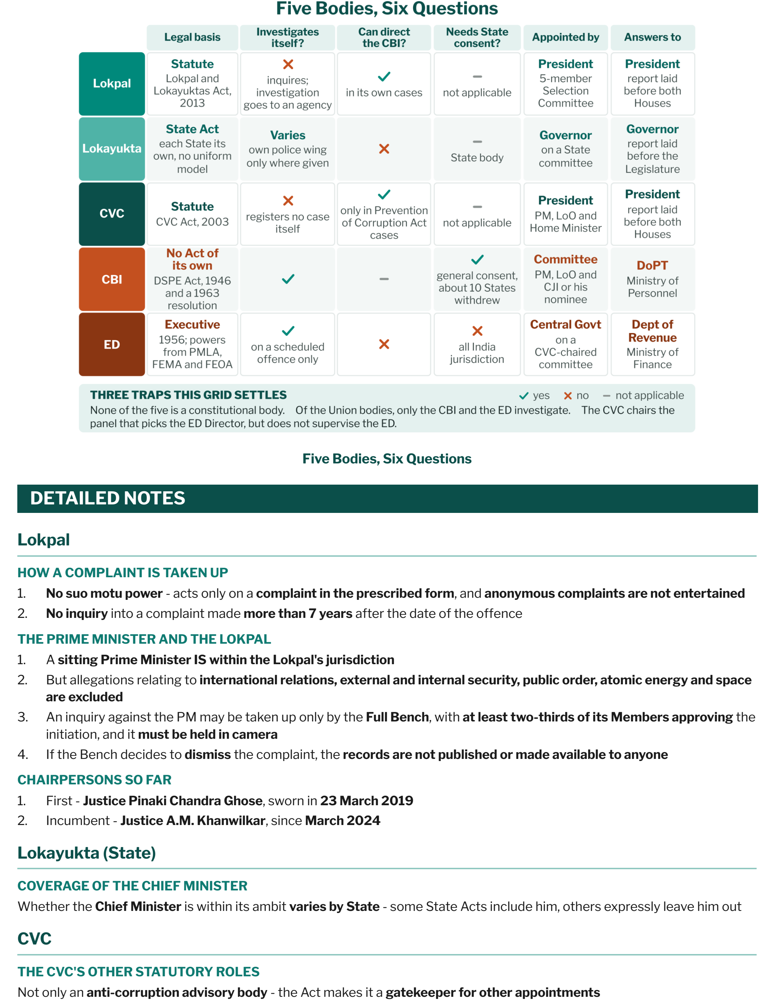

### [Prelims Source Page 206](../../pages/prelims/prelims_page_206.pdf)

### [Prelims Source Page 206](../../pages/prelims/prelims_page_206.pdf)

*Diagram Screenshot: [Anti-Corruption Bodies: Five Bodies, Six Questions Comparison](../../diagrams/pre_diag_anti_corruption_five_bodies_p206.png) · [Full Source Page 206](../../pages/prelims/prelims_page_206.pdf)*

Five Bodies, Six Questions

### DETAILED NOTES

Lokpal

### HOW A COMPLAINT IS TAKEN UP

- **1.** No suo motu power - acts only on a complaint in the prescribed form, and anonymous complaints are not entertained

- **2.** No inquiry into a complaint made more than 7 years after the date of the offence

### THE PRIME MINISTER AND THE LOKPAL

- **1.** A sitting Prime Minister IS within the Lokpal's jurisdiction

- **2.** But allegations relating to international relations, external and internal security, public order, atomic energy and space are excluded

- **3.** An inquiry against the PM may be taken up only by the Full Bench, with at least two-thirds of its Members approving the initiation, and it must be held in camera

- **4.** If the Bench decides to dismiss the complaint, the records are not published or made available to anyone

### CHAIRPERSONS SO FAR

- **1.** First - Justice Pinaki Chandra Ghose, sworn in 23 March 2019

- **2.** Incumbent - Justice A.M. Khanwilkar, since March 2024 Lokayukta (State)

### COVERAGE OF THE CHIEF MINISTER

Whether the Chief Minister is within its ambit varies by State - some State Acts include him, others expressly leave him out CVC THE CVC'S OTHER STATUTORY ROLES Not only an anti-corruption advisory body - the Act makes it a gatekeeper for other appointments
