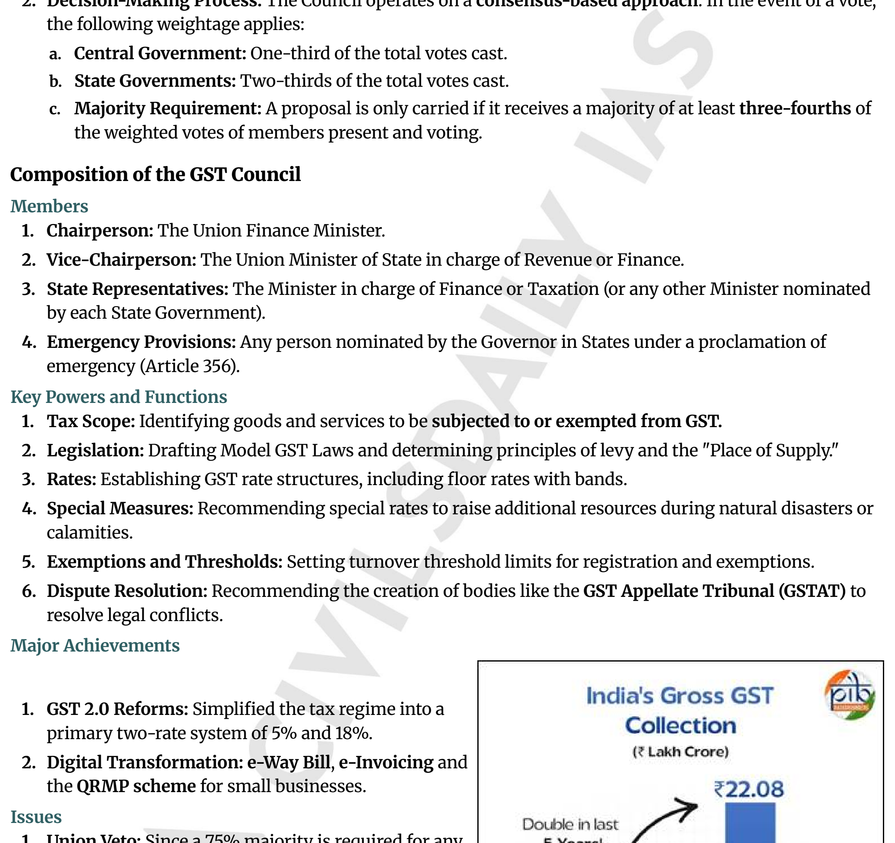

# NITI Aayog, NHRC & SHRC, NCW, NCPCR, NCM, Central Information Commission (CIC & RTI Act), Law Commission & Delimitation Commission — Smash Mains Notes (Ch13_Sub01_NITI_Aayog_NHRC_NCW_NCPCR_CIC_Law_Commission)

---

### [Smash Mains Source Page 225](../../pages/mains/mains_page_225.pdf)

## Chapter 14: Constitutional And Statutory Bodies

### PYQs

- **[2024]** "The duty of the Comptroller and Auditor General is not merely to ensure the legality of expenditure but also its propriety." Comment.(10)

- **[2025]** The National Commission for Protection of Child Rights has to address the challenges faced by children in the digital era. Examine the existing policies and suggest measures the Commission can initiate to tackle the issue. (15)

- **[2024]** "The duty of the Comptroller and Auditor General is not merely to ensure the legality of expenditure but also its propriety." Comment. (10)

- **[2023]** Discuss the role of the Competition Commission of India in containing the abuse of dominant position by the Multi-National Corporations in India. Refer to the recent decisions. (10)

- **[2022]** Discuss the role of the National Commission for Backward Classes in the wake of its transformation from a statutory body to a constitutional body. (10)

- **[2021]** Though the Human Rights Commissions have contributed immensely to the protection of human rights in India, yet they have failed to assert themselves against the mighty and powerful. Analyzing their structural and practical limitations, suggest remedial measures. (15)

- **[2020]** Which steps are required for constitutionalization of a commission? Do you think imparting constitutionality to the National Commission for Women would ensure greater gender justice and empowerment in India? Give reasons. (15)

- **[2020]** "Recent amendments to the Right to Information Act will have a profound impact on the autonomy and independence of the Information Commission". Discuss (10)

- **[2018]** Multiplicity of various commissions for the vulnerable sections of the society leads to problems of overlapping jurisdiction and duplication of functions. Is it better to merge all commissions into an umbrella Human Rights Commission? Argue your case. (15)

- **[2018]** Whether the National Commission for Scheduled Castes (NCSC) can enforce the implementation of constitutional reservation for the Scheduled Castes in the religious minority institutions? Examine. (10)

- **[2018]** "The Comptroller and Auditor General (CAG) has a very vital role to play." Explain how this is reflected in the method and terms of his appointment as well as the range of powers he can exercise. (10)

- **[2018]** How is the Finance Commission of India constituted? What do you know about the terms of reference of the recently constituted Finance Commission? Discuss. (15)

- **[2016]** Exercise of CAG's powers in relation to the accounts of the Union and the States is derived from Article 149 of the Indian Constitution. Discuss whether audit of the Government's policy implementation could amount to overstepping its own (CAG) jurisdiction. [12.5 Marks]

- **[2013]** 'A national Lokpal, however strong it may be, cannot resolve the problems of immorality in public affairs.' Discuss. (10)

---

### [Smash Mains Source Page 226](../../pages/mains/mains_page_226.pdf)

*Diagram Screenshot: [India's Gross GST Collection Trend & Fiscal Impact (Article 279A)](../../diagrams/mains_diag_gst_collection_trend_p226.png) · [Full Source Page 226](../../pages/mains/mains_page_226.pdf)*

### GST Council

- **1.** GST Council is a constitutional body established to make recommendations to the Union and State Governments on issues related to GST. It is the centerpiece of India's fiscal federalism.

- **2.** Decision-Making Process: The Council operates on a consensus-based approach. In the event of a vote, the following weightage applies:

  - **a.** Central Government: One-third of the total votes cast.

  - **b.** State Governments: Two-thirds of the total votes cast.

  - **c.** Majority Requirement: A proposal is only carried if it receives a majority of at least three-fourths of the weighted votes of members present and voting.

### Composition of the GST Council

### Members

- **1.** Chairperson: The Union Finance Minister.

- **2.** Vice-Chairperson: The Union Minister of State in charge of Revenue or Finance.

- **3.** State Representatives: The Minister in charge of Finance or Taxation (or any other Minister nominated by each State Government).

- **4.** Emergency Provisions: Any person nominated by the Governor in States under a proclamation of emergency (Article 356).

### Key Powers and Functions

- **1.** Tax Scope: Identifying goods and services to be subjected to or exempted from GST.

- **2.** Legislation: Drafting Model GST Laws and determining principles of levy and the "Place of Supply."

- **3.** Rates: Establishing GST rate structures, including floor rates with bands.

- **4.** Special Measures: Recommending special rates to raise additional resources during natural disasters or calamities.

- **5.** Exemptions and Thresholds: Setting turnover threshold limits for registration and exemptions.

- **6.** Dispute Resolution: Recommending the creation of bodies like the GST Appellate Tribunal (GSTAT) to resolve legal conflicts.

### Major Achievements

- **1.** GST 2.0 Reforms: Simplified the tax regime into a primary two-rate system of 5% and 18%.

- **2.** Digital Transformation: e-Way Bill, e-Invoicing and the QRMP scheme for small businesses.

### Issues

- **1.** Union Veto: Since a 75% majority is required for any decision, the Union holds a de facto veto.

- **2.** Democratic Deficit: State legislatures have lost fiscal autonomy, as an executive body now determines more than 40% of their own-tax revenue.

- **3.** High complexity and compliance burden due to multiple tax slabs.

- **4.** Nearly half the economy remains outside GST. Eg. petroleum, real estate, electricity duties

- **5.** Fiscal Cliff: The expiry of revenue compensation has left several states facing revenue shortfall.

---

### [Smash Mains Source Page 241](../../pages/mains/mains_page_241.pdf)

- **6.** Research and Studies: Commissions studies into the socio-economic conditions of women to identify and remove factors inhibiting their advancement.

- **7.** Advises the Union and State governments on the planning process for the socio-economic development of women.

- **8.** Report Submission: Mandated to submit annual and special reports to the government regarding the status of women's rights.

- **9.** Mahila Jan Sunwai: A pilot project to facilitate speedy disposal of complaints via in-person and online hearings.

### Significance of National Commission for Women

- **1.** Watchdog of Rights: Monitors safeguards. Eg. POSH Act implementation in corporate offices

- **2.** Legal Catalyst: Influenced the Triple Talaq campaign and subsequent legislation in 2019.

- **3.** Grassroots Advocacy: "She is a Changemaker" initiative

- **4.** International Interface: Represents India at UN Women forums to align domestic policies with global gender standards.

- **5.** Safety Audits: Eg. Shimla Consultation 2026 for safer university environments.

- **6.** Economic Empowerment: Eg. Digital Shakti 4.0 reaching 6 lakh women.

### Major Challenges and Limitations

- **1.** Recommendatory Nature: Its findings are not legally binding

- **2.** No Punitive Power: can only recommend prosecution to the police or government.

- **3.** Financial Dependence on the Ministry of Women and Child Development, limits functional autonomy.

- **4.** Staffing Vacancies: Shortage of permanent investigative staff leads to a heavy reliance on deputation from other government departments.

- **5.** Political Interference: The Chairperson and members are government nominees, leading to frequent allegations of partisan functioning or selective activism.

- **6.** Limited Awareness: Women in remote rural areas remain unaware of its existence; only 15% of complaints in 2025 were from rural belts.

- **7.** No Constitutional Status: Being a statutory body, it lacks the prestige and protected independence of constitutional bodies like the CAG.

- **8.** Underreporting: Socio-cultural stigmas continue to prevent women from utilizing NCW's portal for domestic violence reporting.

- **9.** Resource Constraints: Inadequate budget for conducting large-scale national-level research projects or independent forensic investigations. Major Case Studies

- Ramshree's Case: NCW successfully intervened in the Supreme Court to stay and later commute the death sentence of a woman.

- It played a key role in strengthening Domestic Violence Act 2005 and the Dowry Prohibition Act 1961.

- It has prepared Gender Profiles to assess the status of women and their empowerment in all the states

- Manipur Incident (2023): Faced heavy criticism for delayed response to complaints regarding violence against women during ethnic clashes.

- Mangalore Pub Attack: member's victim-blaming remarks during the inquiry was criticised.

- Section 497 Debate: Its initial stance on Adultery laws was criticized for being non-aligned with modern principles of gender-neutral culpability.

---

### [Smash Mains Source Page 242](../../pages/mains/mains_page_242.pdf)

### Way Forward

- **1.** Constitutional Status to ensure absolute independence from executive influence.

- **2.** Amend the 1990 Act to make its recommendations binding, subject to a "Reasoned Memorandum" for rejection.

- **3.** Empower the Commission to initiate contempt proceedings against officials who ignore its summons or directives.

- **4.** Include the CJI and Leader of Opposition in the selection committee to ensure neutral appointments.

- **5.** Adopt the UK's "Equality and Human Rights Commission" model with powers to issue legally enforceable compliance notices.

- **6.** Appoint District Vigilance Officers to provide a direct link for rural women to report atrocities.

- **7.** Social Audits: Mandate annual Third-Party Social Audits of the commission's performance to ensure accountability to civil society.

### National commission for Minorities

The National Commission for Minorities (NCM) is a statutory body established to safeguard the interests of religious minorities in India.

### Origin

- **1.** Originally set up in 1978 via a Ministry of Home Affairs resolution as a non-statutory body.

- **2.** Became a statutory body under the National Commission for Minorities Act, 1992.

- **3.** Jurisdiction initially included linguistic minorities, but shifted solely to religious minorities in 1988 after the creation of the Special Officer for Linguistic Minorities.

### Organisational Structure

- **1.** Composition: Consists of a Chairperson, a Vice-Chairperson, and five Members—all nominated by the Central Government.

- **2.** Mandated that at least five members (including the Chairperson) must belong to the six notified minority communities.

- **3.** The Chairperson and every member hold office for a term of three years from the date they assume office.

### Major Powers and Functions

- **1.** Evaluation of Progress: Evaluates the progress of development of various minority communities under the Union and State governments.

- **2.** Monitors the working of safeguards provided in the Constitution and other laws enacted by Parliament/States.

- **3.** Complaint Redressal: Eg. Acted on 1,500+ complaints in 2024-25 involving police atrocities, service matters, and religious property encroachments.

- **4.** Suo Motu Action: Empowered to take notice of incidents affecting minority rights based on media reports or verified private petitions.

- **5.** Civil Court Powers: Holds powers of a civil court to summon witnesses, receive evidence on affidavit, and requisition public records—(Section 9).

- **6.** Policy Recommendation: Eg. Recommended the Classical Language status for Pali and Prakrit.

- **7.** Conducting Studies: Commissions studies, research, and analysis on issues relating to the socio-economic and educational development of minorities.

---

### [Smash Mains Source Page 243](../../pages/mains/mains_page_243.pdf)

- **8.** Special Reports: Prepares and submits periodic or special reports to the Central Government on any matter pertaining to minorities. Eg. Special Report on Hate Speech (2025)

### Significance of the NCM

- **1.** Safeguarding Secularism: Acts as a constitutional buffer

- **2.** Quasi-Judicial Relief: Provides a platform for grievance redressal

- **3.** Ensures compliance with the UN Declaration on Minority Rights (1992) regarding cultural and religious identity.

- **4.** Empowering Weaker Sections: Monitors scholarships

- **5.** Communal Harmony: Facilitates inter-faith dialogue. Eg. Unity Conferences 2025

### Major Challenges and Limitations

- **1.** Advisory Nature: Recommendations are non-binding

- **2.** No Constitutional Status: Lacks the autonomy and prestige of the NC-SC or NC-ST

- **3.** Persistent vacancies in key posts (Chairperson/Members) often leave the commission non-functional for several months.

- **4.** Lacks its own permanent investigative cadre, forcing it to rely on state police for field inquiry reports.

- **5.** Annual reports are tabled with significant delays in Parliament, reducing legislative oversight relevance.

- **6.** "Toothless Tiger" Perception: Former chairpersons have termed it a "showpiece" due to its inability to enforce penalty orders or compensation.

- **7.** Overlapping Jurisdiction: Jurisdictional overlaps with the NHRC often lead to procedural confusion and "bouncing" of victims between institutions.

### Way Forward

- **1.** Constitutional Status

- **2.** Binding Directives

- **3.** Adopt the UK's Equality and Human Rights Commission model with powers to conduct binding sector-wide inquiries.

- **4.** Include the CJI and Leader of Opposition in the selection committee to ensure political neutrality.

- **5.** Introduce a central directive requiring every state to establish a functional State Minority Commission within 6 months.

### Central Information Commission

The Central Information Commission (CIC) is the apex statutory body established to ensure the effective implementation of the Right to Information (RTI) Act, 2005. Composition: Consists of a Chief Information Commissioner and up to ten Information Commissioners, appointed by the President.

### Major Powers and Functions

- **1.** The CIC holds the powers of a civil court to summon persons and require document discovery.

- **2.** Adjudication of Appeals: It serves as the final appellate body for second appeals against decisions of Central Public Information Officers.

- **3.** Imposition of Penalties: The Commission can fine officials ₹250 per day (up to ₹25,000) for unjustified denial of information.

---

### [Smash Mains Source Page 244](../../pages/mains/mains_page_244.pdf)

- **4.** Suo Motu Inquiries: It can initiate an inquiry into any matter where there are reasonable grounds for a transparency breach.

- **5.** Recommendatory Power: Can recommend disciplinary action against public officials for persistent non-compliance with the provisions of the Act.

- **6.** Access to All Records: During an inquiry, no record of a public authority can be withheld from the Commission's scrutiny.

- **7.** Directive for Compliance: Empowered to direct public authorities to take necessary steps to align with the RTI Act's spirit.

- **8.** Awarding Compensation: The CIC has the power to award compensation to the complainant for any loss or detriment suffered.

### Major Challenges and Limitations

- **1.** While its orders are theoretically final, departments often seek "writs" in High Courts to stay CIC directives.

- **2.** Executive dominance in appointments (PM, HM, LoP) - In Anjali Bhardwaj v. Union of India (2019), the SC directed greater transparency in appointments to ensure public scrutiny.

- **3.** Unlike courts, the CIC cannot punish for "contempt," making it difficult to enforce compliance with its orders.

- **4.** Vacancies and Backlog leads to bench vacancies and a massive pile-up of pending appeals. (over 22000)

- **5.** Lack of Time-Limit: While the Act mandates 30 days for PIOs, it sets no time limit for CIC to dispose of appeals.

- **6.** Record Management: Inefficient physical record management in government offices leads to the "unavailability" of files during CIC hearings.

- **7.** Autonomy concerns: Amendments giving the Center power to set salaries and tenure have raised concerns about the Commission's independence.

- **8.** Digital Divide: Remote rural applicants struggle to access the CIC's online appeal portal, limiting its reach to urban elites.

- **9.** Exemption Overuse: Public authorities frequently cite "National Security" or "Privacy" (Section 8) to bypass CIC's disclosure orders.

- **10.** Inadequate Staffing: Eg. The Registry of CIC currently operates at 60% of its sanctioned technical strength.

### Way Forward

- **1.** Amend the RTI rules to mandate a 90-day time limit for the CIC to dispose of second appeals.

- **2.** Enhanced Diversity: Actively recruit Commissioners from diverse backgrounds including law, journalism, science, and social service as per the Act.

- **3.** Adopt the UK model where "Public Interest" override is strictly applied against almost all secrecy-based exemptions.

- **4.** Grant the Commission the power to initiate contempt proceedings against officials who repeatedly defy its orders.

- **5.** Independent Selection Panel: Include a judge of the Supreme Court in the selection committee to enhance the Commission's perceived neutrality.

- **6.** Implement a mechanism where penalties are automatically deducted from the salaries of erring Public Information Officers.

- **7.** Third-Party Audits: Make the transparency audit of Section 4 disclosures a mandatory annual feature with a publicly accessible "Grading System."

---

### [Smash Mains Source Page 245](../../pages/mains/mains_page_245.pdf)

### Central Vigilance Commission

The Central Vigilance Commission (CVC) is India's apex integrity institution, mandated to fight corruption and ensure transparency in the Central Government.

### Origin

- **1.** Established in 1964 via a Government of India Executive Resolution based on Santhanam Committee recommendations.

- **2.** Granted statutory status through the Central Vigilance Commission Act, 2003, following the Supreme Court's Vineet Narain judgment.

### Composition

- **1.** Central Vigilance Commissioner (Chairperson)

- **2.** Two Vigilance Commissioners

- **3.** Appointed by the President on recommendation of a committee comprising: Prime Minister (Chairperson), Home Minister, Leader of Opposition in Lok Sabha.

### Recent News

- **1.** Vigilance Awareness 2025 campaign focused on "Culture of Integrity for Nation's Prosperity," promoting preventive vigilance mechanisms

- **2.** Enhanced the Whistleblower (PIDPI) portal to ensure 100% anonymity for complainants.

### Major Powers and Functions

- **1.** Exercises superintendence over the functioning of the CBI specifically for cases under the Prevention of Corruption Act.

- **2.** Inquiry Powers: Can inquire or cause an inquiry into any transaction where a public servant is suspected of corruption.

- **3.** Advises the Central Government on vigilance matters and reviews the progress of investigations conducted by various agencies.

- **4.** Possesses the powers of a civil court while conducting inquiries, including summoning witnesses and inspecting documents.

- **5.** Whistleblower Protection: Acts as the designated agency to receive and act on complaints under the PIDPI Resolution (Whistleblower protection).

- **6.** Oversees the functioning of Chief Vigilance Officers (CVOs) across all Central Ministries, PSUs, and autonomous bodies.

- **7.** Monitors the progress of requests for "sanction of prosecution" pending with various government departments.

- **8.** Conducts technical audits of infrastructure projects through its Chief Technical Examiner's Organization (CTEO) wing.

- **9.** Submits a comprehensive annual report to the President, which is subsequently laid before both Houses of Parliament.

### Major Challenges and Limitations

- **1.** Advisory Limitation: the government can reject them by simply providing written reasons.

- **2.** Lacks its own independent investigative agency and must rely on the CBI or departmental CVOs.

- **3.** Limited Jurisdiction: It cannot investigate corruption cases involving State Government officials, private sector employees, or political leaders.

- **4.** Staffing Constraints: Operates with a sanctioned strength of roughly 300 staff, which is insufficient.

---

### [Smash Mains Source Page 251](../../pages/mains/mains_page_251.pdf)

- **4.** Lack of Benches: The central office in Delhi limits access for small businesses from Southern or North-Eastern India.

- **5.** Data Access Issues: Lacks the power of "dawn raids" on private cloud servers located outside Indian jurisdiction.

- **6.** Bureaucratic Staffing: Heavy reliance on deputation from other departments rather than having a specialized economic-legal permanent cadre.

- **7.** Advisory Nature: Opinions given to the Government under "Competition Advocacy" are non-binding and often ignored in policy-making.

- **8.** Narrow Definitions: The current "Relevant Market" definition often fails to capture multi-sided platforms like Social Media/Search. Major Case Studies Successes

- Cement Cartel (2016): Imposed ₹6,300 crore fine on 11 firms for controlling supply.

- Forced Google to allow third-party app stores and alternative search engines on Android devices in India. Limitations

- E-commerce Probe: Investigations into Amazon/Flipkart have faced repeated "stay orders" from High Courts, stalling the final verdict.

- Coal India Case: Faced significant legal hurdles in applying competition law to a State Monopoly

### Way Forward

- **1.** Digital Markets Act (EU Model): Introduce "Ex-ante" regulations for "Gatekeeper" firms to prevent harm before it occurs.

- **2.** Establish regional benches in Mumbai, Bengaluru, and Kolkata to improve accessibility and disposal speed.

- **3.** Global Cooperation: Strengthen the International Competition Network (ICN) ties for simultaneous raids on multi-national cartels.

- **4.** Permanent Cadre: Create a "Competition Service" to recruit Econometricians and Tech-experts directly rather than via deputation.

- **5.** Whistleblower Rewards: Implement a bounty system for employees who report corporate cartels, similar to US/EU practices.

- **6.** Fix a mandatory 180-day limit for NCLAT to decide on appeals against CCI orders.

### National Green Tribunal

It is a specialized judicial body established to adjudicate environmental disputes. It makes India the third country in the world, after Australia and NZ, to have a dedicated environmental tribunal.

### Origin

- **1.** Established under the National Green Tribunal Act, 2010, replacing the NEAA.

- **2.** Fulfills India's 1992 Rio Earth Summit pledge to provide judicial remedies for victims of environmental damage.

---

### [Smash Mains Source Page 252](../../pages/mains/mains_page_252.pdf)

### Organisational Structure

- **1.** Composition: Consists of a Chairperson, Judicial Members, and Expert Members; sanctioned strength is 10-20 full-time members each.

- **2.** Chairperson: Appointed by the Central Government in consultation with the CJI; must be a retired SC or HC Judge.

- **3.** Judicial members are retired HC judges; Expert members must have 15 years of professional experience in environmental science.

- **4.** Headquartered in New Delhi (Principal Bench) with regional benches in Bhopal, Pune, Kolkata, and Chennai.

### Powers and Functions

- **1.** It deals with civil cases under the seven environmental laws:

  - **a.** The Water (Prevention and Control of Pollution) Act, 1974,

  - **b.** The Water (Prevention and Control of Pollution) Cess Act, 1977,

  - **c.** The Forest (Conservation) Act, 1980,

  - **d.** The Air (Prevention and Control of Pollution) Act, 1981,

  - **e.** The Environment (Protection) Act, 1986,

  - **f.** The Public Liability Insurance Act, 1991 and g. The Biological Diversity Act, 2002.

- **2.** Original Jurisdiction: Can hear all civil cases where a "substantial question relating to environment" arises

- **3.** Appellate Authority: Power to hear appeals against orders from Pollution Control Boards and Environment Clearance (EC) authorities

- **4.** Grant of Compensation: Power to award relief and compensation to victims of pollution or environmental accidents

- **5.** Restitution Power: Can order the restoration of the environment and property to their original state at the polluter's cost.

- **6.** Civil Court Equivalence: Empowered with powers under CPC, 1908, for summoning, discovery, and executing its orders as a decree.

- **7.** Suo Motu Cognizance: Following the SC 2021 ruling, NGT can act on its own motion without formal complaints.

- **8.** Ad-Interim Injunctions: Power to grant ex-parte interim orders and stay activities to prevent immediate environmental damage

- **9.** Review Power: Can review its own decisions if there is a clerical error or new discovery

### Significance of NGT

- **1.** Specialized Expertise: Combines judicial and technical experts

- **2.** Expeditious Disposal: Mandated 6-month timeline

- **3.** Polluter Accountability

- **4.** Strategic Oversight: Balances development with ecology. Eg. Great Nicobar project monitoring through a High-Powered Committee.

- **5.** Reducing Judicial Burden: Diverts technical cases from HC/SC

### Major Challenges and Limitations

- **1.** Wildlife Protection Gap: Its jurisdiction does not include the Wildlife (Protection) Act, 1972, leaving many poaching issues outside.

---

### [Smash Mains Source Page 253](../../pages/mains/mains_page_253.pdf)

- **2.** Forest Rights Exclusion: Cannot hear cases related to the Scheduled Tribes/Forest Rights Act, 2006, limiting tribal environmental justice.

- **3.** Vacancy Backlogs: Persistent delay in appointing members often leaves regional benches non-functional for months.

- **4.** Appellate Hurdles: NGT orders can be challenged in the Supreme Court, often leading to long litigation stays.

- **5.** Benches are located only in five major cities, making it inaccessible for rural environmental activists.

- **6.** Critics argue that expert members are often retired IFS officers, leading to a pro-government stance.

- **7.** Infrastructure Deficit: Lack of advanced technical labs forces the tribunal to rely on data from Pollution Control Boards. Major Case Studies

- Almitra Patel Case: Led to a national ban on open burning of garbage, streamlining solid waste management rules

- In 2015, it banned 10-year-old diesel vehicles in Delhi

- Srinagar Dam Disaster: Successfully enforced the Polluter Pays principle, forcing a hydro-power company to compensate disaster victims.

- Yamuna Floodplain (Art of Living): Despite finding environmental damage, the ₹5 crore fine was criticized as being too lenient.

- Sterlite Copper Case: NGT order to reopen the plant was quashed by the SC, showing its vulnerability to higher judiciary.

- In the Save Mon Federation Vs Union of India case (2013), the NGT suspended a ₹6,400-crore hydro project, to save the habitat of a bird.

### Way Forward

- **1.** Expanding Scope: Amend the NGT Act to include the Wildlife Protection Act and Forest Rights Act

- **2.** Establish District-level circuit benches to bring environmental justice to grassroots activists in eco-sensitive zones.

- **3.** Adopt the New South Wales L&E Court model, where judges have specialized environmental law degrees.

- **4.** Create a permanent Environmental Investigation Agency under NGT to conduct independent audits and dawn raids. Issues Due to Multiplicity of Commissions

- Overlapping Jurisdictions: lead to procedural chaos.

- Forum Shopping: Eg. Bounced petitions between NCM and NHRC.

- Financial Wastage: Operating separate secretariats, chairpersons, and staff

- "Toothless Tiger" Syndrome

- Staffing & Vacancy Crisis: Eg. over 40% of member posts in NCM and NCST vacant.

- Information Silos: Commissions rarely share their Complaint Management Systems, leading to duplication of data and evidence.

- Dilution of Accountability

- Executive Patronage: Multiplicity provides more posts for retired bureaucrats, turning independent bodies into "parking lots" for favorites.

- Inconsistent Legal Standards

---

### [Smash Mains Source Page 254](../../pages/mains/mains_page_254.pdf)

Way Forward

- Umbrella Commission: National Human Rights & Social Justice Commission with sectoral divisions.

- Unified Complaint Portal: Implement a "One-Nation One-Grievance" digital bridge

- Independent Selection Panel

- Binding Recommendations

- Fixed Appointment Calendar

- Charge the salaries and administrative expenses directly on the Consolidated Fund

- Independent Investigative Cadre

- Mandatory "Action Taken Report" (ATR) in Parliament within 6 months of annual report.
