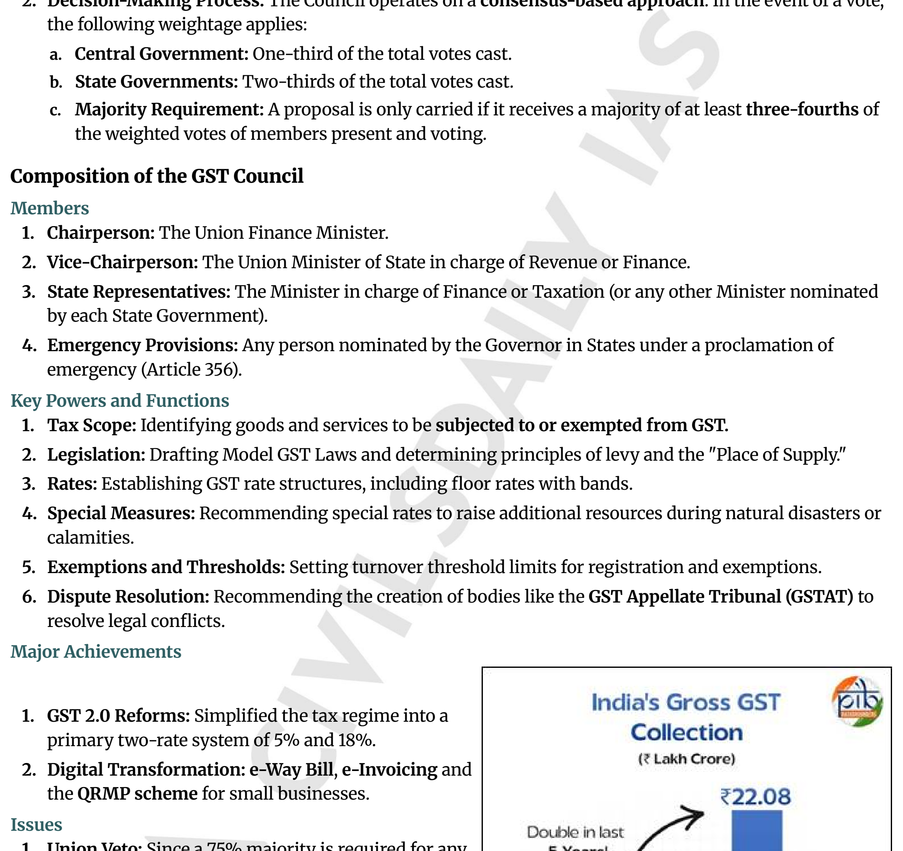

# Anti-Corruption & Investigative Agencies: Lokpal and Lokayuktas, Central Vigilance Commission (CVC), CBI, Enforcement Directorate (ED) & NIA — Smash Mains Notes (Ch13_Sub02_Anti_Corruption_Bodies_Lokpal_CVC_CBI_ED_NIA)

---

### [Smash Mains Source Page 225](../../pages/mains/mains_page_225.pdf)

## Chapter 14: Constitutional And Statutory Bodies

### PYQs

- **[2024]** "The duty of the Comptroller and Auditor General is not merely to ensure the legality of expenditure but also its propriety." Comment.(10)

- **[2025]** The National Commission for Protection of Child Rights has to address the challenges faced by children in the digital era. Examine the existing policies and suggest measures the Commission can initiate to tackle the issue. (15)

- **[2024]** "The duty of the Comptroller and Auditor General is not merely to ensure the legality of expenditure but also its propriety." Comment. (10)

- **[2023]** Discuss the role of the Competition Commission of India in containing the abuse of dominant position by the Multi-National Corporations in India. Refer to the recent decisions. (10)

- **[2022]** Discuss the role of the National Commission for Backward Classes in the wake of its transformation from a statutory body to a constitutional body. (10)

- **[2021]** Though the Human Rights Commissions have contributed immensely to the protection of human rights in India, yet they have failed to assert themselves against the mighty and powerful. Analyzing their structural and practical limitations, suggest remedial measures. (15)

- **[2020]** Which steps are required for constitutionalization of a commission? Do you think imparting constitutionality to the National Commission for Women would ensure greater gender justice and empowerment in India? Give reasons. (15)

- **[2020]** "Recent amendments to the Right to Information Act will have a profound impact on the autonomy and independence of the Information Commission". Discuss (10)

- **[2018]** Multiplicity of various commissions for the vulnerable sections of the society leads to problems of overlapping jurisdiction and duplication of functions. Is it better to merge all commissions into an umbrella Human Rights Commission? Argue your case. (15)

- **[2018]** Whether the National Commission for Scheduled Castes (NCSC) can enforce the implementation of constitutional reservation for the Scheduled Castes in the religious minority institutions? Examine. (10)

- **[2018]** "The Comptroller and Auditor General (CAG) has a very vital role to play." Explain how this is reflected in the method and terms of his appointment as well as the range of powers he can exercise. (10)

- **[2018]** How is the Finance Commission of India constituted? What do you know about the terms of reference of the recently constituted Finance Commission? Discuss. (15)

- **[2016]** Exercise of CAG's powers in relation to the accounts of the Union and the States is derived from Article 149 of the Indian Constitution. Discuss whether audit of the Government's policy implementation could amount to overstepping its own (CAG) jurisdiction. [12.5 Marks]

- **[2013]** 'A national Lokpal, however strong it may be, cannot resolve the problems of immorality in public affairs.' Discuss. (10)

---

### [Smash Mains Source Page 226](../../pages/mains/mains_page_226.pdf)

*Diagram Screenshot: [India's Gross GST Collection Trend & Fiscal Impact (Article 279A)](../../diagrams/mains_diag_gst_collection_trend_p226.png) · [Full Source Page 226](../../pages/mains/mains_page_226.pdf)*

### GST Council

- **1.** GST Council is a constitutional body established to make recommendations to the Union and State Governments on issues related to GST. It is the centerpiece of India's fiscal federalism.

- **2.** Decision-Making Process: The Council operates on a consensus-based approach. In the event of a vote, the following weightage applies:

  - **a.** Central Government: One-third of the total votes cast.

  - **b.** State Governments: Two-thirds of the total votes cast.

  - **c.** Majority Requirement: A proposal is only carried if it receives a majority of at least three-fourths of the weighted votes of members present and voting.

### Composition of the GST Council

### Members

- **1.** Chairperson: The Union Finance Minister.

- **2.** Vice-Chairperson: The Union Minister of State in charge of Revenue or Finance.

- **3.** State Representatives: The Minister in charge of Finance or Taxation (or any other Minister nominated by each State Government).

- **4.** Emergency Provisions: Any person nominated by the Governor in States under a proclamation of emergency (Article 356).

### Key Powers and Functions

- **1.** Tax Scope: Identifying goods and services to be subjected to or exempted from GST.

- **2.** Legislation: Drafting Model GST Laws and determining principles of levy and the "Place of Supply."

- **3.** Rates: Establishing GST rate structures, including floor rates with bands.

- **4.** Special Measures: Recommending special rates to raise additional resources during natural disasters or calamities.

- **5.** Exemptions and Thresholds: Setting turnover threshold limits for registration and exemptions.

- **6.** Dispute Resolution: Recommending the creation of bodies like the GST Appellate Tribunal (GSTAT) to resolve legal conflicts.

### Major Achievements

- **1.** GST 2.0 Reforms: Simplified the tax regime into a primary two-rate system of 5% and 18%.

- **2.** Digital Transformation: e-Way Bill, e-Invoicing and the QRMP scheme for small businesses.

### Issues

- **1.** Union Veto: Since a 75% majority is required for any decision, the Union holds a de facto veto.

- **2.** Democratic Deficit: State legislatures have lost fiscal autonomy, as an executive body now determines more than 40% of their own-tax revenue.

- **3.** High complexity and compliance burden due to multiple tax slabs.

- **4.** Nearly half the economy remains outside GST. Eg. petroleum, real estate, electricity duties

- **5.** Fiscal Cliff: The expiry of revenue compensation has left several states facing revenue shortfall.

---

### [Smash Mains Source Page 246](../../pages/mains/mains_page_246.pdf)

- **5.** CVOs are often employees of the same department they monitor, leading to inherent conflicts of interest.

- **6.** No Prosecution Power: Unlike the Lokpal, the CVC cannot initiate its own criminal prosecution in a court of law.

- **7.** The selection committee is dominated by the executive, raising concerns about the potential for partisan appointments.

- **8.** Sanction Hurdles: Despite monitoring, the "prior sanction" requirement for senior officials often acts as a legal shield for corrupt bureaucrats.

### Way Forward

- **1.** Independent Investigation Wing: Grant the CVC its own cadre of investigators, similar to the ICAC of Hong Kong.

- **2.** Amend the CVC Act to make its recommendations legally binding in cases of proven financial fraud.

- **3.** Prosecutorial Powers: Allow the CVC to maintain a panel of special prosecutors to directly take cases to court.

- **4.** Adopt Singapore's CPIB model, where the anti-corruption agency has the power of arrest without warrant.

- **5.** Digital "Vigilance-by-Design": Integrate CVC's oversight into the Government e-Marketplace (GeM) for automated flagging of suspicious bidding patterns.

- **6.** Expanding Scope: Bring private-public partnership (PPP) projects under CVC's mandatory technical audit to protect public resources.

- **7.** Vigilance Literacy: Launch a National Integrity Index to rank departments, fostering healthy competition in transparency and ethical governance.

### Central Bureau of Investigation

The Central Bureau of Investigation (CBI) is India's premier federal investigating agency.

### Origin

- **1.** Special Police Establishment (1941): Initially formed to investigate wartime corruption in the War and Supply Department during WWII.

- **2.** DSPE Act (1946): Legal authority was derived from the Delhi Special Police Establishment Act, making it a police agency.

- **3.** MHA Resolution (1963): The CBI was formally established via a Government resolution, though it is not a statutory body.

### Major Powers and Functions

- **1.** Anti-Corruption Probe: Investigates bribery and misconduct by Central Government employees and PSU staff. Eg. Investigation of the ₹11,400 crore PNB fraud.

- **2.** Economic Offenses: Handles major financial scams, bank frauds, cyber-crimes, and large-scale smuggling of narcotics or cultural property. Eg. Satyam Computers Scam (2009).

- **3.** Special Crimes: Investigates sensational cases like terrorism, high-profile kidnappings, and murders referred by states or the judiciary. Eg. Aarushi Talwar murder case

- **4.** Interpol Interface: Acts as the "National Central Bureau" for India, facilitating communication between Indian police and international law enforcement.

- **5.** State Referrals: Can investigate crimes within a State if the State Government requests or the Supreme/High Court orders. Eg. RG Kar Medical College case.

---

### [Smash Mains Source Page 247](../../pages/mains/mains_page_247.pdf)

- **6.** Technical Support: Maintains the Central Forensic Science Laboratory (CFSL) to provide advanced scientific evidence support for complex criminal trials.

- **7.** Crime Statistics: Serves as the central repository for specialized crime data and disseminates criminal information to state bureaus.

### Challenges faced by CBI

- **1.** General Consent Hurdle - Over 10 states have withdrawn "General Consent."

- **2.** Political Interference: The Supreme Court criticized the CBI for being a "caged parrot" speaking in its master's voice.

- **3.** Lack of Statutory Status: Eg. The Gauhati High Court (2013) briefly declared the CBI's formation unconstitutional, though the order was later stayed.

- **4.** Roughly 1,700 posts (23% of sanctioned strength) are vacant, leading to excessive workloads and investigation delays.

- **5.** Over-reliance on IPS officers on deputation who may lack specialized forensic or financial investigation expertise.

- **6.** Prior Sanction Shield: Section 17A of the PCA mandates prior approval before even starting an inquiry against senior officials.

- **7.** Administrative and financial control lies with the DoPT, limiting the Director's ability to modernize the agency independently.

- **8.** Struggle to keep pace with Dark Web and cryptocurrency-based money laundering due to inadequate high-tech lab funding.

- Bhopal Gas Tragedy: Criticized for failure to extradite Warren Anderson and "diluting" charges, which led to widespread public outcry.

- Aarushi Talwar Case: Labeled a "forensic failure" by legal experts as two different CBI teams reached contradictory conclusions.

- Bofors Scandal: Decades of investigation failed to secure a single conviction Consent of State for CBI Types of consent of states

- General: CBI is not required to seek fresh permission every time it enters that state in connection with investigation or for every case.

- State government can grant or deny consent. (Section 6 of DSPE Act)

- Specific: CBI would have to apply to the state government in every case.

### Major SC Judgments

- **1.** Vineet Narain (1998): Directed a fixed 2-year tenure for the Director and mandated a high-powered selection committee for autonomy.

- **2.** Subramanian Swamy (2014): Struck down Section 6A, ruling that prior permission is not required to probe senior officials in corruption cases.

- **3.** Manohar Lal Sharma (2014): Famously termed the agency a "caged parrot" and barred it from sharing probe reports with the executive.

- **4.** Legislative Council U.P. v. Sushil Kumar (2025): Ruled that constitutional courts must order CBI probes "sparingly and cautiously" in exceptional situations only.

---

### [Smash Mains Source Page 248](../../pages/mains/mains_page_248.pdf)

### Way Forward

- **1.** Replace the DSPE Act with a dedicated CBI Act to grant it a clear statutory identity.

- **2.** FBI Model (USA): Adopt a model where the agency has automatic jurisdiction over federal crimes without needing state-by-state consent.

- **3.** Administrative Autonomy: Grant the Director the power to recruit specialized lateral entries (accountants, cyber-experts) directly rather than relying on IPS.

- **4.** Social Audit: Implement periodic Third-Party Audits of the agency's performance to balance RTI exemptions with public accountability.

- **5.** Transition to a 70% permanent cadre to ensure institutional memory and specialized domain expertise in financial forensics.

### Lokpal And Lokayukta

The Lokpal (Union level) and Lokayukta (State level) are statutory anti-corruption ombudsman bodies, designed to inquire into allegations of corruption against public functionaries and ensure "clean governance."

### Origin

- **1.** Based on the Ombudsman model of Sweden; terms coined by Dr. L.M. Singhvi in 1963.

- **2.** The First Administrative Reforms Commission (1966) first officially recommended their establishment to address citizen grievances.

- **3.** After eight failed attempts since 1968, Anna Hazare movement forced the 2013 enactment.

### Major Powers and Functions

- **1.** Jurisdiction over PM: Can investigate the Prime Minister, excluding matters of national security, public order, and foreign relations.

- **2.** Covers all Central Government employees from Group A to Group D and MPs for bribery/misconduct.

- **3.** Civil Court Powers: Possesses the power to summon witnesses, examine documents, and receive evidence on affidavits like a civil court.

- **4.** Has powers of direction and superintendence over the CBI for cases referred to it by Lokpal.

- **5.** Maintains an independent Inquiry Wing to conduct preliminary examinations into allegations against public servants before formal investigation.

- **6.** Features a dedicated Prosecution Wing to initiate proceedings in Special Courts for corruption offenses after investigation.

- **7.** Empowered to confiscate assets and benefits obtained through corrupt practices, even while legal proceedings are ongoing.

- **8.** Authorized to issue directions to prevent the destruction of records during the course of a preliminary inquiry.

### Major Challenges and Limitations

- **1.** Delay in Appointment: Lokpal was operationalized only in 2019, despite the Act being passed in 2013. Several states still lack a functional Lokayukta.

- **2.** Lack of Suo Motu Power: Lokpal cannot initiate investigations on its own; it requires a formal citizen complaint to act.

- **3.** It cannot inquire into any complaint filed after seven years from the date of alleged offense.

- **4.** Being purely statutory, it lacks the constitutional protection of bodies like the CAG or Election Commission.

---

### [Smash Mains Source Page 249](../../pages/mains/mains_page_249.pdf)

- **5.** Investigation Dependency: Primarily relies on the CBI or CVC for field investigations, as it lacks its own pan-India investigative cadre.

- **6.** The higher judiciary (SC/HC Judges) is completely excluded from Lokpal's ambit, creating an accountability gap.

- **7.** Anonymity Restriction: Complaints must be in a prescribed format; anonymous complaints are not entertained, deterring many whistleblowers from reporting.

- **8.** State-Level Lags: Several states have either not appointed Lokayuktas or have significantly diluted their powers via state amendments.

- Karnataka Lokayukta exposed a ₹16,000 crore illegal mining scam, leading to the resignation of the then Chief Minister.

- Dismissal on Technicalities: In 2025-26, nearly 40% of complaints were dismissed for not being in the "prescribed format".

### Major SC Judgments

- **1.** Common Cause v. Union of India (2017): Ruled that the lack of an official Leader of Opposition (LoP) shouldn't stall Lokpal appointments.

- **2.** The SC stayed a Lokpal order that categorized HC Judges as public servants, reaffirming their immunity.

- **3.** CBI v. Lokpal (2026): Clarified that Lokpal's superintendence over CBI is limited to the specific case referred, not administrative control.

### Way Forward

- **1.** Suo Motu Powers: Grant Lokpal the power to initiate self-directed inquiries based on credible media reports or audits.

- **2.** Adopt the Swedish model where the Ombudsman has direct access to all state secret files.

- **3.** Constitutional Status to ensure total independence.

- **4.** Establish a permanent, internal investigative wing to end dependency on the CBI for field evidence.

- **5.** Integrate the Whistleblowers Protection Act with Lokpal to provide concrete legal and physical security to informers.

- **6.** Create Regional Benches of Lokpal to make the anti-corruption mechanism accessible to rural and remote citizens

### Competition Commission of India

The Competition Commission of India is a statutory body within the Ministry of Corporate Affairs and is responsible for enforcing the Competition Act, 2002, to promote a fair and competitive business environment.

### Origin

- **1.** Officially formed on October 14, 2003, following the recommendations of the Raghavan Committee (2000).

- **2.** Replaced the archaic MRTP Act, 1969, moving from "curbing monopolies" to "promoting competition".

- **3.** Became fully functional in May 2009.

### Organisational Structure

- **1.** Consists of a Chairperson and not less than two and not more than six Members.

---

### [Smash Mains Source Page 250](../../pages/mains/mains_page_250.pdf)

- **2.** The Central Government appoints members based on the recommendation of a Search-cum-Selection Committee.

- **3.** Members must have 15 years of experience in international trade, economics, law, or public affairs.

- **4.** Includes the Director General (DG) wing, which acts as the independent investigative arm for the Commission.

### Major Powers and Functions

- **1.** Anti-Competitive Agreements: Prohibiting horizontal (cartels) and vertical agreements that cause an Appreciable Adverse Effect on Competition (AAEC).

- **2.** Preventing Abuse of Dominance: Eg. Penalized Google for leveraging its Android dominance to force-install its search apps on smartphones.

- **3.** Combination Regulation: Reviews mergers and acquisitions exceeding specific thresholds to prevent monopolistic market consolidation. Eg. Air India-Vistara merger

- **4.** Suo Motu Power: Can initiate inquiries independently based on market reports without waiting for a formal complaint.

- **5.** Civil Court Power: Possesses powers of a civil court to summon witnesses and compel the production of documents.

- **6.** Extra-Territorial Reach: Can inquire into conduct outside India if it has a direct effect on the Indian market. Eg. Investigated global shipping lines for price-fixing in 2024.

- **7.** Interim Orders: Authorized to issue "cease and desist" orders to halt anti-competitive behavior while an investigation is pending.

- **8.** Mandated to create public awareness and provide training to stakeholders on competition-related economic issues.

- **9.** Consults with other regulators (like TRAI or RBI) to ensure harmony between sectoral laws and competition law.

- **10.** Can impose fines up to 10% of global turnover for anti-competitive conduct or gun-jumping.

### Significance of Competition Commission of India

- **1.** Consumer Welfare: Ensures lower prices and better quality

- **2.** Promoting Innovation: Prevents incumbents from blocking new entrants

- **3.** Curbing Cartels and ensuring fair competition.

- **4.** Regulating Big Tech & ensuring a level playing field in the digital economy

- **5.** Ease of Doing Business: Transparent merger reviews through the "Green Channel" for fast-track automated approvals.

- **6.** Resource Efficiency: Prevents hoarding and artificial scarcities

- **7.** Inclusive Growth: Supports MSMEs against predatory pricing by large e-commerce entities

- **8.** Aligns Indian markets with OECD standards, attracting foreign direct investment into a fair environment.

### Major Challenges and Limitations

- **1.** High Pendency: Frequent stays by High Courts and NCLAT cause investigations to drag for several years. Eg. Tyre cartel case took nearly a decade.

- **2.** Overlapping Jurisdiction: Frequent jurisdictional conflicts with sectoral regulators like TRAI (Telecom) or SEBI (Finance) over market conduct.

- **3.** Resource Constraints: An annual budget of ~₹750 crore is small compared to the trillion-dollar companies it regulates.
