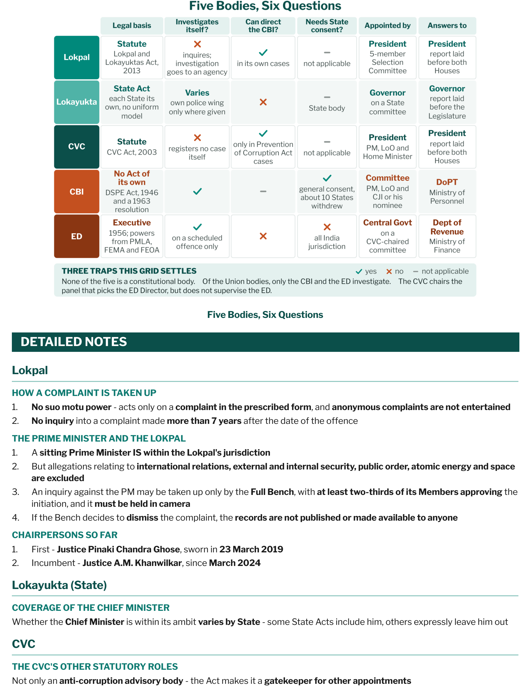

### [Prelims Source Page 198](../pages/prelims/prelims_page_198.pdf)

## CHAPTER 24
ANTI CORRUPTION BODIES
THEME ANALYSIS PYQ pattern for this chapter
1. REPEATS

#### A. Legal Basis and Status
- None of the four is a constitutional body - the Lokpal and the CVC are statutory, the Lokayukta rests on a State Act,
and the CBI has no statute of its own.
- The CVC turned statutory through the Central Vigilance Commission Act, 2003 after the Vineet Narain judgement.
- The CBI rests on an executive resolution plus the Delhi Special Police Establishment Act, 1946, under the Ministry
of Personnel, Public Grievances and Pensions [2026].
- The ED is not statutory either - it is an executive agency under the Department of Revenue that draws its powers
from the PMLA, 2002, FEMA, 1999 and the Fugitive Economic Offenders Act, 2018.

#### B. Who Reaches the CBI
- The Lokpal may direct the CBI to conduct a preliminary inquiry or investigation, and an officer so assigned cannot be
transferred without the Lokpal's approval.
- The CVC superintends the CBI only in Prevention of Corruption Act, 1988 cases; otherwise the CBI answers to the
DoPT.
- The CVC chairs the committee recommending CBI officers of the rank of SP and above, and the committee
recommending the Director of Enforcement.
- The CVC chairs the committee that recommends the Director of Enforcement, but the ED is not under the CVC's
superintendence.

#### C. Headship and Selection Committees
- The Lokpal Chairperson need not be the sitting Chief Justice of India; a former CJI, a former Supreme Court judge or
an eminent person qualifies [2025].
- The CVC has no judicial requirement at all and is in practice almost always a retired civil servant.
- The CBI Director is chosen by the Prime Minister, the Leader of the Opposition and the CJI or his nominee, the same
trio that removes the Lokpal's own members through a Supreme Court reference.

#### D. Jurisdiction Limits and Traps
- The Lokpal covers Indian public servants posted outside India as well, and the sitting Prime Minister is within its
jurisdiction, subject to excluded subjects and a Full Bench two-thirds safeguard [2025].
- The Lokpal has no suo motu power and cannot look at a complaint more than seven years old.
- The CBI needs the general consent of a State to act in its area, which about ten States have withdrawn, though the SC
or a High Court can still order a probe.
- The CBI needs a State's general consent; the ED does not, because it enforces central laws with all-India jurisdiction.

#### E. Tenure of the Two Directors
- CBI and ED Directors both get a 2-year minimum (Vineet Narain, 1997), extendable 1 year at a time to a ceiling of 5
years.
- Dr Jaya Thakur, 2023, upheld the CVC (Amendment) Act, 2021 and the DSPE (Amendment) Act, 2021 but struck
down the specific extensions given to the then ED Director.
- Also tested: ED, DRI and DGSDM with their parent departments [2025]
2. HOW THE FORMAT HAS CHANGED
- 2025 to 2026: four statement and row matching sets [2025, 2026]
3. WHAT IS BEING ASKED NOW
- Lokpal jurisdiction and composition [2025]
- Organisation to ministry matching: ED, DRI, CEIB, SFIO, CBI [2025, 2026]

#### Structured Tables on Page 198

| CHAPTER 24 |
| --- |
| ANTI CORRUPTION BODIES |
| THEME ANALYSIS PYQ pattern for this chapter |
| 1. REPEATS A. Legal Basis and Status • None of the four is a constitutional body - the Lokpal and the CVC are statutory, the Lokayukta rests on a State Act, and the CBI has no statute of its own. • The CVC turned statutory through the Central Vigilance Commission Act, 2003 after the Vineet Narain judgement. • The CBI rests on an executive resolution plus the Delhi Special Police Establishment Act, 1946, under the Ministry of Personnel, Public Grievances and Pensions [2026]. • The ED is not statutory either - it is an executive agency under the Department of Revenue that draws its powers from the PMLA, 2002, FEMA, 1999 and the Fugitive Economic Offenders Act, 2018. B. Who Reaches the CBI • The Lokpal may direct the CBI to conduct a preliminary inquiry or investigation, and an officer so assigned cannot be transferred without the Lokpal's approval. • The CVC superintends the CBI only in Prevention of Corruption Act, 1988 cases; otherwise the CBI answers to the DoPT. • The CVC chairs the committee recommending CBI officers of the rank of SP and above, and the committee recommending the Director of Enforcement. • The CVC chairs the committee that recommends the Director of Enforcement, but the ED is not under the CVC's superintendence. C. Headship and Selection Committees • The Lokpal Chairperson need not be the sitting Chief Justice of India; a former CJI, a former Supreme Court judge or an eminent person qualifies [2025]. • The CVC has no judicial requirement at all and is in practice almost always a retired civil servant. • The CBI Director is chosen by the Prime Minister, the Leader of the Opposition and the CJI or his nominee, the same trio that removes the Lokpal's own members through a Supreme Court reference. D. Jurisdiction Limits and Traps • The Lokpal covers Indian public servants posted outside India as well, and the sitting Prime Minister is within its jurisdiction, subject to excluded subjects and a Full Bench two-thirds safeguard [2025]. • The Lokpal has no suo motu power and cannot look at a complaint more than seven years old. • The CBI needs the general consent of a State to act in its area, which about ten States have withdrawn, though the SC or a High Court can still order a probe. • The CBI needs a State's general consent; the ED does not, because it enforces central laws with all-India jurisdiction. E. Tenure of the Two Directors • CBI and ED Directors both get a 2-year minimum (Vineet Narain, 1997), extendable 1 year at a time to a ceiling of 5 years. • Dr Jaya Thakur, 2023, upheld the CVC (Amendment) Act, 2021 and the DSPE (Amendment) Act, 2021 but struck down the specific extensions given to the then ED Director. • Also tested: ED, DRI and DGSDM with their parent departments [2025] 2. HOW THE FORMAT HAS CHANGED • 2025 to 2026: four statement and row matching sets [2025, 2026] 3. WHAT IS BEING ASKED NOW • Lokpal jurisdiction and composition [2025] • Organisation to ministry matching: ED, DRI, CEIB, SFIO, CBI [2025, 2026] |

---

### [Prelims Source Page 199](../pages/prelims/prelims_page_199.pdf)

### PRELIMS PREVIOUS YEAR QUESTIONS

**Q1. With reference to organisations under the**
Government of India: [2026]
Organisatio
n Some of its Functions It Works Under
Central
Economic
Intelligence
Bureau
(CEIB)
To coordinate between various
law enforcement agencies
Ministry of Home
Affairs
Serious
Fraud
Investigation
Office (SFIO)
To investigate complex
corporate frauds Ministry of Finance
Central
Bureau of
Investigation
(CBI)
To preserve values in public life
and ensure the health of the
national economy
Ministry of
Personnel, Public
Grievances and
Pension
In how many of the above rows is the information correctly
matched?
(a) 1
(b) 2
(c) 3
(d) None
**`ANSWER (a)`**

**Q2. Consider the following statements about Lokpal:**

- **[2025]** 

#### I. The power of Lokpal applies to public servants of
India, but not to the Indian public servants posted
outside India.
II. The Chairperson or a Member shall not be a
Member of the Parliament or a Member of the
Legislature of any State or Union Territory, and
only the Chief Justice of India, whether incumbent
or retired, has to be its Chairperson.
III. The Chairperson or a Member shall not be a
person of less than forty-five years of age on the
date of assuming office.
IV. Lokpal cannot inquire into the allegations of
corruption against a sitting Prime Minister of
India.
Which of the statements given above is/are correct?
(a) III only
(b) II and III
(c) I and IV
(d) None of the above statements is correct
**`ANSWER (a)`**

**Q3. With reference to the Government of India, consider**
the following information (Organization | Some of its
functions | It works under): [2025]

#### I. Directorate of Enforcement | Enforcement of the
Fugitive Economic Offenders Act, 2018 | Internal
Security Division I, Ministry of Home Affairs
II. Directorate of Revenue Intelligence | Enforces the
provisions of the Customs Act, 1962 |
Department of Revenue, Ministry of Finance
III. Directorate General of Systems and Data
Management | Carrying out big data analytics to
assist tax officers for better policy and nabbing
tax evaders | Department of Revenue, Ministry of
Finance
In how many of the above rows is the information
correctly matched?
(a) Only one
(b) Only two
(c) All three
(d) None
**`ANSWER (a)`**

#### Structured Tables on Page 199

| Organisatio n | Some of its Functions | It Works Under |
| --- | --- | --- |
| Central Economic Intelligence Bureau (CEIB) | To coordinate between various law enforcement agencies | Ministry of Home Affairs |
| Serious Fraud Investigation Office (SFIO) | To investigate complex corporate frauds | Ministry of Finance |
| Central Bureau of Investigation (CBI) | To preserve values in public life and ensure the health of the national economy | Ministry of Personnel, Public Grievances and Pension |

| In how many of the above rows is the information correctly |
| --- |
| matched? |

---

### [Prelims Source Page 200](../pages/prelims/prelims_page_200.pdf)

LOKPAL
https://lokpal.gov.in/
LOKAYUKTA (STATE) CVC
https://www.cvc.gov.in
CBI
https://cbi.gov.in/
ED
https://enforcementdirectorate.gov.in/
Established 1. Statutory, under the Lokpal and
Lokayuktas Act, 2013 - assent 1
Jan 2014, brought into force 16
January 2014, now observed as
the Lokpal's Foundation Day;
amended in 2016
2. It is not a constitutional body
3. The institution stayed on paper
for five years - the first
Chairperson was appointed only
in March 2019
1. Each Lokayukta rests
on its own State Act,
so there is no
uniform model
2. Odisha was the first
State to pass a
Lokayukta Act
(1970), but
Maharashtra was the
first State to
actually establish
the institution (1971)
3. The Lokpal and
Lokayuktas Act,
2013 required every
State to establish a
Lokayukta within
one year, while
leaving its form to
State law
1. Set up in 1964 by an
executive resolution of
the Central Government,
on the Santhanam
Committee on
Prevention of
Corruption (1962-64)
2. Given statutory status
by Parliament in 2003
(CVC Act, 2003)
1. Set up in 1963 by a
Home Ministry
resolution, on the
Santhanam Committee
(1962-64)
2. Draws its police powers
from the Delhi Special
Police Establishment
Act, 1946
3. Not a statutory body
1. Set up as an Enforcement
Unit on 1 May 1956 in the
Department of Economic
Affairs, to handle violations
of exchange control law
under the Foreign Exchange
Regulation Act, 1947
2. Renamed the Directorate of
Enforcement in 1957; under
the Department of Revenue,
Ministry of Finance since
1960
3. Not a statutory body - an
executive agency that draws
all its powers from the
statutes it enforces
Purpose 1. Apex anti-corruption
ombudsman of the Union
2. Inquires into allegations of
corruption punishable under the
Prevention of Corruption Act,
1988 against the Prime
Minister, Union Ministers,
Members of Parliament and
central government employees
of Groups A, B, C and D
3. Also covers chairpersons,
directors and officers of bodies
established by a Central Act or
financed or controlled by the
Centre, and any society, trust or
body receiving foreign
State-level
anti-corruption
ombudsman - inquires
into allegations of
corruption and
maladministration
against State Ministers,
MLAs and State public
servants, as the State
Act provides
1. Main agency for
preventing corruption in
the Central Government
2. Agency to receive and
act on whistle-blower
complaints
3. Under the Central
Government
4. Only designated agency
to act on motivated or
vexatious complaints
1. Main investigation
agency for preventing
corruption and
maintaining integrity
2. Provides assistance to
the CVC and the Lokpal
3. Investigates corruption,
economic offences,
serious and organised
crime other than
terrorism
1. India's financial investigation
agency, enforcing economic
and foreign exchange law
2. Prevention of Money
Laundering Act, 2002 -
investigation, attachment
and confiscation of proceeds
of crime, and prosecution
before a Special Court
3. Foreign Exchange
Management Act, 1999 -
civil adjudication of
contraventions, punishable by
penalty, not imprisonment
4. Fugitive Economic
Offenders Act, 2018 - to

#### Structured Tables on Page 200

|  | LOKPAL https://lokpal.gov.in/ | LOKAYUKTA (STATE) | CVC https://www.cvc.gov.in | CBI https://cbi.gov.in/ | ED https://enforcementdirectorate.gov.in/ |
| --- | --- | --- | --- | --- | --- |
| Established | 1. Statutory, under the Lokpal and Lokayuktas Act, 2013 - assent 1 Jan 2014, brought into force 16 January 2014, now observed as the Lokpal's Foundation Day; amended in 2016 2. It is not a constitutional body 3. The institution stayed on paper for five years - the first Chairperson was appointed only in March 2019 | 1. Each Lokayukta rests on its own State Act, so there is no uniform model 2. Odisha was the first State to pass a Lokayukta Act (1970), but Maharashtra was the first State to actually establish the institution (1971) 3. The Lokpal and Lokayuktas Act, 2013 required every State to establish a Lokayukta within one year, while leaving its form to State law | 1. Set up in 1964 by an executive resolution of the Central Government, on the Santhanam Committee on Prevention of Corruption (1962-64) 2. Given statutory status by Parliament in 2003 (CVC Act, 2003) | 1. Set up in 1963 by a Home Ministry resolution, on the Santhanam Committee (1962-64) 2. Draws its police powers from the Delhi Special Police Establishment Act, 1946 3. Not a statutory body | 1. Set up as an Enforcement Unit on 1 May 1956 in the Department of Economic Affairs, to handle violations of exchange control law under the Foreign Exchange Regulation Act, 1947 2. Renamed the Directorate of Enforcement in 1957; under the Department of Revenue, Ministry of Finance since 1960 3. Not a statutory body - an executive agency that draws all its powers from the statutes it enforces |
| Purpose | 1. Apex anti-corruption ombudsman of the Union 2. Inquires into allegations of corruption punishable under the Prevention of Corruption Act, 1988 against the Prime Minister, Union Ministers, Members of Parliament and central government employees of Groups A, B, C and D 3. Also covers chairpersons, directors and officers of bodies established by a Central Act or financed or controlled by the Centre, and any society, trust or body receiving foreign | State-level anti-corruption ombudsman - inquires into allegations of corruption and maladministration against State Ministers, MLAs and State public servants, as the State Act provides | 1. Main agency for preventing corruption in the Central Government 2. Agency to receive and act on whistle-blower complaints 3. Under the Central Government 4. Only designated agency to act on motivated or vexatious complaints | 1. Main investigation agency for preventing corruption and maintaining integrity 2. Provides assistance to the CVC and the Lokpal 3. Investigates corruption, economic offences, serious and organised crime other than terrorism | 1. India's financial investigation agency, enforcing economic and foreign exchange law 2. Prevention of Money Laundering Act, 2002 - investigation, attachment and confiscation of proceeds of crime, and prosecution before a Special Court 3. Foreign Exchange Management Act, 1999 - civil adjudication of contraventions, punishable by penalty, not imprisonment 4. Fugitive Economic Offenders Act, 2018 - to |

---

### [Prelims Source Page 201](../pages/prelims/prelims_page_201.pdf)

LOKPAL
https://lokpal.gov.in/
LOKAYUKTA (STATE) CVC
https://www.cvc.gov.in
CBI
https://cbi.gov.in/
ED
https://enforcementdirectorate.gov.in/
contribution above Rs 10 lakh a
year
4. The Act extends to the whole of
India and applies to public
servants in and outside India, so
Indian public servants posted
abroad are covered
have an absconding offender
declared a fugitive economic
offender and his properties
confiscated
5. Sponsoring agency for
preventive detention under
COFEPOSA and residual
work under the repealed
FERA, 1973
Composition 1. Chairperson + up to 8 Members,
of whom not less than half must
be judicial members
2. Not less than 50% of the
Members must be from among
SC, ST, OBC, minorities and
women
3. The Act also creates an Inquiry
Wing headed by a Director of
Inquiry and a Prosecution Wing
headed by a Director of
Prosecution, plus a Secretary to
the Lokpal
Varies by State -
commonly a Lokayukta
with one or more
Upa-Lokayuktas;
neither the Constitution
nor the central Act
prescribes a pattern
1 Central Vigilance
Commissioner + not more
than 2 Vigilance
Commissioners
1. Head - Director, assisted
by a Special Director or
Additional Director
2. Director of Prosecution,
an officer not below the
rank of Joint Secretary
to the GoI, appointed by
the Central Government
on the recommendation
of the CVC for 2 years
3. Has about 5,000 staff,
125 forensic scientists,
250 law officers
Director of Enforcement,
assisted by Special Directors
and Additional Directors
heading the zones; officers are
drawn from the IRS, IPS and IAS
and from the Directorate's own
cadre
Head Chairperson, who is
1. A person who is or has been the
Chief Justice of India, or
2. A person who is or has been a
Judge of the Supreme Court, or
3. An eminent person of
impeccable integrity and
outstanding ability with at least
25 years' special knowledge of
anti-corruption policy, public
administration, vigilance, finance
including insurance and banking,
law or management
Usually a retired Chief
Justice or Judge of a
High Court; some States
allow a retired Judge of
the Supreme Court, and
a few do not insist on a
judicial head at all
Central Vigilance
Commissioner, drawn from
persons who
1. Are or have been in an
All-India Service, or in
any civil service of the
Union or civil post under
the Union, with
knowledge and
experience in vigilance,
policy-making and
administration including
police administration
(CVC Act, 2003)
Director, an IPS officer of
the rank of Director General
of Police
Director of Enforcement, an
officer not below the rank of
Additional Secretary to the
Government of India (CVC Act,
2003), in practice usually from
the Indian Revenue Service

#### Structured Tables on Page 201

|  | LOKPAL https://lokpal.gov.in/ | LOKAYUKTA (STATE) | CVC https://www.cvc.gov.in | CBI https://cbi.gov.in/ | ED https://enforcementdirectorate.gov.in/ |
| --- | --- | --- | --- | --- | --- |
|  | contribution above Rs 10 lakh a year 4. The Act extends to the whole of India and applies to public servants in and outside India, so Indian public servants posted abroad are covered |  |  |  | have an absconding offender declared a fugitive economic offender and his properties confiscated 5. Sponsoring agency for preventive detention under COFEPOSA and residual work under the repealed FERA, 1973 |
| Composition | 1. Chairperson + up to 8 Members, of whom not less than half must be judicial members 2. Not less than 50% of the Members must be from among SC, ST, OBC, minorities and women 3. The Act also creates an Inquiry Wing headed by a Director of Inquiry and a Prosecution Wing headed by a Director of Prosecution, plus a Secretary to the Lokpal | Varies by State - commonly a Lokayukta with one or more Upa-Lokayuktas; neither the Constitution nor the central Act prescribes a pattern | 1 Central Vigilance Commissioner + not more than 2 Vigilance Commissioners | 1. Head - Director, assisted by a Special Director or Additional Director 2. Director of Prosecution, an officer not below the rank of Joint Secretary to the GoI, appointed by the Central Government on the recommendation of the CVC for 2 years 3. Has about 5,000 staff, 125 forensic scientists, 250 law officers | Director of Enforcement, assisted by Special Directors and Additional Directors heading the zones; officers are drawn from the IRS, IPS and IAS and from the Directorate's own cadre |
| Head | Chairperson, who is 1. A person who is or has been the Chief Justice of India, or 2. A person who is or has been a Judge of the Supreme Court, or 3. An eminent person of impeccable integrity and outstanding ability with at least 25 years' special knowledge of anti-corruption policy, public administration, vigilance, finance including insurance and banking, law or management | Usually a retired Chief Justice or Judge of a High Court; some States allow a retired Judge of the Supreme Court, and a few do not insist on a judicial head at all | Central Vigilance Commissioner, drawn from persons who 1. Are or have been in an All-India Service, or in any civil service of the Union or civil post under the Union, with knowledge and experience in vigilance, policy-making and administration including police administration (CVC Act, 2003) | Director, an IPS officer of the rank of Director General of Police | Director of Enforcement, an officer not below the rank of Additional Secretary to the Government of India (CVC Act, 2003), in practice usually from the Indian Revenue Service |

---

### [Prelims Source Page 202](../pages/prelims/prelims_page_202.pdf)

LOKPAL
https://lokpal.gov.in/
LOKAYUKTA (STATE) CVC
https://www.cvc.gov.in
CBI
https://cbi.gov.in/
ED
https://enforcementdirectorate.gov.in/
It need not be a CJI 2. Or hold or have held
office in a corporation
established by a Central
Act or a Government
company, with expertise
in finance (including
insurance and banking),
law, vigilance and
investigations (CVC Act,
2003)
Member
Qualification
[PRELIMS 2025]
1. A judicial member must be or
have been a Judge of the
Supreme Court or a Chief
Justice of a High Court
2. A non-judicial member must be
an eminent person with at least
25 years' knowledge of the
same fields as the Chairperson
3. Minimum age on assuming
office: 45 years
4. Disqualifications - shall not be
an MP or a member of any State
or UT legislature, hold any office
of trust or profit, be connected
with any political party, or carry
on any business or profession
Prescribed by the State
Act; there is no uniform
rule
Vigilance Commissioners -
the same eligibility as the
Central Vigilance
Commissioner (CVC Act,
2003)
Not applicable - the CBI is an
investigating agency, not a
commission with members
Not applicable - the ED is an
investigating and adjudicating
agency, not a commission with
members
Appointed by 5-member Selection Committee,
appointment by the President
1. Prime Minister - Chairperson
2. Speaker, Lok Sabha
3. LoO, Lok Sabha (or the leader of
the single largest opposition
party, by the 2016 amendment)
4. CJI or a Judge of the Supreme
Court nominated by him
The Governor, on the
advice of a committee
that ordinarily includes
the Chief Minister, the
Speaker, the Chief
Justice of the High
Court and the Leader of
the Opposition - the
exact composition varies
by State
3-member committee
1. Head - Prime Minister
2. LoO, Lok Sabha
3. Union Home Minister
1. CBI Director: chosen by a
three member
committee (DSPE Act,
1946, as amended by the
Lokpal and Lokayuktas
Act, 2013).
(a) Chaired by the Prime
Minister.
(b) Members: the
Leader of Opposition
Central Government, on the
recommendation of a committee
chaired by the Central Vigilance
Commissioner (CVC Act, 2003)
1. Vigilance Commissioners
2. Secretary, Home
3. Secretary, Personnel
4. Secretary, Revenue

#### Structured Tables on Page 202

|  | LOKPAL https://lokpal.gov.in/ | LOKAYUKTA (STATE) | CVC https://www.cvc.gov.in | CBI https://cbi.gov.in/ | ED https://enforcementdirectorate.gov.in/ |
| --- | --- | --- | --- | --- | --- |
|  | It need not be a CJI |  | 2. Or hold or have held office in a corporation established by a Central Act or a Government company, with expertise in finance (including insurance and banking), law, vigilance and investigations (CVC Act, 2003) |  |  |
| Member Qualification [PRELIMS 2025] | 1. A judicial member must be or have been a Judge of the Supreme Court or a Chief Justice of a High Court 2. A non-judicial member must be an eminent person with at least 25 years' knowledge of the same fields as the Chairperson 3. Minimum age on assuming office: 45 years 4. Disqualifications - shall not be an MP or a member of any State or UT legislature, hold any office of trust or profit, be connected with any political party, or carry on any business or profession | Prescribed by the State Act; there is no uniform rule | Vigilance Commissioners - the same eligibility as the Central Vigilance Commissioner (CVC Act, 2003) | Not applicable - the CBI is an investigating agency, not a commission with members | Not applicable - the ED is an investigating and adjudicating agency, not a commission with members |
| Appointed by | 5-member Selection Committee, appointment by the President 1. Prime Minister - Chairperson 2. Speaker, Lok Sabha 3. LoO, Lok Sabha (or the leader of the single largest opposition party, by the 2016 amendment) 4. CJI or a Judge of the Supreme Court nominated by him | The Governor, on the advice of a committee that ordinarily includes the Chief Minister, the Speaker, the Chief Justice of the High Court and the Leader of the Opposition - the exact composition varies by State | 3-member committee 1. Head - Prime Minister 2. LoO, Lok Sabha 3. Union Home Minister | 1. CBI Director: chosen by a three member committee (DSPE Act, 1946, as amended by the Lokpal and Lokayuktas Act, 2013). (a) Chaired by the Prime Minister. (b) Members: the Leader of Opposition | Central Government, on the recommendation of a committee chaired by the Central Vigilance Commissioner (CVC Act, 2003) 1. Vigilance Commissioners 2. Secretary, Home 3. Secretary, Personnel 4. Secretary, Revenue |

---

### [Prelims Source Page 203](../pages/prelims/prelims_page_203.pdf)

LOKPAL
https://lokpal.gov.in/
LOKAYUKTA (STATE) CVC
https://www.cvc.gov.in
CBI
https://cbi.gov.in/
ED
https://enforcementdirectorate.gov.in/
5. One eminent jurist nominated
by the President on the
recommendation of the other
four
A Search Committee of at least
seven persons shortlists
candidates, at least 50% of it from
SC, ST, OBC, minorities and women.
A vacancy in the Selection
Committee does not invalidate an
appointment
in the Lok Sabha (or
leader of the single
largest opposition
party), and the CJI or
an SC judge he
nominates.
2. SP and above in the CBI
(DSPE Act, 1946):
(a) Chaired by the
Central Vigilance
Commissioner.
(b) Members: the
Vigilance
Commissioners, the
Home Secretary and
the Secretary, DoPT;
the CBI Director is
consulted.
Tenure (Years) 5 yrs from entering office or 70 yrs,
whichever is earlier
Commonly 5 yrs or up to
70 yrs, as the State Act
provides
4 yrs or up to the age of 65
yrs
1. Minimum 2 yrs (DSPE
Act, 1946; Vineet Narain,
1997)
2. Extendable 1 yr at a time,
capped at 5 yrs in total
(DSPE (Amendment)
Act, 2021)
1. Minimum 2 yrs (Vineet
Narain, 1997)
2. Extendable 1 yr at a time,
capped at 5 yrs in total (CVC
(Amendment) Act, 2021)
3. An extension needs the same
committee's
recommendation and
reasons recorded in writing
Reports
[PRELIMS 2026]
1. President - annual report
2. Laid before both Houses of
Parliament
Governor, who causes
the report to be laid
before the State
Legislature
President 1. Administratively under
the DoPT (Ministry of
Personnel)
2. The CVC superintends
only Prevention of
Corruption Act, 1988
cases
3. Takes non-corruption
cases on reference from
Department of Revenue,
Ministry of Finance - the ED is
not under the CVC's
superintendence, the CVC only
chairs the committee that
recommends its Director

#### Structured Tables on Page 203

|  | LOKPAL https://lokpal.gov.in/ | LOKAYUKTA (STATE) | CVC https://www.cvc.gov.in | CBI https://cbi.gov.in/ | ED https://enforcementdirectorate.gov.in/ |
| --- | --- | --- | --- | --- | --- |
|  | 5. One eminent jurist nominated by the President on the recommendation of the other four A Search Committee of at least seven persons shortlists candidates, at least 50% of it from SC, ST, OBC, minorities and women. A vacancy in the Selection Committee does not invalidate an appointment |  |  | in the Lok Sabha (or leader of the single largest opposition party), and the CJI or an SC judge he nominates. 2. SP and above in the CBI (DSPE Act, 1946): (a) Chaired by the Central Vigilance Commissioner. (b) Members: the Vigilance Commissioners, the Home Secretary and the Secretary, DoPT; the CBI Director is consulted. |  |
| Tenure (Years) | 5 yrs from entering office or 70 yrs, whichever is earlier | Commonly 5 yrs or up to 70 yrs, as the State Act provides | 4 yrs or up to the age of 65 yrs | 1. Minimum 2 yrs (DSPE Act, 1946; Vineet Narain, 1997) 2. Extendable 1 yr at a time, capped at 5 yrs in total (DSPE (Amendment) Act, 2021) | 1. Minimum 2 yrs (Vineet Narain, 1997) 2. Extendable 1 yr at a time, capped at 5 yrs in total (CVC (Amendment) Act, 2021) 3. An extension needs the same committee's recommendation and reasons recorded in writing |
| Reports [PRELIMS 2026] | 1. President - annual report 2. Laid before both Houses of Parliament | Governor, who causes the report to be laid before the State Legislature | President | 1. Administratively under the DoPT (Ministry of Personnel) 2. The CVC superintends only Prevention of Corruption Act, 1988 cases 3. Takes non-corruption cases on reference from | Department of Revenue, Ministry of Finance - the ED is not under the CVC's superintendence, the CVC only chairs the committee that recommends its Director |

---

### [Prelims Source Page 204](../pages/prelims/prelims_page_204.pdf)

LOKPAL
https://lokpal.gov.in/
LOKAYUKTA (STATE) CVC
https://www.cvc.gov.in
CBI
https://cbi.gov.in/
ED
https://enforcementdirectorate.gov.in/
a State Government or
on SC/HC direction
Removal 1. By the President on the ground
of misbehaviour, but only after
the Supreme Court, on a
reference by the President - suo
motu or on a petition signed by
at least 100 MPs - holds an
inquiry and reports that he ought
to be removed
2. The President may suspend him
during the inquiry
3. Direct removal by Presidential
order for insolvency, paid
employment outside the office,
infirmity of mind or body,
conviction involving moral
turpitude, or acquiring a
financial interest prejudicial to
the office
As the State Act
provides, generally by
the Governor for
misbehaviour or
incapacity after an
inquiry
1. Proved misbehaviour or
incapacity
2. The President has to
refer the matter to the
Supreme Court
3. Thereafter the President
CAN (not shall) remove
him
1. The Director's removal
requires the
recommendation of a
committee of the Prime
Minister, the Leader of
the Opposition and the
CJI or a Judge of the
Supreme Court
nominated by him
2. Other staff follow the
general civil service
rules for removal
Ordinary service rules; the fixed
minimum tenure protects the
Director against premature
transfer, the same protection
the CBI Director got in Vineet
Narain, 1997
Post-retirement /
Re-appointment
1. Not eligible for reappointment
2. Barred from further
employment under the Union or
any State Government after
demitting office
Most State Acts bar
reappointment and
further office under the
State Government
1. Not eligible for
re-appointment
2. A VC may be appointed
CVC, but the total term
must be 4 yrs or less
(CVC Act, 2003)
Nil No statutory bar - the officer
reverts to, or retires from, his
parent service
Salary, Pension,
Allowance
1. Chairperson - same as the Chief
Justice of India
2. Members - same as a Judge of
the Supreme Court
3. Charged on the Consolidated
Fund of India
Fixed by the State
Government and, in
most States, charged on
the Consolidated Fund
of the State
1. CVC - same as the
Chairman, UPSC
2. VC - same as a Member,
UPSC
As per the rank held in his
parent service; there is no
separate statutory scale for the
post

#### Structured Tables on Page 204

|  | LOKPAL https://lokpal.gov.in/ | LOKAYUKTA (STATE) | CVC https://www.cvc.gov.in | CBI https://cbi.gov.in/ | ED https://enforcementdirectorate.gov.in/ |
| --- | --- | --- | --- | --- | --- |
|  |  |  |  | a State Government or on SC/HC direction |  |
| Removal | 1. By the President on the ground of misbehaviour, but only after the Supreme Court, on a reference by the President - suo motu or on a petition signed by at least 100 MPs - holds an inquiry and reports that he ought to be removed 2. The President may suspend him during the inquiry 3. Direct removal by Presidential order for insolvency, paid employment outside the office, infirmity of mind or body, conviction involving moral turpitude, or acquiring a financial interest prejudicial to the office | As the State Act provides, generally by the Governor for misbehaviour or incapacity after an inquiry | 1. Proved misbehaviour or incapacity 2. The President has to refer the matter to the Supreme Court 3. Thereafter the President CAN (not shall) remove him | 1. The Director's removal requires the recommendation of a committee of the Prime Minister, the Leader of the Opposition and the CJI or a Judge of the Supreme Court nominated by him 2. Other staff follow the general civil service rules for removal | Ordinary service rules; the fixed minimum tenure protects the Director against premature transfer, the same protection the CBI Director got in Vineet Narain, 1997 |
| Post-retirement / Re-appointment | 1. Not eligible for reappointment 2. Barred from further employment under the Union or any State Government after demitting office | Most State Acts bar reappointment and further office under the State Government | 1. Not eligible for re-appointment 2. A VC may be appointed CVC, but the total term must be 4 yrs or less (CVC Act, 2003) | Nil | No statutory bar - the officer reverts to, or retires from, his parent service |
| Salary, Pension, Allowance | 1. Chairperson - same as the Chief Justice of India 2. Members - same as a Judge of the Supreme Court 3. Charged on the Consolidated Fund of India | Fixed by the State Government and, in most States, charged on the Consolidated Fund of the State | 1. CVC - same as the Chairman, UPSC 2. VC - same as a Member, UPSC |  | As per the rank held in his parent service; there is no separate statutory scale for the post |

---

### [Prelims Source Page 205](../pages/prelims/prelims_page_205.pdf)

LOKPAL
https://lokpal.gov.in/
LOKAYUKTA (STATE) CVC
https://www.cvc.gov.in
CBI
https://cbi.gov.in/
ED
https://enforcementdirectorate.gov.in/
Working/
Functions
1. Has the powers of a civil court
2. May direct the CBI or any other
agency to conduct a preliminary
inquiry or investigation
3. May order attachment and
confiscation of assets through a
Special Court
4. May recommend transfer or
suspension of the public servant
concerned
5. Ordinarily functions in Benches
of not less than 3 Members, at
least half judicial, and may sit
outside Delhi
1. Inquires into
complaints and
reports its findings;
the
recommendations
are advisory in most
States
2. A few States give it
police and
investigative
machinery of its own
- the Karnataka
Lokayukta is the
best known example
1. Inquires into offences by
public servants under
the Prevention of
Corruption Act, 1988
2. Superintendence over
the CBI only in PC Act,
1988 cases - otherwise
the CBI is under the
DoPT (CVC Act, 2003)
3. Designated agency
under the Whistle
Blowers Protection Act,
2014
1. Undertakes investigation
of corruption-related
cases, economic
offences and
conventional crime
2. In the anti-corruption
field normally confined to
employees of the Central
Government, UTs and
their PSUs
3. Takes up conventional
crimes such as murder,
kidnapping, rape on
reference from the State
Government or when
directed by the SC/HC
1. Search, seizure, survey,
summons and arrest under
the PMLA, 2002
2. Provisional attachment of
proceeds of crime, confirmed
by an Adjudicating
Authority, with appeal to the
Appellate Tribunal
3. Prosecution before a Special
Court designated under the
PMLA
4. Acts only on a predicate
(scheduled) offence
registered by another agency
such as the CBI or the State
police - without a scheduled
offence there can be no
money laundering case

#### Structured Tables on Page 205

|  | LOKPAL https://lokpal.gov.in/ | LOKAYUKTA (STATE) | CVC https://www.cvc.gov.in | CBI https://cbi.gov.in/ | ED https://enforcementdirectorate.gov.in/ |
| --- | --- | --- | --- | --- | --- |
| Working/ Functions | 1. Has the powers of a civil court 2. May direct the CBI or any other agency to conduct a preliminary inquiry or investigation 3. May order attachment and confiscation of assets through a Special Court 4. May recommend transfer or suspension of the public servant concerned 5. Ordinarily functions in Benches of not less than 3 Members, at least half judicial, and may sit outside Delhi | 1. Inquires into complaints and reports its findings; the recommendations are advisory in most States 2. A few States give it police and investigative machinery of its own - the Karnataka Lokayukta is the best known example | 1. Inquires into offences by public servants under the Prevention of Corruption Act, 1988 2. Superintendence over the CBI only in PC Act, 1988 cases - otherwise the CBI is under the DoPT (CVC Act, 2003) 3. Designated agency under the Whistle Blowers Protection Act, 2014 | 1. Undertakes investigation of corruption-related cases, economic offences and conventional crime 2. In the anti-corruption field normally confined to employees of the Central Government, UTs and their PSUs 3. Takes up conventional crimes such as murder, kidnapping, rape on reference from the State Government or when directed by the SC/HC | 1. Search, seizure, survey, summons and arrest under the PMLA, 2002 2. Provisional attachment of proceeds of crime, confirmed by an Adjudicating Authority, with appeal to the Appellate Tribunal 3. Prosecution before a Special Court designated under the PMLA 4. Acts only on a predicate (scheduled) offence registered by another agency such as the CBI or the State police - without a scheduled offence there can be no money laundering case |

---

### [Prelims Source Page 206](../pages/prelims/prelims_page_206.pdf)

*Diagram Screenshot: [Anti-Corruption Bodies: Five Bodies, Six Questions Comparison](../diagrams/pre_diag_anti_corruption_five_bodies_p206.png) | [Full Source Page 206](../pages/prelims/prelims_page_206.pdf)*

Five Bodies, Six Questions
DETAILED NOTES
Lokpal
HOW A COMPLAINT IS TAKEN UP
1. No suo motu power - acts only on a complaint in the prescribed form, and anonymous complaints are not entertained
2. No inquiry into a complaint made more than 7 years after the date of the offence
THE PRIME MINISTER AND THE LOKPAL
1. A sitting Prime Minister IS within the Lokpal's jurisdiction
2. But allegations relating to international relations, external and internal security, public order, atomic energy and space
are excluded
3. An inquiry against the PM may be taken up only by the Full Bench, with at least two-thirds of its Members approving the
initiation, and it must be held in camera
4. If the Bench decides to dismiss the complaint, the records are not published or made available to anyone
CHAIRPERSONS SO FAR
1. First - Justice Pinaki Chandra Ghose, sworn in 23 March 2019
2. Incumbent - Justice A.M. Khanwilkar, since March 2024
Lokayukta (State)
COVERAGE OF THE CHIEF MINISTER
Whether the Chief Minister is within its ambit varies by State - some State Acts include him, others expressly leave him out
CVC
THE CVC'S OTHER STATUTORY ROLES
Not only an anti-corruption advisory body - the Act makes it a gatekeeper for other appointments

---

### [Prelims Source Page 207](../pages/prelims/prelims_page_207.pdf)

1. ED Director: appointed by the Central Government on a committee's recommendation (CVC Act, 2003).
(a) Chaired by the Central Vigilance Commissioner.
(b) Members: the Vigilance Commissioners and the Secretaries of Home, Personnel and Revenue.
2. The ED holds office for a minimum of 2 years, extendable year by year up to a total of 5 years after the 2021
amendments
3. The CVC chairs the committee recommending appointments of CBI officers of the rank of SP and above (DSPE Act,
1946)
4. Exercises superintendence over the vigilance administration of all Central Ministries, Departments and PSUs, and every
Chief Vigilance Officer functions as its extended arm
5. Has the powers of a civil court, and its proceedings are deemed judicial proceedings (CVC Act, 2003)
CBI
STATE CONSENT
1. General consent of the State is needed to act in its area (DSPE Act, 1946)
2. Withdrawn by about 9 States - WB, Kerala, Punjab, Jharkhand, Meghalaya , Mizoram, TN, Telangana, Karnataka (2024)
3. Maharashtra restored consent in 2022
4. The SC/HC can still order a CBI probe without State consent
HOW THE LOKPAL AND THE CVC REACH THE CBI
1. The CBI's dependence runs both ways - the Lokpal may direct the CBI to conduct a preliminary inquiry or investigation
2. An officer so assigned cannot be transferred without the Lokpal's approval - the same protection the CVC's
superintendence gives in PC Act cases
STRUCTURE
1. Headquarters New Delhi; training at the CBI Academy, Ghaziabad
2. Main investigative divisions - Anti-Corruption, Economic Offences and Special Crimes - supported by Policy,
Administration, Prosecution and a Central Forensic Science Laboratory
3. India's National Central Bureau for INTERPOL, the single official channel for police cooperation with foreign countries
THE STANDING LEGAL QUESTION
1. Because it rests only on the DSPE Act, 1946 and a 1963 MHA resolution and has no statute of its own, the Gauhati
High Court in Navendra Kumar v. Union of India (Nov 2013) held the constituting resolution unconstitutional
2. The Supreme Court stayed that ruling within days and the matter remains pending - the standing argument for a
dedicated CBI statute rather than reliance on an executive resolution
ED
NO STATE CONSENT NEEDED
1. The ED does not need the general consent of a State
2. Unlike the CBI, whose police powers rest on the DSPE Act, 1946, the ED enforces central laws with all-India jurisdiction,
which is why withdrawal of consent by States hits the CBI alone
TENURE LITIGATION
1. Common Cause, 2021 - the Supreme Court allowed one last extension to the then Director and issued a mandamus
barring any further extension
2. Dr Jaya Thakur v. Union of India (26 July 2023) - the Court upheld the CVC (Amendment) Act, 2021 and the DSPE
(Amendment) Act, 2021, which allow up to three one-year extensions, a 5-year ceiling for the ED and the CBI Director
alike
3. But the specific extensions of November 2021 and November 2022 were held illegal, since a writ of mandamus cannot
be annulled by legislation, and a fresh appointment was directed
PMLA JURISPRUDENCE
Vijay Madanlal Choudhary v. Union of India (2022) upheld:
(a) the ED's powers of search, seizure, arrest and attachment;
(b) the twin conditions for bail;
(c) that an ECIR is not an FIR and need not be supplied to the accused.